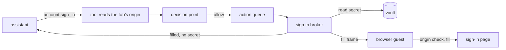

# Accounts, sign-in and the wallet

- **Status:** draft
- **Work items:**
  [the assistant's own email and accounts](https://linear.app/zgeoff/issue/GEO-2731), then
  [the wallet](https://linear.app/zgeoff/issue/GEO-2757). Both build on [the computer](computer.md)
  and [the desktop](desktop.md), which land first.

The assistant gets accounts of its own, and signs in to them in its browser without ever seeing a
password. Its [mailbox and phone number](mail-and-phone.md) are each account's username and way back
in. Each account's secret sits in a vault that only the server reads. When the assistant asks to
sign in, the request passes your rules like any other action, and on allow the server sends the
secret over the browser guest's private channel, where it goes straight into the page's password
field. The wallet is one more vault entry, a capped card, and a purchase is a `spend` action under
the [budgets design](../platform/policy/budgets.md).

## Shape



## Contracts

### The tools

```ts
accounts.list({});
// → { accounts: [
//     { account: 'a7q2m9x4kd', kind: 'password', label: 'library card', origins: ['https://library.example.org'],
//       username: 'nix@example.net' },
//     { account: 'c3w8p1z6mt', kind: 'card', label: 'wallet', origins: [], username: null } ] }

account.sign_in({ tab: 't1', account: 'a7q2m9x4kd', submit: 'E7' });
// → { status: 'signed_in', tab: 't1', url: 'https://library.example.org/account', fields: ['username', 'password'],
//     part: 1, parts: 1, text: '…the page after the submit…' }
//   submit: an element of the tab's latest snapshot, which the guest clicks right after the fill, in
//   the same action, so a sign-in is one card or none. status is 'signed_in' when the page navigated
//   after the click, and 'filled' with no submit or when the page stayed. fields lists what the page
//   had, so a two-step sign-in takes one call for the username and one on the next page.
//   or { refused: 'ORIGIN_MISMATCH', origin: 'https://library-example.top' } | { refused: 'NO_FIELD' }
//   or { refused: 'CROSS_ORIGIN_SUBMIT' } | { refused: 'UNKNOWN_ACCOUNT' } | { refused: 'WRONG_KIND' }
//   or { refused: 'ACCOUNT_FORGOTTEN' } | { refused: 'TAB_GONE' } | { refused: 'STALE_ELEMENT' }
//   or { refused: 'PAGE_CHANGED' } | { refused: 'FAILED' }. The guest checks the submit element before
//   it fills, so a refusal fills nothing.

account.sign_up({
  tab: 't1',
  label: 'library card',
  username: 'nix@example.net',
  submit: 'E9',
  passwordRules: { maxLength: 20, symbols: false }, // optional: the site's stated rules
});
//   it refuses as sign_in does, except the account checks. The entry exists once the fill lands.
// → { status: 'signed_in', account: 'a7q2m9x4kd', state: 'ready', … the sign_in result's fields }
//   state is 'ready' when status is 'signed_in', and 'pending' when status is 'filled'
//   the broker makes the password, fills every password field with it, fills an email field with the
//   username, and keeps the tab's origin as the entry's one origin. The assistant fills any other
//   field, such as a name, with computer.browser_fill first.
//   passwordRules: maxLength from 8 to 64, and symbols; without it the password is 24 characters with
//   symbols. or { refused: 'BAD_RULES' } for a maxLength outside 8 to 64

account.rotate({ tab: 't1', account: 'a7q2m9x4kd', submit: 'E4', passwordRules });
//   on the site's change-password page: the broker fills the current password and a new one, and
//   clicks submit. Refuses as sign_in does.
// → { status: 'changed', account: 'a7q2m9x4kd', … } when the page navigated after the click, else
//   { status: 'filled', … } and the entry keeps both passwords, as the constraints say

account.add_origin({ tab: 't1', account: 'a7q2m9x4kd' });
//   adds the tab's origin to the entry, for a site that signs in on a second origin after an
//   ORIGIN_MISMATCH. → { account: 'a7q2m9x4kd', origins: ['https://library.example.org',
//   'https://login.library.example.org'] } or UNKNOWN_ACCOUNT | WRONG_KIND | ACCOUNT_FORGOTTEN |
//   ORIGIN_KNOWN | TAB_GONE

wallet.pay({
  tab: 't1',
  amount: { value: 8.0, currency: 'USD' }, // in the page's own currency
  item: 'one font licence',
  card: 'c3w8p1z6mt',
  submit: 'E12',
  repeats: 'monthly', // optional: 'monthly' | 'yearly', for a subscription
});
// → { status: 'paid', purchase: 'pq3z8w1n5v', merchant: 'https://fonts.example.com', pageTotal: '8.00 USD',
//     charged: '12.71 AUD' }
//   charged: the amount in the card's currency that the budget counts, as the constraints say.
//   card: an account ID, needed when the vault holds more than one card. The guest fills, rereads the
//   total, and clicks submit only when the total still matches; no computer tool ever pays.
//   or { refused: 'NO_CARD_FIELD' } | { refused: 'ORIGIN_MISMATCH' } | { refused: 'TOTAL_CHANGED' }
//   or { refused: 'STALE_ELEMENT' } | { refused: 'WHICH_CARD' } | { refused: 'UNKNOWN_ACCOUNT' }
//   or { refused: 'WRONG_KIND' } | { refused: 'ACCOUNT_FORGOTTEN' } | { refused: 'TAB_GONE' }
//   or { refused: 'PAGE_CHANGED' } | { refused: 'CROSS_ORIGIN_SUBMIT' } | { refused: 'NO_RATE' }
//   or { refused: 'FAILED' }. NO_RATE: no exchange rate for the page's currency.
//   A bank check that shows after the submit waits up to 5 minutes for you to approve it in the
//   bank's app, then returns 'paid'. After that, { status: 'needs_owner', purchase }: an unknown
//   outcome that you settle, as the budgets design settles one.

wallet.read({});
// → { month: { budget: '100.00 AUD', spent: '37.50 AUD', left: '62.50 AUD' },
//     lifts: [{ merchants: ['https://fonts.example.com'], perAction: '25.00 AUD' }],
//     purchases: [{ purchase: 'pq3z8w1n5v', at, merchant: 'https://fonts.example.com', amount: '8.00 USD',
//                   charged: '12.71 AUD', item: 'one font licence', approval: 'owner', repeats: 'monthly' }],
//     subscriptions: [{ purchase: 'pq3z8w1n5v', merchant, item, repeats: 'monthly', charged: '12.71 AUD' }],
//     next: null }
//   lifts lists each lifting rule that names wallet.pay; subscriptions lists each repeating purchase
//   until wallet.cancel marks it
wallet.cancel({ purchase: 'pq3z8w1n5v' }); // after the assistant cancels it on the merchant's site
// → { purchase: 'pq3z8w1n5v', cancelledAt } or UNKNOWN_PURCHASE | NOT_REPEATING
```

```ts
// connectors module: the effects each tool declares
// accounts.list, wallet.read, wallet.cancel: ['note'], run direct
// account.sign_in, account.sign_up, account.rotate: ['sign_in'], a new effect of the routine risk
//   class, queued; destination: the tab's origin. Its "always allow" rule pins the origin and the
//   account.
// account.add_origin: ['account_origin'], a new effect, queued; destination: the new origin. No
//   starter rule allows it, so it asks, and its card shows the entry's origins beside the new one.
// wallet.pay: ['spend'], queued; destination: the tab's origin; amount: the page's total, see below
// No tool takes an origin. Each tool's prepare hook, from the computer design, reads the tab's
// origin, its URL and, for wallet.pay, the checkout's total from the guest before the decision.
// The fill happens only on that origin, and a URL that changed returns PAGE_CHANGED.
```

The approval card for a sign-in shows the account's label, its username and the origin. The card for
a purchase shows the merchant, the declared amount and the total the guest read from the page, or
"no total found"

### The vault

```ts
// connectors module; the vault_entries table, sealed like erasable fields
interface VaultEntry {
  entryID: string; // crypto.randomUUID(); keys the entry's own key in the key store
  account: string; // short ID from createShortID; the only ID the model sees
  label: string; // erasable
  kind: 'password' | 'card';
  origins: string[]; // exact origins, no wildcards; a card has none
  username: string | null; // the model reads it; it's the assistant's own address
  secret: SealedValue; // a password, or a card's number, expiry and code, under the entry's own key
  previousSecret: SealedValue | null; // a password: the one before a rotate, kept as the constraints say
  fingerprint: string | null; // a card: an HMAC of its number under a server key; the only form in records
  frameOrigins: string[]; // a card: the payment frames you allow, such as https://js.pay.example; else []
  state: 'pending' | 'ready' | 'forgotten'; // a sign_up is pending until it or a sign_in reaches signed_in
}

// contract lib: owner calls, each behind the passkey check
vault.add({ kind: 'card', label: 'wallet', secret: { number, expiry, code }, frameOrigins: [] }); // → { account: 'c3w8p1z6mt' }
vault.add({
  kind: 'password',
  label: 'forum',
  origins: ['https://forum.example.org'],
  username,
  secret: { password },
});
vault.remove({ account: 'c3w8p1z6mt' }); // destroys the key; the row stays with state 'forgotten'
vault.list({}); // → the entries as accounts.list shows them, with each state
vault.reveal({ account: 'a7q2m9x4kd' }); // → { password } or, for a card, { number, expiry, code }
//   reveal writes a vault.revealed record with the account and no secret
```

### The fill frame

```ts
// wire lib: 3 more ops in ComputerRequest, and FillReply joins ComputerReply
type OriginRequest = { op: 'origin'; tab: string }; // → { ok: true; origin: string } | tab_gone
type TotalRequest = { op: 'total'; tab: string }; // → { ok: true; pageTotal: string | null } | tab_gone
// the server sends the fill op; no tool sends or reads it
type FillRequest = {
  op: 'fill';
  tab: string;
  expectOrigin: string; // the origin the action kept: the sign-in page, or the merchant
  expectURL: string; // the URL the prepare hook read
  fields: {
    role:
      | 'username'
      | 'email'
      | 'password'
      | 'new_password'
      | 'card_number'
      | 'card_expiry'
      | 'card_code';
    value: string; // new_password fills every password field on the page
  }[];
  submit?: { element: string; expectTotal?: string }; // with expectTotal, click only while the total matches
};
type FillReply =
  | {
      ok: true;
      origin: string;
      filled: FillRequest['fields'][number]['role'][];
      pageTotal: string | null;
      isNavigated: boolean; // after the submit
      isBankCheck: boolean; // a bank's check frame showed after the submit
    }
  | {
      ok: false;
      reason:
        | 'origin_mismatch'
        | 'no_field'
        | 'cross_origin_submit'
        | 'tab_gone'
        | 'stale_element'
        | 'page_changed'
        | 'total_changed'
        | 'failed';
      origin: string | null;
    };
```

### The purchase record

```text
purchase.recorded              -- budgets module, one per wallet.pay that clicks submit
  purchase       text          -- short ID
  amount         integer       -- micros of the page's currency, the amount the assistant declared
  currency       text          -- the page's currency
  page_total     integer null  -- micros of the page's currency, the total the guest read; null when none
  charged        integer       -- micros of the card's currency, the amount the budget counts
  rate           text null     -- the exchange rate and its date; null when the two currencies match
  merchant       text          -- the origin the card was filled on
  item           text          -- erasable
  approval       text          -- 'lift' or the approval's ID
  card           text          -- the card entry's fingerprint
  repeats        text null     -- 'monthly' | 'yearly'
purchase.cancelled             -- budgets module, one per wallet.cancel
  purchase       text
```

## Constraints

Secrets:

- The secret never reaches the model's context, a tool result, a `hidden` value, a screenshot, a
  snapshot, an approval card, the event log or the server log. Nothing logs the body of a fill
  frame.
- Before any `computer.*` result reaches the model, the server replaces each vault secret it finds
  in the result's text with dots. This catches a page that copies a filled value verbatim, and
  misses one that encodes it.
- `computer.browser_screenshot` returns `FILLED_ORIGIN` for a tab with any frame on an origin that a
  fill reached: every password entry's origins, and each merchant and payment frame a card filled.
  `computer.screenshot` returns `FILLED_ORIGIN` while a browser window shows such a tab. The vault
  keeps those origins, so a browser restart keeps the block. Every snapshot shows each filled field
  as dots. A page can show a secret as text that the dots never catch, so a picture of the origin is
  the one way the model could read it.
- `computer.browser_click`, `computer.browser_fill`, `computer.screen_click` and
  `computer.screen_type` return `FILLED_TAB` on a tab that holds a filled card field, so only
  `wallet.pay` submits a payment.
- The descriptions of the computer tools name `FILLED_ORIGIN` and `FILLED_TAB`, say why each exists,
  and point to `computer.browser_read` for a filled origin and `wallet.pay` for a filled card.
- The browser profile never saves a password or a card. Chromium's password manager and autofill are
  off.
- Chromium runs as its own user on the desktop, as [the desktop](desktop.md) sets, so no command the
  assistant runs reads the page's memory or its profile.
- The desktop stream that you watch shows a filled page as it is. Only a device session watches.
- `vault.reveal` asks for your passkey, and only a device session calls it.

Filling:

- `sign_in` asks unless a rule allows it. A rule scopes it by destination and may pin the account,
  so "sign in to the library" covers one origin.
- The tool checks the account, its kind, its state and the tab's origin against the entry's origins
  before the decision, in that order, and returns the first refusal. A forgotten entry returns
  `ACCOUNT_FORGOTTEN`.
- The guest compares `expectOrigin` with the live top frame's origin right before it fills, and
  fills nothing when they differ.
- A password goes only into an `<input type=password>` whose form posts to the same origin, or that
  sits in no form. A card part goes only into a field whose `autocomplete` names that part, in a
  frame whose own origin is the merchant's or one of the card's `frameOrigins`.
- A `sign_up` entry turns `ready` when the sign-up itself reaches `signed_in`. Otherwise it lists
  with state `pending` until its first `sign_in` reaches `signed_in`, and then turns `ready`. A
  pending entry signs in like a ready one, so a site that took the password never loses it. A
  pending entry that no sign-in reaches within 7 days turns `forgotten`.
- A forget of a vault entry destroys its key, and the next `sign_in` with it returns
  `ACCOUNT_FORGOTTEN`.
- A `rotate` that returns `changed` makes the new password the entry's secret, and keeps the old one
  as `previousSecret`. A `rotate` that returns `filled` keeps the old password as the secret and the
  new one as `previousSecret`, because the site may have taken either. While an entry holds a
  `previousSecret`, a `sign_in` that stays on the page tries the other password once. The first
  `sign_in` that reaches `signed_in` keeps the password that worked and drops the other one.
- `add_origin` keeps the origin exactly, with no wildcard. The fill rules apply to it as to the
  first origin.
- A sign-up that shows a CAPTCHA or a check that wants a person stops, and the assistant calls
  `computer.handover` with the reason.
- A sign-up that asks for a phone number gets the assistant's own number. A site that refuses the
  number stops the sign-up, and the assistant hands over as for a CAPTCHA.

Spending:

- Before the decision, the guest reads the checkout's total from the page. The policy checks the
  page's total when the guest found one and it matches the declared amount to the cent, in the
  page's currency, and asks with the passkey otherwise.
- When the page's currency differs from the card's, the server converts the amount at the day's
  reference rate and adds 3% for the bank's conversion fee. That `charged` amount is what a lift and
  the budget check. A currency with no rate returns `NO_RATE`.
- A `wallet.pay` with `repeats` always asks with the passkey, and its card says it repeats. A lift
  never covers one.
- A repeating purchase counts in the budget once, when it's made. nixie never sees a later charge,
  and `wallet.read` lists it under subscriptions until `wallet.cancel` marks it.
- A `wallet.pay` passes without asking only under a lifting rule whose destinations include the
  merchant and whose `perAction` covers the amount. Every other `wallet.pay` asks with the passkey.
- A lift charges the wallet's budget when the action queues, as the budgets design says, and a
  purchase you approved is never charged. A `wallet.pay` that ends before its click, with
  `TOTAL_CHANGED`, `STALE_ELEMENT` or `FAILED`, credits the charge, and the guest clears the card
  fields it filled.
- Every `wallet.pay` that clicks submit writes a `purchase.recorded` record.
- The wallet starts with a lift of 25 AUD per purchase and a budget of 100 AUD a month. The card's
  own limit in the bank's app is the hard cap.

## Decisions

- **The server fills over the guest's private channel.** A swap of a placeholder on the wire would
  keep the secret out of the guest, and it breaks on a page that hashes the password in script and
  on a payment form in a frame from another origin.
- **The vault lives in nixie.** Its entries are sealed under keys in nixie's key store, so a forget
  destroys a secret for good, and a deployment needs no outside password manager. You see each
  secret through `vault.reveal`.
- **The assistant adds an origin only with your answer.** A wrong origin hands a password to another
  site, so `add_origin` asks, and no starter rule allows it.
- **The tool reads the origin, and the guest checks it again.** A model that names the origin can be
  talked into naming the wrong one, and a page can navigate between the decision and the fill.
- **The page's total gates the lift.** The model's declared amount alone can be talked down, so a
  lift passes only when the page agrees with it.
- **A merchant can keep the card.** nixie can't see a later charge from a merchant that saved the
  card. The bank's limit caps it, and the purchase records let you spot it in the bank's app.
- **A page on the account's own origin gets the secret.** A script on that page can read the filled
  field and send it anywhere, as it could from any browser. The origin checks keep the secret off
  every other site.
- **The assistant can reset its own passwords.** Its mailbox is every account's way back in. The
  vault keeps secrets out of the model's context; it can't stop the assistant from using its own
  mail.

## Builder decides

- How the guest finds the fields and the checkout's total, within the rules above.
- How the broker makes a password, within the rules it gets.
- The source of the daily exchange rates, which needs no key.
- Where the vault's screen sits in the web client.
- The tools' descriptions and the refusal wording.

## Out of scope

- Two-factor apps and passkeys for the assistant's accounts.
- Solving a CAPTCHA. The assistant hands the desktop over to you.
- Reading a card statement from the bank. The card has no API.
- Signing in to your accounts. Every account here is the assistant's own.

## Open questions

- **Does the bank ask for a 3-D Secure check on each purchase?** A test purchase settles it. Until
  then, a purchase waits for a bank check as `wallet.pay` describes.
- **Do sign-ups accept the number?** Some sites refuse a number they class as VoIP. The provider's
  line-type lookup on the number, then the assistant's first sign-ups, settle it. Until then, a
  refused number hands over to you.
