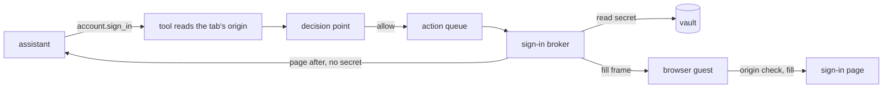

# Accounts and sign-in

- **Status:** draft
- **Work items:**
  [the assistant's own email and accounts](https://linear.app/zgeoff/issue/GEO-2731). It builds on
  [the browser renames](https://linear.app/zgeoff/issue/GEO-2798) and
  [the desktop sandbox](https://linear.app/zgeoff/issue/GEO-2799) of [the desktop](desktop.md),
  which land first.

The assistant gets accounts of its own, and signs in to them in its browser without ever seeing a
password. Its [mailbox and phone number](mail-and-phone.md) are each account's username and way back
in. Each account's secret sits in a vault that only the server reads. When the assistant asks to
sign in, the request passes your rules like any other action, and on allow the server sends the
secret over the browser guest's private channel, where it goes straight into the page's password
field. [The wallet](wallet.md) keeps a card in the same vault and fills it the same way.

## Shape



## Contracts

### The tools

```ts
account.list({});
// → { accounts: [{ account: 'a7q2m9x4kd', kind: 'password', label: 'library card',
//                  origins: ['https://library.example.org'], username: 'nix@example.net', state: 'ready' }] }
//   a forgotten entry is left out

account.sign_in({ tab: 't1', account: 'a7q2m9x4kd', submit: 'E7' });
// → { status: 'signed_in', tab: 't1', url: 'https://library.example.org/account',
//     fields: ['username', 'password'], part: 1, parts: 1, text: '…the page after the submit…' }
```

`submit` is an element of the tab's latest snapshot. The guest fills each role it finds on the page,
then clicks `submit` in the same action, so one sign-in raises one approval card or none. `fields`
lists the roles it filled.

| `status`    | When                                                                          |
| ----------- | ----------------------------------------------------------------------------- |
| `signed_in` | the page navigated after the click, and the new page holds no password field  |
| `next_step` | the page navigated, and the new page holds a password field: a two-step login |
| `filled`    | the page stayed after the click                                               |

A page that asks for a second factor or an email check counts as `signed_in`: the site took the
password. A two-step sign-in takes one call for the username and one on the next page, so it shows
two cards until a rule allows it.

```ts
account.sign_up({
  tab: 't1',
  label: 'library card',
  username: 'nix@example.net',
  submit: 'E9',
  passwordRules: { maxLength: 20, symbols: false }, // optional: the site's stated rules
});
// → { status: 'signed_in', account: 'a7q2m9x4kd', state: 'ready', … the sign_in result's fields }
//   state is 'ready' for signed_in, else 'pending'. The broker makes the password, fills every
//   new-password field with it and an email or username field with the username, and keeps the
//   tab's origin as the entry's one origin. The assistant fills any other field, such as a name,
//   with computer.browser_fill first. Without passwordRules the password is 24 characters with symbols.

account.rotate({ tab: 't1', account: 'a7q2m9x4kd', submit: 'E4', passwordRules });
// on the change-password page: fills the current-password field with the current password and every
// new-password field with a new one, then clicks submit.
// → { status: 'changed', account: 'a7q2m9x4kd', … } when the page navigated, else { status: 'filled', … }

account.add_origin({ tab: 't1', account: 'a7q2m9x4kd' });
// for a site that signs in on a second origin after an ORIGIN_MISMATCH
// → { account: 'a7q2m9x4kd', origins: ['https://library.example.org', 'https://login.library.example.org'] }

account.inspect({ tab: 't1', kind: 'password', dump: true }); // kind: 'password' | 'card'; dump optional
// → { report: FillReport, dump: 'debug/fill/<record ID>.tar.zst' }
//   every field and frame the broker would look at, the role it would give each, and why it skips
//   the rest. It fills nothing and reads no secret.
```

Every refusal is `{ refused, message, origin?, report? }`. The `message` says what happened and what
to do next.

| Refusal               | Tools                    | When                                                                                                                                  |
| --------------------- | ------------------------ | ------------------------------------------------------------------------------------------------------------------------------------- |
| `UNKNOWN_ACCOUNT`     | all but sign_up, inspect | no entry has that ID                                                                                                                  |
| `WRONG_KIND`          | all but sign_up, inspect | the entry is a card                                                                                                                   |
| `ACCOUNT_FORGOTTEN`   | all but sign_up, inspect | the entry is forgotten                                                                                                                |
| `ORIGIN_MISMATCH`     | sign_in, rotate          | the tab's origin is not one of the entry's; carries `origin`                                                                          |
| `ORIGIN_KNOWN`        | add_origin               | the entry already holds the tab's origin                                                                                              |
| `BAD_RULES`           | sign_up, rotate          | `maxLength` outside 8 to 64                                                                                                           |
| `ROTATE_UNSETTLED`    | rotate                   | the entry still holds a previous password                                                                                             |
| `NO_FIELD`            | sign_in, sign_up, rotate | no field to fill; for sign_up, no new-password field; for rotate, no current-password field told apart from the new; carries `report` |
| `CROSS_ORIGIN_SUBMIT` | sign_in, sign_up, rotate | the form posts to another origin; carries `report`                                                                                    |
| `STALE_ELEMENT`       | sign_in, sign_up, rotate | `submit` no longer holds its number                                                                                                   |
| `PAGE_CHANGED`        | sign_in, sign_up, rotate | the tab's URL differs from the one the prepare hook read                                                                              |
| `TAB_GONE`            | all                      | the tab closed                                                                                                                        |
| `FAILED`              | sign_in, sign_up, rotate | the guest threw; carries `report`                                                                                                     |

The first 7 return from the prepare hook before the decision, as a direct result, so no card shows.
The guest checks the submit element and the form before it fills, so a refusal fills nothing. A
result of `filled` carries `report` too.

```ts
// connectors module: the effects each tool declares
// account.list: ['note'], direct. account.inspect: ['read'], direct.
// account.sign_in, sign_up, rotate: ['sign_in'], queued; destination: the tab's host, as the
//   computer's act tools declare it. Its "always allow" rule pins the host and the account, as the
//   rule builder pins any scalar argument.
// account.add_origin: ['account_origin'], queued; destination: the new host. Its card shows the
//   entry's origins beside the new one.
// policy module: sign_in joins the routine risk class and account_origin the always-ask class, in
//   the effect list, so add_origin asks with your passkey and offers no "always allow".
// No tool takes an origin. The prepare hook reads the tab's origin and URL from the guest before the
// decision. The fill happens only on that origin.
```

The approval card for a sign-in shows the account's label, its username and the origin, read from
the vault when the card renders, and "forgotten" once the entry is.

### The vault

```ts
// connectors module; the vault_entries table, a projection of the vault.* records
// records: vault.entry_added, vault.entry_ready, vault.secret_changed, vault.origin_added,
//   vault.entry_forgotten, vault.revealed. entry_added and secret_changed carry the sealed label
//   and secrets as erasable fields under the entry's key; no record holds a secret in the clear.
interface VaultEntry {
  entryID: string; // crypto.randomUUID(); keys the entry's own erasure key in the key store
  account: string; // short ID from createShortID; the only ID the model sees
  label: string; // sealed under the entry's key, with secret and previousSecret
  kind: 'password' | 'card';
  origins: string[]; // exact origins, no wildcards; a card has none; kept after a forget
  username: string | null; // the assistant's own address; kept after a forget
  secret: SealedValue; // a password, or a card's number, expiry and code
  previousSecret: SealedValue | null; // a password: the other one after a rotate, as the constraints say
  state: 'pending' | 'ready' | 'forgotten'; // a card starts ready
  // a card's fingerprint, frameOrigins and currency: see the wallet design
}

// contract lib: owner calls from a device session. add, remove and reveal take a passkey assertion
// bound to a SHA-256 of the request's canonical JSON, a new challenge kind in the published contract.
vault.add({
  kind: 'password',
  label: 'forum',
  origins: ['https://forum.example.org'],
  username,
  secret: { password },
}); // → { account: 'b5n2x8q1rw' }
vault.remove({ account: 'b5n2x8q1rw' }); // destroys the key; the row stays with state 'forgotten'
vault.list({}); // → every entry with its state; a forgotten one shows the label "forgotten"
vault.reveal({ account: 'a7q2m9x4kd' }); // → { password }; writes vault.revealed, with no secret
```

### The fill frame

```ts
// wire lib: more ops in ComputerRequest, and FillReply joins ComputerReply with kind: 'filled'
type OriginRequest = { op: 'origin'; tab: string }; // → { ok: true; origin: string } | tab_gone
type InspectRequest = { op: 'inspect'; tab: string; kind: 'password' | 'card'; isDump: boolean };
// → { ok: true; report: FillReport; dump: string | null }
type FillRequest = {
  // the server sends it; no tool sends or reads it
  op: 'fill';
  tab: string;
  expectOrigin: string; // the origin the prepare hook read
  expectURL: string; // the URL the prepare hook read
  fields: { role: FillRole; value: string }[]; // new_password fills every new-password field
  submit: { element: string }; // the wallet adds expectTotal
  retry?: { value: string }; // a sign_in on an entry with a previousSecret: the other password
};
type FillRole = 'username' | 'email' | 'password' | 'current_password' | 'new_password'; // the wallet adds the card roles
type FillReply =
  | {
      ok: true;
      origin: string;
      page: PageBody; // the page after the submit, as the act op's reply carries it
      filled: FillRole[];
      isNavigated: boolean;
      hasPasswordField: boolean; // on the page after the submit
      usedRetry: boolean; // the retry value is the one that reached the page after
      report: FillReport | null; // set when the page stayed
    }
  | {
      ok: false;
      reason:
        | 'origin_mismatch'
        | 'no_field'
        | 'cross_origin_submit'
        | 'tab_gone'
        | 'stale_element'
        | 'page_changed'
        | 'failed';
      origin: string | null;
      report: FillReport | null; // set for no_field, cross_origin_submit and failed
    };

// what the guest saw when it looked for fields; never a value, typed or filled
type FillReport = {
  url: string;
  frames: { origin: string; isAllowed: boolean }[];
  fields: {
    element: string; // the snapshot's element ID
    tag: string; // 'input' | 'select' | 'textarea'
    type: string | null;
    name: string | null;
    id: string | null;
    autocomplete: string | null;
    label: string | null; // the label text, its aria-label or its placeholder
    frameOrigin: string;
    formAction: string | null; // the origin the field's form posts to
    isVisible: boolean;
    role: FillRole | null; // the role the guest gave it
    skipped: string | null; // why it got no role, such as 'form posts to another origin'
  }[];
  error: string | null; // for failed: what threw, with no value in it
};
```

## Constraints

Secrets:

- The broker never puts a secret in the model's context, a tool result, a `hidden` value, a
  snapshot, an approval card, the event log or the server log. Nothing logs the body of a fill
  frame.
- A page that shows a filled password as text can put it in a screenshot. The design accepts that
  for passwords, and the acceptance test leaves screenshots out of its search for a password.
- Before any result of an `account.*`, `wallet.*` or `computer.*` tool reaches the model, the server
  replaces each vault secret it finds in the result's text with dots: every secret and previous
  secret, of pending entries too. A stored page read later through `web_fetch` gets the same pass.
  This catches a page that copies a filled value verbatim, and misses one that encodes it.
- The checking proxy's scan of each request URL refuses a URL that carries a vault secret to a host
  outside its entry's origins. The body of an HTTPS request goes unscanned.
- The browser profile never saves a password or a card. Chromium's password manager and autofill are
  off.
- Chromium runs as its own user on the desktop, as [the desktop](desktop.md) sets, so no command the
  assistant runs reads the page's memory or its profile.
- The desktop stream that you watch shows a filled page as it is. Only a device session watches.
- `vault.reveal` asks for your passkey, and only a device session calls it.

Filling:

- `sign_in` asks unless a rule allows it. A rule scopes it by host and may pin the account.
- The guest compares `expectOrigin` with the live top frame's origin right before it fills, and
  fills nothing when they differ.
- A password goes only into an `<input type=password>` whose form posts to the same origin, or that
  sits in no form.
- `add_origin` keeps the origin exactly, with no wildcard. The fill rules apply to it as to the
  first origin.
- A sign-up that shows a CAPTCHA or a check that wants a person stops, and the assistant calls
  `computer.handover` with the reason. A sign-up that asks for a phone number gets the assistant's
  own number, and a site that refuses the number hands over the same way.

Entry state:

- The broker writes a `sign_up`'s pending entry before it sends the fill frame, and removes it when
  the guest refuses before filling.
- A `sign_up` entry turns `ready` when the sign-up reaches `signed_in` or `next_step`. Otherwise it
  stays `pending` until its first `sign_in` does. A pending entry signs in like a ready one.
- After 7 days with no sign-in, a pending entry raises a push notice that links the vault screen,
  where you keep or remove it. nixie never forgets an entry on its own.
- A forget of an entry, or of any of its `vault.*` records, destroys the entry's key.
- A `rotate` that returns `changed` makes the new password the secret and keeps the old one as
  `previousSecret`. One that returns `filled` keeps the old password as the secret and the new one
  as `previousSecret`, because the site may have taken either.
- While an entry holds a `previousSecret`, a `sign_in` whose page stays tries the other password
  once: the guest fills the password field again and clicks the form's submit button, found again on
  the new page. A username step never retries.
- The first `sign_in` that reaches `signed_in` keeps the password that `usedRetry` names, and drops
  the other.

Debugging a fill:

- Each fill that refuses with a report, or returns `filled`, writes an `account.fill_failed` record
  with the tool, the account, the origin, the report and the name of a page dump. The report's URL
  and labels are erasable fields.
- With that record, the guest writes a page dump to `debug/fill/<record ID>.tar.zst` in nixie's data
  folder, for a developer on the server to unpack. It holds the tab's MHTML snapshot with every
  frame, each frame's DOM, the accessibility tree, the URLs the page requested, the console log, the
  report, and a screenshot unless a card field was filled. The guest takes the dump from a copy of
  the page in which every input's value, and every vault secret in the text, reads as dots.
- nixie keeps the newest 50 page dumps and deletes older ones, a setting with that default. The
  model never reads a dump.

## Decisions

- **The server fills over the guest's private channel.** A swap of a placeholder on the wire would
  keep the secret out of the guest, and it breaks on a page that hashes the password in script and
  on a payment form in a frame from another origin.
- **The vault lives in nixie.** Its entries are sealed under keys in nixie's key store, so a forget
  destroys a secret for good, and a deployment needs no outside password manager. You see each
  secret through `vault.reveal`.
- **The assistant adds an origin only with your answer.** A wrong origin hands a password to another
  site, so `add_origin` asks, and no starter rule allows it.
- **The tool reads the origin, and the guest checks it again.** A model that names the origin can be
  talked into naming the wrong one, and a page can navigate between the decision and the fill.
- **A page on the account's own origin gets the secret.** A script on that page can read the filled
  field and send it anywhere, as it could from any browser. The origin checks keep the secret off
  every other site.
- **The assistant can reset its own passwords.** Its mailbox is every account's way back in. The
  vault keeps secrets out of the model's context; it can't stop the assistant from using its own
  mail.

## Builder decides

- How the guest finds the fields and gives each a role, within the rules above.
- How the broker makes a password, within the rules it gets.
- Where the vault's screen sits in the web client.
- The tools' descriptions and the refusal wording.

## Out of scope

- Two-factor apps and passkeys for the assistant's accounts.
- Solving a CAPTCHA. The assistant hands the desktop over to you.
- Signing in to your accounts. Every account here is the assistant's own.

## Open questions

- **Do sign-ups accept the number?** Some sites refuse a number they class as VoIP. The provider's
  line-type lookup on the number, then the assistant's first sign-ups, settle it. Until then, a
  refused number hands over to you.
