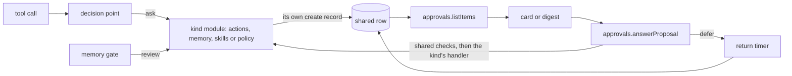

# The approval record

- **Status:** draft
- **Work items:**
  [the approval record and its answer path](https://linear.app/zgeoff/issue/GEO-1804), built first;
  then [the approval cards and the digest](https://linear.app/zgeoff/issue/GEO-1805), which read it

You answer every proposal, a tool call or a change that waits for you, through one checked call. A
proposal comes from 1 of 3 places: an action that the
[decision point](../platform/policy/decision-point.md) asks about, a memory write that the
[memory gate](../../architecture/memory/writes.md) sends to review, or an internal change, such as a
skill that nixie wrote or a rule widening that a
[seed of your definitions](../../architecture/policy/rules.md#rules-in-force) waits to apply. Every
proposal of every kind has one shared row, the approval record, and the checked call is
`approvals.answerProposal`, with Approve, Always allow, Defer or Decline. Each kind keeps its own
store and records, and the proposals module builds the shared row from those records, as a
[projection](../../architecture/core/event-log.md#projections) of the log, and runs the checks that
every answer shares. The memory write tools declare the `memory_write`
[effect](../platform/policy/decision-point.md#effects), so your rules decide a memory write before
the memory gate does.

[Proposals and approvals](../platform/policy/approvals.md) holds the action hash, the sentence
templates, the 3 risk classes and the rule that Always allow creates.
[Approvals in the client](../platform/channels/approvals.md) holds the cards and the digest layout.

## Shape



4 modules own proposals: actions owns the `action` kind, memory owns `memory_write`, and skills and
policy each own one family of `internal_change`.

## Contracts

### The shared row

```ts
// proposals module. One row per proposal, in the proposals projection. The records of each
// kind fold into it, so no kind writes the row directly.
interface Proposal {
  id: string; // the kind's own proposal UUID
  shortID: string; // from createShortID; the ID the model reads and passes
  kind: 'action' | 'memory_write' | 'internal_change';
  riskClass: 'routine' | 'always_ask' | 'lifting'; // policy computes it; the kind's create record carries it
  // lifting: the row creates or widens a lifting rule, as approvals.md's Risk class defines
  actionHash: string; // the kind's current hash of the exact operation
  rule: { hash: string } | null; // the rule Always allow would create; null when not offered
  cause:
    | PromptCause
    | MemoryReviewReason
    | 'rule_widening'
    | 'skill_write'
    | 'proposed_rule'
    | 'mandate';
  taskID: string | null; // null for a proposal no task made, such as a seed's rule widening
  thread: string | null;
  createdAt: Date;
  lapsesAt: Date;
  deadlineAt: Date | null; // the action's real deadline, which its hash covers
  state: ProposalState;
  usedBy: string | null; // "used once": the action ID, version or mutation that consumed it
  deferGeneration: number; // 0 until the first defer; each defer adds 1
  deferUntil: Date | null; // set while deferred
}

type ProposalState = 'pending' | 'deferred' | 'approved' | 'declined' | 'lapsed' | 'withdrawn';
```

- The row holds no free text. The sentence, the arguments and the rule's sentence stay in the kind's
  own store, in [erasable fields](../../architecture/core/erasable-fields.md) or under the memory
  item's key, and `listItems` reads them when it lists. A forget of a memory item therefore leaves
  nothing of it readable in the row.
- "Used once" is the `usedBy` mark on an `approved` row. The kind sets it in the transaction that
  consumes the approval: an action in the transaction that queues it, a memory write when its
  version applies, and an internal change with its mutation.
- `pending` and `deferred` are open, and the other 4 states are closed. A record never reopens a
  closed row, with no exception.
- An approved action that newly falls in the always-ask set before an attempt gets a new row, under
  a new proposal ID and the `always_ask` risk class, for the same action, as
  [policy before each attempt](../platform/core/actions.md#policy-before-each-attempt) sets. The
  [actions work item](https://linear.app/zgeoff/issue/GEO-1810) owns that check, and the record that
  opens the new row, with its rollback.

| Kind              | Its store                                                                                      | Its states map to the shared row                                                          |
| ----------------- | ---------------------------------------------------------------------------------------------- | ----------------------------------------------------------------------------------------- |
| `memory_write`    | `memory_proposals`                                                                             | `pending` as is; `consumed` to `approved` with `usedBy`; `rejected` to `declined`         |
| `internal_change` | skill write proposals, in `skills.write_*` records                                             | `skills.write_approved` to `approved`; `skills.write_rejected` to `declined`              |
| `internal_change` | rule change proposals from a seed                                                              | approval to `approved`; rejection to `declined`; a later seed's withdrawal to `withdrawn` |
| `action`          | `policy.action_proposed` and `policy.action_answered` records, from the decision point cutover | `action_proposed` to `pending`; `action_answered` to `approved` or `declined`             |

A lapse record of any kind maps to `lapsed`. Each kind keeps its own record kinds and their
payloads. The proposals module adds 3 record kinds for the transitions that no kind records:
`proposals.deferred`, `proposals.returned` and `proposals.withdrawn`. Their payloads hold IDs, times
and the generation, and the note of a defer sits in the record's erasable fields.

A proposal is withdrawn by the model, which withdraws its own proposal to post a changed one; by a
stop of the task that made it; by a seed that holds other widenings; or by your edit of a proposed
rule, which withdraws the row and posts a new one with the edited rule.

### A kind's handler

```ts
// proposals module. actions, memory, skills and policy each register one.
interface ProposalKindHandler {
  kind: Proposal['kind'];
  // Reads the body of each row for listItems. A body whose key is gone is null.
  describe(tx: Transaction, rows: readonly Proposal[]): Promise<Map<string, ProposalBody | null>>;
  // Recomputes both hashes from the kind's current state: the target version, the pinned tool
  // hash, the execution profile, the rule the card would create.
  currentHashes(tx: Transaction, row: Proposal): Promise<{ action: string; rule: string | null }>;
  // Each runs inside the answer's write transaction, after the shared checks pass.
  approve(tx: Transaction, row: Proposal, answer: ProposalAnswer): Promise<AnswerResult>;
  decline(tx: Transaction, row: Proposal, note: string | null): Promise<void>;
  lapse(tx: Transaction, row: Proposal): Promise<void>; // writes the kind's own lapse record
  moveLapse(tx: Transaction, row: Proposal, lapsesAt: Date): Promise<void>; // after a defer
}

interface ProposalBody {
  sentence: string; // from the tool's or the kind's template, never from a model
  fields: Record<string, string>; // the arguments and destinations the card shows beside it
  ruleSentence: string | null; // the rule Always allow would create
  memory?: MemoryProposalView; // memory's own fields, as memory.listProposals returns them
}
```

The proposals module holds the answer path that every kind shares: the hash check, the closed and
stale refusals, and the outcomes. Skills, memory and rule changes answer through it, and their
proposal tests pass unchanged.

### Listing

```ts
const { items, defer } = await client.approvals.listItems();
// → { defer: { defaultMinutes: 60, eveningAt: '18:00', morningAt: '08:00', zone: 'Australia/Sydney' },
//     items: [
//   { group: 'unknown_outcome', action: { … } },
//   { group: 'always_ask', proposal: { shortID: 'k3x9m2p7qa', riskClass: 'lifting', … },
//     body: { sentence: 'Spend up to $20 a purchase from shopping-month', … },
//     choices: ['approve', 'defer', 'decline'] },
//   { group: 'routine', task: { id, name: 'Reports' }, proposal: { … }, body: { … },
//     choices: ['approve', 'always_allow', 'defer', 'decline'] },
//   { group: 'memory', proposal: { kind: 'memory_write', … }, body: { memory: { … } },
//     choices: ['approve', 'defer', 'decline'] },
//   { group: 'deferred', proposal: { state: 'deferred', deferUntil: … }, … },
// ] }
```

```ts
// contract: approvals
type ApprovalItem =
  | { group: 'unknown_outcome'; action: UnknownOutcome } // its shape and answers: the actions work
  | {
      group: 'always_ask' | 'routine' | 'memory' | 'deferred';
      proposal: Proposal;
      body: ProposalBody;
      task: { id: string; name: string } | null;
      choices: Choice[]; // the host's list for this row; the client offers only these
    };

type Choice = 'approve' | 'always_allow' | 'defer' | 'decline';
```

- The groups come in this order: unknown outcomes, always-ask, routine, memory, deferred. An unknown
  outcome is an action that may or may not have reached its provider, as
  [actions](../../architecture/core/actions.md#outcomes) defines.
- The always-ask group lists `lifting` rows first, then `always_ask` rows.
- The routine group sorts by task, and each task's oldest row comes first. Every other group lists
  its oldest row first.
- A deferred row sits only in the deferred group, whatever its risk class.
- The digest's "Approve all routine" sends one `answerProposals` call for the rows of the routine
  group on screen. It never covers the memory, always-ask or deferred groups.

### Answering

```ts
const result = await client.approvals.answerProposal({
  proposalID: 'b3c1…', // the UUID or the short ID
  actionHash: 'sha256:9f2e…', // the hash the card showed
  choice: 'always_allow',
  ruleHash: 'sha256:41aa…', // the rule hash the card showed; required for always_allow only
  clientActionID: crypto.randomUUID(),
});
// → { proposalID: 'b3c1…', state: 'approved', rule: { id: 'mail-send-sam-k3f9', revision: 1 } }
//   or ORPCError CONFLICT { current: { actionHash, ruleHash } }, CLOSED { state: 'lapsed' },
//   or NOT_ALLOWED { reason: 'choice' }
```

```ts
// contract: approvals
interface ProposalAnswer {
  proposalID: string;
  actionHash: string;
  choice: Choice;
  ruleHash?: string;
  deferUntil?: Date; // required for defer; 1 minute to 30 days ahead
  note?: string; // decline or defer; 1 to 500 characters, kept in the record's erasable fields
  clientActionID: string; // a UUID; a retry with the same ID returns the first result
  memory?: {
    editedText?: string;
    revisionOf?: { itemID: string; version: number };
    ignoreCloseMatch?: boolean;
  }; // approve on a memory_write row only
}

type AnswerResult =
  | { proposalID: string; state: 'approved'; rule?: { id: string; revision: number } }
  | { proposalID: string; state: 'declined' | 'deferred' }
  | {
      proposalID: string;
      state: 'pending';
      closeMatch: { itemID: string; text: string; version: number };
    };

const { results } = await client.approvals.answerProposals({ answers }); // at most 100
// → { results: [AnswerResult | { proposalID, error: 'CONFLICT' | 'CLOSED' | 'NOT_ALLOWED', … }] }
```

The server runs these checks in order, in one write transaction. The first check that fails refuses
the answer. The transaction then writes nothing but the refusal under the client action ID, so a
retry gets the same refusal:

1. The caller's session is live, as for every
   [checked action](../../architecture/channels/api.md#checked-actions).
2. The row exists, is open, and its `lapsesAt` lies after the transaction's time. A closed row
   refuses as `CLOSED` with its state. A row past its lapse refuses as `CLOSED` with `lapsed`, even
   before the lapse sweep closes it.
3. `actionHash` equals the handler's current action hash. For `always_allow`, `ruleHash` also equals
   its current rule hash. A mismatch refuses as `CONFLICT`, with the current hashes.
4. The choice is in the row's choices, and the memory fields fit the row. Otherwise the answer
   refuses as `NOT_ALLOWED`.
5. The kind's handler applies the choice.

- `answerProposals` runs each answer in its own transaction, in input order, so one refused item
  leaves the rest applied.
- A memory approval that finds an active item with close wording commits nothing and returns
  `state: 'pending'` with that item. The row stays pending. Your next answer is a new checked action
  with a new client action ID, and it names `revisionOf` or `ignoreCloseMatch`.
- A memory approval whose target item has a newer version refuses as `CONFLICT`, and the row stays
  pending, so the client can offer it against the current version.
- Memory's own refusals, such as an edit of a retirement or a full pinned core, refuse as
  `NOT_ALLOWED` with memory's code as the `reason`.
- `memory.listProposals`, `memory.approveProposals` and `memory.rejectProposals` stay in the
  contract and answer through the shared path, so a client built for the release before this one
  keeps working.

### The choices

The host builds each row's choices from its kind, risk class and cause:

| Row                                                                                                                           | Approve | Always allow | Defer | Decline |
| ----------------------------------------------------------------------------------------------------------------------------- | ------- | ------------ | ----- | ------- |
| Routine action, asked by the [destination limits](../platform/policy/decision-point.md#destination-limits) or no rule matched | yes     | yes          | yes   | yes     |
| Routine action, asked by your ask rule                                                                                        | yes     | no           | yes   | yes     |
| An `always_ask` or `lifting` row, of any kind                                                                                 | yes     | no           | yes   | yes     |
| `memory_write`                                                                                                                | yes     | no           | yes   | yes     |
| Routine `internal_change`                                                                                                     | yes     | no           | yes   | yes     |

The causes are the [prompt causes](../platform/policy/decision-point.md#prompt-causes) of the
decision point.

- **Approve** hands the row to its kind. An action enters the action queue, and a memory write or an
  internal change commits in the answer's transaction.
- **Always allow** approves as Approve does. In the same transaction, it adds the card's rule as a
  runtime change through [the rules core](../../architecture/policy/rules.md#rules-in-force), with
  the proposal as the change's reason. The rule takes effect at once and joins the
  [rule export](../../architecture/policy/rules.md#the-rule-export). The answer takes no edited
  rule, so Always allow creates only the rule the card showed.
- **Defer** moves the row to `deferred`, as [Defer](#defer) sets.
- **Decline** closes the row. The kind's decline record holds the note in its erasable fields. When
  the row has a task, the record lands in that task's inbox, so the task reads the note as a
  message. A task never proposes the same action hash again in the same task run.

### Defer

```ts
await client.approvals.answerProposal({
  proposalID,
  actionHash,
  choice: 'defer',
  deferUntil: new Date('2026-11-14T08:00:00+11:00'),
  note: 'After the board meeting',
  clientActionID,
});
// → { proposalID, state: 'deferred' }
```

A defer does these steps in one transaction:

1. It adds 1 to `deferGeneration`, sets `deferUntil`, and moves the row to `deferred`.
2. It sets the return time to `deferUntil`. When `deferUntil` falls inside quiet hours, the return
   time is the end of those quiet hours.
3. It sets the new lapse, and the kind's `moveLapse` writes the same time into the kind's own store:

   ```ts
   // lapseInterval: the kind's lapse time, such as 72 hours for an action
   lapsesAt = min(deadlineAt ?? Infinity, max(lapsesAt, returnAt + lapseInterval));
   ```

4. It writes a `proposals.deferred` record. When the row has a task, the record goes on the task's
   thread, and the [task's inbox](../../architecture/core/tasks.md#the-inbox) takes it, so the task
   reads the defer and the note and carries on.

At the return time, the return timer reads the row. When the row is still `deferred` at the same
generation, the timer writes `proposals.returned`, which moves the row to `pending` and posts a
returning notice. Otherwise the timer writes nothing, so an answered, lapsed or re-deferred row
never comes back.

- You can approve, decline or defer a deferred row again, and the model or a task stop can withdraw
  it. A second defer replaces the first.
- A defer whose return falls after `deadlineAt` is accepted, and the row lapses at `deadlineAt`
  before it returns.
- The lapse sweep closes a deferred row as it closes a pending one.
- Defer authorizes nothing, so a later approval of the row runs every check of
  [Answering](#answering).

### Settings

```yaml
# config.yaml. The server owns quiet_hours; the proposals module owns approvals.
quiet_hours: { start: '22:00', end: '07:00' } # leave out to have no quiet hours
approvals:
  defer:
    default_minutes: 60 # the "1 hour" choice
    evening_at: '18:00' # "this evening": today before this time, tomorrow after it
    morning_at: '08:00' # "tomorrow morning"
```

- nixie reads every time of day in the time zone of your newest message that carries a zone, as
  [the time tool](../../architecture/connectors/time.md) reads it, and in `time.default_zone` when
  no message carries a zone.
- The client computes "this evening" and "tomorrow morning" from the `defer` settings that
  `listItems` returns. The server checks only the `deferUntil` that the answer sends.
- The [Telegram push notices](https://linear.app/zgeoff/issue/GEO-1812) read `quiet_hours` too, and
  keep their presence and batch settings under `channels.telegram`.

### Memory writes on rules

`memory.remember`, `memory.edit` and `memory.retire` declare one effect, `memory_write`, whoever
calls them: the conversation, a task or the memory writer. A self-note is a `memory.remember` call,
so it declares `memory_write` too. These calls declare the `note` effect:

- a pin, an unpin, a rating and a comment;
- a consolidator suggestion and a moment;
- a skill write or reload;
- `task.message` and `task.start`.

`memory_write` ships in 2 stages, one release apart, because a release refuses to parse a rule that
names an effect it does not know:

1. The rule format, the rules core and the effect table accept `memory_write`. No tool declares it,
   so a rule on it matches nothing.
2. The 3 memory tools declare `memory_write`, and the gate asks the rules first.

[The content gate](../../architecture/memory/writes.md#the-content-gate) backs a write with a quote:
words from one of your messages that the write's text rests on. Before the decision point runs, the
gate finds that quote, and from it sets the write's sources in code:

| What the gate finds                                                                                                                   | Sources   |
| ------------------------------------------------------------------------------------------------------------------------------------- | --------- |
| The quote, in text you typed in the thread's recent messages, outside any pasted span                                                 | `owner`   |
| A batch write of the [memory writer](../../architecture/memory/writer.md), whose quote lies in the one message it cites, typed by you | `owner`   |
| No quote, a quote in a pasted span, a photo, or a quote the gate cannot place                                                         | `outside` |

The rule format's sources are `owner`, `own_data`, `task` and `outside`. When a task run makes the
call, the gate adds `task` to the sources. No gate path finds a quote in your own data, so a memory
write never holds `own_data`. The rule match reads the sources as a set, as
[matching](../../architecture/policy/rules.md#matching) sets: an allow rule covers the write only
when it lists every source.

The decision point then decides the call. Its consent stage and its "no rule matched" stage, stages
8 and 9 of [the pipeline](../platform/policy/decision-point.md#the-pipeline), never run for a memory
write, and the gate decides in their place:

| The rules for the write | What happens                                                                         |
| ----------------------- | ------------------------------------------------------------------------------------ |
| A deny rule matches     | The decision point denies the call, and the model reads the rule's sentence          |
| An ask rule matches     | The write becomes a memory proposal, with the review reason `ask_rule`               |
| An allow rule matches   | The gate runs the token check only, and skips the quote check and the memory checker |
| No rule matches         | The gate runs every check                                                            |

[Memory writes](../../architecture/memory/writes.md) defines the token check, the quote check and
the memory checker.

- An allow rule covers a write from a photo only when it also checks the `image` argument, such as
  `{ arg: image.eventID, op: matches, value: '*' }`. A rule that allows `outside` alone leaves a
  photo write a proposal.
- An allow rule covers a self-note only when it checks `subject` `eq` `self`. When a call to
  `memory.edit` or `memory.retire` leaves `subject` out, the host fills it from the item, so a rule
  reads the same argument on all 3 tools. The token check still runs on a self-note under such a
  rule.
- Under an `owner` allow rule, nixie knows only that the quote lies in your typed words. The memory
  checker judges whether you meant the memory, and the allow rule skips the checker.
- Every write that applies under a rule takes a notice with undo, as every applied write does.
- No starter rule matches `memory_write`, so with the starter rules every memory write runs every
  check of the gate.

## Constraints

- A row keeps its kind and risk class for its life. Only the kind's create record sets them, and
  model output or a client request never changes them.
- One row moves to `approved` at most once, and its kind consumes it at most once.
- Always allow runs only on a row whose choices hold it, whatever the client sends.
- `listItems` leaves out a row whose body is null, a closed row, and a row past its `lapsesAt`.
- A row whose kind has no handler, such as after a rollback of that kind, stays out of the list and
  refuses every answer as `NOT_ALLOWED`.
- A deferred row counts in no push and no routine batch.

## Decisions

- **Each kind keeps its own store and records, and one projection folds them into the shared row.**
  An agent's call on 13 Nov 2026: the release before then reads every memory, skill and rule
  proposal as it did, and skills and memory move onto the shared path with their tests unchanged.
- **The states are `pending`, `deferred`, `approved`, `declined`, `lapsed` and `withdrawn`, and
  "used once" is the `usedBy` mark on `approved`.** The owner's decision on 14 Nov 2026. A queued
  action is approved and not yet used, and the mark records the use without a seventh state.
- **Lifting rows join the always-ask group of the digest, first within it.** The owner's decision on
  14 Nov 2026: the agreed digest has no lifting group, and lifting cards have their own frame.
- **Quiet hours are one top-level setting, `quiet_hours`, which Defer and the Telegram notices
  read.** The owner's decision on 14 Nov 2026: Defer then works with no Telegram set up.
- **The row holds no free text.** An agent's call on 13 Nov 2026: a sentence in a plain column would
  outlive a forget of the memory item it quotes.
- **"Approve all routine" never covers the memory group.** An agent's call on 13 Nov 2026: the
  agreed digest gives memory its own group, and each memory approval checks its own target.
- **An allow rule on `memory_write` skips the quote check and the memory checker.** An agent's call
  on 13 Nov 2026: the work item keeps the built gate's behaviour under a rule. The sources come from
  the quote first, so an `owner` rule covers only a write whose quote lies in your typed words.
- **A self-note declares `memory_write`.** The owner's decision on 14 Nov 2026: a tool's effects
  never depend on its arguments, and `memory.remember` writes self-notes. No starter rule matches
  `memory_write`, so a self-note always waits for your review.
- **`memory_write` ships in 2 stages.** An agent's call on 13 Nov 2026: every rule that names the
  effect then parses on the release a rollback lands on, so no rollback takes a step for it.
- **A reopened action gets a new row, and the approved row stays closed.** An agent's call on 13 Nov
  2026: a row keeps its risk class for life and moves to `approved` once, and the passkey check
  reads the row's risk class, so only a new `always_ask` row makes that approval take the passkey.
- **A defer past the deadline is accepted, and the row lapses at the deadline.** An agent's call on
  13 Nov 2026: the smaller rule, and the return timer already leaves a closed row closed.

## Builder decides

- The fold order of the proposals projection among the others, and its index columns.
- The internal names, and how each kind registers its handler and its record mapping.
- How the return timer schedules, and how one lapse sweep covers every kind.
- The wording of each refusal's message and of the returning notice.
- The layout of the tests.

## Out of scope

- The cards and the digest layout, in [approvals in the client](../platform/channels/approvals.md).
- Answering an unknown outcome, consuming an approval, and the policy check before each attempt of
  an action. The [actions work item](https://linear.app/zgeoff/issue/GEO-1810) owns them.
- The action kind's create record and its CLI, in the decision point cutover
  ([decision point cutover](decision-point-cutover.md)).
- The passkey, voice cards, proposed rules and mandates.
