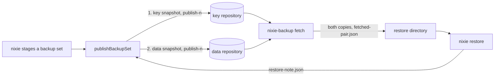

# The backup pair: publish numbers, the fetch and the restore note

- **Status:** draft
- **Decision records:** [0020](../../decisions/0020-deployment.md),
  [0032](../../decisions/0032-offsite-backups-and-replication.md)
- **Work items:** the publish numbers, the fetch and the snapshot list, the restore reads the pair

A lost host restores from 2 restic repositories: the data repository holds copies of `nixie.db`, and
the key repository holds copies of `keys.db`. The backup job numbers each publish in both
repositories, and `nixie-backup fetch` takes a data copy and a key copy that belong together. The
fetch refuses a data copy that holds records whose keys the key copy lacks. `nixie restore` then
reads the fetched pair, empties staging, and leaves a restore note that tells the next publish which
key snapshot the restore came from.

Terms:

- A **backup set** is one `nixie.db` copy and one `keys.db` copy that nixie stages in one folder of
  the staging folder. Its **sequence** is the folder's 12-digit name.
- A **data snapshot** and a **key snapshot** are the 2 restic snapshots that one publish writes. The
  **publish number** is the positive integer that one publish gives both.
- A key copy **vouches for** a data snapshot when it holds the key of every record in that snapshot,
  except the records of an item you forgot.
- A **backup pair** is the key snapshot and the data snapshot that the fetch picks.

## Shape



## Contracts

### Tags

```ts
// backup job: one function formats every tag, and one parses them. A tag that does not parse
// reads as absent.
type SnapshotTag =
  | `set-${number}` // both snapshots: the set's sequence
  | `kind-${BackupSetKind}` // both snapshots; BackupSetKind: wire lib, built
  | `publish-${number}` // both snapshots: the publish number
  | `legacy-set-${number}` // key snapshot only: the set- number of the last key snapshot with no publish number
  | `proven-from-${number}`; // key snapshot only: the key copy vouches for no data snapshot below this publish number
```

### The repository interface

```ts
// backup job. Adapters: restic, through the built ResticClient, and the stub restic for tests.
interface BackupRepository {
  // …the built ResticClient methods
  readSnapshots: () => Promise<readonly PublishedSnapshot[]>; // every snapshot, with its tags and time
  restoreSnapshot: (snapshotID: string, directory: string) => Promise<void>; // writes bytes, never text
}
```

### The pick

```ts
pickBackupPair(keys, data, null); // IDs shortened here; the code holds restic's full IDs
// → { key: { snapshotID: 'a1b2c3d4', publish: 42, … }, data: { snapshotID: '9f8e7d6c', publish: 42, … },
//     relation: 'same-publish' }
//   or { refused: 'no-data-of-publish', message: '… name data snapshot 5e4d3c2b …' }
```

```ts
// backup job: both picks are pure functions over the 2 snapshot lists
interface PublishedSnapshot {
  snapshotID: string;
  writtenAt: number; // restic's time
  set: number | null;
  kind: BackupSetKind | null;
  publish: number | null; // null: no publish- tag
  legacySet: number | null; // key snapshots only
  provenFrom: number | null; // key snapshots only
}

type PairRelation = 'same-publish' | 'older-data';

type PairRefusal =
  | 'no-key-snapshot'
  | 'no-data-of-publish' // the message holds the ID of the data snapshot with the highest publish number that the key copy vouches for
  | 'duplicate-publish'
  | 'no-such-data-snapshot'
  | 'data-newer-than-keys'
  | 'data-unproven';

type BackupPairPick =
  | { key: PublishedSnapshot; data: PublishedSnapshot; relation: PairRelation }
  | { refused: PairRefusal; message: string };

declare function pickNewestKey(keys: readonly PublishedSnapshot[]): PublishedSnapshot | null;

declare function pickBackupPair(
  keys: readonly PublishedSnapshot[],
  data: readonly PublishedSnapshot[],
  dataSnapshotID: string | null, // null: the default data snapshot
): BackupPairPick;

const fetchRepickLimit = 3;
```

### The commands

```text
nixie-backup fetch --to <directory> [--data-snapshot <snapshot_id>]
  exit 0 after one backup.fetched line; exit 1 after one backup.fetch_failed line,
  and for a <directory> that exists and is not empty
nixie-backup snapshots
  one SnapshotLine of JSON for each snapshot of both repositories
```

`<directory>` is an empty folder for the pair, and `<snapshot_id>` is a data snapshot's ID from
`nixie-backup snapshots`.

```ts
// backup job: log lines and command output
interface BackupFetchedLine {
  event: 'backup.fetched';
  dataSnapshotID: string;
  keySnapshotID: string;
  dataSet: number | null;
  keySet: number | null;
  dataPublish: number | null;
  keyPublish: number | null;
  relation: PairRelation;
}

interface BackupFetchFailedLine {
  event: 'backup.fetch_failed';
  step: string; // 'pick' for a refused pick and for a fourth change of the newest key snapshot
  refusal?: PairRefusal; // only when the pick refused
}

interface SnapshotLine {
  repository: 'data' | 'key';
  snapshotID: string;
  time: string; // restic's time
  set: number | null;
  kind: BackupSetKind | null;
  publish: number | null;
}
```

### The files

```ts
// wire lib: both programs touch these, so the wire lib owns each name and schema
const unfinishedBackupMarker = 'backup-incomplete'; // the built name, moved from the log module

// fetched-pair.json, at the root of the fetch's directory. A strict object.
interface FetchedPair {
  format: 1;
  fetchedAt: number;
  key: FetchedCopy;
  data: FetchedCopy;
  relation: PairRelation;
}

interface FetchedCopy {
  snapshotID: string;
  publish: number | null;
  set: number | null;
  writtenAt: number;
}

// restore-note.json, at the root of the staging folder. A strict object. Its name is not 12
// digits, so the built backup job and nixie skip it as no set.
interface RestoreNote {
  format: 1;
  restoredAt: number;
  keySnapshotID: string | null; // null: the directory came from nixie backup --to
}
```

### The restore

```ts
// log module: the built result grows one field
interface DataRestore {
  // …existing fields
  pair: FetchedPair | null; // null: the directory came from nixie backup --to
}
```

## Constraints

### The publish

- `publishBackupSet` runs under the built staging lock of the job pass.
- The publish number is one more than the highest in either repository, or 1 when neither holds one.
- When the backup job cannot list the data repository, it counts from the key repository alone. When
  the key repository then holds no publish number, it writes a failed receipt and no snapshot, so a
  publish number never repeats.
- The publish writes the key snapshot first. When the key snapshot fails, the publish writes no data
  snapshot and removes no key snapshot.
- The key snapshot that the publish replaces is the one `pickNewestKey` gives.
- When the backup job cannot list the key repository, it writes a failed receipt and no snapshot.
- The key snapshot copies `legacy-set-` and `proven-from-` from the key snapshot it replaces. The
  first key snapshot with a publish number takes `legacy-set-` with the `set-` number of the one it
  replaces.
- The key snapshot takes `proven-from-<n>` with its own number in 2 cases. In the first, staging
  holds a restore note whose key snapshot ID is null or is not the newest key snapshot's ID, and the
  key snapshot also takes no `legacy-set-`. In the second, the key snapshot it replaces has no
  publish number while either repository holds one. In both cases the key snapshot copies no tag,
  and the first case wins when both hold.
- A restore note that does not parse reads as one with no key snapshot ID.
- Every snapshot ID in a tag, a file, a log line or a message is restic's full ID.
- The data snapshot carries the same `set-`, `kind-` and `publish-` tags. The data repository's
  retention runs after it.
- Only when the publish wrote its own key snapshot does it remove every other key snapshot, prune
  and check, whether the data snapshot passed or failed.
- `publishBackupSet` removes the restore note, then the job pass writes the receipt, so later sets
  of the same pass find no note. The manifest and the receipt keep their built format 1.
- nixie's set table holds no publish number, so `set-<sequence>` can repeat in the data repository
  after a restore.

### The pick

- To find the newest key snapshot, the pick drops each key snapshot with no publish number whose
  `set-` number another key snapshot holds in `legacy-set-`. When every key snapshot left has a
  publish number, it takes the highest. Otherwise it takes the latest by restic's time.
- With no key snapshot, the pick refuses with `no-key-snapshot`.
- The default data snapshot has the key snapshot's publish number. With none, the pick refuses with
  `no-data-of-publish`. With more than one, it refuses with `duplicate-publish`.
- For a key snapshot with no publish number, the default data snapshot is the latest by restic's
  time with no publish number and the same `set-` number. This case and the newest key are the only
  reads of a clock.
- A named data snapshot that the data repository lacks is `no-such-data-snapshot`. For one it holds:

| Key snapshot      | Named data snapshot | Condition                                                        | Result                 |
| ----------------- | ------------------- | ---------------------------------------------------------------- | ---------------------- |
| publish number    | publish number      | the same publish number                                          | `same-publish`         |
| publish number    | publish number      | a higher publish number                                          | `data-newer-than-keys` |
| publish number    | publish number      | a lower publish number, below `proven-from`                      | `data-unproven`        |
| publish number    | publish number      | a lower publish number, otherwise                                | `older-data`           |
| publish number    | no publish number   | `set-` at or below `legacy-set`, and no `proven-from` on the key | `older-data`           |
| publish number    | no publish number   | otherwise                                                        | `data-unproven`        |
| no publish number | no publish number   | the same `set-` number                                           | `same-publish`         |
| no publish number | no publish number   | a lower `set-` number                                            | `older-data`           |
| no publish number | no publish number   | a higher `set-` number                                           | `data-newer-than-keys` |
| no publish number | publish number      | any                                                              | `data-unproven`        |

### The fetch

- The fetch reads the backup job's `NIXIE_BACKUP_*` repository and password variables, and never the
  staging folder.
- The fetch writes the unfinished-backup marker before the first copy. Its last write is
  `fetched-pair.json`, and then it removes the marker.
- After it writes both copies, the fetch lists the key repository again. When the newest key
  snapshot changed, it empties the directory but for the marker and picks again, at most
  `fetchRepickLimit` times.
- On any failure, the marker stays, the fetch exits 1, and `nixie restore` refuses the directory
  with the built refusal.
- The fetch container holds no deployment key and mounts no data volume. The restore container holds
  no backup credential.
- A deployment calls only commands, and its script never reads a repository's layout or a file of
  the data directory.
- No command restores a key copy other than the newest, because that copy makes a forgotten item
  readable again.

### The restore, steps 1 to 5

| Step | `nixie restore --from <directory> --yes`                                       | After a kill here, the data directory holds |
| ---- | ------------------------------------------------------------------------------ | ------------------------------------------- |
| 1    | refuses a directory with the unfinished-backup marker, and reads the pair file | what it held before                         |
| 2    | copies both checked copies in, under the writer lock, as built                 | both copies beside the databases, no marker |
| 3    | writes the restore marker in the state `replacing`, as built                   | a marker that reads `replacing`             |
| 4    | moves both databases into place, as built                                      | a marker that reads `replacing`             |
| 5    | removes every set folder of staging and writes the restore note                | a marker that reads `replacing`             |

- After a kill at any of steps 1 to 5, you run the restore again. A second pass of step 5 removes
  nothing more and writes the same note.
- When `fetched-pair.json` does not parse, the restore replaces nothing. A directory with no such
  file came from `nixie backup --to`, and the restore reads its 2 copies as one backup set.
- The log module owns step 5. Step 5 takes the job pass's staging lock while the restore holds the
  writer lock. When it cannot, the restore fails at step 5 and the marker stays.
- Step 5 removes every set folder, because nixie staged each from the replaced database, and the job
  would publish a remaining one as a set of the restored database.
- Step 6 is [the recovery hold's](recovery-hold.md#the-marker). Until it lands, step 6 removes the
  marker, as built.

### When a publish or a fetch stops

- When a publish stops between its 2 snapshots, the set has no receipt, and the next job pass
  publishes it under the next number. When the host is lost in that window, the default fetch
  refuses with `no-data-of-publish`, and you name the data snapshot that the message holds.
- When a publish stops after its key snapshot and before it removes the replaced one, the pick takes
  the higher publish number.
- When the first numbered publish stops between those 2 writes, its `legacy-set-` tag makes the pick
  drop the replaced key snapshot.
- When a publish stops after its key snapshot and before it removes the restore note, the next
  publish raises `proven-from` again. The fetch then refuses more data snapshots, never fewer.
- When a job pass publishes during a fetch, the fetch's second list shows it, and the fetch picks
  again.
- When a backup job publishes after the fetch and before the restore, the restore note holds a key
  snapshot ID that is not the newest, and the next publish sets `proven-from`.
- A restore from a `nixie backup --to` directory writes a note with no key snapshot ID, so every
  data snapshot from before the restore becomes `data-unproven`.
- A backup job of a release without publish numbers writes none of the 3 new tags. The fetch reads
  its snapshots as unnumbered, ordered by restic's time.

## Decisions

- **The backup job alone holds the repositories' credentials, and nixie alone opens a database.**
  [0020](../../decisions/0020-deployment.md)
- **The fetch and the publish reach restic through one interface.** restic is the chosen tool, and
  the interface is where an alternative fits.
  [0032](../../decisions/0032-offsite-backups-and-replication.md)

## Builder decides

- The names of the 2 repository methods. The interface stays inside the backup job.
- The text of each refusal's `message`, within the rule on `no-data-of-publish`.
- The step names of `backup.fetch_failed` other than `pick`.
- The layout of the tests, and the stub restic's record of a snapshot's time.

## Out of scope

- A field added to the manifest or the receipt, a record kind, a config key, an environment variable
  and a migration.
- A flag on `nixie restore`, `run` or `loop`.
- A tag added to a data snapshot after its key snapshot is written. restic rewrites a retagged
  snapshot under another ID.
- The offsite replica, `nixie rollback`, the monthly restore check and the check of a forget against
  the backups.
- A guard against a backup job on a host you took for lost. Stopping nixie and its backup job is the
  restore runbook's first step.

## Open questions

- **What identifies a backup set?** The owner settles it, among: publish numbers that the backup job
  counts in the repositories, as written; a sequence floor in staging with gap ranges; or a random
  set ID with a lineage that nixie stores. Until then, nothing here is built. The cost of publish
  numbers: a host lost between the 2 writes makes the default fetch refuse until you name a data
  snapshot.
- **Does one command fetch the pair?** The owner settles it, against `fetch data` and `fetch keys`.
  Until then, one command, because 2 commands cannot refuse a data copy that is ahead of the key
  copy.
- **How does `nixie restore` refuse a stopped fetch?** The owner settles it: the unfinished-backup
  marker, or a manifest with checksums. Until then, the marker.
- **Does the fetch accept a named data snapshot while the newest key snapshot has no publish
  number?** The owner settles it: the pick's table as written, with a warning in the restore
  runbook; or a refusal of every named data snapshot under such a key copy, which blocks the restore
  of an older copy from repositories that no numbered publish has reached. Until then, the table as
  written.
- **What happens to an item forgotten after the data snapshot of an `older-data` pair?** The owner
  settles it: it stays unreadable; the restore finishes each forget whose key is gone, at the next
  start in the start part `recovery_holds` or in `nixie restore`; or `--data-snapshot` comes only
  with a runbook warning. Until then, such an item stays unreadable, and `restoreDataBackup` takes
  no option for it.
- **Does restic store `publish-<n>`, `legacy-set-<sequence>` and `proven-from-<n>` as written, and
  list them back?** A spike settles it: the first case of the real restic suite writes one snapshot
  with the 3 tags and reads the snapshot list, under
  `NIXIE_RESTIC_BINARY=<path_to_restic> bun run test:restic`. Until then, the publish numbers work
  starts with that case, and changes the tag format first when restic changes or refuses one.
- **Does only a forget delete a row of `record_keys`?** A check settles it: read each caller of
  `removeRecordKey`, `removeThreadKeys` and `deleteFrom('record_keys')` outside tests. A grep lists
  the compaction module, the memory module, the conversation reset and the log reset beside the
  forgets. Until then, the promise that a record with no key in an `older-data` pair belongs to a
  forgotten item is unproven. Only the finish of forgets, which is not designed, relies on it.
