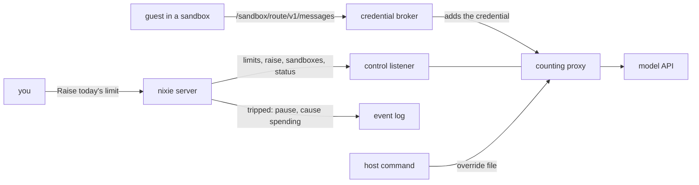

# Budgets and the hard spending stop

- **Status:** draft
- **Work items:**
  [budgets, model limits and the hard stop](https://linear.app/zgeoff/issue/GEO-1811),
  [search on its own budget](https://linear.app/zgeoff/issue/GEO-1813)
- **Decision records:** [0012](../../decisions/0012-spending-stop.md)

Every model request in production passes the
[counting proxy](../../architecture/policy/counting-proxy.md) on the host. The proxy counts a day
and a month, each reset at local midnight. nixie sets the proxy's limits, and the proxy refuses any
limit above a cap that only its own config holds. When a limit is reached, nixie pauses every task
with the [pause](pause.md), shows a notice, and resumes on its own at the reset. You can raise
today's limit from the client, up to the cap.

Paid tools, such as search, and purchases that a lifting rule lets through charge a budget in
nixie's database before they act. The [budgets design](../platform/policy/budgets.md) gives the
reasons and the default limits, and this design gives the contracts that build them.

Terms:

- The **host** is the machine that runs nixie and the proxy. The **operator** is the person who runs
  commands on it. The **server** is nixie's server process on the host.
- The **release before** is the nixie release, or the proxy release, that a rollback returns to.
- The **cap** is the highest that the day's or the month's limit can reach without a host command.
  It is a total, never the size of a raise.
- The **control listener** is the proxy's second listener, which only the server reaches.
- The **lost mark** is the `lost` field that the proxy writes to its store when the store holds less
  than the model spent, such as after a reply it could not count
  ([failing closed](../../architecture/policy/counting-proxy.md#failing-closed)). While it stands,
  the proxy refuses every request, and only an operator removes it.
- The **watcher** is the part of the server that reads the proxy's status and trips or clears the
  stop.
- A **lift** is an allow rule's `lift` field, which lets a purchase, a tool call with the `spend`
  effect, through without asking, within a budget
  ([lifting rules](../platform/policy/budgets.md#lifting-rules)).
- A **charge** is one amount on one budget for one period, written before the paid call or the
  purchase acts.
- A record **on no thread** belongs to no task's thread, so no task reads it and the live stream
  never shows it ([the event log](../../architecture/core/event-log.md)).

## Shape



## Contracts

### The proxy's config

```yaml
# counting proxy config: the keys this design adds beside listen, store and routes
periods:
  zone: Europe/London # an IANA zone, equal to the time tool's default_zone
caps:
  day: { dollars: 120, tokens: 160000000 }
  month: { dollars: 1000, tokens: 1000000000 }
control:
  listen: { hostname: 127.0.0.1, port: 8790 } # an address no sandbox reaches
  tokenFile: /run/secrets/proxy-control-token # one line, the same value as the server's secret
countBySandbox: true # the path is /<sandbox>/<route>/…; false keeps /<route>/…
override: /var/lib/counting-proxy/override.json # written only by the host command
```

- A config sets either `periods` or the current `limits`, and the schema refuses one that sets both
  or neither.
- A config with `periods` needs `caps` and `control`. The config of a
  [preview](../../runbooks/preview.md), the throwaway build of one pull request, keeps `limits`, one
  count that never resets, and sets none of these keys.

### The store

```ts
// counting proxy: the store file when the config sets periods; a `limits` config keeps its current shape
interface PeriodStore {
  version: 2;
  lost?: true; // the lost mark
  periods: Record<'day' | 'month', PeriodCount>;
  sandboxes: Record<string, SandboxCount>; // key: the sandbox name from the path
}

interface PeriodCount {
  start: string; // ISO date of the period's first day, in periods.zone
  dollars: number;
  tokens: number;
  limit: Measures | null; // the base limit the server set; null until it sets one
  raise: Measures | null; // the day's raise; always null on the month
}

interface SandboxCount {
  dollars: number;
  tokens: number;
  limit: Measures | null; // null: count only, such as the conversation's sandbox
}

type Measures = { dollars: number; tokens: number };

// counting proxy: the override file, read before each admission
interface Override {
  period: 'day' | 'month';
  start: string; // the period it applies to; ignored once that period ends
  limit: Measures; // may pass the cap
}
```

### The control listener

```http
GET /status
Authorization: Bearer <control token>

200 {
  "zone": "Europe/London",
  "lost": false,
  "periods": {
    "day":   { "start": "2026-11-13", "resetsAt": "2026-11-14T00:00:00Z",
               "spent": { "dollars": 61.2, "tokens": 51200000 },
               "limit": { "dollars": 60, "tokens": 80000000 },
               "cap": { "dollars": 120, "tokens": 160000000 } },
    "month": { "…": "the same fields" }
  },
  "tripped": { "period": "day", "measure": "dollars", "at": "2026-11-13T16:42:07Z" }
}
```

```http
PUT /limits
{ "day": { "dollars": 60, "tokens": 80000000 }, "month": { "dollars": 600, "tokens": 600000000 } }
→ 200 <status>, or 409 { "error": "above_cap", "period": "day", "cap": { … } }

POST /raise
{ "period": "day", "start": "2026-11-13", "limit": { "dollars": 90, "tokens": 120000000 } }
→ 200 <status>, 409 { "error": "above_cap", … }, or 409 { "error": "period_ended" }

PUT /sandboxes/<name>      { "limit": { "dollars": 2, "tokens": 2000000 } }  or  { "limit": null }
→ 204; sets the limit and sets the count to zero
GET /sandboxes/<name>      → 200 { "dollars": 0.41, "tokens": 380000, "tripped": false }, or 404
DELETE /sandboxes/<name>   → 204, also for a name the store lacks
```

- `limit` in the status is the limit in force: the override when one applies, otherwise the larger
  of the base limit and the day's raise.
- `tripped` is null while each period's count is under its limit in force and the lost mark is
  absent.

### The host commands

```bash
counting-proxy raise --config <config file> --period day --dollars 200 --tokens 250000000
# → writes the override file for the period in force, through a second file and a rename
```

```bash
nixie spend raise --turns 3000
# → writes spend.limit_raised for today's turns, which may pass day.turnCap; run by the operator
```

### nixie's config

```yaml
# deployment config. Built: models.limits.taskRun with turns and dollars. This design adds the rest.
models:
  limits:
    workerRun: { dollars: 2, tokens: 2000000, turns: 25, minutes: 10 }
    taskRun:
      default: { turns: 25, dollars: 2, tokens: 4000000 }
      max: { turns: 100, dollars: 10, tokens: 16000000 }
    day: { dollars: 60, tokens: 80000000, turns: 1000, turnCap: 2000 }
    month: { dollars: 600, tokens: 600000000, turns: 20000 }
spendStop:
  control: http://127.0.0.1:8790 # the proxy's control listener
  token: deployment:proxy-control # a reference into the secrets file
  modelURL: http://10.0.0.2:8789 # the proxy's model listener, as the credential broker reaches it
```

### The stop in nixie

```ts
// log module: PauseCause from the pause design, with one more value
type PauseCause = 'restore' | 'owner' | 'spending';

// spend module: the 3 record kinds, each on no thread
interface SpendStopTripped {
  kind: 'spend.stop_tripped';
  payload:
    | {
        reason: 'limit';
        period: 'day' | 'month';
        measure: 'dollars' | 'tokens' | 'turns';
        limit: number;
        spent: number;
        at: number;
        resetsAt: number;
      }
    | { reason: 'unreachable' | 'lost'; at: number };
}

interface SpendStopCleared {
  kind: 'spend.stop_cleared';
  payload: { reason: 'reset' | 'raised' | 'reachable' | 'lost_cleared' };
}

interface SpendLimitRaised {
  kind: 'spend.limit_raised';
  payload: { start: string; dollars: number; tokens: number; turns: number; by: string };
}
```

```ts
// spend module: the watcher's read, called by its poll and by the runner after a failed step
const stop = await readSpendStop(context);
// → { state: 'tripped', period: 'day', measure: 'dollars', limit: 60, spent: 61.2,
//     resetsAt: 1794614400000, canRaise: true }
//   or { state: 'clear' }, { state: 'unreachable' }, { state: 'lost' }
// canRaise: true only for a day trip, when each tripped measure's limit in force is below its cap
declare function readSpendStop(context: SpendContext): Promise<SpendStop>;
```

```ts
// contract lib: the device API that the client calls
spend.read({}); // → the SpendStop above, with { cap: { dollars, tokens, turns } }
spend.raise({ start: '2026-11-13', dollars: 90, tokens: 120000000, turns: 1500 });
// → { state: 'clear' }, or { error: 'above_cap', cap }, or { error: 'period_ended' }
```

### Budgets

```yaml
# definitions repo, budgets/<any name>.yaml: a map of budget ID to budget
shopping-month:
  counts: spend # spend: purchases through tools with the spend effect; or tool:<name>
  limit: 100 # dollars
  period: month # day, week (from Monday) or month
search-day:
  counts: tool:search
  limit: 5
  period: day
```

```yaml
# definitions repo, rules/*.yaml: the lift field, on an allow rule only
allow-groceries:
  outcome: allow
  tools: [shop.order]
  destinations: ['*@grocer.example']
  lift: { perAction: 20, budget: shopping-month } # perAction in dollars
```

```ts
// definitions module, beside the current format numbers in definitionsFormats: the lowest
// format version in the manifest that applies budgets/*.yaml; the next unreleased format
const definitionsFormats = { /* …existing fields */ budgets: 5 };

// policy module: the tool declaration of a paid tool, beside its effects
interface ToolDeclaration {
  // …existing fields
  paid?: { priceMicros: number }; // the price of one call, in millionths of a dollar
}
```

```sql
-- One migration appended to nixieSchema.
create table budget_charges (
  charge_id      text primary key,           -- random
  budget_id      text not null,
  period_start   text not null,              -- ISO date of the period's first day
  amount_micros  integer not null check (amount_micros > 0),
  for_kind       text not null,              -- 'tool_call' or 'action'
  for_id         text not null,
  credited       integer not null default 0  -- 1 once budget.credited lands
) strict;

create table budget_ledger (
  budget_id      text not null,
  period_start   text not null,
  spent_micros   integer not null,           -- the charges less the credits
  primary key (budget_id, period_start)
) strict;
```

```ts
// budgets module: the 2 record kinds, each on no thread
interface BudgetCharged {
  kind: 'budget.charged';
  payload: {
    chargeID: string;
    budgetID: string;
    periodStart: string;
    amountMicros: number;
    for: { kind: 'tool_call' | 'action'; id: string };
  };
}

interface BudgetCredited {
  kind: 'budget.credited'; // lowers budget_ledger.spent_micros by the charge's amount
  payload: { chargeID: string };
}

// budgets module: one transaction charges every budget or none
const charge = await chargeBudgetsInTransaction(tx, {
  budgetIDs: ['search-day', 'search-month'],
  amountMicros: 25000,
  for: { kind: 'tool_call', id: '0c4f…' },
});
// → { chargeIDs: ['…', '…'] }
//   or { error: 'budget_reached', budgetID: 'search-day', spentMicros: 5000000,
//        limitMicros: 5000000, resetsAt: 1794614400000 }
```

```bash
nixie budgets list           # each budget, its limit, period, spent and reset, as JSON
nixie budgets ledger <id>    # the budget's charges in the period in force, as JSON
```

## Constraints

### The proxy's count

- The proxy reads the store and the override file before it admits each request. It refuses the
  request with its current limit 403 when any period's count has reached its limit in force.
- While a period's `limit` is null, the proxy answers every request with a 503, so a proxy that the
  server never set sends nothing upstream.
- Each read of the store, for an admission, a reply or a control call such as `/status`, first
  resets each period whose next start in `periods.zone` has passed: it sets the count to zero, sets
  `start`, and drops `raise`. It keeps `limit` and the lost mark. A reset therefore needs no model
  request.
- A reply adds its dollars and tokens to the day, the month and the sandbox in one write.
- With `countBySandbox`, the proxy refuses with a 403 a request whose first path segment holds a
  sandbox name that the store lacks. It refuses a request past its sandbox's limit with the
  limit 403. It takes the route from the second segment, and strips the sandbox segment and the
  route segment before it sends the request upstream.
- `PUT /limits` and `POST /raise` refuse a value above the cap, and `POST /raise` refuses a `start`
  that is not the day in force. A refused call changes nothing.
- The control listener refuses a request without the token from `control.tokenFile` with a 401. The
  model listener serves no control path.
- The host command is the only writer of the override file. The server has no path to it, to the
  store, or to the proxy's config.

### Routing every request

- Every model request reaches the proxy: the conversation's, each task run's and worker run's, the
  checker's, the memory writer's and the consolidator's.
- The base URL in each turn frame is the model profile's base URL followed by
  `/<sandbox name>/<profile ID>`. The server builds it. A turn frame holds the settings that a
  guest's model loop gets for one turn
  ([conversation turns](../../architecture/core/conversation-turns.md)). The profile ID is the
  proxy's route ID.
- Each model grant, the credential that the broker adds for a sandbox
  ([model profiles](../../architecture/core/model-profiles.md#credentials)), carries the path filter
  `/<sandbox name>/**`. A guest therefore reaches only its own sandbox's count.
- With `spendStop` set, the server holds no model credential. It refuses to start when its secrets
  file has a `model_credentials` entry, so no nixie code can send a request with the key past the
  proxy.
- The deployment adds each model secret to impd with `modelURL` as the secret's upstream, the
  address where the broker sends the request in place of the model host. The sandbox adapter reads
  each model secret's upstream from impd, and refuses to grant a secret whose upstream is not
  `modelURL`.
- The server registers each sandbox with `PUT /sandboxes/<name>` before its first model request. A
  worker's sandbox gets the `workerRun` dollars and tokens, and every other sandbox gets
  `{ limit: null }`. The server deletes the entry when it destroys the sandbox.

### The stop

- At each start, after the migrations, a step of the server's start sends the configured day and
  month limits with `PUT /limits`. On `above_cap`, the server refuses to start with an error that
  holds the cap. When the proxy does not answer, the server starts, pauses with the cause `spending`
  and the reason `unreachable`, and sends the limits once the proxy answers.
- At start, the server refuses to start when the zone in `/status` differs from the time tool's
  `default_zone`, so the proxy's periods and the budgets' periods reset together.
- The watcher reads `/status` every 10 seconds. The runner calls `readSpendStop` before it counts a
  failed step that ran a model turn.
- The runner counts the deployment's turns since the day's start and the month's start from the turn
  records, and checks both before each turn. At `day.turns` or `month.turns`, plus any raise, the
  runner trips the stop with the measure `turns`. The watcher reads this count beside `/status`, and
  the stop stands while either one shows a trip.
- The stop trips when the status shows `tripped`, when the lost mark stands, or when the proxy has
  not answered for 30 seconds. The server then writes `spend.stop_tripped` and, when nixie is not
  paused, pauses with the cause `spending`, in one transaction.
- When nixie is already paused, for a restore or by you, a trip writes only `spend.stop_tripped`,
  and the pause keeps its cause.
- When the stop clears, the server writes `spend.stop_cleared` and, when the pause's cause is
  `spending`, resumes in one transaction. A clear never resumes a pause of another cause.
- A `limit` trip clears at the period's reset, or when a raise lifts every tripped measure. This
  holds for turns as for dollars and tokens: a raise from the client up to `day.turnCap`, the host
  command `nixie spend raise` above it, or the next period. `unreachable` clears at the proxy's
  first answer. The lost mark clears only when an operator removes it from the store.
- When the runner finds the stop tripped after a failed step, the step counts no step error. The
  task keeps its state and its work, and its next claim after the resume runs the step again.
- While the stop stands, nixie refuses `Resume nixie` and a task's Resume, whatever the pause's
  cause, with a message on how the stop clears. Only a raise, the period's reset, the proxy's answer
  or an operator's removal of the lost mark ends the stop, so a resume never restarts turns while it
  stands. A task's Pause and Stop work as on any day.
- When you pause nixie while the stop stands, the cause becomes `owner`, and the clear leaves nixie
  paused for you to resume.
- The spending pause raises the database's oldest reader version to this design's migration
  ([the reader gate](pause.md#the-reader-gate)), so the release before refuses to open the database
  while the spending pause stands.

### The raise

- Only you raise the day's limit, through `spend.raise` from the client. A tool or a task never
  raises it.
- `spend.raise` covers the day only. A month trip clears at the month's reset, or when the
  deployment raises the month's limit in the config, up to its cap, or with the host command.
- One confirm in the client is the one approval. The record's `by` is the session that confirmed.
- `spend.raise` writes `spend.limit_raised`, then calls `POST /raise`. When the proxy refuses or
  does not answer, the record stands, and the watcher sends the raise again until the day ends.
- The turn raise is capped at `day.turnCap`. nixie's config file is read-only to nixie, so nixie
  never moves that cap. The proxy's caps bound the dollars and the tokens, whatever the server
  sends.
- On a day trip, the client shows: "Model spending stopped: the daily limit of $60 was reached at
  16:42. All tasks are paused where they were. Nothing is lost. [Raise today's limit] Resumes on its
  own at midnight." On a month trip, the client shows the month and the date of its reset, with no
  button. On `unreachable` and the lost mark, the client shows that the operator must act, with no
  button.
- The client reads the notice from `spend.read`. The
  [Telegram push](https://linear.app/zgeoff/issue/GEO-1812), once built, sends the same notice as
  well.

### Model limits

- The runner passes `workerRun.turns` to the SDK as `maxTurns`, and ends the worker run at
  `workerRun.minutes`. The proxy ends it at its sandbox's dollar and token limits.
- At the end of a worker run, the server reads `GET /sandboxes/<name>`. The worker's result record
  holds those dollars and tokens, and they count toward the calling task run's limits.
- A task run's tokens count from the same records as its dollars, as
  [started tasks](../../architecture/core/started-tasks.md#limits) builds them. The schema refuses a
  `default` that is above its `max` in any one measure.
- The memory writer, the checker and the consolidator come under the day and month limits, and under
  no task run or worker run limit.

### Budgets and the ledger

- A budget lives in `budgets/*.yaml`. Each budget ID belongs to one budget across every file. A
  budget ID never collides with a rule ID, because the two live in different folders.
- Each budget period starts at local midnight in the [time](../../architecture/connectors/time.md)
  tool's `default_zone`.
- The budgets are in the definitions' [snapshot hash](../../architecture/core/definitions.md). Each
  seed, the step that puts a new version of the definitions in force, treats a raised limit as a
  widening and a lowered limit as a narrowing, through the rule store's
  [widening flow](../../architecture/policy/rules.md#rules-in-force).
- Each paid tool has the built-in budgets `<tool>-day`, $5, and `<tool>-month`, $50. A budget in the
  definitions with the same ID sets its limit.
- A charge lands only when every named budget has room for the whole amount, in the transaction that
  writes the `budget.charged` records and updates `budget_ledger`. Two charges at the same moment
  therefore never both fit in the last of a budget.
- A paid tool charges its price to its day and month budgets when the call starts, before the
  provider sees it. A call that fails credits each charge. A call whose outcome is unknown stays
  charged.
- At the limit, the tool returns to the model: "budget reached: search-day ($5.00 of $5.00). Resets
  at midnight." The client shows a notice.
- The search tool checks the
  [daily call cap](../../architecture/connectors/search.md#the-daily-call-cap) and charges its
  budgets in one transaction, and refuses when either has no room. The search tool never credits the
  call cap's count.

### Lifts

- `lift` is valid only on an allow rule. The parser refuses a lift with no budget, with a budget the
  definitions lack, or with a budget whose `counts` is not `spend`.
- Stage 4 of the [decision point](../platform/policy/decision-point.md#the-pipeline) passes a
  `spend` call only when its amount is at most `perAction` and the charge to the lift's budget
  lands. The charge lands when the action queues, in the queue's transaction. A failed action
  credits it. A task's Stop that cancels the action credits it too, in the Stop's transaction.
- The widening check treats an added lift, a higher `perAction` and a changed budget as widening,
  and a removed lift and a lower `perAction` as narrowing. A widened lift takes the lifting risk
  class of [approvals](../platform/policy/approvals.md#risk-class).
- A lifted call still passes the
  [destination limits](../platform/policy/decision-point.md#the-pipeline).
- The rule export writes the `lift` field as it writes every other field.

### A rollback

The release before reads this design's changes this way:

| The change                                         | The release before                                             |
| -------------------------------------------------- | -------------------------------------------------------------- |
| the added `models.limits` keys, `spendStop`        | refuses to start: the config schema is strict                  |
| the `lift` field                                   | refuses the seed; the rules in force stay                      |
| a manifest at `definitionsFormats.budgets`         | refuses the format, when it reads only the format before       |
| the migration                                      | never selects the 2 tables                                     |
| `spend.*` and `budget.*` records                   | never meets them on a thread: each is on no thread             |
| the cause `spending`                               | refuses with `SchemaTooNewError` while it stands               |
| the `/<sandbox>/<route>` base URL and path filters | sends `/<route>` paths, which a `countBySandbox` proxy refuses |

The proxy before reads its changes this way:

| The change             | The proxy before                             |
| ---------------------- | -------------------------------------------- |
| the added config keys  | refuses to start, so no model request passes |
| the store at version 2 | never reads it: step 3 moves the file aside  |
| the override file      | never reads it                               |

To roll back:

1. Clear the stop on this build. For a day trip, raise the limit or wait for midnight. For a month
   trip, use the host command. For `unreachable`, start the proxy. For the lost mark, remove it from
   the store. Expect: nixie resumes, and `spend.read` returns `{ state: 'clear' }`.
2. Remove the added keys from nixie's config, the `lift` fields from the rules, and the manifest's
   step up to `definitionsFormats.budgets`.
3. Restore the proxy's config to one `limits`, and move its store file aside.
4. Start the proxy before, then the release before. Expect: the proxy starts a new count at zero,
   and nixie starts.

## Decisions

- **The proxy holds the caps, and nixie sets limits under them.** nixie's config keeps the limits
  with the other model limits, and the proxy's config, which nixie cannot reach, bounds every value
  nixie sends. [0012](../../decisions/0012-spending-stop.md)
- **With the stop, the deployment holds every model credential.** An agent's call on 13 Nov 2026: a
  key in nixie's secrets file would let nixie's own code reach the provider past the proxy.
- **The cap is the day's total, never the size of a raise.** An agent's call on 13 Nov 2026: the
  notice and the status show a total, so the cap reads in the same terms.
- **The stop is nixie's pause, with the cause `spending`.** An agent's call on 13 Nov 2026: the
  pause already stops every task with nothing lost, and the cause keeps the stop's clear from
  resuming a pause of yours or a restore's.
- **An unreachable proxy pauses nixie.** An agent's call on 13 Nov 2026: every model request fails
  while the proxy is down, and without the pause each task would fail on its step errors.
- **The raise is your own control, with no proposal.** An agent's call on 13 Nov 2026: nixie makes a
  proposal when nixie asks for something, and this raise starts with you, as the
  [pause controls](pause.md#the-pause) do.
- **The client raises only the day.** An agent's call on 13 Nov 2026: the owner gave the client
  today's limit only, and a month's raise is rare enough for the config or the host command.
- **Turns stay in nixie, with a cap in nixie's config.** An agent's call on 13 Nov 2026: the proxy
  sees requests, never turns, and the proxy's dollar and token caps already bound what any turn
  costs.
- **One proxy for the deployment, with a count per sandbox.** An agent's call on 13 Nov 2026: the
  day and month counts must cover every sandbox, and a proxy per sandbox would split them.
- **The host command writes the override file.** An agent's call on 13 Nov 2026: the server holds
  the control token, so a control call that passed the cap would let nixie move it.
- **Budgets live in `budgets/`, apart from `rules/`.** An agent's call on 13 Nov 2026: a rules file
  maps rule IDs to rules, so a `budgets:` key there would collide with a rule ID.
- **A budget counts `spend` or one paid tool.** An agent's call on 13 Nov 2026: the model limits
  live in the config, so a budget that counted model use would be a second copy of them.
- **A paid tool's limits change only in the definitions.** An agent's call on 13 Nov 2026: a raise
  there passes the widening flow, which asks, and a deployment config would raise it without asking.
- **Money in the ledger is integer millionths of a dollar.** An agent's call on 13 Nov 2026: a
  search costs a fraction of a cent, and an integer sum never drifts.

## Builder decides

- The internal names, files and modules of the watcher, the spend reads and the ledger, as long as
  the spend module is the one writer of `spend.*` and the budgets module the one writer of
  `budget.*`.
- How the proxy keeps the reads of the store and the override file cheap.
- The wording of each refusal, log line and notice, past the stop's notice and the model's "budget
  reached" text.
- How the client shows the cap and the amount it offers for a raise.
- The layout of the tests.

## Out of scope

- Lifts on the always-ask effects `policy_widen` and `budget_raise`, which add an allow rule or
  raise a budget, and the passkey check on an approval.
- The search tool and its provider.
- A raise of a budget from the client. A budget's limit changes in the definitions.
- The Telegram push.

## Open questions

The owner settles each one in [the budgets work item](https://linear.app/zgeoff/issue/GEO-1811), and
the interim stands until then:

- **Does `search.daily_call_cap` stay beside the search budget?** Interim: both apply.
- **The names `caps`, `counting-proxy raise` and `nixie spend raise`.** Interim: those names.
- **What the raise control offers.** Interim: today's limit plus half, up to the cap, and you can
  change the amount before you confirm.
