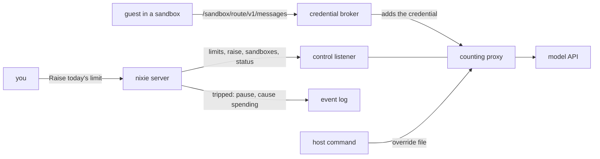

# Budgets and the hard spending stop

- **Status:** draft
- **Work items:**
  [budgets, model limits and the hard stop](https://linear.app/zgeoff/issue/GEO-1811),
  [search on its own budget](https://linear.app/zgeoff/issue/GEO-1813)
- **Decision records:** [0012](../../decisions/0012-spending-stop.md)

Every model request in production passes the counting proxy on the host. The proxy keeps a day count
and a month count that reset at local midnight. nixie sets the proxy's limits, but never above a cap
that only the host's config holds. When a limit is reached, nixie pauses every task with the
[pause](pause.md), shows a notice, and resumes on its own at the reset. You can also raise today's
limit from the client, up to the cap. Paid tools and lifted purchases charge a budget ledger in
nixie's database before they act.

The [budgets design](../platform/policy/budgets.md) gives the reasons and the default limits. This
design gives the contracts that build them.

Terms:

- The **cap** is the highest that the day's or the month's limit can reach without a host command.
  It is the limit's total, never the size of a raise.
- The **control listener** is the proxy's second listener, which only nixie's server reaches.
- A **charge** is one amount on one budget for one period, written before the paid call or the
  purchase acts.

## Shape



## Contracts

### The proxy's config

```yaml
# counting proxy config. Every key below is new, beside the built listen, store and routes.
periods:
  zone: Europe/London # IANA zone; equal to the time tool's default_zone
caps:
  day: { dollars: 120, tokens: 160000000 }
  month: { dollars: 1000, tokens: 1000000000 }
control:
  listen: { hostname: 127.0.0.1, port: 8790 } # an address no sandbox reaches
  tokenFile: /run/secrets/proxy-control-token # one line; the same value as nixie's secret
countBySandbox: true # the path is /<sandbox>/<route>/…; false keeps /<route>/…
override: /var/lib/counting-proxy/override.json # written only by the host command
```

- The built `limits` key becomes optional. A config with `periods` has no `limits`, and the schema
  refuses one that sets both. The schema refuses a config with neither, as built.
- A config with `periods` needs `caps` and `control`. A preview config keeps `limits`, one count
  that never resets, and none of the new keys.

### The store

```ts
// counting proxy: the store file when the config sets periods. The built shape stays for `limits`.
interface PeriodStore {
  version: 2;
  lost?: true; // as built: only an operator removes it
  periods: Record<'day' | 'month', PeriodCount>;
  sandboxes: Record<string, SandboxCount>; // key: the sandbox name from the path
}

interface PeriodCount {
  start: string; // ISO date of the period's first day, in periods.zone
  dollars: number;
  tokens: number;
  limit: Measures | null; // the base limit nixie set; null until nixie sets one
  raise: Measures | null; // today's raise; dropped when the period resets
}

interface SandboxCount {
  dollars: number;
  tokens: number;
  limit: Measures | null; // null: count only, such as the conversation's sandbox
}

type Measures = { dollars: number; tokens: number };
```

```ts
// counting proxy: the override file, written by the host command and read before each admission
interface Override {
  period: 'day' | 'month';
  start: string; // the period it applies to; ignored once that period ends
  limit: Measures; // may pass the cap
}
```

### The control listener

```http
GET /status
Authorization: Bearer <control token>

200 {
  "zone": "Europe/London",
  "lost": false,
  "periods": {
    "day":   { "start": "2026-11-13", "resetsAt": "2026-11-14T00:00:00Z",
               "spent": { "dollars": 61.2, "tokens": 51200000 },
               "limit": { "dollars": 60, "tokens": 80000000 },
               "cap": { "dollars": 120, "tokens": 160000000 } },
    "month": { "…": "the same fields" }
  },
  "tripped": { "period": "day", "measure": "dollars", "at": "2026-11-13T16:42:07Z" }
}
```

```http
PUT /limits
{ "day": { "dollars": 60, "tokens": 80000000 }, "month": { "dollars": 600, "tokens": 600000000 } }
→ 200 <status>, or 409 { "error": "above_cap", "period": "day", "cap": { … } }

POST /raise
{ "period": "day", "start": "2026-11-13", "limit": { "dollars": 90, "tokens": 120000000 } }
→ 200 <status>, 409 { "error": "above_cap", … }, or 409 { "error": "period_ended" }

PUT /sandboxes/<name>      { "limit": { "dollars": 2, "tokens": 2000000 } }  or  { "limit": null }
→ 204; sets the limit and sets the count to zero
GET /sandboxes/<name>      → 200 { "dollars": 0.41, "tokens": 380000, "tripped": false }, or 404
DELETE /sandboxes/<name>   → 204, also for a name the store lacks
```

- `limit` in the status is the limit in force: the override when one applies, otherwise the larger
  of the base limit and today's raise.
- `tripped` is null while each period's count is under its limit in force and `lost` is false.

### The host command

```bash
counting-proxy raise --config <config file> --period day --dollars 200 --tokens 250000000
# → writes the override file for the period in force, through a second file and a rename
```

### nixie's config

```yaml
# deployment config. models.limits.taskRun is built; tokens, workerRun, day and month are new.
models:
  limits:
    workerRun: { dollars: 2, tokens: 2000000, turns: 25, minutes: 10 }
    taskRun:
      default: { turns: 25, dollars: 2, tokens: 4000000 }
      max: { turns: 100, dollars: 10, tokens: 16000000 }
    day: { dollars: 60, tokens: 80000000, turns: 1000, turnCap: 2000 }
    month: { dollars: 600, tokens: 600000000, turns: 20000 }
spendStop:
  control: http://127.0.0.1:8790 # the proxy's control listener
  token: deployment:proxy-control # a reference into the secrets file
  modelURL: http://10.0.0.2:8789 # the proxy's model listener, as the credential broker reaches it
```

### The stop in nixie

```ts
// log module: PauseCause, built, gains one value
type PauseCause = 'restore' | 'owner' | 'spending';

// spend module (new): the 3 record kinds, each on no thread
interface SpendStopTripped {
  kind: 'spend.stop_tripped';
  payload:
    | {
        reason: 'limit';
        period: 'day' | 'month';
        measure: 'dollars' | 'tokens' | 'turns';
        limit: number;
        spent: number;
        at: number;
        resetsAt: number;
      }
    | { reason: 'unreachable' | 'lost'; at: number };
}

interface SpendStopCleared {
  kind: 'spend.stop_cleared';
  payload: { reason: 'reset' | 'raised' | 'reachable' | 'lost_cleared' };
}

interface SpendLimitRaised {
  kind: 'spend.limit_raised';
  payload: { start: string; dollars: number; tokens: number; turns: number; by: string };
}
```

```ts
// spend module: the watcher's read, called by its poll and by the runner after a failed step
const stop = await readSpendStop(context);
// → { state: 'tripped', period: 'day', measure: 'dollars', limit: 60, spent: 61.2,
//     resetsAt: 1763078400000, canRaise: true }
//   or { state: 'clear' }, { state: 'unreachable' }, { state: 'lost' }
declare function readSpendStop(context: SpendContext): Promise<SpendStop>;
```

```ts
// contract lib: the device API
spend.read({}); // → the SpendStop above, plus { cap: { dollars, tokens, turns } }
spend.raise({ start: '2026-11-13', dollars: 90, tokens: 120000000, turns: 1500 });
// → { state: 'clear' }, or { error: 'above_cap', cap }, or { error: 'period_ended' }
```

### Budgets

```yaml
# definitions repo, budgets/<any name>.yaml: a map of budget ID to budget
shopping-month:
  counts: spend # spend, or tool:<name> for a paid tool
  limit: 100 # dollars
  period: month # day, week (from Monday) or month, from local midnight
search-day:
  counts: tool:search
  limit: 5
  period: day
```

```yaml
# definitions repo, rules/*.yaml: the lift field, on an allow rule only
allow-groceries:
  outcome: allow
  tools: [shop.order]
  destinations: ['*@grocer.example']
  lift: { perAction: 20, budget: shopping-month }
```

```ts
// definitions module
definitionsFormats.budgets; // the first format that applies budgets/*.yaml

// policy module: the tool declaration of a paid tool, beside its effects
interface ToolDeclaration {
  // …existing fields
  paid?: { priceMicros: number }; // the price of one call, in millionths of a dollar
}
```

```sql
-- One migration appended to nixieSchema.
create table budget_charges (
  charge_id      text primary key,           -- random
  budget_id      text not null,
  period_start   text not null,              -- ISO date in the time tool's default_zone
  amount_micros  integer not null check (amount_micros > 0),
  for_kind       text not null,              -- 'tool_call' or 'action'
  for_id         text not null,
  credited       integer not null default 0  -- 1 once budget.credited lands
) strict;

create table budget_ledger (
  budget_id      text not null,
  period_start   text not null,
  spent_micros   integer not null,
  primary key (budget_id, period_start)
) strict;
```

```ts
// budgets module (new): the 2 record kinds, each on no thread
interface BudgetCharged {
  kind: 'budget.charged';
  payload: {
    chargeID: string;
    budgetID: string;
    periodStart: string;
    amountMicros: number;
    for: { kind: 'tool_call' | 'action'; id: string };
  };
}

interface BudgetCredited {
  kind: 'budget.credited';
  payload: { chargeID: string };
}

// budgets module: one transaction charges every budget or none
const charge = await chargeBudgetsInTransaction(tx, {
  budgetIDs: ['search-day', 'search-month'],
  amountMicros: 25000,
  for: { kind: 'tool_call', id: '0c4f…' },
});
// → { chargeIDs: ['…', '…'] }
//   or { error: 'budget_reached', budgetID: 'search-day', spentMicros: 5000000,
//        limitMicros: 5000000, resetsAt: 1763078400000 }
```

```bash
nixie budgets list           # each budget, its limit, period, spent and reset, as JSON
nixie budgets ledger <id>    # the budget's charges in the period in force, as JSON
```

## Constraints

### The proxy's count

- The proxy reads the store and the override file before it admits each request, and refuses the
  request with the built 403 when any period's count has reached its limit in force.
- A period whose `limit` is null refuses every request with a 503, so a proxy that nixie never set
  sends nothing upstream.
- Each read of the store, for an admission, a reply or a control call such as `/status`, first
  resets each period whose next start in `periods.zone` has passed: it sets the count to zero, sets
  `start`, and drops `raise`. It keeps `limit` and `lost`. So a reset needs no model request.
- A reply adds its dollars and tokens to the day, the month and the sandbox in one write.
- With `countBySandbox`, the proxy refuses a request whose first path segment holds a sandbox name
  that the store lacks, with a 403, and a request past its sandbox's limit, with the built 403. The
  proxy strips both segments before it sends the request upstream.
- `PUT /limits` and `POST /raise` refuse a value above the cap, and `POST /raise` refuses a `start`
  that is not the day in force. A refused call changes nothing.
- The control listener refuses a request without the token from `control.tokenFile` with a 401. The
  model listener serves no control path.
- The host command is the only writer of the override file. nixie's server holds no path to it, to
  the store, or to the proxy's config.

### Routing every request

- Every model profile's requests reach the proxy: the conversation, tasks, workers, the checker, the
  memory writer and the consolidator.
- The host builds each turn frame's base URL as the profile's base URL, then
  `/<sandbox name>/<profile ID>`. The profile ID is the proxy's route ID.
- Each model grant carries the path filter `/<sandbox name>/**`, so a guest reaches only its own
  sandbox's count.
- With `spendStop` set, nixie holds no model credential. The server refuses to start when its
  secrets file has a `model_credentials` entry, so no nixie code can send a request with the key
  past the proxy.
- The deployment adds each model secret with `modelURL` as its upstream. The sandbox adapter reads
  the secret's rules and refuses the grant when the upstream is not `modelURL`.
- The host registers each sandbox with the proxy before its first model request. A worker's sandbox
  gets the `workerRun` dollars and tokens, and every other sandbox gets `{ limit: null }`. The host
  deletes the entry when it destroys the sandbox.

### The stop

- At each start, after the migrations, the start part `spend_stop` sends the configured day and
  month limits with `PUT /limits`. nixie refuses to start on `above_cap`, and the error holds the
  cap. When the proxy does not answer, nixie starts, pauses with the cause `spending` and the reason
  `unreachable`, and sends the limits once the proxy answers.
- The watcher reads `/status` every 10 seconds, and the runner reads it before it counts a failed
  step that ran a model turn.
- The runner counts the deployment's turns since the day's and the month's start from the turn
  records, and checks them before each turn. At `day.turns` or `month.turns`, the runner trips the
  stop with the measure `turns`.
- The stop trips when the status shows `tripped`, when `lost` is true, or when the proxy has not
  answered for 30 seconds. nixie then writes `spend.stop_tripped` and, when nixie is not paused,
  pauses with the cause `spending`, in one transaction.
- When nixie is already paused for a restore or by you, a trip writes only `spend.stop_tripped`. The
  pause keeps its cause.
- When the stop clears, nixie writes `spend.stop_cleared` and, when the pause's cause is `spending`,
  resumes in one transaction. A clear never resumes a pause of another cause.
- A pause by you while the stop stands replaces the cause with `owner`, so the clear leaves nixie
  paused.
- `lost` clears only when an operator removes the field from the store. `unreachable` clears at the
  first answer. A `limit` trip clears at the period's reset, or when a raise lifts every tripped
  measure.
- A failed step that the stop explains counts no step error. The task keeps its state and its work,
  and its next claim after the resume runs the step again.
- While the cause is `spending`, `Resume nixie` and a task's Resume refuse, and the refusal tells
  you how the stop clears. A task's Pause and Stop work as on any day.
- The spending pause closes the [reader gate](pause.md#the-reader-gate) at this design's migration
  version, so the release before refuses the database while the spending pause stands.

### The raise

- Only you raise, through `spend.raise` from the client. No tool and no task raises a limit.
- `spend.raise` applies to the day only. A month trip resumes at the month's reset, or after the
  deployment raises the month limit in the config, up to its cap, or with the host command.
- One confirm in the client is the one approval. The record's `by` is the session that confirmed.
- `spend.raise` writes `spend.limit_raised`, then calls `POST /raise`. When the proxy refuses or
  does not answer, the record stands, and the watcher sends the raise again until the day ends.
- A turn raise is capped at `day.turnCap`. nixie's config file is read-only to nixie, so nixie never
  moves that cap. The proxy's caps bound the dollars and tokens, whatever nixie sends.
- When the trip is on the day, the notice reads: "Model spending stopped: the daily limit of $60 was
  reached at 16:42. All tasks are paused where they were. Nothing is lost. [Raise today's limit]
  Resumes on its own at midnight." The notice of a month trip holds the month and the date of the
  reset, with no button. `unreachable` and `lost` each say that the host must act, with no button.
- The client shows the notice from `spend.read` until the
  [Telegram push](https://linear.app/zgeoff/issue/GEO-1812) carries it too.

### Model limits

- The runner passes `workerRun.turns` to the SDK as `maxTurns`, and ends the worker run at
  `workerRun.minutes`. The proxy ends it at the dollar and token limits of its sandbox's entry.
- At the end of a worker run, the host reads `GET /sandboxes/<name>`. The worker's result record
  holds those dollars and tokens, and they count toward the calling task run's limits.
- A task run's tokens count the same records as its dollars do, as
  [started tasks](../../architecture/core/started-tasks.md#limits) builds them. The schema refuses a
  `default` above its `max` in every measure.
- The memory writer, the checker and the consolidator come under the day and month limits, through
  the proxy, and under no run limit.

### Budgets and the ledger

- A budget lives in `budgets/*.yaml`. Each budget ID belongs to one budget across every file, and a
  rule ID never collides with it, because the two live in different folders.
- The budgets are in the snapshot hash. A seed treats a raised limit as a widening and a lowered
  limit as a narrowing, through the rule store's
  [widening flow](../../architecture/policy/rules.md#rules-in-force).
- Each paid tool has the built-in budgets `<tool>-day`, $5, and `<tool>-month`, $50. A budget in the
  definitions with the same ID sets its limit.
- A charge lands only when every named budget has room for the whole amount, in the transaction that
  writes the `budget.charged` records and updates `budget_ledger`. So two charges at the same moment
  never both fit in the last of a budget.
- A paid tool charges its price to its day and month budgets when the call starts, before the
  provider sees it. A call that fails credits each charge. A call whose outcome is unknown stays
  charged.
- At the limit, the tool returns to the model: "budget reached: search-day ($5.00 of $5.00). Resets
  at midnight." The client shows a notice.
- A budget period starts at local midnight in the time tool's `default_zone`.
- The search tool checks the
  [daily call cap](../../architecture/connectors/search.md#the-daily-call-cap) and charges its
  budgets in one transaction, and refuses when either has no room. The call cap's count is never
  credited, as built.

### Lifts

- `lift` is valid only on an allow rule. The parser refuses a lift with no budget, a budget the
  definitions lack, or a budget whose `counts` is not `spend`.
- Stage 4 of the [decision point](../platform/policy/decision-point.md#the-pipeline) passes a
  `spend` call only when its amount is at most `perAction` and the charge to the lift's budget
  lands. The charge lands when the action queues, in the queue's transaction. A failed action
  credits it, and so does a stop that cancels the action, in the stop's transaction.
- The widening check treats an added lift, a higher `perAction` and a changed budget as widening,
  and a removed lift and a lower `perAction` as narrowing. A widening of a lift is in the lifting
  risk class.
- A lifted call still passes the destination limits.
- The rule export writes the `lift` field as it writes every other field.

### A rollback

The release before reads this design's changes this way:

| The change                                         | The release before                                             |
| -------------------------------------------------- | -------------------------------------------------------------- |
| `models.limits` new keys, `spendStop`              | refuses to start: the config schema is strict                  |
| the `lift` field                                   | refuses the seed; the rules in force stay                      |
| a manifest at `definitionsFormats.budgets`         | refuses the format, when it reads only the format before       |
| the migration                                      | never selects the 2 tables                                     |
| `spend.*` and `budget.*` records                   | never meets them on a thread: each is on no thread             |
| the cause `spending`                               | refuses with `SchemaTooNewError` while it stands               |
| the `/<sandbox>/<route>` base URL and path filters | sends `/<route>` paths, which a `countBySandbox` proxy refuses |

The proxy before reads its changes this way:

| The change             | The proxy before                             |
| ---------------------- | -------------------------------------------- |
| the new config keys    | refuses to start, so no model request passes |
| the store at version 2 | answers every request with a 503             |
| the override file      | never reads it                               |

To roll back:

1. Clear the stop on this build: wait for the reset, or raise the limit. nixie resumes.
2. Remove the new keys from nixie's config, the `lift` fields from the rules, and the manifest's
   format bump.
3. Restore the proxy's config to one `limits`, and move its store file aside. The proxy before
   starts a new count at zero.
4. Start the proxy before, then the release before.

## Decisions

- **The proxy holds the caps, and nixie sets limits under them.** nixie's config keeps the limits in
  one place with the other model limits, and the proxy's config, which nixie cannot reach, bounds
  every value nixie sends. [0012](../../decisions/0012-spending-stop.md)
- **With the stop, the deployment holds every model credential.** An agent's call on 13 Nov: a key
  in nixie's secrets file would let nixie's own code reach the provider past the proxy and its cap.
- **The cap is the day's total, never the size of a raise.** An agent's call on 13 Nov: the notice
  and the status show a total, so the cap reads in the same terms.
- **The stop is nixie's pause, with the cause `spending`.** An agent's call on 13 Nov: one switch
  already stops every task with nothing lost, and the cause keeps the stop's clear from resuming a
  pause of yours or a restore's.
- **An unreachable proxy pauses nixie.** An agent's call on 13 Nov: every model request fails while
  the proxy is down, and without the pause each task would fail on its step errors.
- **The raise is your own control, with no proposal.** An agent's call on 13 Nov: nixie makes a
  proposal when nixie asks for something, and this raise starts with you, as the
  [pause controls](pause.md#the-pause) do.
- **The client raises only the day.** An agent's call on 13 Nov: the owner gave the client today's
  limit only, and a month's raise is rare enough for the config or the host command.
- **Turns stay in nixie, with a cap in nixie's config.** An agent's call on 13 Nov: the proxy sees
  requests, never turns, and a turn costs nothing that the proxy's dollar and token caps miss.
- **One proxy for the deployment, with a count per sandbox.** An agent's call on 13 Nov: the day and
  month counts must cover every sandbox, and a proxy per sandbox would split them.
- **The host command writes the override file.** An agent's call on 13 Nov: nixie's server holds the
  control token, so a control call that passed the cap would let nixie move it.
- **Budgets live in `budgets/`, apart from `rules/`.** An agent's call on 13 Nov: a rules file maps
  rule IDs to rules, so a `budgets:` key there would collide with a rule ID.
- **A budget counts `spend` or one paid tool.** An agent's call on 13 Nov: the model limits live in
  the config, so a budget that counted model use would be a second copy of them.
- **A paid tool's limits change only in the definitions.** An agent's call on 13 Nov: a raise there
  passes the widening flow, which asks, and a deployment config would raise it without asking.
- **Money in the ledger is integer millionths of a dollar.** An agent's call on 13 Nov: a search
  costs a fraction of a cent, and an integer sum never drifts.
- **The search call cap stays beside the budget.** The owner settles it in
  [GEO-1813](https://linear.app/zgeoff/issue/GEO-1813). Until then, both apply.

## Builder decides

- The internal names, files and modules of the watcher, the spend reads and the ledger, as long as
  the spend module is the one writer of `spend.*` and the budgets module the one writer of
  `budget.*`.
- How the proxy keeps the store and the override file read before each admission cheap.
- The wording of each refusal, log line and client notice past the 2 texts above.
- How the client shows the cap and the amount it proposes for a raise.
- The layout of the tests.

## Out of scope

- Lifts on `policy_widen` and `budget_raise`, and the passkey check.
- The Kagi adapter and the search tool, which are built.
- A raise of a budget from the client. A budget's limit changes in the definitions.
- The Telegram push.

## Open questions

The owner settles each one in [GEO-1811](https://linear.app/zgeoff/issue/GEO-1811), and the interim
stands until then:

- **Does `search.daily_call_cap` stay?** Interim: both the call cap and the budget apply.
- **The names `caps` and `counting-proxy raise`.** Interim: those names.
- **What the raise control offers.** Interim: half again on today's limit, up to the cap, with the
  amount editable.
