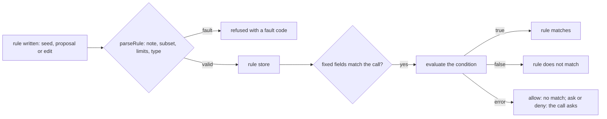

# CEL conditions on rules

- **Status:** draft
- **Work items:** [the rest of the rules design](https://linear.app/zgeoff/issue/GEO-2785)
- **Decision records:** [0004](../../decisions/0004-rule-engine.md)

A rule's fixed fields can't say "only before 17:00 in London" or "only when every attachment is a
PDF". A rule already carries a `cel` field for such a condition, but nixie never evaluates it: an
allow with a condition never matches, and an ask or a deny matches on its other fields alone. This
design makes nixie evaluate the condition with `@marcbachmann/cel-js`, inside a subset of CEL that
nixie checks when the rule is written and tests with its own conformance suite. Every rule with a
condition carries a note in your words, and shows to you as a card that phrases the condition in
plain words, never as raw CEL alone.

## Shape



## Contracts

### The rule

```yaml
# rules/school.yaml in the definitions repo
allow-term-mail-in-hours:
  outcome: allow
  tools: [mail.send]
  destinations: ['*@school.example']
  cel: now.getHours("Europe/London") < 17 && args.subject.startsWith("Term")
  note: School mail about the term can go out during the working day.
```

- `cel` keeps its place in the rule format, with no change to the stored rule JSON or the snapshot
  hash's canonical form.
- The parser refuses a rule that holds `cel` without `note`, with the fault
  `condition_note_missing`.
- The condition is one more test after the fixed fields: a rule matches a call when every fixed
  field matches and then the condition is true.

### What a condition reads

```ts
// policy module. Built from RuleCall for each evaluation; nothing else is in scope.
interface ConditionInput {
  tool: string; // with its variant, such as 'task.start/atc'
  effects: string[];
  context: string; // 'conversation' | 'task' | 'coding'
  definition: string; // the task definition ID, or '' outside a task run
  args: Record<string, unknown>; // the tool input, less every argument the tool declares as content
  destinations: string[]; // the declared destination strings, as `destinations` matches them
  sources: string[];
  now: Date; // RuleCall.at, so a replay agrees
}
```

The environment declares each name with its CEL type: `args` is `map<string, dyn>`, `now` is
`google.protobuf.Timestamp`, the lists are `list<string>`, and the rest are `string`.

- `args` converts JSON as follows: an integral number becomes a CEL `int`, any other number a
  `double`, and every string is in Unicode NFC. String literals in the condition normalise to NFC
  when the rule is parsed, as the fixed checks do.
- A number in `args` compares with an `int` or a `double` literal alike, because its type is `dyn`:
  `args.amount < 100` is true for `99.5`. Two literals of different number types, such as
  `1 == 1.0`, fail the type check.
- `RuleCall` gains `contentArgs`, the top-level argument names that the tool's declaration lists in
  `content`, filled where `buildRuleCall` builds the call, so the condition input can leave them
  out. The fixed `checks` read `args` as today.
- A condition never reads memory, secrets, the vault, contacts, budgets or spend, the conversation,
  the task's history or another call's result, because `RuleCall` holds none of them.
- A condition never reads a place or its trust level. A rule about a place uses `destinations` or
  [the trusted places](https://github.com/zgeoff/nixie/pull/1410) directory, and a condition sees
  only the declared destination strings.
- A content argument, such as a mail body or a memory item's text, is left out of `args`, so a
  condition that reads one errors with `no_such_key` and fails closed. Whether any rule may read
  content is [open](#open-questions).
- A timestamp method takes a zone name as a string literal. nixie's walk refuses a method with no
  zone, or with a zone that the runtime's zone data doesn't hold, with `condition_not_allowed`. As
  in CEL, `getMonth` counts from 0 for January and `getDayOfWeek` from 0 for Sunday; `getDate`
  counts the day of the month from 1. The card's words name the month and the day, so you never read
  the counts.

### The subset

The library supports most of CEL. A rule may use only this subset, and the conformance suite covers
each row of it:

| Kind              | Allowed                                                                                                 |
| ----------------- | ------------------------------------------------------------------------------------------------------- |
| Literals          | `bool`, `int`, `double`, `string`, and a list of them; a negative number                                |
| Access            | the variables above, `.field` and `[index]`                                                             |
| Operators         | `==` `!=` `<` `<=` `>` `>=`, `&&` `\|\|` `!`, `in`                                                      |
| Functions         | `size`, `has`, and on a string `startsWith`, `endsWith`, `contains`, `lowerAscii`                       |
| Macros            | `exists` and `all` on a list, never one inside another                                                  |
| Timestamp methods | `getHours`, `getMinutes`, `getDayOfWeek`, `getDate`, `getMonth`, `getFullYear`, each with a zone string |

Everything else is refused with the fault `condition_not_allowed`, which names the construct:
arithmetic, `?:`, map literals, `matches`, `bytes` and its methods, `map`, `filter`, `exists_one`,
`cel.bind`, conversions such as `int()`, `timestamp()` and `duration()`, optional types and every
other built-in. `matches` is out because the library runs it on a JavaScript regular expression,
which can backtrack for seconds.

### Checking a condition

```ts
const checked = checkCondition(rule); // reads the rule's cel and note
// → { ok: true, view: { kind: 'all', parts: [ … ] } }
//   or { ok: false, fault: 'condition_not_allowed', detail: 'matches' }
```

```ts
// policy module. Every path that accepts a rule with `cel` calls it: the rules-file parser and
// rules.editProposedRule.
type ConditionCheck =
  | { ok: true; view: ConditionView }
  | { ok: false; fault: ConditionFault; detail: string }; // detail: the construct or the type error

type ConditionFault =
  | 'condition_syntax' // the library's parse fails
  | 'condition_too_large' // over a limit in Constraints
  | 'condition_not_allowed' // outside the subset
  | 'condition_type' // the library's check fails, or the result type is not bool
  | 'condition_note_missing'; // cel with no note
```

`checkCondition` runs in this order, and stops at the first fault:

1. The note, then the length limit on the raw text.
2. The library's parse, with the node and depth limits set on the environment.
3. nixie's own walk over the parsed tree, which refuses each construct outside the subset. The
   library can't drop a built-in from an environment, so the walk is the only gate.
4. The library's type check against the declared variables, with undeclared variables refused. A
   result of type `dyn` is refused too, so `args.flag` fails and `args.flag == true` passes.
5. Building the structured view.

- In the rules-file parser, a fault is a problem of the rule's file, with the fault code and the
  detail as its reason, and it refuses the seed as any rule fault does.
- A read of the rule store never runs the check. The first evaluation of each condition text runs
  steps 1 to 4 and caches the result, and a stored condition that fails them, such as one written
  before this design, evaluates as an error with the code `condition_invalid`.
- Evaluation, the card's new sentence and the check on every write path ship in one release, so no
  release shows a condition as working while `isRuleMatch` still skips it.

### Evaluating a condition

```ts
const result = evaluateCondition(rule, call);
// → { kind: 'true' } | { kind: 'false' } | { kind: 'error', code: 'no_such_key' }
```

```ts
// policy module. Called by isRuleMatch only after every fixed field matched.
// code: the library's error code, such as no_such_key or no_such_overload, or nixie's own:
// input_too_large or condition_invalid.
type ConditionResult = { kind: 'true' } | { kind: 'false' } | { kind: 'error'; code: string };
```

```ts
// log module: the decision record. …existing fields
type Decision = {
  // every rule whose condition errored on this call, whatever its outcome
  conditionErrors?: { ruleID: string; revision: number; code: string }[];
  cause?: /* …existing causes */ 'condition_error';
};
```

| The rule | `true`          | `false`          | `error`                                         |
| -------- | --------------- | ---------------- | ----------------------------------------------- |
| allow    | covers the call | doesn't cover it | doesn't cover it                                |
| ask      | catches it      | doesn't catch it | catches it                                      |
| deny     | catches it      | doesn't catch it | the call asks, with the cause `condition_error` |

- A deny whose condition errors makes the call ask, so a broken condition never refuses a call that
  you can't see. The decision point's deny stage sets such a deny aside when no other deny matches,
  and its ask-rule stage counts it as an ask rule with the cause `condition_error`. A deny that
  matches wins over one that errored.
- A call that leaves out an argument a deny's condition reads errors with `no_such_key`, so it asks
  where the deny meant to refuse. To refuse such a call, write the condition so a missing argument
  gives true, such as `!has(args.to) || …`.
- The approval card for a call that asks with `condition_error`, or through an ask rule whose
  condition errored, names each rule in `conditionErrors` with its code.
- The record holds the error code and never the library's message, which can quote argument text.
- The lift check and the destination permissions read allow rules through `isRuleMatch`, so they
  evaluate a condition the same way. A caller that matches rules against a call it built itself,
  such as the memory gate's `listUncoveredMemoryWrites`, counts every condition as an error.
- An error inside one side of `&&` or `||` that the other side settles is no error, as CEL defines:
  `false && args.missing == 1` is `false`.

### The structured view and the card

```ts
// policy module. Built from the parsed tree when the rule is checked; the card renders it.
// The library's tree changes shape between major versions, so nothing outside the policy module
// reads it.
type ConditionView =
  | { kind: 'all' | 'any'; parts: ConditionView[] } // && and ||, flattened
  | { kind: 'not'; part: ConditionView }
  | { kind: 'compare'; subject: Subject; op: '==' | '!=' | '<' | '<=' | '>' | '>='; value: Literal }
  | { kind: 'in'; subject: Subject; values: Literal[] }
  | { kind: 'text'; subject: Subject; op: 'startsWith' | 'endsWith' | 'contains'; value: string }
  | { kind: 'size'; subject: Subject; op: '==' | '!=' | '<' | '<=' | '>' | '>='; value: number }
  | { kind: 'present'; subject: Subject } // has()
  | { kind: 'each' | 'some'; list: Subject; part: ConditionView } // all and exists
  | { kind: 'code'; source: string }; // any part with no phrase, shown as code

type Subject =
  // args.to.address → name 'args', path ['to', 'address']
  | { kind: 'variable'; name: string; path: string[] }
  | { kind: 'time'; part: 'hour' | 'minute' | 'weekday' | 'day' | 'month' | 'year'; zone: string }
  | { kind: 'item' } // the element inside each or some
  | { kind: 'code'; source: string };
type Literal = string | number | boolean | Literal[];
```

```ts
// libs/contract. Every schema that carries a rule's sentence gains `condition`: the rule in force
// (ruleInForceSchema), the rule versions in a proposal, the approval card's rule and the rule notice.
type RuleCondition = {
  note: string;
  // 'nixie' when the rule in force is a runtime change whose changed_by is nixie; no path makes one
  // with a condition yet, and a mandate would if its open question allows conditions
  noteBy: 'you' | 'nixie';
  words: string; // the view as one sentence: "the hour in Europe/London is before 17, and …"
  source: string; // the raw CEL
};
// rule: { …existing fields, condition?: RuleCondition }
```

A card for a rule with a condition shows, in this order:

1. The rule's sentence, which ends "when its condition holds" in place of today's fail-closed
   wording.
2. The note, labelled by who wrote it: "Your note" or "nixie's note".
3. The condition in words, built from the view. A `code` part shows inline as code.
4. The raw CEL, behind a "Show the expression" control.

The approval card, the rule notice after an answer, the mandates page, the `rules.list` tool and
`nixie rules list` all show these parts. The host renders the words, so every client shows the same
sentence.

### How a rule with a condition arrives

| Path                                           | With a condition                                                  |
| ---------------------------------------------- | ----------------------------------------------------------------- |
| a seed from the definitions repo               | applies at once; a fault refuses the seed, as any rule fault does |
| `buildProposedRule` and `buildAlwaysAllowRule` | never write one                                                   |
| `rules.editProposedRule`                       | accepted when `checkCondition` passes; the new card shows it      |
| `rules.propose_mandate`                        | refused until the [open question](#open-questions) is settled     |
| `rules.editRule` from the client               | keeps the condition as it is                                      |
| `rules.removeRule` from the client             | removes the rule with its condition                               |

- A seed's fault lists the rule's file with its `ConditionFault` code, and the definitions of the
  last accepted seed stay in force. A repo that already holds a rule with `cel` and no note fails
  its first seed after the release, and the release notes say so. The starter rules hold none.
- A proposal inside nixie that adds or changes a condition is a widening, so its card has the
  `always_ask` risk class, or `lifting` when the rule carries a lift, and the answer takes the
  passkey.

### The widening check

- An edit that adds, removes or changes a condition widens, as today.
- An edit that keeps the condition's canonical text and the outcome the same is classed by its other
  fields. With the same condition C, the match "A and C" lies inside "B and C" whenever A lies
  inside B, and an error in C acts the same on both sides. So `rules.editRule` can drop a
  destination from a rule with a condition, and the edit narrows.
- An edit that changes the outcome follows the outcome rules of today: an allow that becomes an ask
  or a deny narrows, and a test covers it for a rule with a condition.
- An edit to the note alone is unchanged, as today.

### The conformance suite

The suite is a table of cases in the policy module, each an expression, an input and the result that
the [CEL language definition](https://github.com/google/cel-spec/blob/master/doc/langdef.md) gives.
CI runs it with the unit tests. It holds:

- For each row of [the subset](#the-subset): a case that is true, one that is false, and one that
  errors, such as a missing key, an index out of range or a type mismatch on a `dyn` value.
- Error absorption: `&&` and `||` with the error on each side, settled and unsettled.
- `in` on a list and on the keys of `args`; `has` on a present and a missing key.
- String comparison by code point, and an NFC and an NFD form of the same text, which compare equal
  after normalisation.
- JSON numbers: an integral number and a fraction, each against an `int` and a `double` literal.
- Time: each timestamp method in `UTC` and in a zone on each side of a daylight-saving change, with
  the counts from 0 that `getMonth` and `getDayOfWeek` use.
- For each construct outside the subset: one case that `checkCondition` refuses with
  `condition_not_allowed`.
- For each limit: one case at the limit, which passes, and one over it, which fails.
- For each `ConditionView` kind: the words the card shows, and one part with no phrase, which shows
  as code.

Each case expects the language definition's result. Where the library departs from it, the case pins
the library's result with a comment that names the departure, so the suite also catches a bump that
changes it.

## Constraints

- A condition is at most 1,000 characters, 100 parsed nodes and 12 levels deep, with at most 50
  elements in a list literal and 3 arguments to a call.
- A condition evaluates only after every fixed field of its rule matched the call.
- The library evaluates synchronously, so no timer can stop it. The limits bound the work instead:
  one macro level, every list in the condition input at most 1,000 elements, and the strings in it
  at most 262,144 UTF-16 code units in total. A call whose input exceeds either bound makes every
  condition on it an error with the code `input_too_large`.
- A test in the unit lane evaluates the costliest condition the limits allow over the largest input
  they allow, and fails above 50 ms. That case takes about 4 ms on a desktop machine.
- nixie parses each condition once per rule hash and reuses the parsed form.
- The environment registers no function of its own and no async function.
- `@marcbachmann/cel-js` is pinned at an exact version in the root catalog, and only the policy
  module imports it, through the `zgeoff/import-zones` lint rule.
- A version bump of `@marcbachmann/cel-js` merges only with the conformance suite green on its head
  commit. Renovate never merges such a bump on its own.
- A replay evaluates each condition again with the library in force. The conformance suite is the
  guard that a bump keeps past verdicts.

## Decisions

- **CEL as a condition inside nixie's own rules.** Rule IDs, precedence, the widening check and the
  record stay nixie's own, as [0004](../../decisions/0004-rule-engine.md) requires.
- **`@marcbachmann/cel-js` 8.0.0.** It is MIT, has no dependencies, ships ESM with types, and has a
  parse step, a type check, structural limits, an error code on each error, and timestamp methods
  that take a zone and read a JavaScript `Date`. Its project runs no cel-spec conformance suite, so
  nixie keeps its own.
- **A required note, and words built from the condition.** The note says what you meant, and the
  words say what the rule checks. A card shows both, so a wrong note shows beside the condition it
  describes.
- **An error never grants access, and never refuses a call unseen.** An allow stops covering, and an
  ask or a deny asks.
- **The snapshot holds no library version.** The conformance suite gates each bump instead, so the
  snapshot hash changes only with the definitions.

## Builder decides

- The names of the internal functions, and the file layout in the policy module.
- How the walk over the parsed tree is written, and how the view's words read, within the card order
  above.
- The JSON-number conversion's handling of a number beyond 2^53, provided a conformance case pins
  it.
- The wording of each fault's detail and of the "Show the expression" control.

## Out of scope

- A condition field in the web client's rule form. A condition comes from the definitions repo, or
  stays as it is through an edit in the client.
- A widening check that reads CEL. Any change to a condition widens.
- Custom functions, such as a lookup of a contact or a place.

## Open questions

- **May a condition read a tool call's content arguments?** The owner settles it in
  [the content question](https://linear.app/zgeoff/issue/GEO-2840). The recommendation is no, for
  every rule, so outside text never steers a rule. Until then, `args` leaves content out.
- **May a mandate that nixie proposes carry a condition?** The owner settles it in
  [the mandate question](https://linear.app/zgeoff/issue/GEO-2841). The recommendation is yes, when
  the card phrases every part in words. Until then, `rules.propose_mandate` refuses `cel`.
