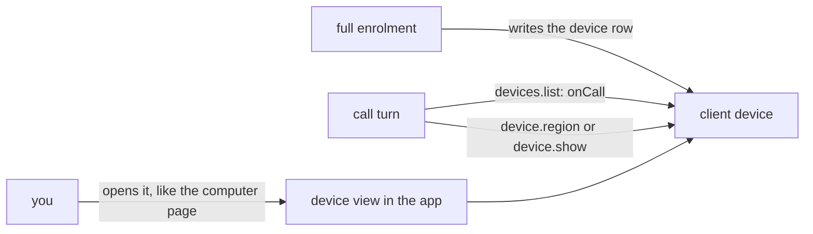

# Client devices

- **Status:** agreed
- **Work items:** [client devices](https://linear.app/zgeoff/issue/GEO-2872), after
  [the call screen](https://linear.app/zgeoff/issue/GEO-2863)

Every client you sign in is a device, so the assistant can show something on the screen you're
using. A client is one signed-in browser or app and its session, so ten tabs of one browser are one
device. On a call, the assistant keeps its spoken reply short and puts a long answer, such as this
week's plans, on the call's device, then says "I've put that on your screen". You open the device
view from the app's navigation and go back to the call, which stays live the whole time.

A real GPT-Live session summarised or cut short a 2,400-character answer in 3 of 3 tries, and short
answers worked every time. The server needs no new call machinery for this: the call's turn already
gets the conversation's tools, the device tools among them. Build it from this doc, the
[devices architecture](../../architecture/channels/devices.md) and the
[calls architecture](../../architecture/channels/calls.md).

## Shape



## Contracts

```ts
// api module, enrolment. A full enrolment now writes the session's device row in the same write
// transaction, as a device enrolment does, named with the session's deviceName.
await sessions.enrol({
  clientActionID,
  code,
  deviceName: 'Kitchen laptop',
  tokenDelivery: 'cookie',
});
// → { scope: 'full', sessionID: '9c1e…' }
//   and a devices row { shortID: 'd4k2', deviceKind: 'client', screen: true }
```

```ts
// devices module. devices.list gains two fields per device.
interface DeviceListEntry {
  // …existing fields
  deviceKind: 'client' | 'screen'; // client: a full session's own device; screen: enrolled with a device code
  onCall: boolean; // true only while this device's session carries a call in the live state
}

// devices module. The server wires it from the calls module, so neither module imports the other.
type ReadCallSession = () => Promise<string | null>; // the carrying session's identity ID, or null
```

```text
call turn's prompt (calls module), one added rule. The speech layer's own prompt stays as it is.
  Keep a spoken reply to about 3 sentences. When the answer is longer, such as a list or a plan,
  put it on a device with the device tools, then say where it is. The call's device is the one
  devices.list marks onCall. Showing anything is your choice each time.
```

```tsx
// web client. The call lives above the router, so a route change never ends it.
<CallProvider>
  {/* holds the peer connection, the microphone and the call's live stream */}
  <CallBar />
  {/* on every route while a call is live: time, mute, hang up, back to the call */}
  <Router />
  {/* the call screen, the chat and the device view are routes under it */}
</CallProvider>
```

## Constraints

- Every full session holds one device row, of `deviceKind` `client`, from enrolment until its
  sign-out or revoke, which removes the row. This holds for cookie and bearer sessions alike, so the
  phone app is a device too.
- A migration gives each existing full session with no row a client row, named with its
  `deviceName`, with the screen on. A row that `devices.register` wrote becomes a client row and
  keeps its name and screen.
- `devices.register` renames the session's row and leaves its screen as it is.
- A client device starts with the screen on, so the assistant may draw on it; you see what it drew
  only when you open the device view. A screen device keeps the existing rule: its screen stays off
  until the device switches it on.
- The web client follows its own device's stream while any tab is open, so the device is online
  whenever nixie is open. The device view draws what the stream holds.
- The device view is its own page, which you open from the app's navigation, as you open the
  computer page. This build adds no pop-up, badge or notice when the device's content changes.
- During a call, the call bar's back button returns from the device view to the call screen.
- `onCall` is true for the device whose session is the call's carrying session while the call is
  `live`, and false for every other device.
- No tool takes "the call's device" as a target. The assistant passes the device's short ID from
  `devices.list`.
- The device view shows the client's own device at the size of the page's content area, and reports
  that size through `devices.resize`.
- Opening the device view, the chat or the call screen during a call keeps the call's audio, its
  microphone grant and its live stream. Only a hang-up, a call end or a sign-out ends the call.
- On a full session's browser, `/device` shows that client's own device full screen. On a browser
  with no session, it keeps the enrolment form for a screen device.
- A full session follows its device stream and its conversation stream on one session.

## Builder decides

- Where the device view sits in the app's navigation, and its icon.
- The call bar's layout.
- The migration's number and the tests.

## Out of scope

- The call screen's own layout: [the call screen](https://linear.app/zgeoff/issue/GEO-2863).
- Moving a live call to another session, ringing a device, and voice tuning.
- A camera or a microphone on a client device.
- Ending a client device that went unused; a sign-out or a revoke ends it.
- Showing the device view or the computer beside the chat, and any cue that new content is waiting.
  Later UI work can add both, because the device view reads only the device's stream.
