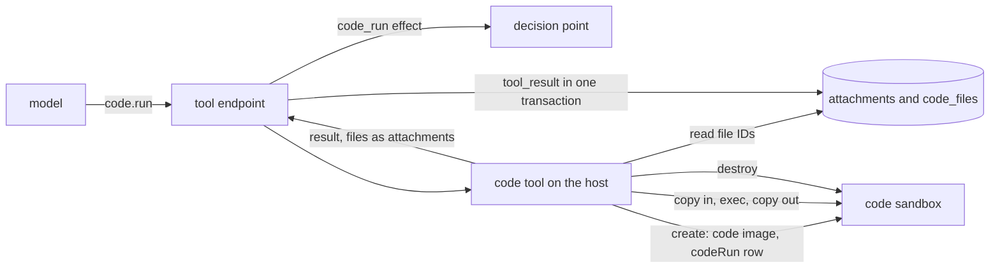

# The code tool

- **Status:** draft
- **Work items:** [the code tool](https://linear.app/zgeoff/issue/GEO-1841)

`code.run` runs a short program, such as a calculation, a file conversion or a chart, and returns
its output and the files it wrote. Any task can call it, the conversation included, and so can a
worker, as the [glossary](../../glossary.md) defines each. Every code run gets a fresh sandbox from
the code image. The sandbox has no network, no grant (a credential the sandbox runtime adds to
requests) and no tool route (the guest's way back to nixie's tools), as
[sandboxes](../../architecture/connectors/sandboxes.md#kinds-of-work) describes. nixie destroys the
sandbox when the tool call returns.

nixie seals the files a code run writes under the key of the tool call's result record, as
[erasable fields](../../architecture/core/erasable-fields.md#keys) describes for attachments. When
nixie forgets the record, it deletes that key, as
[forgetting a record](../../architecture/core/erasable-fields.md#forgetting-a-record) describes, so
the files become unreadable along with the record's text. The rest of this doc calls that a forget.
A later code run reads a file by its short file ID.

A file lasts as long as its thread, the line of records that one task writes. A stored web page
lasts one session, the model's context on that thread, which a compaction or a forget replaces. So a
file ID works only on its own thread, and a page ID only in its own session.

This design changes the code tool section of the
[coding design](../platform/connectors/coding.md#the-code-tool), and adds the `code` key to
[the image set](sandbox-image-set.md) and the `codeRun` row to [the size table](sandbox-sizes.md).

## Shape



## Contracts

### The call

```ts
code.run({
  language: 'python',
  program: "import pandas as pd\ndf = pd.read_csv('orders.csv')\n…\nplt.savefig('out/totals.png')",
  files: [{ path: 'orders.csv', file: 'f8k2m4q9za' }],
  skills: ['pdf-forms'],
});
// → {
//     exitCode: 0,
//     stdout: { text: 'north 412.50\nsouth 380.00\n', bytes: 28, isCut: false, file: null },
//     stderr: { text: '', bytes: 0, isCut: false, file: null },
//     files: [{ file: 'p3n8x2c7ke', path: 'out/totals.png', bytes: 48213,
//               mediaType: 'image/png', isShown: true }],
//     limit: null,
//     seconds: 2.4,
//   }
// A limit the program reached still returns its result:
//   { exitCode: null, …, limit: { kind: 'wall_time',
//     sentence: 'The program ran past its limit of 60 s, so nixie stopped it.' } }
// A refusal before the program starts is a tool error, such as:
//   'No file f8k2m4q9za belongs to this thread.'
```

```ts
// connectors module. The input schema is strict.
interface CodeRunInput {
  language: 'python' | 'javascript' | 'typescript' | 'bash';
  program: string; // 1 to 100,000 characters
  files?: CodeRunFileInput[]; // at most 50, each path once
  skills?: string[]; // at most 10 distinct names, each one that the caller's task pinned
}

type CodeRunFileInput =
  | { path: string; file: string } // a file an earlier code run on this thread wrote
  | { path: string; page: string }; // a stored web page of this session, its text as stored

// path: relative to the work folder, 1 to 200 characters of [A-Za-z0-9._/-], with no segment
// that is empty, '.' or '..', and never under 'out/'.

interface CodeRunResult {
  exitCode: number | null; // null when the program ended on a signal
  stdout: CodeRunStream;
  stderr: CodeRunStream;
  files: CodeRunFile[]; // the files under out/, in path order; empty on a 'files' limit
  limit: CodeRunLimitHit | null;
  seconds: number; // the program's own time, 1 decimal place
}

interface CodeRunStream {
  text: string; // the first 32 KiB, decoded as UTF-8 with replacement
  bytes: number; // every byte the program wrote to the stream
  isCut: boolean; // the stream passed 1 MiB, and nixie kept the first 1 MiB
  file: string | null; // when bytes passes 32 KiB: the file ID of the kept stream
}

interface CodeRunFile {
  file: string; // a short ID from createShortID
  path: string; // relative to the work folder, such as 'out/totals.png'
  bytes: number;
  mediaType: string;
  isShown: boolean; // the model received the file as an image beside this result
}

interface CodeRunLimitHit {
  kind: 'wall_time' | 'memory' | 'output' | 'files';
  sentence: string; // from the table in Constraints
}
```

```ts
// connectors module, the tool definition
// EffectDeclaration: policy module. The decision point matches rules on its effects, as
// ../platform/policy/decision-point.md#effects sets out.
const codeRunDeclaration: EffectDeclaration = {
  effects: ['code_run'],
  destinations: [],
  amount: null,
  content: ['program'],
  results: {
    exitCode: 'untrusted',
    stdout: 'untrusted',
    stderr: 'untrusted',
    files: 'untrusted',
    limit: 'untrusted',
    seconds: 'untrusted',
  },
};
// execution: 'direct'. A code run reaches nothing outside nixie, so a rerun repeats nothing.
```

### The limits

```ts
// connectors module. Constants, with no config key and no definition key.
export const codeRunLimits = {
  wallTimeMs: 60_000, // the program, from its start to its exit
  callMs: 120_000, // the whole call: create, copy in, the program, copy out, destroy
  streamBytes: 1024 * 1024, // per stream, the current exec cap
  shownStreamBytes: 32 * 1024, // per stream, in the result's text
  inputBytes: 64 * 1024 * 1024, // the program, every input file and every skill file
  outputFiles: 50,
  outputBytes: 20 * 1024 * 1024, // every file under out/
  shownImages: 4,
  runsAtOnce: 2, // in one server process
} as const;
```

```ts
// sandbox module, a new row in the current size table
export const sandboxSizes = {
  // …existing rows
  codeRun: { vcpus: 1, memoryMiB: 512, diskMiB: 4096 },
} as const satisfies Readonly<Record<string, SandboxLimits>>;
```

### The files

```text
code_files: one row per file a code run wrote, written in the transaction of its tool_result
  file_id      text primary key   -- the short ID the model reads and passes
  thread       text not null      -- the result record's thread
  sequence     integer not null   -- references records (sequence): the tool_result record
  position     integer not null   -- the attachment's position on that record
  bytes        integer not null
  media_type   text not null
-- No path and no other free text: the path sits in the result's erasable fields.
```

```ts
// tools module, current types extended
interface DirectResult extends TypedResult {
  // …existing fields
  // Sealed under the result record's key, in order, as record attachments.
  readonly attachments?: readonly Uint8Array<ArrayBuffer>[];
  // Runs inside the result record's write transaction, with that record's sequence.
  readonly writeBeside?: (tx: WriteTransaction, resultSequence: number) => Promise<void>;
}
```

### The image

```ts
// sandbox module, the current tuple and records
export const sandboxImageKeys = ['conversation', 'fetch', 'code'] as const;
// sandboxImageRecords.code: { repository: 'nixie-code', dockerfile: <beside the other guests> }

// The server part that registers code.run declares its image, as the image set's PartDeclaration
// shows. Every deployment needs the code image.
images: () => ['code'],
```

The code image is Python 3.13 on a slim Debian base, about 690 MB on disk, with:

| Group        | Holds                                                                                   |
| ------------ | --------------------------------------------------------------------------------------- |
| Python       | numpy, pandas, scipy, duckdb, matplotlib with Pillow, openpyxl, pdfplumber, python-docx |
| JavaScript   | Bun, for `javascript` and `typescript`                                                  |
| Command line | bash, sqlite, jq, ripgrep, git, and the common file and text tools                      |

The image holds no package installer, no ffmpeg, no polars and no ImageMagick. The build pins every
version, and a non-root user `code` runs the program.

### What the model reads

The tool's description holds these facts, because the model sees only the name, the description and
the input schema:

- The program has no network, no credentials and no route to nixie's tools. It gets outside data
  only through a file input.
- What the image holds, from the table above, and that nothing can be installed.
- pandas reads a CSV of up to about 90 MB in the 512 MiB of memory. For a larger CSV, the program
  uses duckdb, which spills to disk.
- Each limit, with its figure.
- The program writes the files it returns under `out/`, and reads its inputs at their paths in the
  work folder, and each skill at `/skills/<name>/`.

## Constraints

### The sandbox

- Each code run creates a sandbox of its own, of kind `code_run`, from the code image at the
  `codeRun` row, with egress `none`, no grant and no tool route. A code run never runs in the
  caller's sandbox.
- The sandbox's owner is `code_run:<callID>`. At each server start, nixie destroys every sandbox
  whose owner is not the conversation, a memory task or an open started task, so a code sandbox that
  a crash left goes at the next start.
- nixie destroys the sandbox on every way out of the call, a refusal after nixie created the sandbox
  and a thrown error included. The sandbox holds unencrypted copies of the inputs and outputs, so
  nixie tries a failed destroy again every 60 s until it succeeds, and the sandbox counts towards
  `runsAtOnce` until then.
- The program runs as the user `code`, in the work folder `/work`. Each input file lands at
  `/work/<path>`, the program at a path outside `/work`, and each skill folder at `/skills/<name>/`,
  owned by root and read-only to `code`.
- `language` picks the command: `python3` for `python`, `bun` for `javascript` and `typescript`,
  `bash` for `bash`.
- When `runsAtOnce` code runs are in progress, a call creates nothing and gets the error "2 code
  runs are in progress, which is the most at once. Call again when one has returned."

### The limits

nixie applies every limit the program reaches, and `limit` holds the first one in table order. A
program that passes 1 MiB of output and writes 60 files gets `output` as its `limit`, and no files.

| `kind`      | When                                                  | Sentence                                                                                                             |
| ----------- | ----------------------------------------------------- | -------------------------------------------------------------------------------------------------------------------- |
| `wall_time` | the program runs 60 s; nixie stops it                 | The program ran past its limit of 60 s, so nixie stopped it.                                                         |
| `memory`    | the guest's memory-kill count rose during the program | The program ran out of its 512 MiB of memory. For a large CSV, read it with duckdb.                                  |
| `output`    | a stream passed 1 MiB                                 | The program wrote more than 1 MiB to {stream}, and nixie kept the first 1 MiB.                                       |
| `files`     | out/ holds more than 50 files or more than 20 MiB     | The program wrote {count} files of {size} under out/, past the limit of 50 files and 20 MiB, so nixie returned none. |

- nixie reads the guest's count of memory kills through `readMemoryKills` from
  [the memory-kill signal](memory-kill-signal.md), before and after the program. When the count
  cannot be read, a program that ended on a `SIGKILL` that nixie did not send gets the `memory`
  limit.
- A maintainer never raises the `codeRun` row after a code run's memory kill, because the program
  chose how much memory to use. For every other row, [the size table](sandbox-sizes.md) has a
  maintainer raise the row in a release after a memory kill.
- The whole call ends within `callMs`. Past it, nixie destroys the sandbox, and the call returns the
  tool error "The code run took more than 120 s, so nixie stopped it." The model runtime's own wait
  for a tool call follows [the tool-call wait](tool-call-wait.md).

### The refusals

Each refusal is a tool error before the program starts:

- A `file` with no `code_files` row, or whose row holds another thread: "No file {file} belongs to
  this thread."
- A `file` whose result record a forget made unreadable: "The file {file} was forgotten."
- A `page` that the page store does not hold for the call's session, or a call with no session, such
  as a worker's: "No page {page} is stored in this session." The model then fetches the page again.
  Pages last one session, as
  [pages and parts](../../architecture/connectors/web-fetch.md#pages-and-parts) describes.
- A skill that the calling task has not pinned: "No skill {name} is on your skill list." The
  conversation is a task too, so this holds for it, and a worker's call checks its caller's task.
- Inputs past `inputBytes`: "The inputs come to {size}, past the limit of 64 MiB."
- A sandbox that fails to start: "nixie could not start the code sandbox. A second call starts a new
  one."

### The files

- After the program ends, nixie lists `/work/out/`, and copies nothing out when the list passes
  either `files` limit.
- When a stream passes 32 KiB, nixie keeps the stream, up to 1 MiB, as a file with the path
  `.stdout` or `.stderr`. The two stream files count toward neither `files` limit.
- Each file the result returns is one attachment of the `tool_result` record and one `code_files`
  row, written in the same transaction. A file's bytes never sit in the record's plain payload or in
  its encrypted text fields.
- A file ID resolves only on its own thread. A worker's tool calls write their records on the
  caller's thread, so the caller reads the files of its worker's code runs.
- `mediaType` comes from the file's bytes for PNG, JPEG, GIF and WebP, else from its extension, else
  `application/octet-stream`.
- Up to 4 image files reach the model beside the result, each scaled as
  [web fetch images](../../architecture/connectors/web-fetch-images.md) are. Each one counts against
  the session's image caps through the session's `reserveImages`. When the call has no session, or
  the session refuses an image, the file's `isShown` is false.
- The result record holds each skill's name and content hash, and the sandbox ID, beside the result.
  The model never receives these fields.
- When the call has a session, the transaction that writes the result first checks that no forget
  ended the session, as the web fetch's page write does. When one did, nixie writes no attachment
  and no `code_files` row, and the call returns the tool error "A forget ended this session during
  the code run, so nixie kept nothing from it."
- A forget of the `tool_result` record makes its files unreadable with its text. The `code_files`
  row stays, and the next use of its ID gets the "forgotten" refusal.
- Each code run can add up to 22 MiB to `nixie.db` and to each backup: 20 MiB of files and two
  stream files of 1 MiB.

### The image and the release

- The `code` key follows every rule of [the image set](sandbox-image-set.md): its record, the
  `code_run` part's `images`, a release job, an Images build step and a public registry package.
- The `codeRun` row follows [the size table](sandbox-sizes.md). Its 512 MiB covers the highest peak
  that the owner measured on a probe of the image: 278 MiB, for pandas reading a 55 MB CSV.

### A rollback

The release a rollback returns to lacks the code tool. What that release does with each thing this
design adds:

| Added                                                 | The release before                                                                                                                                   |
| ----------------------------------------------------- | ---------------------------------------------------------------------------------------------------------------------------------------------------- |
| the `code_files` migration                            | runs on the newer schema, because the migration only adds a table, and never reads that table                                                        |
| attachments of a `tool_result`                        | never reads them; a forget of the record still deletes the key that seals them                                                                       |
| `tool_called` and `tool_result` records of `code.run` | reads them as it reads any tool record                                                                                                               |
| `sandbox.created` of kind `code_run`                  | reads it, because the kind `code_run` exists before this design; nixie destroys the sandbox at start                                                 |
| the `code` image key and the `codeRun` row            | never meets them: each release's nixie image holds its own manifest, and a size is a constant                                                        |
| a started task with `code.run` on its tool list       | keeps the list, and refuses each call of `code.run` as a tool it does not have                                                                       |
| a task definition that lists `code.run`               | refuses the whole seed, as [the task definition format](task-definition-format.md#what-a-seed-refuses) sets out, and keeps the seed it last accepted |

When the release before must take new seeds, the operator takes `code.run` out of each task
definition in the definitions repo before the rollback.

## Decisions

- **A code run from a worker gets a fresh code sandbox, as from any other caller.** An agent's call
  on 13 Nov 2026, from the owner's answer on the code image and its 512 MiB: the owner sized one
  image for one code run, a worker keeps the conversation image with no Python, and the program
  never runs beside the worker's model credential or its context.
- **A code run's files are attachments of its result record.** A forget of that one record then
  makes its files unreadable in every copy, backups included, with no store of its own to clean.
- **A code run's limits are constants, with no key in a task definition.** An agent's call on 13 Nov
  2026: [the size table](sandbox-sizes.md) holds every size as a constant, and a new `task.yaml` key
  would make every older release refuse the whole seed.
- **A file ID resolves only on its own thread.** An agent's call on 13 Nov 2026: the smallest scope
  that serves a task and its workers.
- **Input files are earlier code runs' files and stored web pages.** An agent's call on 13 Nov 2026:
  nixie holds no other bytes under an ID that lasts. An image in a message carries a marker ID that
  changes on each render, so it is not an input.
- **The result shows 32 KiB of each stream and keeps up to 1 MiB as a file.** An agent's call on 13
  Nov 2026: 1 MiB of text in one result would fill most of a model's context, and the kept file lets
  the next code run read the rest.
- **At most 2 code runs at once, and a third is refused.** An agent's call on 13 Nov 2026: each code
  run holds 512 MiB of host memory, and a refusal is easier to reason about than a queue inside a
  tool call.
- **Every deployment pulls the code image, with no config switch.** An agent's call on 13 Nov 2026:
  a switch would save a deployment the 690 MB image, but it is a config key that a rollback must
  remove first.

## Builder decides

- The name and place of the code image's Dockerfile, beside the other guest images.
- How nixie sets the skill folders read-only and runs the program as `code`.
- The extension table for `mediaType`, and how nixie lists `out/`.
- Test names and layout, and the wording of the tool's description.

## Out of scope

- A way for the files a code run writes to reach the person nixie works for. The files reach only
  the model, and the question stays open in
  [the code tool](https://linear.app/zgeoff/issue/GEO-1841).
- An image in a message as an input. It waits for a marker ID that lasts, an open question in
  [the code tool](https://linear.app/zgeoff/issue/GEO-1841).
- Network access, a package installer, and an image or size per caller.
- Coding sessions, which the [coding design](../platform/connectors/coding.md#the-coding-adapter)
  covers.
