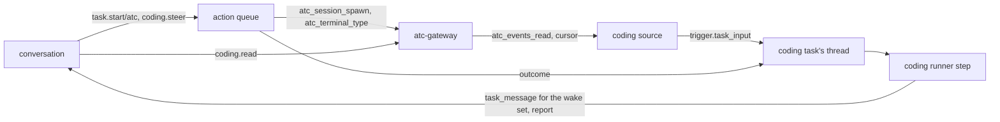

# The coding session runner

- **Status:** agreed
- **Work items:** [the atc runner](https://linear.app/zgeoff/issue/GEO-1843),
  [supervised sessions in the live view](https://linear.app/zgeoff/issue/GEO-311)

You ask nixie for a coding session, such as "fix the flaky login test in the shop repo", and nixie
starts it in atc, a separate program that runs coding agents, once your policy rules allow it. Or
you point nixie at a session you already run in atc, and nixie joins it. Either way the session
shows as a task in nixie. nixie steers the session by typing into its input, so each steer is a user
turn of the session, as a line you type is. nixie reads the session's state and last reply when it
needs them, and only the session events that nixie picked wake it. This design adds the coding
runner, which runs such a task, with its tools and its first adapter: the package `coding-atc`,
whose adapter ID is `atc`.

Once the owner approves this design, build
[the atc runner](https://linear.app/zgeoff/issue/GEO-1843) from it and its three parts.

The coding runner calls no model of its own, and judges nothing about the session's work. Each step
of a coding task moves text and events between the task and the session. nixie's conversation reads
what the step forwards, and decides whether the session is done, waits on you, or needs a steer. The
runner plugs into the [task runner port](../../../architecture/core/tasks.md), and this design adds
members to the port's types. This design also rewrites the coding adapter section of the
[coding design](../../platform/connectors/coding.md).

These sibling designs touch this one:

- The [code tool](../../../architecture/connectors/code-tool.md) owns the code tool section of the
  coding design.
- The [MCP proxy build](../mcp-proxy-build.md) leaves atc out: the proxy carries none of atc's
  tools, because this runner calls atc-gateway directly.
- The [decision point cutover](../decision-point-cutover.md) builds the policy stages that decide
  each start of a coding session and each line typed into one.

## Terms

| Term           | Meaning                                                                                                                                                           |
| -------------- | ----------------------------------------------------------------------------------------------------------------------------------------------------------------- |
| atc            | a separate program that runs coding sessions on targets, such as a cloud VM, under its own rules; each machine runs one atc daemon                                |
| atc-gateway    | atc's MCP server for several daemons at once, which routes each tool call to one daemon; nixie calls atc only through it                                          |
| service client | a caller of atc-gateway with a static token and no browser sign-in; nixie is the service client `service:nixie`                                                   |
| principal      | a named caller that a daemon's config lists, with the targets it may use; a service client is the principal `service:<name>`                                      |
| target         | one place that a daemon runs sessions, named by the daemon and the daemon's target ID, such as `cloud` on the daemon `cloud`                                      |
| reach          | the sessions a principal can see: every session on its targets, those nixie never started included                                                                |
| event trail    | atc's stored list of what each session did, which a caller reads from a cursor                                                                                    |
| coding task    | a task whose runner is a coding runner                                                                                                                            |
| adapter        | a package that reaches one outside system for an interface that nixie owns; the coding runner calls its adapter for every atc call                                |
| turn           | one reply cycle of the coding agent inside the session, from a user input to the agent's reply                                                                    |
| steer          | a line nixie types into the session's input, which the agent takes as a user turn                                                                                 |
| note           | a message that atc's bridge hands the agent beside its conversation; the agent can answer it, and a note never steers                                             |
| wake set       | the session events that wake nixie's conversation; every other event lands on the coding task only                                                                |
| bound session  | the session a coding task works with, once the task has recorded its ID                                                                                           |
| started        | a bound session that the task's start created in atc                                                                                                              |
| joined         | a bound session that already ran in atc before the task, such as one you started yourself                                                                         |
| coding source  | the [trigger source](../../../architecture/core/triggers.md) that reads atc's event trail into each coding task's thread                                          |
| report target  | the task that started a coding task, usually the conversation; it receives each forwarded event and the report                                                    |
| variant        | one form of a tool's input, picked by a field such as `runner`, with its own policy rule name, such as `task.start/atc`                                           |
| hop            | the count of task messages in one exchange; past the [hop limit](../../../architecture/core/task-messages.md#the-hop-limit) a message wakes nobody                |
| claim          | the step of the task runner that takes a task's lease before a step runs ([leases and the restart sweep](../../../architecture/core/leases-and-restart-sweep.md)) |
| decision point | the code that decides allow, ask or deny for each tool call and each attempt of an action ([actions](../../../architecture/core/actions.md))                      |
| harness        | the model client a profile runs on, such as `agent-sdk` or `codex` ([model profiles](../../../architecture/core/model-profiles.md#harnesses))                     |

These terms hold in [the runner](runner.md), [the tools](tools.md) and [the atc adapter](atc.md)
too. Look up other terms, such as an inbox, a task run, a projection and an imp, in the
[glossary](../../../glossary.md).

## Shape

To start a session, nixie writes the coding task and queues the spawn, a `coding.start` action whose
prompt is the brief. To join one, nixie reads the session from atc and binds it in the same step,
and sends the session nothing. nixie steers the session with `coding.steer`, an action that types
nixie's text into the session's input. The spawn's outcome and the session's events land on the
task's thread. The step forwards each event in the wake set to the report target as a
`task_message`, and ends the task with a report when the session ends. nixie reads the session's
state, last reply and recent turns with `coding.read`.

## Parts

| Doc                       | What it holds                                                                                          |
| ------------------------- | ------------------------------------------------------------------------------------------------------ |
| [the runner](runner.md)   | the start and the join, their policy, the runner definition, the records, what one step does, the ends |
| [the tools](tools.md)     | `coding.sessions`, `coding.steer`, `coding.message`, `coding.read`, `coding.watch`, and their policy   |
| [the atc adapter](atc.md) | `CodingAdapter`, the coding source, the map onto atc-gateway's tools, the config, the release pairs    |

This work changes these modules that every runner or connector uses:

- tasks: an async `plan` that returns actions,
  [`StepResult.actions` and `messages`](runner.md#what-one-step-does), `TaskMessageRequest.outside`,
  and the definition's [`meters`, `ended` and `listFields`](runner.md#the-runner-definition)
- actions: [a key per refused attempt](atc.md#the-coding-adapter)
- triggers: [the `stream` kind and `TaskInputEvent`](atc.md#the-coding-source)
- policy: the `coding_start` effect name

## Decisions

- **A coding runner runs no model, and judges nothing.** Its step only moves text and events between
  the task and the session, so it spends no model money and needs no sandbox. An idle session is no
  sign that the work is done: an agent ends a turn while a background shell still runs. nixie's
  conversation reads the session and decides.
- **nixie steers a session by typing into its input.** A coding agent runs in auto mode, where a
  judge model decides each tool call from the user turns it sees. A note from atc's bridge never
  reaches the judge, so only typed input steers the session. nixie's typed line counts as the
  session's user input, because nixie spawns and steers these sessions in a system built for that.
- **One task run spans the whole binding.** The start or the join opens it, and the session's end, a
  failed start, a stop, a close or a failure ends it, with one report. Between those, each event in
  the wake set reaches the report target as a `task_message`, and no event but `ended` ends the task
  run. `gone` never ends it.
- **This runner's key is `atc`.** The config section `coding.atc` and the variant `task.start/atc`
  take their names from the key.
- **The coding runner is generic over `CodingAdapter`, and its key is the adapter's ID.** A later
  adapter, such as a built-in one that runs a session in an [imp](../../../glossary.md), gets its
  own key and its own `task.start` variant. The wake set, the tools and the `coding.wake` config are
  the same for every adapter, and only `coding.<key>` holds what the adapter needs.
- **The spawn, each steer, each note and each `coding.stop` are actions on the action queue.** The
  spawn and each note declare `idempotency_key` reconciliation, so a crash never spawns a second
  session or sends a note twice. A steer declares `none`, because atc's typing call takes no key and
  a retry types the line again.
- **A stop of a coding task stops its session, joined or started, through a `coding.stop` action.**
  Under the starter rules, nixie asks you before it stops a session it joined. A close or a failure
  of the task only unbinds a joined session, which runs on in atc as yours.
- **A steer checks the session's state first, and accepts the race that remains.** The adapter
  refuses a steer to a session in `waiting` with `menu_open`. A menu that opens between that check
  and the keystrokes takes the line's Enter as a pick of its highlighted option. atc has no call
  that types only when no menu is open; nixie uses one when atc adds it.
- **A message to a coding task is a note, and only `coding.steer` types a user turn.** A message
  from you to the task, or a `task_message` from the conversation, goes to the session as a
  `coding.message` note, as [what one step does](runner.md#what-one-step-does) describes.
- **nixie names each session by a short ID.** `coding.sessions` gives each session it lists a short
  ID, and every tool takes that ID. atc's session IDs stay inside the runner.
- **The default wake sets are fixed.** A started session wakes nixie on `waiting`, `idle`,
  `blocked`, `decision`, `ended` and `gone`. A joined session wakes it on `waiting`, `ended` and
  `gone`. `coding.wake` holds both, as [the wake set](tools.md#picking-the-wake-set) shows.
- **nixie reaches atc only through atc-gateway, as a service client.** The gateway reaches every
  daemon in its registry, so one connection sees the sessions on your desktop and on a cloud VM
  alike.
- **nixie's atc token is a deployment secret.** The adapter takes it as a plain value, as every
  adapter takes its deployment secrets.

## Builder decides

- Each part has its own Builder decides list.

## Out of scope

- The container sandbox adapter ([GEO-308](https://linear.app/zgeoff/issue/GEO-308)).
- A limit on a session's spend or wall time. The coding agent spends on its own account in atc,
  outside nixie's [budgets](../../platform/policy/budgets.md).
- Answering a session's permission menu or any other menu. The agent's auto mode judge decides its
  permission prompts, and the [approval forwarding](https://linear.app/zgeoff/issue/GEO-70) design
  and [typing into a coding session](https://linear.app/zgeoff/issue/GEO-945) own the rest.
- A coding task from a definition file. The
  [task definitions work](https://linear.app/zgeoff/issue/GEO-1330) adds a `runner` key to the
  definition format.

## Open questions

- **Does each model API accept a `oneOf` under an object root for the `task.start` input?** The
  `task.start` tool sends that root as soon as a second runner can start tasks. Settle it with one
  probe per harness, for `agent-sdk` and `codex`: have the conversation's model call `task.start`
  with both variants in the tool's input schema, and check that the API takes the schema and the
  call parses. This work runs both probes. Until the probe passes on a harness, the server leaves
  the coding variant out of `task.start` on that harness. The tasks module's code keeps the list of
  harnesses that passed.
