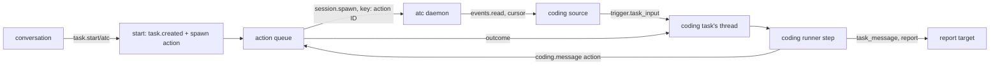

# The coding session runner

- **Status:** draft
- **Work items:** [the atc runner](https://linear.app/zgeoff/issue/GEO-1843),
  [typing into a coding session](https://linear.app/zgeoff/issue/GEO-945),
  [supervised sessions in the live view](https://linear.app/zgeoff/issue/GEO-311)

You ask for a coding session, nixie starts it in atc under your rules, and it shows as a task that
you and Nix message like any other. The task's runner holds no model: each step passes the messages
in the task's inbox to the session, and turns what the session does into task messages and one
report per task run. This doc adds the coding runner to
[the task runner port](https://linear.app/zgeoff/issue/GEO-2588), rewrites the coding adapter of the
[coding design](../../platform/connectors/coding.md), and builds its first adapter, `coding-atc`.

Three sibling designs meet this one. The code tool (`docs/design/queue/code-tool.md`) owns the code
tool section of the coding design. The MCP proxy build (`docs/design/queue/mcp-proxy-build.md`)
reaches no atc tool, because this runner calls atc directly. The decision point cutover
(`docs/design/queue/decision-point-cutover.md`) builds stages 3 to 9, which decide each start and
message.

Terms:

- A **coding task** is a task whose runner is a coding runner.
- A **bound session** is the coding session that a coding task's start created.
- atc's terms, such as a principal, a target and the event trail, are as
  [atc's protocol docs](https://github.com/zgeoff/atc/tree/main/docs/architecture/protocol) define
  them.

Other terms are in the [glossary](../../../glossary.md).

## Shape

## Parts

| Doc                       | What it holds                                                                                                             |
| ------------------------- | ------------------------------------------------------------------------------------------------------------------------- |
| [the runner](runner.md)   | the start and its policy, the runner definition, the records, what one step does, delivery, ends and limits, `tasks.list` |
| [the atc adapter](atc.md) | `CodingAdapter`, the coding source, the map onto atc, the config and the token, the release pairs, typing                 |

## Rollback

The release a rollback returns to has the runner port and lacks this work.

| What this work adds                         | What that release does                                                   |
| ------------------------------------------- | ------------------------------------------------------------------------ |
| `task.created` with `runner: 'atc'`         | its step throws on the unknown key, so the task fails at its error limit |
| `coding.session_bound`, `coding.delivered`  | skips both kinds                                                         |
| `trigger.task_input`                        | skips the kind in its projections, and its wake treats one as hop 0      |
| the `coding_sessions` table, `tasks.runner` | reads the schema and never reads either                                  |
| the `coding` config section                 | refuses to start, because every section is strict                        |
| a rule that names the effect `coding_start` | refuses the rule file                                                    |
| the `coding:atc` row of `trigger_sources`   | never reads it                                                           |

A rollback takes these steps, in order:

1. Close each coding task, so `ended` stops its session.
2. Remove the `coding` section from the config, and each rule that names `coding_start`.
3. Roll back.

## Decisions

- **A coding runner holds no model.** Its step only moves records between the task and the session,
  so it spends nothing and needs no sandbox.
- **The coding runner is generic over `CodingAdapter`, and its key is the adapter's ID.** A later
  built-in adapter gets its own key and its own variant.
- **The start and each delivery are actions.** The queue gives one attempt record, the action ID as
  the key, and an unknown outcome in place of a blind second spawn.
- **One task run is one stretch of the session's work, from a message to the turn that leaves it
  idle.** Every turn end then reaches its starter as one report, as every task run does.

## Builder decides

- The choices that each part lists under its own Builder decides.

## Out of scope

- The container sandbox adapter, [GEO-308](https://linear.app/zgeoff/issue/GEO-308).
- A limit on a session's spend or wall time. atc and the agent's own account bound them.
- Answering a session's question or its permission menu:
  [typing](https://linear.app/zgeoff/issue/GEO-945) and
  [approval forwarding](https://linear.app/zgeoff/issue/GEO-70) own them.
- A coding task from a definition file. The definitions work adds a `runner` key.

## Open questions

- **What is this runner's key?** The owner settles it, in
  [the atc runner](https://linear.app/zgeoff/issue/GEO-1843). The key also names the config section
  and the `task.message` variant. Until then, the key is `atc`.
- **Does each model API accept a `oneOf` under an object root for the `task.start` input?** One
  probe per harness settles it, for `agent-sdk` and `codex`: a model call of `task.start` with both
  variants in its input, checked at the tool. Until it passes on the conversation's harness, the
  server leaves the coding variant out of that harness's input.
- **Typing into a coding session:** questions 2 to 11 of
  [GEO-945](https://linear.app/zgeoff/issue/GEO-945) stay with its design session.
