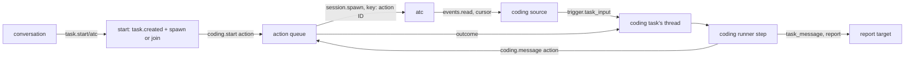

# The coding session runner

- **Status:** draft
- **Work items:** [the atc runner](https://linear.app/zgeoff/issue/GEO-1843),
  [typing into a coding session](https://linear.app/zgeoff/issue/GEO-945),
  [supervised sessions in the live view](https://linear.app/zgeoff/issue/GEO-311)

You ask nixie for a coding session, such as "fix the flaky login test in the shop repo", and nixie
starts it in atc, a separate program that runs coding agents, once your policy rules allow it. Or
you point nixie at a session you already run in atc, and nixie joins it. Either way the session
shows as a task in nixie. You message it like any other task, and so does the conversation, the task
where nixie talks with you. This design adds the code that runs such a task, the coding runner, and
its first adapter: the package `coding-atc`, whose adapter ID is `atc`.

The owner reads this design to approve it, and the builder of
[the atc runner](https://linear.app/zgeoff/issue/GEO-1843) starts from it and its two parts.

The coding runner calls no model of its own. Each step of a coding task passes the messages in the
task's inbox to the session, and turns what the session does into task messages and one report per
task run. The runner plugs into the [task runner port](../../../architecture/core/tasks.md), and
this design adds members to the port's types. It also rewrites the coding adapter section of the
[coding design](../../platform/connectors/coding.md).

These sibling designs touch this one:

- The [code tool](../../../architecture/connectors/code-tool.md) owns the code tool section of the
  coding design.
- The [MCP proxy build](../mcp-proxy-build.md) leaves atc out: the proxy carries none of atc's
  tools, because this runner calls atc directly.
- The [decision point cutover](../decision-point-cutover.md) builds the policy stages that decide
  each start of a coding session and each message to one.

## Terms

| Term           | Meaning                                                                                                                                             |
| -------------- | --------------------------------------------------------------------------------------------------------------------------------------------------- |
| atc            | a separate program that runs coding sessions on targets, such as a cloud VM, under its own rules                                                    |
| principal      | a named caller that atc's config lists, with the targets it may use; nixie calls atc as one                                                         |
| reach          | the sessions a principal can see: every session on its targets, those nixie never started included                                                  |
| the hello      | the first request on a connection to atc, which carries the token, the protocol version and the contract's major version                            |
| event trail    | atc's stored list of what each session did, which a caller reads from a cursor                                                                      |
| coding task    | a task whose runner is a coding runner                                                                                                              |
| adapter        | a package that reaches one outside system for an interface that nixie owns; the coding runner calls its adapter for every atc call                  |
| turn           | one reply cycle of the coding agent inside the session, which atc reports when it ends                                                              |
| bound session  | the session a coding task works with, once the task has recorded its ID                                                                             |
| started        | a bound session that the task's start created in atc                                                                                                |
| joined         | a bound session that already ran in atc before the task, such as one you started yourself                                                           |
| coding source  | the [trigger source](../../../architecture/core/triggers.md) that reads atc's event trail into each coding task's inbox                             |
| report target  | the task that started a coding task, usually the conversation; it receives each report                                                              |
| variant        | one form of a tool's input, picked by a field such as `runner`, with its own policy rule name, such as `task.start/atc`                             |
| hop            | the count of task messages in one exchange; past the [hop limit](../../../architecture/core/task-messages.md#the-hop-limit) a message wakes nobody  |
| claim          | the step of the task runner that takes a task's lease before a step runs ([leases and recovery](../../../architecture/core/leases-and-recovery.md)) |
| decision point | the code that decides allow, ask or deny for each tool call and each attempt of an action ([actions](../../../architecture/core/actions.md))        |
| harness        | the model client a profile runs on, such as `agent-sdk` or `codex` ([model profiles](../../../architecture/core/model-profiles.md#harnesses))       |

[The runner](runner.md) and [the atc adapter](atc.md) use these terms too. Other terms, such as an
inbox, a task run, a projection and an imp, are in the [glossary](../../../glossary.md).

## Shape

A start writes the coding task and queues the spawn, a `coding.start` action; a join reads the
session from atc and binds it in the same step. The spawn's outcome and the session's events land on
the task's thread. Each step then moves them on: a message to the task goes to the session as a
`coding.message` action, and the session's answers, notes and reports go back to the report target
as `task_message` records.

## Parts

| Doc                       | What it holds                                                                                                                      |
| ------------------------- | ---------------------------------------------------------------------------------------------------------------------------------- |
| [the runner](runner.md)   | the start and the join, their policy, the runner definition, the records, what one step does, delivery, ends and limits, the lists |
| [the atc adapter](atc.md) | `CodingAdapter`, the coding source, the map onto atc, the config and the token, the release pairs, typing                          |

## Decisions

- **A coding runner runs no model.** Its step only moves records between the task and the session,
  so it spends no model money and needs no sandbox.
- **This runner's key is `atc`.** The config section `coding.atc` and the variant `task.start/atc`
  take their names from the key.
- **The coding runner is generic over `CodingAdapter`, and its key is the adapter's ID.** A later
  adapter, such as a built-in one that runs a session in an [imp](../../../glossary.md), gets its
  own key and its own `task.start` variant.
- **The spawn (`coding.start`) and each message delivery (`coding.message`) are actions on the
  action queue, keyed by the action ID.** They declare `idempotency_key` reconciliation, so an
  attempt with no result is retried under the same key while atc keeps the key, and a crash never
  spawns a second session.
- **Each message to a session is decided as its own action, `coding.message`.** A rule on
  `coding.message` covers every message to every coding session, whoever sent it.
- **A task that joins a session never stops it.** A stop, a close or a failure of the task only
  unbinds the session, which runs on in atc as yours.
- **One task run is one stretch of the session's work, from a message nixie delivers to the turn
  that leaves the session idle.** The report target gets one report for each such stretch, as it
  gets one for every task run.
- **nixie's atc token is a deployment secret.** The adapter takes it as a plain value, as every
  adapter takes its deployment secrets.

## Builder decides

- Each part has its own Builder decides list.

## Out of scope

- The container sandbox adapter ([GEO-308](https://linear.app/zgeoff/issue/GEO-308)).
- A limit on a session's spend or wall time. The coding agent spends on its own account in atc,
  outside nixie's [budgets](../../platform/policy/budgets.md).
- Answering a session's question or its permission menu. The design session on
  [typing](https://linear.app/zgeoff/issue/GEO-945) and the
  [approval forwarding](https://linear.app/zgeoff/issue/GEO-70) design own them.
- A coding task from a definition file. The
  [task definitions work](https://linear.app/zgeoff/issue/GEO-1330) adds a `runner` key to the
  definition format.

## Open questions

- **Does each model API accept a `oneOf` under an object root for the `task.start` input?** The
  `task.start` tool already sends that root once a second runner can start tasks. Settle it with one
  probe per harness, for `agent-sdk` and `codex`: have the conversation's model call `task.start`
  with both variants in the tool's input schema, and check that the API takes the schema and the
  call parses. Until the probe passes on a harness, the server leaves the coding variant out of
  `task.start` on that harness.
- **Does atc limit nixie's principal so it cannot stop your sessions?** The owner decides. nixie
  never stops a joined session, but atc lets a principal stop every session in its reach, so nixie's
  token could stop yours. Per-principal scopes in atc would let nixie read and message your sessions
  and never stop them. Until the owner decides, nixie's own rule is the only guard.
- **When does a line that nixie types into a session carry your authority?** A design session with
  the owner, held after the approval forwarding design, settles it, with the questions of
  [GEO-945](https://linear.app/zgeoff/issue/GEO-945). Until then, nixie types nothing into a
  session's terminal. Typing means keystrokes, such as an answer to the session's question or its
  permission menu, and differs from a `coding.message`, which atc delivers as a message.
