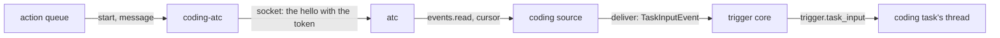

# The coding session runner: the atc adapter

- **Status:** draft
- **Work items:** [the atc runner](https://linear.app/zgeoff/issue/GEO-1843),
  [typing into a coding session](https://linear.app/zgeoff/issue/GEO-945)

atc is a separate program that runs coding sessions, and nixie calls it over its TCP listener as a
principal, a named caller that atc's config lists. The `coding-atc` adapter implements
`CodingAdapter` with atc's procedures, and the coding source reads atc's event trail, its stored
list of what each session did, into the inbox of each coding task. This doc holds the interface, the
source, the map onto atc's procedures, the config and the token, and the release pairs. The step
that calls the adapter is in [the runner](runner.md). The terms, such as reach, the hello, a hop and
a bound session, are in the [README](README.md#terms). The action queue is in
[actions](../../../architecture/core/actions.md), and the trigger core in
[the trigger core](../triggers.md).

## Shape



## Contracts

### The coding adapter

```ts
// coding module. Adapters: coding-atc, and an in-memory fake for tests.
interface CodingAdapter {
  id: string; // the runner key, such as 'atc'
  start(brief: SessionBrief, idempotencyKey: string): Promise<AdapterReply<StartedSession>>;
  status(session: SessionRef): Promise<AdapterReply<SessionStatus>>;
  message(
    session: SessionRef,
    text: string,
    idempotencyKey: string,
  ): Promise<AdapterReply<{ messageRef: string }>>;
  results(session: SessionRef): Promise<AdapterReply<SessionResult>>;
  stop(session: SessionRef): Promise<AdapterReply<{ stopped: boolean }>>;
  events(
    cursor: JSONValue | null,
    signal: AbortSignal,
    session?: SessionRef, // narrows the read to one session, for the catch-up
  ): AsyncIterable<{ cursor: JSONValue; events: SessionEvent[] }>;
}
// idempotencyKey: the ID of the action that calls it. Every attempt of one action sends the same key.

interface SessionBrief {
  name: string;
  prompt: string; // the task's brief
  repo: { url: string; ref: string };
  agent?: string;
  model?: string;
}

interface StartedSession {
  session: SessionRef;
  fromCursor: JSONValue; // the event trail's position, read just before the spawn
}

interface SessionRef {
  id: string; // the adapter's session ID, such as atc's 's7-m4x2p'
}

type SessionState = 'running' | 'waiting' | 'idle' | 'ended';

interface SessionStatus {
  state: SessionState;
  question: string | null; // untrusted: the question the session waits on
}

interface SessionResult {
  text: string | null; // untrusted: the final reply of the session's last finished turn
  truncated: boolean;
}

// Every member also holds { session: string; eventKey: string; at: string }.
// eventKey: unique per adapter, such as '<daemonID>|<event cursor>'. Every text is untrusted.
type SessionEvent =
  | { kind: 'state'; state: SessionState; question: string | null }
  | { kind: 'answered'; messageRef: string; answer: string }
  | { kind: 'unanswered'; messageRef: string; reason: string }
  | { kind: 'note'; label: 'progress' | 'blocked' | 'decision'; text: string };

// What an adapter call returns to the action queue's attempt. The queue's 3 outcomes follow it.
type AdapterReply<T> =
  | { status: 'ok'; value: T }
  | { status: 'refused'; canClear: boolean; reason: string } // reason: atc's error code
  | { status: 'unknown'; reason: string };
// canClear true: a refusal that may pass, such as atc being down, so the queue tries again on its
// backoff and fails the action when its tries run out. false: the queue fails the action at once.
```

### The coding source

The coding source is a trigger source of kind `stream`: it holds a long read open against the
outside system, where a `poll` source asks on a timer. There is one per adapter, with the ID
`coding:<adapter>`. It hands its events to the trigger core in a new member of `TriggerEvent`:

```ts
// triggers module: the member for an event that names its task
interface TaskInputEvent {
  kind: 'task_input';
  taskID: string;
  dedupeKey: string; // the SessionEvent's eventKey
  occurredAt: string; // ISO
  hop: number; // coding_sessions.hop of the session
  wake: boolean;
  payload: JSONObject; // the SessionEvent, kept in the record's erasable fields, which a forget destroys
}

// coding module
declare function buildCodingSource(adapter: CodingAdapter, context: CodingContext): TriggerSource;
```

For each `TaskInputEvent`, the core's `deliverTriggerBatch` writes one `trigger.task_input` record
on the task's thread, in the batch's transaction, with its dedupe key in `trigger_keys`. The record
is an inbox record when `wake` is true. `buildStepWake` gives hop 0 to every waking record that is
not a task message, and it reads the `hop` of a `trigger.task_input`.

### The atc adapter

Each adapter call maps to one atc call, or 2 for `start`:

| Adapter call | atc procedure                                                            |
| ------------ | ------------------------------------------------------------------------ |
| `start`      | `events.read` with `limit` 1, then `session.spawn` with `idempotencyKey` |
| `message`    | `session.message`, with `idempotencyKey` and `notice: false`             |
| `status`     | `session.get`, read for `state` and `pending.message`                    |
| `results`    | `session.get`, read for `result`                                         |
| `stop`       | `session.kill`, with `stopOnly: true`                                    |
| `events`     | `events.read` with a cursor, `waitMs`, and `limit` 200                   |

- `start`'s first read gives `fromCursor`. The spawn takes a git workspace from `repo`, the `target`
  from [the config](#the-config-and-the-token), and the brief as its `prompt`.
- A message's answer comes back through `events`.
- `result` is the final reply of the last finished turn, at most 16,384 bytes.
- `stopOnly` stops the session's process and keeps atc's record of the session.
- `events` reads every session in reach, and the adapter keeps only the bound sessions. With
  `session`, atc narrows its read to that one session.

```ts
// coding-atc adapter: the spawn it sends, and no other field
const spawn = {
  name,
  prompt,
  agent,
  model,
  target,
  workspace: { kind: 'git', url: repo.url, ref: repo.ref },
  trustClonedWorkspace: true,
  idempotencyKey,
};
```

The adapter maps atc's session states: `running` to `running`, `needs_you` to `waiting`, `done` to
`idle`, and `exited` to `ended`. A session that leaves reach, or that atc answers with
`no_such_session`, maps to `ended`.

atc's answers map to replies:

| atc answer                                                                                          | Reply                        |
| --------------------------------------------------------------------------------------------------- | ---------------------------- |
| `outcome_unknown`, `idempotency_conflict`, or a connection that closed after nixie sent the request | `unknown`                    |
| `bad_args`, `target_forbidden`, `unsupported`, `session_dead`, `scope_invalid`                      | `refused`, `canClear: false` |
| `protocol_mismatch`, a refused connection, `unauthorized` at the hello                              | `refused`, `canClear: true`  |
| any other code                                                                                      | `refused`, `canClear: false` |

### The config and the token

```yaml
# deployment config, coding section. Strict, as every section is.
coding:
  atc:
    address: 100.64.12.7 # an IP literal: atc's listener binds only an IP address
    port: 7391
    range: 100.64.0.0/10 # the private range the address must fall in
    principal: nixie # sent as x-atc-as on every request, and in the hello
    token: deployment:atc-listener-token # a static credential in the credential store
    target: cloud # the one target every spawn names
    agent: coder # optional: the agent of a start that names none
```

atc's listener speaks JSON lines over TCP. The `fetcher` of the
[credential store](../../platform/connectors/credentials.md) makes only HTTP requests, so the store
gains a call for such a service:

```ts
// connectors module
interface CredentialStore {
  // …existing members
  socket(
    ref: CredentialRef,
    endpoint: { address: string; port: number },
  ): Promise<AuthorizedSocket>;
}

interface AuthorizedSocket {
  write(line: string): Promise<void>; // the store puts the value in place of credentialPlaceholder, in the first line only
  lines(): AsyncIterable<string>;
  close(): Promise<void>;
}
// credentialPlaceholder: a constant string that the connectors module exports
```

### The release pairs

atc deploys apart from nixie, and either can roll back alone. Rule 12 of
[the port rules](https://linear.app/zgeoff/issue/GEO-2581) covers an implementation that runs in
another process: its design lists the pairs of releases that work together, and nixie stops using it
on a pair the list lacks. Each nixie release pins one `@atcx/contract` version, and sends that
contract's protocol version in the hello:

| nixie release                   | atc protocol version | `@atcx/contract` |
| ------------------------------- | -------------------- | ---------------- |
| the release that adds this work | 14                   | 7.14.0           |

## Constraints

### Events

- The coding source drops each event of a session that has no `coding_sessions` row, and stores
  nothing of it, because nixie's principal reaches sessions that nixie never started.
- The source can read a session's events before the coding task's step writes
  `coding.session_bound`. So for each bound session whose state is not `ended`, when the source
  starts and when the session's row appears, the source reads that session's events from the row's
  `from_cursor` up to its own cursor. The batch carries the source's stored cursor, so the cursor
  stays where it was. Each event keeps its dedupe key, so an event that both reads deliver lands
  once.
- The source stores its cursor through `deliver`, so a batch's records and its cursor commit
  together. At its first start, it reads without a cursor and keeps only the cursor it gets, so it
  never replays the trail.
- atc prunes old events from the trail, and a cursor still reads every event after the pruned ones.
  An outage longer than atc's retention therefore loses only the pruned events.
- The source writes a `state` event of `running` with `wake: false`, so the core's write updates the
  session's state in `coding_sessions` and wakes no step.
- The source drops an event of a task that is done, failed or closed, and still moves its cursor.
- After a failed read, the source waits from 1 s, doubling to 5 min, and reports itself unhealthy
  after 3 failures in a row.

### Versions

- nixie learns the pairing at each hello, in 2 checks. atc refuses a hello on another protocol
  version with `protocol_mismatch`, whose data holds atc's version as `daemonProtocol`; the adapter
  never sends a hello again with that version. After an accepted hello, the contract's `checkDaemon`
  compares atc's major version with the contract's, and a mismatch counts as a pairing the table
  lacks.
- On a pairing that the table lacks, the adapter sends nothing past the hello. The source reports
  unhealthy and tries the hello again on its backoff. Each action attempt gets `refused` with
  `canClear: true`, so the queue tries again on its backoff and fails the action when its tries run
  out.
- `checkDaemon` also lists each feature, a capability that an atc release adds within its major
  version, that atc lacks. The adapter logs them and refuses nothing, because this work needs no
  feature.

### The token

- The token is a static credential, and the adapter never reads it. The adapter writes the hello
  with `credentialPlaceholder` where the token goes, and the store puts the value in that first
  line.
- `socket` refuses an address that is not one of the credential's `hosts`, which the composition
  root registers as the config's `address`, or that falls outside the configured `range`. The config
  schema refuses an `address` that is not an IP literal.
- atc's config grants nixie's principal only the cloud target. atc owns that grant, and the adapter
  names that target in every spawn.

### Typing

- `CodingAdapter` has the 6 calls above, and no call types into a session's terminal. The adapter
  maps none of atc's terminal procedures: `session.submit`, `session.choose`, `session.screen` and
  `session.menu`.
- A typing tool, once [its design session](https://linear.app/zgeoff/issue/GEO-945) agrees it, is a
  nixie tool on this runner with an effect it declares, which that session names.

### Rollback

- The release a rollback returns to builds none of its tables from `trigger.task_input`. A coding
  task that such a record wakes fails, because that release lacks the runner.

## Decisions

- **This doc holds the coding adapter's signatures, and the coding design links to it.** An agent's
  call on 13 Nov 2026: the Events section needs `start` to return `fromCursor`, and one copy of the
  interface keeps the two docs from drifting.
- **The adapter package is `coding-atc`, and only it imports `@atcx/contract` and the oRPC client.**
  Rules 2 and 5 of the port rules: an adapter package is named after the interface and the outside
  system, and one package holds all of nixie's code that imports a system's client.
- **The spawn sends `trustClonedWorkspace`.** An agent's call on 13 Nov 2026: atc makes the checkout
  from the repo that the start names, which you approved with the start. A session in a folder the
  agent does not trust waits on the agent's trust prompt, which nixie cannot answer.
- **A session's events enter as `trigger.task_input` records that carry a hop.** An agent's call on
  13 Nov 2026: a session's answer to a message from the conversation belongs to the same exchange,
  so it keeps that exchange's hop count.
- **The token reaches atc through `socket`.** An agent's call on 13 Nov 2026: the adapter still
  never reads the token, as the fetcher's callers never do.

## Builder decides

- Internal names, file layout and test layout.
- How the adapter frames oRPC peer messages on the socket.
