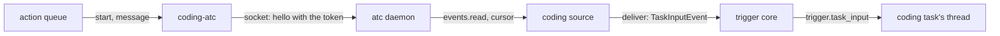

# The coding session runner: the atc adapter

- **Status:** draft
- **Work items:** [the atc runner](https://linear.app/zgeoff/issue/GEO-1843),
  [typing into a coding session](https://linear.app/zgeoff/issue/GEO-945)

The `coding-atc` adapter implements `CodingAdapter` over atc's TCP listener, as a principal that
atc's config lists, and a coding source reads atc's event trail into each coding task's inbox. This
part holds the interface, the source, the map onto atc's procedures, the config and the token, and
the release pairs. The step that calls the adapter is in [the runner](runner.md).

## Shape



## Contracts

### The coding adapter

```ts
// coding module. Adapters: coding-atc, and an in-memory fake for tests.
interface CodingAdapter {
  id: string; // the runner key, such as 'atc'
  start(brief: SessionBrief, key: string): Promise<AdapterReply<SessionRef>>;
  status(session: SessionRef): Promise<AdapterReply<SessionStatus>>;
  message(
    session: SessionRef,
    text: string,
    key: string,
  ): Promise<AdapterReply<{ messageRef: string }>>;
  results(session: SessionRef): Promise<AdapterReply<SessionResult>>;
  stop(session: SessionRef): Promise<AdapterReply<{ stopped: boolean }>>;
  events(
    cursor: JSONValue | null,
    signal: AbortSignal,
  ): AsyncIterable<{ cursor: JSONValue; events: SessionEvent[] }>;
}

interface SessionBrief {
  name: string;
  prompt: string; // the task's brief
  repo: { url: string; ref: string };
  agent?: string;
  model?: string;
}

interface SessionRef {
  id: string; // the adapter's session ID, such as atc's 's7-m4x2p'
}

type SessionState = 'running' | 'waiting' | 'idle' | 'ended';

interface SessionStatus {
  state: SessionState;
  question: string | null; // untrusted: the question the session waits on
}

interface SessionResult {
  text: string | null; // untrusted: the final reply of the session's last finished turn
  truncated: boolean;
}

type SessionEvent =
  | {
      kind: 'state';
      session: string;
      key: string;
      at: string;
      state: SessionState;
      question: string | null;
    }
  | {
      kind: 'answered';
      session: string;
      key: string;
      at: string;
      messageRef: string;
      answer: string;
    }
  | {
      kind: 'unanswered';
      session: string;
      key: string;
      at: string;
      messageRef: string;
      reason: string;
    }
  | {
      kind: 'note';
      session: string;
      key: string;
      at: string;
      label: 'progress' | 'blocked' | 'decision';
      text: string;
    };
// key: unique per adapter, such as '<daemonID>|<event cursor>'. Every text is untrusted.

// The 3 replies a connector gives the action queue, as built
type AdapterReply<T> =
  | { status: 'ok'; value: T }
  | { status: 'refused'; canClear: boolean; reason: string } // reason: atc's error code
  | { status: 'unknown'; reason: string };
```

### The coding source

```ts
// triggers module: the member of TriggerEvent that a source with a task target builds
interface TaskInputEvent {
  kind: 'task_input';
  taskID: string;
  dedupeKey: string;
  occurredAt: string; // ISO
  hop: number;
  wake: boolean;
  payload: JSONObject; // erasable: the SessionEvent
}

// coding module. One source per adapter, id 'coding:<adapter>', kind 'stream'.
declare function buildCodingSource(adapter: CodingAdapter, context: CodingContext): TriggerSource;
```

For each `TaskInputEvent`, `deliverTriggerBatch` writes one `trigger.task_input` record on the
task's thread in the batch's transaction, keyed in `trigger_keys`. The record is an inbox record
when `wake` is true, and the built `buildStepWake` reads its `hop` in place of hop 0.

### The atc adapter

| Adapter call | atc procedure                                          | Notes                                                                       |
| ------------ | ------------------------------------------------------ | --------------------------------------------------------------------------- |
| `start`      | `session.spawn`, with `idempotencyKey`                 | a git workspace from `repo`; the configured `target`; `prompt` is the brief |
| `message`    | `session.message`, with `idempotencyKey`               | `notice: false`; the answer comes back through `events`                     |
| `status`     | `session.get`                                          | `state` and `pending.message`                                               |
| `results`    | `session.get`                                          | `result`: the final reply of the last finished turn, at most 16,384 bytes   |
| `stop`       | `session.kill`, with `stopOnly: true`                  | stops the process and leaves atc's record of the session                    |
| `events`     | `events.read` with a cursor, `waitMs`, and `limit` 200 | the whole reach, filtered to bound sessions in code                         |

```ts
// coding-atc adapter: the spawn it sends, and nothing else
const spawn = {
  name,
  prompt,
  agent,
  model,
  target,
  workspace: { kind: 'git', url: repo.url, ref: repo.ref },
  trustClonedWorkspace: true,
  idempotencyKey: actionID,
};
```

The adapter maps atc's states: `running` to `running`, `needs_you` to `waiting`, `done` to `idle`,
`exited` to `ended`. A session that leaves reach, or answers `no_such_session`, maps to `ended`.

atc's errors map to replies:

| atc answer                                                                      | Reply                   |
| ------------------------------------------------------------------------------- | ----------------------- |
| `outcome_unknown`, `idempotency_conflict`, a drop after the request was written | `unknown`               |
| `bad_args`, `target_forbidden`, `unsupported`, `session_dead`, `scope_invalid`  | `refused`, cannot clear |
| `protocol_mismatch`, a refused connection, `unauthorized` at the handshake      | `refused`, can clear    |
| any other code                                                                  | `refused`, cannot clear |

### The config and the token

```yaml
# deployment config, coding section. Strict, as every section is.
coding:
  atc:
    address: 100.64.12.7 # an IP literal: atc's listener binds no host name
    port: 7391
    range: 100.64.0.0/10 # the private range the address must fall in
    principal: nixie # sent as x-atc-as on every request and in the hello
    token: deployment:atc-listener-token # a static credential in the credential store
    target: cloud # the one target every spawn names
    agent: claude # optional: the default agent of a start that names none
```

```ts
// connectors module: the credential store's call for a service that is no HTTP service
interface CredentialStore {
  // …existing members
  socket(
    ref: CredentialRef,
    endpoint: { address: string; port: number },
  ): Promise<AuthorizedSocket>;
}

interface AuthorizedSocket {
  write(line: string): Promise<void>; // the first line's credentialPlaceholder becomes the value, once
  lines(): AsyncIterable<string>;
  close(): Promise<void>;
}
```

### The release pairs

atc deploys apart from nixie, so rule 12 of
[the port rules](https://linear.app/zgeoff/issue/GEO-2581) applies. Each nixie release pins one
`@atcx/contract` version and sends that contract's protocol version in its hello:

| nixie release                   | atc protocol version | `@atcx/contract` |
| ------------------------------- | -------------------- | ---------------- |
| the release that adds this work | 14                   | 7.14.0           |

## Constraints

### Events

- The coding source drops each event of a session that no `coding_sessions` row holds, and stores
  nothing of it, because nixie's principal reaches sessions it never started.
- The source stores its cursor through `deliver`, so a batch's records and its cursor commit
  together. At its first start it reads without a cursor and keeps only the cursor, so it never
  replays the trail.
- A cursor that points past events the trail pruned reads every later event, so a long outage loses
  only the pruned events.
- A `state` event of `running` is written with `wake: false`, so it moves the projection and starts
  no step.
- The source drops an event for a task that is done, failed or closed, and still advances the
  cursor.
- A failed read backs off from 1 s to 5 min, and the source reports itself unhealthy after 3
  failures in a row.

### Versions

- The adapter sends the pinned contract's protocol version in its hello and never adopts
  `daemonProtocol` from a `protocol_mismatch`.
- On a pairing the table lacks, the coding runner stops: the source reports unhealthy and reads
  nothing, and each attempt is `refused` and can clear, so the queue retries on its schedule and
  then fails the action.
- The adapter runs the contract's `checkDaemon` after each handshake and logs the features it lacks.
  This work needs no feature past the protocol version.

### The token

- The token is a static credential. The adapter never reads it: it writes the hello with
  `credentialPlaceholder`, and the store puts the value into that first line.
- `socket` refuses an address outside the credential's `hosts`, and an address outside the
  configured `range`. The config schema refuses an `address` that is no IP literal.
- The principal's grants in atc's config name only the cloud target. atc owns that grant, and the
  adapter names that target in every spawn.

### Typing

- `CodingAdapter` has the 6 calls above, and none of them types. The adapter maps no
  `session.submit`, `session.choose`, `session.screen` or `session.menu`.
- A typing tool, once [its design session](https://linear.app/zgeoff/issue/GEO-945) agrees it, is a
  nixie tool on this runner with its own declared effect, and this doc holds its contract then.

## Decisions

- **The adapter package is `coding-atc`, and it alone imports `@atcx/contract` and the oRPC
  client.** Rules 2 and 5 of the port rules.
- **The spawn sends `trustClonedWorkspace`.** An agent's call on 13 Nov: atc makes the checkout from
  the repo you approved, and an untrusted folder waits on a menu that nixie cannot answer.
- **The session's events enter as `trigger.task_input` records that carry a hop.** An agent's call
  on 13 Nov: a session's answer to Nix's message continues Nix's exchange, so it keeps that hop.
- **The token reaches atc through `socket`.** An agent's call on 13 Nov: atc's listener speaks JSON
  lines over TCP, and the store's `fetcher` serves only HTTP.

## Builder decides

- Internal names, file layout and test layout.
- How the adapter frames oRPC peer messages on the socket.
