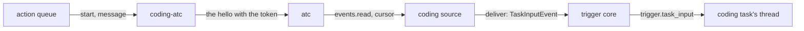

# The coding session runner: the atc adapter

- **Status:** draft
- **Work items:** [the atc runner](https://linear.app/zgeoff/issue/GEO-1843),
  [typing into a coding session](https://linear.app/zgeoff/issue/GEO-945)

atc is a separate program that runs coding sessions, and nixie calls it over its TCP listener as a
principal, a named caller that atc's config lists. The `coding-atc` adapter implements
`CodingAdapter` with atc's procedures, and the coding source reads atc's event trail, its stored
list of what each session did, into the inbox of each coding task. This doc holds the interface, the
source, the map onto atc's procedures, the config and the token, and the release pairs. The step
that calls the adapter is in [the runner](runner.md). The terms, such as reach, the hello, a hop and
a bound session, are in the [README](README.md#terms). The action queue is in
[actions](../../../architecture/core/actions.md), and the trigger core in
[the trigger core](../../../architecture/core/triggers.md).

## Shape



## Contracts

### The coding adapter

```ts
// coding module. Adapters: coding-atc, and an in-memory fake for tests.
interface CodingAdapter {
  id: string; // the runner key, such as 'atc'
  start(
    brief: SessionBrief,
    idempotencyKey: string,
    options: { replayOnly: boolean }, // true: read the key's first answer, start nothing new
  ): Promise<AdapterReply<StartedSession>>;
  join(session: SessionRef): Promise<AdapterReply<StartedSession>>; // sends no key
  list(): Promise<AdapterReply<ReachableSession[]>>;
  status(session: SessionRef): Promise<AdapterReply<SessionStatus>>;
  message(
    session: SessionRef,
    text: string,
    idempotencyKey: string,
  ): Promise<AdapterReply<{ messageRef: string }>>;
  results(session: SessionRef): Promise<AdapterReply<SessionResult>>;
  stop(session: SessionRef): Promise<AdapterReply<{ stopped: boolean }>>; // started sessions only
  events(
    cursor: JSONValue | null,
    signal: AbortSignal,
    session?: SessionRef, // narrows the read to one session, for the catch-up
  ): AsyncIterable<{ cursor: JSONValue; events: SessionEvent[] }>;
}
// idempotencyKey: the ID of the action that calls it. Every attempt of one action sends the same key.

interface SessionBrief {
  name: string;
  prompt: string; // the task's brief
  repo: { url: string; ref: string };
  agent?: string;
  model?: string;
}

interface StartedSession {
  session: SessionRef;
  state: SessionState;
  fromCursor: JSONValue; // the event trail's position, read just before the spawn or the join
}

interface SessionRef {
  id: string; // the adapter's session ID, such as atc's 's7-m4x2p'
}

interface ReachableSession {
  session: SessionRef;
  name: string; // untrusted
  cwd: string; // untrusted
  state: SessionState;
}

type SessionState = 'running' | 'waiting' | 'idle' | 'ended' | 'gone'; // gone: left reach

interface SessionStatus {
  state: SessionState;
  question: string | null; // untrusted: the question the session waits on
}

interface SessionResult {
  text: string | null; // untrusted: the final reply of the session's last finished turn
  truncated: boolean;
}

// Every member also holds { session: string; eventKey: string; at: string }.
// eventKey: unique per adapter: '<daemonID>|<origin cursor>' for a trail event, which stays the same
// through an atc gateway; '<sessionID>|state|<state>|<at>' for a state read. Every text is untrusted.
type SessionEvent =
  | { kind: 'state'; state: SessionState; question: string | null }
  | { kind: 'answered'; messageRef: string; answer: string }
  | { kind: 'unanswered'; messageRef: string; reason: string }
  | { kind: 'note'; label: 'progress' | 'blocked' | 'decision'; text: string };

// What an adapter call returns to the action queue's attempt. The queue's 3 outcomes follow it.
type AdapterReply<T> =
  | { status: 'ok'; value: T }
  | { status: 'refused'; canClear: boolean; reason: string } // reason: atc's error code
  | { status: 'unknown'; reason: string }; // the queue's `ambiguous` response
// canClear true: a refusal that may pass, such as atc being down, so the queue tries again on its
// backoff and fails the action when its tries run out. false: the queue fails the action at once.
```

### The coding source

The coding source is a trigger source of a new kind, `stream`: it holds a long read open against the
outside system, where a `schedule` source fires on a timer. There is one per adapter, with the ID
`coding:<adapter>`. This work adds the `stream` kind to the trigger core: `TriggerSource.kind` gains
`'stream'`, and `TriggerEvent` becomes a union of the built schedule event and a new member:

```ts
// triggers module: the member for an event that names its task
interface TaskInputEvent {
  kind: 'task_input';
  taskID: string;
  dedupeKey: string; // the SessionEvent's eventKey
  occurredAt: string; // ISO
  hop: number; // coding_sessions.hop of the session
  wake: boolean;
  payload: JSONObject; // the SessionEvent, kept in the record's erasable fields, which a forget destroys
}

// coding module
declare function buildCodingSource(adapter: CodingAdapter, context: CodingContext): TriggerSource;
```

For each `TaskInputEvent`, the core's `deliverTriggerBatch` writes one `trigger.task_input` record
on the task's thread, in the batch's transaction, with its dedupe key in `trigger_keys`. The record
is an inbox record when `wake` is true. `buildStepWake` gives hop 0 to every waking record that is
not a task message, and it reads the `hop` of a `trigger.task_input`.

### The atc adapter

Each adapter call maps to atc calls on `@atcx/contract`:

| Adapter call | atc procedure                                                                                                                    |
| ------------ | -------------------------------------------------------------------------------------------------------------------------------- |
| `start`      | `events.read` with `limit` 1, then `session.spawn` with `idempotencyKey` and `replayOnly`                                        |
| `join`       | `session.get`, then `events.read` narrowed to the session with `limit` 1                                                         |
| `list`       | `session.list`, kept to descriptors whose `locator.targetID` is the configured target                                            |
| `message`    | `session.message`, with `idempotencyKey` and `notice: false`                                                                     |
| `status`     | `session.get`, read for `state` and `pending.message`                                                                            |
| `results`    | `session.get`, read for `result`                                                                                                 |
| `stop`       | `session.kill`, with `stopOnly: true`                                                                                            |
| `events`     | `events.read` with a cursor, `waitMs`, and `limit` 200; `answer.get` and `note.get` for full texts; `session.get` for each state |

- `start`'s first read gives `fromCursor`. The spawn takes a git workspace from `repo`, the `target`
  from [the config](#the-config-and-the-token), and the brief as its `prompt`.
- A message's answer comes back through `events`.
- `result` is the final reply of the last finished turn, at most 16,384 bytes.
- `stopOnly` stops the session's process and keeps atc's record of the session.
- `events` reads every session in reach, and the adapter keeps only the bound sessions. With
  `session`, atc narrows its read to that one session.

```ts
// coding-atc adapter: the spawn it sends, and no other field
const spawn = {
  name,
  prompt,
  agent,
  model,
  target,
  workspace: { kind: 'git', url: repo.url, ref: repo.ref },
  trustClonedWorkspace: true,
  idempotencyKey,
  replayOnly,
};
```

The adapter maps `session.get`'s states: `running` to `running`, `needs_you` to `waiting`, `done` to
`idle`, and `exited` to `ended`. A session that leaves reach maps to `gone`.

`events` builds each `SessionEvent` from the trail as follows:

- `message-answered` gives `answered`, with the whole text from `answer.get`. An answer that atc
  marks `complete: false` keeps its text and ends with a line that says atc cut it.
- `message-unanswered` gives `unanswered`, and `note` gives `note`, with the whole text from
  `note.get`.
- Each `state` event comes from a `session.get` of a bound session, mapped as above. `events` reads
  one after every trail event of that session, and every 60 s for each bound session that has not
  ended, and yields a `state` event only when the state changed. A `no_such_session` answer gives
  `gone`.
- Every other kind is dropped.

The trail carries no sender. The step matches each answer to nixie's own message by its
`messageRef`, as [the runner](runner.md#what-one-step-does) describes, and drops an answer to a
joined session that matches none.

atc's answers map to replies:

| atc answer                                                                                                                                            | Reply                                                                    |
| ----------------------------------------------------------------------------------------------------------------------------------------------------- | ------------------------------------------------------------------------ |
| `outcome_unknown`, `idempotency_key_unknown`, or `connection_lost` on a call that carried a key                                                       | `unknown`                                                                |
| `no_such_session` with a session ID, to a resent spawn                                                                                                | `ok`, with that session; its state comes from the source's next read     |
| `target_unavailable`, `host_unavailable`, `connection_lost` on a call with no key, `timeout`, `too_slow`, `broker_not_ready`, `unsupported_operation` | `refused`, `canClear: true`                                              |
| `idempotency_conflict`                                                                                                                                | `refused`, `canClear: false`; a bug, since an action's args never change |
| `protocol_mismatch`, a refused connection, `unauthorized` at the hello                                                                                | `refused`, `canClear: true`                                              |
| `bad_args`, `target_forbidden`, `session_dead`, `scope_invalid`                                                                                       | `refused`, `canClear: false`                                             |
| any other code                                                                                                                                        | `refused`, `canClear: false`                                             |

- `outcome_unknown` carries the session or message ID in its data when atc has one. The adapter
  keeps it in the reply's `reason`, so the record of the unknown outcome names it.
- The start's plan resolves `agent` from the config into the action's args, so every attempt sends
  the same spawn.
- Both actions declare `idempotency_key` reconciliation with `keptForMs` set to the
  `completedRetentionMs` that the first hello after the server starts returns. The queue's own key
  expiry then sends an unknown outcome to you once atc no longer keeps its key.

### The config and the token

```yaml
# deployment config, coding section. As in every section, nixie ignores a key it does not know, with
# a warning at start.
coding:
  atc:
    address: 100.64.12.7 # an IP literal: atc's listener binds only an IP address
    port: 7391
    range: 100.64.0.0/10 # the private range the address must fall in
    principal: nixie # sent in the hello and as x-atc-as on every request
    token: deployment:atc_token # a key of the deployment's secrets file
    target: cloud # the one target every spawn names, and the one `list` reads
    agent: coder # optional: the agent of a start that names none
```

The composition root resolves `token` from the secrets file, as it resolves every `deployment:`
value, and passes the adapter the plain string. The token is a static credential that never expires.

### The release pairs

atc deploys apart from nixie, and either can roll back alone. Rule 12 of the
[port rules](../../../architecture/ports.md) covers an implementation that runs in another process:
its design lists the pairs of releases that work together, and nixie stops using it on a pair the
list lacks. Each nixie release pins one `@atcx/contract` version, and sends that contract's protocol
version and major version in the hello:

| nixie release                   | atc protocol version | `@atcx/contract` |
| ------------------------------- | -------------------- | ---------------- |
| the release that adds this work | 15                   | 7.25.1           |

## Constraints

### Events

- The coding source drops each event of a session that has no bound `coding_sessions` row, and
  stores nothing of it, because nixie's principal reaches sessions that nixie is not working with.
- The source can read a session's events before the coding task's step writes
  `coding.session_bound`. So for each bound session whose state is not `ended`, when the source
  starts and when the session's row appears, the source reads that session's events from the row's
  `from_cursor` until the narrowed read answers `more: false`. The batch carries the source's stored
  cursor, so the cursor stays where it was. Each event keeps its dedupe key, so an event that both
  reads deliver lands once.
- The source stores its cursor through `deliver`, so a batch's records and its cursor commit
  together. At its first start, it reads without a cursor and keeps only the cursor it gets, so it
  never replays the trail.
- atc prunes old events from the trail, and a cursor still reads every event after the pruned ones.
  An outage longer than atc's retention therefore loses only the pruned events.
- The source writes a `state` event of `running` with `wake: false`. The core's write then updates
  the session's state in `coding_sessions` and wakes no step.
- For a joined session, the source writes `idle` and `note` events with `wake: true` only while the
  task has a delivery that waits on an answer or a task run open; otherwise with `wake: false`.
- The source drops an event of a task that is done, failed or closed, and of a session whose row has
  `unbound_at` set, and still moves its cursor.
- After a failed read, the source waits from 1 s, doubling to 5 min, and reports itself unhealthy
  after 3 failures in a row.

### Versions

- nixie learns the pairing at each hello. atc refuses a hello on another protocol version or major
  version with `protocol_mismatch`. Its data may hold `daemonProtocol` and `daemonMajor`, and an
  older atc may send no data; the adapter logs what it gets and never retries the hello with another
  version.
- On a pairing that the table lacks, the adapter sends nothing past the hello. The source reports
  unhealthy and tries the hello again on its backoff. Each action attempt gets `refused` with
  `canClear: true`, so the queue tries again on its backoff and fails the action when its tries run
  out.
- The contract's `checkDaemon` lists each feature, a capability that an atc release adds within its
  major version, that atc lacks. The adapter logs them and refuses nothing, because this work needs
  no feature.

### The token and reach

- The adapter sends the token only in the hello, and never logs it. The config schema refuses an
  `address` that is not an IP literal or that falls outside `range`.
- atc's config grants nixie's principal only the configured target. atc owns that grant, and the
  adapter names that target in every spawn and every list.
- A principal's grant reaches every session on its targets, so `coding.sessions` shows your own
  sessions on that target, and a join can bind one. Sessions on other targets stay out of reach.
- The adapter calls `stop` only on a started session. atc itself would let it stop a joined one, as
  the [open question](README.md#open-questions) on atc scopes says.

### Typing

- `CodingAdapter` has the calls above, and no call types into a session's terminal. The adapter maps
  none of atc's terminal procedures: `session.input`, `session.submit`, `session.choose`,
  `session.screen`, `session.menu`, `session.eject` and `permission.respond`.
- A typing tool waits on [its design session](https://linear.app/zgeoff/issue/GEO-945). Once agreed,
  it is a nixie tool on this runner, and declares the effect that the design session sets.

### Rollback

- The release a rollback returns to builds none of its tables from `trigger.task_input`. A coding
  task that such a record wakes fails, because that release lacks the runner.

## Decisions

- **This doc holds the coding adapter's signatures, and the coding design links to it.** The
  catch-up in [Events](#events) reads from the `fromCursor` that `start` and `join` return, and one
  copy of the interface keeps the two docs from drifting.
- **The adapter package is `coding-atc`, and only it imports `@atcx/contract` and `@atcx/client`.**
  `@atcx/client` makes the connection, the hello and the version check, and raises atc's typed
  errors, so nixie writes none of atc's wire protocol. The `zgeoff/import-zones` lint rule names
  both packages. An adapter package is named after the interface and the outside system, and one
  package holds all of nixie's code that imports a system's client.
- **The spawn sends `trustClonedWorkspace`.** atc makes the checkout from the repo that the start
  names, which you approved with the start. A session in a folder the agent does not trust waits on
  the agent's trust prompt, which nixie cannot answer.
- **A session's events enter as `trigger.task_input` records that carry a hop.** A session's answer
  to a message from the conversation belongs to the same exchange, so it keeps that exchange's hop
  count.

## Builder decides

- Internal names, file layout and test layout.
- The hello's client name, and how the connection reconnects.
