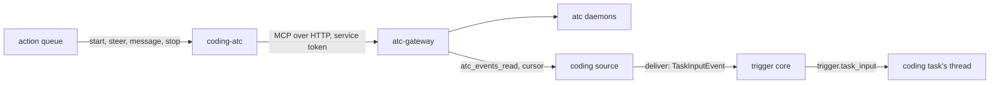

# The coding session runner: the atc adapter

- **Status:** draft
- **Work items:** [the atc runner](https://linear.app/zgeoff/issue/GEO-1843)

atc is a separate program that runs coding sessions, one daemon per machine, and atc-gateway serves
the tools of several daemons as one MCP server. nixie calls atc-gateway's MCP tools over HTTP as the
service client `service:nixie`. The `coding-atc` adapter implements `CodingAdapter` with those
tools, and the coding source reads atc's event trail into the thread of each coding task. This doc
holds the interface, the source, the map onto the gateway's tools, the config and the token, and the
release pairs. The step that calls the adapter is in [the runner](runner.md), and the tools that
call it are in [the tools](tools.md). The terms, such as reach, a target, a steer and a bound
session, are in the [README](README.md#terms). The action queue is in
[actions](../../../architecture/core/actions.md), and the trigger core in
[the trigger core](../../../architecture/core/triggers.md).

## Shape



## Contracts

### The coding adapter

```ts
// coding module. Adapters: coding-atc, and an in-memory fake for tests.
interface CodingAdapter {
  id: string; // the runner key, such as 'atc'
  start(brief: SessionBrief, idempotencyKey: string): Promise<AdapterReply<StartedSession>>;
  join(session: SessionRef): Promise<AdapterReply<StartedSession>>; // sends no key
  list(): Promise<AdapterReply<ReachableSession[]>>;
  read(session: SessionRef, options: ReadOptions): Promise<AdapterReply<SessionRead>>;
  steer(session: SessionRef, text: string): Promise<AdapterReply<{ typed: true }>>; // no key
  message(
    session: SessionRef,
    text: string,
    idempotencyKey: string,
  ): Promise<AdapterReply<{ messageRef: string }>>;
  stop(session: SessionRef): Promise<AdapterReply<{ stopped: boolean }>>; // started or joined
  events(
    cursor: string | null,
    signal: AbortSignal,
  ): AsyncIterable<{ cursor: string; events: SessionEvent[] }>;
}
// idempotencyKey: '<action ID>', and '<action ID>.<n>' after n refused attempts of the action.
// An attempt after an unknown outcome keeps the key of the attempt before it.

// actions module: the port change. The queue counts each action's refused attempts in a new
// column of the actions table, from an appended migration, and passes the key above as the
// `idempotencyKey` of each attempt and each check, in place of the bare action ID. `keptForMs`
// counts from the first attempt under the current key.

interface SessionBrief {
  name: string;
  prompt: string; // the task's brief
  repo: { url: string; ref: string };
  target: TargetRef;
  agent?: string;
  model?: string;
}

interface TargetRef {
  daemon: string; // a daemon name in the gateway's registry
  target: string; // that daemon's target ID
}

interface StartedSession {
  session: SessionRef;
  state: SessionState;
  fromCursor: string; // the event trail's cursor, read just before the spawn or the join
}

interface SessionRef {
  // the gateway's session ID, '<daemon>.<incarnation>.<session UUID>', where the incarnation is the
  // first 8 hex characters of the daemon's ID: 'cloud.3f9a1c2e.5d0c7a14-2b6e-4f1a-9c3d-7e8f90a1b2c3'
  id: string;
}

interface ReachableSession {
  session: SessionRef;
  target: TargetRef;
  name: string; // untrusted
  cwd: string; // untrusted
  state: SessionState;
}

type SessionState = 'running' | 'waiting' | 'idle' | 'ended' | 'gone'; // gone: out of sight

interface ReadOptions {
  prompt: boolean;
  tailTurns: number; // 0 for none
}

interface SessionRead {
  state: SessionState;
  question: string | null; // untrusted: the text of the session's pending question
  lastReply: string | null; // untrusted: the final reply of the session's latest finished turn
  prompt: string | null; // untrusted: the prompt the session was spawned with
  tail: TranscriptTurn[] | 'unsupported'; // [] when tailTurns is 0
}

interface TranscriptTurn {
  user: string; // untrusted
  assistant: string; // untrusted
  tools: string[]; // untrusted
}

// Every member also holds { session: string; eventKey: string; at: string }.
// eventKey: unique per adapter: '<daemon>.<incarnation>|<daemon cursor>' from the event's `origin`,
// which stays the same whatever the gateway's merged cursor holds; '<sessionID>|state|<state>|<at>'
// for a state read. Every text is untrusted.
type SessionEvent =
  | { kind: 'state'; state: SessionState; question: string | null }
  | { kind: 'answered'; messageRef: string; answer: string }
  | { kind: 'unanswered'; messageRef: string; reason: string }
  | { kind: 'note'; label: 'progress' | 'blocked' | 'decision'; text: string };

// What an adapter call returns to the action queue's attempt, one member per queue outcome.
type AdapterReply<T> =
  | { status: 'ok'; value: T }
  | { status: 'refused'; canClear: boolean; reason: string } // reason: atc's error code
  | { status: 'unknown'; reason: string }; // the queue's `ambiguous` response
// canClear true: a refusal that may pass, such as a daemon that is down, so the queue tries again
// on its backoff and fails the action when its tries run out. false: the queue fails it at once.
```

### The coding source

The coding source is a trigger source of a new kind, `stream`: it holds a long read open against the
outside system, where a `schedule` source fires on a timer. There is one per adapter, with the ID
`coding:<adapter>`. This work adds the `stream` kind to the trigger core: `TriggerSource.kind` gains
`'stream'`, and `TriggerEvent` becomes a union of the built schedule event and a new member:

```ts
// triggers module: the member for an event that names its task
interface TaskInputEvent {
  kind: 'task_input';
  taskID: string;
  dedupeKey: string; // the SessionEvent's eventKey
  occurredAt: string; // ISO
  hop: number; // coding_sessions.hop of the session
  wake: boolean; // true: the event is `ended`, or in the session's wake set
  payload: JSONObject; // the SessionEvent, kept in the record's erasable fields, which a forget destroys
}

// coding module
declare function buildCodingSource(adapter: CodingAdapter, context: CodingContext): TriggerSource;
```

For each `TaskInputEvent`, the core's `deliverTriggerBatch` writes one `trigger.task_input` record
on the task's thread, in the batch's transaction, with its dedupe key in `trigger_keys`. It reads no
definition for such an event, and drops one whose task is missing, done, failed or closed. The
record is an inbox record when `wake` is true. `buildStepWake` reads the `hop` of a
`trigger.task_input`, and gives hop 0 to every other waking record that is not a task message.

- The tasks module owns the codec of `trigger.task_input`, because `buildStepWake` reads it and the
  triggers module already depends on tasks. The triggers core writes the record, and the coding
  module folds it.
- The coding module is a new package, `modules/coding`. It depends on tasks, triggers, actions,
  connectors and policy, and `coding-atc` depends only on it.

### The atc adapter

Each adapter call maps to atc-gateway's tools:

| Adapter call | atc-gateway tools                                                                                       |
| ------------ | ------------------------------------------------------------------------------------------------------- |
| `start`      | `atc_events_read` with `limit` 1 and no cursor, then `atc_session_spawn` with `idempotencyKey`          |
| `join`       | `atc_session_get`, then `atc_events_read` with `limit` 1 and no cursor                                  |
| `list`       | `atc_sessions_list`, kept to the sessions whose `locator.daemon` and `locator.targetID` are configured  |
| `read`       | `atc_session_get` for the state, `pending`, `result` and `prompt`; `atc_transcript_read` for the tail   |
| `steer`      | `atc_session_get` for the state, then `atc_terminal_type`                                               |
| `message`    | `atc_message_send`, with `idempotencyKey`                                                               |
| `stop`       | `atc_session_stop`                                                                                      |
| `events`     | `atc_events_read` with a cursor, `waitMs` 25,000 and `limit` 200; `atc_session_get` for a bound session |

- `start`'s first read gives `fromCursor`. The spawn takes a git workspace from `repo`, and the
  `daemon` and `target` from the brief.
- atc takes `trustClonedWorkspace` only for an agent and target that can trust a clone: stock Claude
  Code on the daemon's local target, or stock Claude Code, a Claude gateway agent or Codex signed in
  through atc's broker on a remote target that can trust a clone. Any other start gets `bad_args`
  and fails.
- A note's answer comes back through `events`.
- `atc_session_stop` stops the session's process and keeps atc's record of the session. On a target
  that suspends its hosts, it puts the host to sleep.
- `events` reads every session in reach, with no session filter, and the adapter keeps only the
  bound sessions. The gateway refuses a cursor in a read whose filter differs from the read that
  gave the cursor.

```ts
// coding-atc adapter: the spawn it sends, and no other field
const spawn = {
  name,
  prompt, // the brief: the session's first user turn
  agent,
  model,
  daemon: target.daemon, // the gateway's input that names the daemon
  target: target.target,
  workspace: { kind: 'git', url: repo.url, ref: repo.ref },
  trustClonedWorkspace: true,
  idempotencyKey,
};
```

The adapter maps the session's state from `atc_session_get`:

| atc                                            | `SessionState` |
| ---------------------------------------------- | -------------- |
| `running`                                      | `running`      |
| `needs_you`                                    | `waiting`      |
| `done`                                         | `idle`         |
| `exited`, with `lifecycle.harness` `suspended` | `gone`         |
| `exited`, otherwise                            | `ended`        |
| the answer `no_such_session`                   | `gone`         |

atc may add a state value in a later release. On a value the table lacks, the adapter keeps the last
state it mapped and logs the value.

`events` builds each `SessionEvent` from the trail as follows:

- `message-answered` gives `answered`, with the whole answer from the event's `text`. An answer that
  atc marks `complete: false`, or whose `textError` is set, keeps the preview in `detail` and ends
  with a line that says atc cut it.
- `message-unanswered` gives `unanswered`, and `note` gives `note`, with its text read the same way.
- Each `state` event comes from an `atc_session_get` of a bound session, mapped as above. `events`
  reads one after every trail event of that session, and every 60 s for each bound session that has
  not ended, and yields a `state` event only when the state changed. A read that fails for any
  reason but `no_such_session` yields nothing.
- Every other kind is dropped.

The trail carries no sender. The step matches each answer to nixie's own note by its `messageRef`,
as [the runner](runner.md#what-one-step-does) describes.

`read` builds the tail from `atc_transcript_read`, which pages oldest first. It pages from the start
with `limit` 200 until `more` is false, groups the rows into turns, each one a `user` row and every
`assistant` row after it, and keeps the last `tailTurns`. An agent with no transcript reader answers
`unsupported`, which gives `'unsupported'`.

atc's answers map to replies. A failed tool call carries atc's code in its structured content; an
HTTP refusal carries none:

| atc answer                                                                                                  | Reply                                                                    |
| ----------------------------------------------------------------------------------------------------------- | ------------------------------------------------------------------------ |
| `outcome_unknown`; a lost connection or a timeout after the request left                                    | `unknown`                                                                |
| `daemon_unavailable`, on a call with a key                                                                  | `unknown`                                                                |
| `no_such_session`, to a resent spawn                                                                        | `unknown`                                                                |
| `daemon_unavailable` on a call with no key, `target_unavailable`, `host_unavailable`, `timeout`, `too_slow` | `refused`, `canClear: true`                                              |
| `permission_pending`, to a steer                                                                            | `refused`, `canClear: true`                                              |
| `unsupported`, to a note in the session's first minute; `host_leased`, to a stop                            | `refused`, `canClear: true`                                              |
| HTTP 401, or a connection refused before the request left                                                   | `refused`, `canClear: true`                                              |
| `idempotency_conflict`                                                                                      | `refused`, `canClear: false`; a bug, since an action's args never change |
| HTTP 403 `insufficient_scope`, `bad_args`, `target_forbidden`, `session_dead`, `unsupported`                | `refused`, `canClear: false`                                             |
| `menu_open`, the adapter's own refusal of a steer to a session in `waiting`                                 | `refused`, `canClear: false`                                             |
| any other code                                                                                              | `refused`, `canClear: false`                                             |

- atc refuses a note with `unsupported` while the session's message bridge has not attached, up to
  15 s after the session started, and for an agent that takes no notes. The adapter reads the
  session's start time to tell the two apart.
- atc's MCP answer carries only the error's code and `problem`, so the adapter cannot tell a daemon
  whose identity changed under a key from a daemon that is down. A keyed call takes either as
  `unknown`, and the queue resends it under the same key.
- A steer's lost connection after the request left is `unknown`, and its action's `none`
  reconciliation sends it to you, because the line may have reached the terminal.
- The start's plan resolves `agent` and `target` from the config into the action's args, so every
  attempt sends the same spawn.
- `coding.start` and `coding.message` declare `idempotency_key` reconciliation with `keptForMs` 23
  h. A daemon forgets a completed key 24 h after its call, and the gateway keeps its own binding of
  the key for 48 h, so a resend in the first 23 h gets the first answer. The queue's own key expiry
  then sends an unknown outcome to you.
- A refused attempt's key is spent at the gateway: a resend of it gets `outcome_unknown` and runs
  nothing. So the next attempt after a refusal takes the next key, `<action ID>.<n>`, and an attempt
  after an unknown outcome keeps its key, which the gateway resends to the daemon as a replay.
- A replay gets the first answer only when the daemon holds the key as completed. When the first
  send never reached the daemon, or the daemon holds the outcome as unknown, every resend gets
  `outcome_unknown`, and the action's unknown outcome reaches you once its 23 h run out.

### The config and the token

```yaml
# deployment config, coding section. As in every section, nixie ignores a key it does not know, with
# a warning at start.
coding:
  atc:
    url: https://atc.example.net/mcp # the gateway's MCP endpoint; https only
    principal: service:nixie # the service client the token belongs to, named in logs and errors
    token: deployment:atc_token # a key of the deployment's secrets file
    targets: # the targets nixie lists, joins and starts on
      - { daemon: laptop, target: local }
      - { daemon: cloud, target: cloud }
    defaultTarget: cloud/cloud # '<daemon>/<target>', one of targets; a start that names none
    agent: coder # optional: the agent of a start that names none
```

The composition root resolves `token` from the secrets file, as it resolves every `deployment:`
value, and passes the adapter the plain string. The token is one of the gateway's static service
tokens, which starts with `atcs_` and never expires.

### The release pairs

atc-gateway and its daemons deploy apart from nixie, and either side can roll back alone. Rule 12 of
the [port rules](../../../architecture/ports.md) covers an implementation that runs in another
process: its design lists the pairs of releases that work together, and nixie stops using it on a
pair the list lacks. The gateway reports its version in its MCP server info as
`atc-gateway/<version>`, and refuses a daemon on another major atc version itself. The gateway
releases on its own version line, apart from the daemons, and every gateway from 7.12.0 on serves
service tokens and every tool this adapter calls.

| nixie release                   | atc-gateway          | atc daemons |
| ------------------------------- | -------------------- | ----------- |
| the release that adds this work | 7.12.0 or later in 7 | major 7     |

## Constraints

### Events

- The coding source drops each event of a session that has no bound `coding_sessions` row, and
  stores nothing of it, because nixie's principal reaches sessions that nixie is not working with.
- The source can read a session's events before the coding task's step writes
  `coding.session_bound`. So for each bound session whose state is not `ended`, when the source
  starts and when the session's row appears, the source reads the whole trail from the row's
  `from_cursor` until a read answers `more: false`, and keeps that session's events. The batch
  carries the source's stored cursor, so the cursor stays where it was. Each event keeps its dedupe
  key, so an event that both reads deliver lands once.
- The source stores its cursor through `deliver`, so a batch's records and its cursor commit
  together. At its first start, it reads without a cursor and keeps only the cursor it gets, so it
  never replays the trail.
- atc deletes events older than 30 days, except each listed session's newest event, and a cursor
  still reads every event after the deleted ones. An outage longer than that loses only the deleted
  events.
- A page that lists a daemon under `unavailable` keeps that daemon's place in the cursor, and the
  source reads it on the next call. A page that lists one under `truncated` lost that daemon's older
  events: the source logs it with the daemon's name.
- The source writes an event with `wake: true` when the event is `ended`, or its kind is in the
  session's wake set: the state for a `state` event, and the label for a `note`. Every other event
  gets `wake: false`, and the core's write updates `coding_sessions` and wakes no step.
- The source drops an event of a task that is done, failed or closed, and of a session whose row has
  `unbound_at` set, and still moves its cursor.
- After a failed read, the source waits from 1 s, doubling to 5 min, and reports itself unhealthy
  after 3 failures in a row.

### Versions

- The adapter reads the gateway's version from the server info of each MCP initialize, after the
  `atc-gateway/` prefix. On a version the table lacks, it sends nothing past the initialize. The
  source reports unhealthy and tries again on its backoff. Each action attempt gets `refused` with
  `canClear: true`, so the queue tries again on its backoff and fails the action when its tries run
  out.
- A daemon on a version the gateway cannot serve answers `daemon_unavailable`, which the table above
  maps.

### The token and reach

- The adapter sends the token only as the bearer of each request, and never logs it. The config
  schema refuses a `url` that is not `https://`.
- The gateway's service token file gives `service:nixie` the scopes `read`, `message`, `spawn` and
  `kill`. `spawn` covers typing into a session as well as a spawn.
- Each daemon's `principals` config grants `service:nixie` only the configured targets. atc owns
  that grant, and the adapter names a configured target in every spawn and keeps only those in every
  list.
- A principal's grant reaches every session on its targets, so `coding.sessions` shows your own
  sessions on those targets, and a join can bind one. Sessions on other targets stay out of reach.
- atc lets nixie's principal stop every session in its reach. nixie's
  [`coding.stop` rules](runner.md#ends-stops-and-the-sweep) decide which of your sessions it stops.

### Typing

- `steer` is the only call that types into a session. It never calls `atc_terminal_choose`, so the
  adapter answers no menu.
- A steer reads the session's state first, and refuses a session in `waiting` with `menu_open`. atc
  refuses the line itself with `permission_pending` while a Claude Code permission prompt is open.

### Rollback

- The release a rollback returns to builds none of its tables from `trigger.task_input`. A coding
  task that such a record wakes fails, because that release lacks the runner.

## Decisions

- **This doc holds the coding adapter's signatures, and the coding design links to it.** The
  catch-up in [Events](#events) reads from the `fromCursor` that `start` and `join` return, and one
  copy of the interface keeps the two docs from drifting.
- **The adapter package is `coding-atc`, and it is the one package that calls atc-gateway.** It
  speaks MCP with `@modelcontextprotocol/client`, which the workspace catalog already holds, so
  nixie writes none of atc's wire protocol. An adapter package is named after the interface and the
  outside system, and one package holds all of nixie's code that reaches a system.
- **nixie authenticates with a static service token.** A static token needs no token endpoint and no
  refresh, and the gateway's token file rotates it with no outage.
- **The spawn sends `trustClonedWorkspace`.** atc makes the checkout from the repo that the start
  names, which you approved with the start. A session in a folder the agent does not trust waits on
  the agent's trust prompt, which nixie never answers.
- **A session's events enter as `trigger.task_input` records that carry a hop.** A session's answer
  to a note from the conversation belongs to the same exchange, so it keeps that exchange's hop
  count.

## Builder decides

- Internal names, file layout and test layout.
- The MCP client's name in its initialize, and how the connection reconnects.
- `CodingContext`, and how the coding source learns that a `coding_sessions` row appeared.
