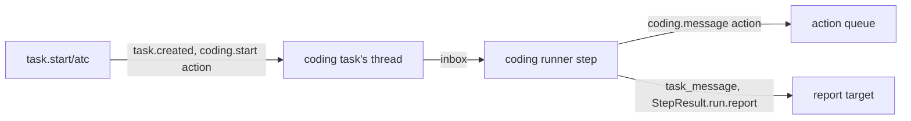

# The coding session runner: the runner

- **Status:** draft
- **Work items:** [the atc runner](https://linear.app/zgeoff/issue/GEO-1843),
  [supervised sessions in the live view](https://linear.app/zgeoff/issue/GEO-311)

A coding task's runner calls no model. Each of its steps passes the messages in the task's inbox to
the bound session, and turns what the session does into task messages and one report per task run.
This doc holds the start of a coding task, the runner's definition, its records, what one step does,
and how the task ends. The adapter that the step calls is in [the atc adapter](atc.md). The terms,
such as a bound session, a hop and a variant, are in the [README](README.md#terms).

## Shape



## Contracts

### The start

```ts
task.start({
  runner: 'atc',
  name: 'Fix the flaky login test',
  brief: 'The login test fails 1 time in 5 on CI. Find why and open a pull request with the fix.',
  repo: { url: 'https://github.com/example/shop.git', ref: 'main' },
  agent: 'coder', // optional: atc's agent ID; omitted: the configured default, else the target's
  model: 'opus', // optional: passed to atc, which checks it against what the agent offers
  report: 'wake', // optional: as in the current start, default 'wake'
});
// → { taskID: 't7k2' }
//   or the refusal sentence that the variant's plan returned

// coding module. The variant's input is a strict object, so its schema refuses `limits`,
// `reportShape`, `persona`, `memory` and `tools`.
interface CodingStart extends TaskStartEnvelope {
  runner: string; // the adapter's ID, as a constant
  repo: { url: string; ref: string }; // url: https:// or ssh form, never starting with '-'
  agent?: string;
  model?: string;
}
```

Each start variant has a `plan` function, which checks the input and returns what the start writes.
A plan returns actions beside its envelope:

```ts
// tasks module: the port change
type RunnerStartPlan<Options> =
  | {
      status: 'planned';
      envelope: { report: TaskReport; limits: TaskLimits };
      options: Options;
      actions: readonly RunnerAction[]; // new; [] for the sandbox runner
    }
  | { status: 'refused'; sentence: string };

// actions module. An action that a runner queues: the call or record that caused it was decided
// already, so the action meets no second decision.
interface RunnerAction {
  tool: string; // a connector tool that no tool list holds, such as 'coding.start'
  args: JSONObject; // erasable, as every action's arguments are
  hashParts: readonly string[]; // the action hash; a step that runs again with the same parts queues nothing
  causedBy: { kind: 'tool_call'; callID: string } | { kind: 'record'; sequence: number };
}
```

### The runner definition

```ts
const { definition, runStep } = buildCodingRunner(atcAdapter, codingSettings);
// definition.key === 'atc'

// tasks module: the members the port gains. The sandbox runner and each fixed-task runner set
// meters ['turns', 'dollars'], message null and ended null.
export interface TaskRunnerDefinition {
  // …existing fields
  readonly meters: readonly ('turns' | 'dollars')[]; // the meters that limit this runner's task runs
  readonly message: EffectDeclaration | null; // the declaration of `task.message/<key>`; null: no variant
  readonly ended:
    | ((context: RunnerContext, taskID: string, cause: 'stopped' | 'closed') => Promise<void>)
    | null; // called after a stop or a close commits
}

// coding module: one definition per adapter
const codingDefinition = {
  key: adapter.id,
  controls: ['pause', 'resume', 'stop', 'close'],
  start: defineRunnerStart(codingStart), // declares `task.start/<key>`
  fixedTasks: [],
  keepsSandboxes: false,
  meters: [],
  message: { effects: ['send'], contentArgs: ['body'] }, // `task.message/<key>`
  ended: stopBoundSession,
} satisfies TaskRunnerDefinition;

// `task.start/atc`
const codingStartDeclaration: EffectDeclaration = {
  effects: ['coding_start'],
  destinations: [],
  contentArgs: ['brief', 'name'],
};
```

### The records and the projection

```ts
// coding module. Both sit on the coding task's thread, and neither is an inbox record.
// coding.session_bound: written by the step that reads the spawn's done outcome
interface CodingSessionBound {
  taskID: string;
  adapter: string; // the runner key
  sessionID: string;
  actionID: string; // the spawn action
  fromCursor: JSONValue; // from the spawn's result: where the coding source's catch-up read starts
}
// coding.delivered: written by the step that reads a message action's done outcome
interface CodingDelivered {
  taskID: string;
  messageID: string; // nixie's task_message or owner_message ID
  messageRef: string; // atc's ID of the message
  hop: number; // the hop of the step that queued the delivery
}
```

```text
coding_sessions, one appended migration. Key session_key = '<adapter>\n<sessionID>'.
  task_id          text
  adapter          text
  session_id       text
  state            text    -- SessionState, or 'starting' before the first event
  hop              integer -- the hop of the newest delivery, else of the start
  from_cursor      text    -- JSON: where the catch-up read starts
  last_event_at    integer -- epoch ms; null before the first event
  updated_sequence integer
Folded from coding.session_bound, coding.delivered and trigger.task_input.
tasks gains a column: runner text, null when task.created has no runner key.
```

### What one step does

A coding task's inbox holds 4 kinds of record: the brief, which the start writes as the task's first
waking input; the outcomes of its actions; messages to the task; and `trigger.task_input` records,
which the coding source writes for each event of the session. The step handles every action outcome
in the inbox first, then every other record oldest first, and commits once. `state`, `answered`,
`unanswered` and `note` are the kinds of [`SessionEvent`](atc.md#the-coding-adapter). Each row ends
in the next state the step returns, as every runner does: `done` finishes the task, and `wait`
leaves it waiting for its next inbox record.

The step's actions:

| Inbox record                                     | The step                                                                                                       |
| ------------------------------------------------ | -------------------------------------------------------------------------------------------------------------- |
| the brief                                        | nothing: the start queued the spawn, and the task run stays open                                               |
| `coding.start` done                              | writes `coding.session_bound`                                                                                  |
| `coding.start` failed                            | ends the task run with a report that says atc refused the start, and returns `done`                            |
| `coding.start` unknown                           | ends the task run with a report that says nixie cannot tell whether the session started, and returns `wait`    |
| a `task_message` or `owner_message` to the task  | queues a `coding.message` action, caused by that record                                                        |
| `coding.message` done                            | writes `coding.delivered`                                                                                      |
| `coding.message` failed or unknown               | replies to the message's sender that the session did not get it, or may not have                               |
| `trigger.task_input`, `answered` or `unanswered` | replies to the sender of the message that `coding.delivered` matches by `messageRef`, with `replyTo` set to it |
| `trigger.task_input`, `note`                     | sends a `progress` message to the report target, which wakes it for `blocked` and `decision` only              |
| `trigger.task_input`, `state` `waiting`          | sends a `progress` message with the session's question to the report target, which wakes it                    |
| `trigger.task_input`, `state` `idle`             | ends the task run with a report, unless a delivery is queued or waits on an answer                             |
| `trigger.task_input`, `state` `ended`            | ends the task run with a report when one is open, and returns `done`                                           |

A runner with no model needs 2 more fields in its step result:

```ts
// tasks module: the port change
interface StepResult {
  // …existing fields
  run?: {
    // …existing fields
    report?: { summary: string }; // the commit writes task.run_report_requested from it
  };
  actions?: readonly RunnerAction[]; // queued in the commit's transaction, after its lease check
}
```

- An answer can reach the inbox before the outcome of its message's action. When no
  `coding.delivered` matches an answer and a `coding.message` action of the task is still pending,
  the step stops at the answer. It marks read every record before the answer, leaves the answer and
  every later record unread, and sets a timer 5 s out. The timer wakes the next step, which handles
  the answer the same way, until the outcome lands. When none is pending and none matches, the step
  sends the answer to the report target, marked as matching no message that nixie sent.
- The report's summary is the `text` of the adapter's [`results`](atc.md#the-coding-adapter) read,
  cut to 8,000 characters. When the read fails or `text` is null, the summary is "The session's turn
  ended, and nixie could not read its final reply."
- Each text the step forwards from the session is outside content: each `task_message` carries
  `source: 'untrusted'`, and the model that reads it sees its text marked as outside content.
- Each message the step sends has the hop in `coding_sessions.hop`, plus 1. A loop of messages
  between the conversation and a session therefore stops at the hop limit.

### `tasks.list` and the live view

```ts
tasks.list({ runner: 'atc', state: 'waiting', limit: 20 });
// → { tasks: [{ id: 't7k2', name: 'Fix the flaky login test', runner: 'atc', limits: null,
//      session: { state: 'waiting', lastEventAt: 1_794_550_000_000 }, … }] }

// tasks module: `runner` filters on the key that the registry resolves for each task.
// A listed task gains `limits: null` for a runner with no meters.
// coding module: `session` comes from coding_sessions. The API stream sends each change of a row,
// so the live view shows each coding task's session state as it moves.
```

## Constraints

### The start and the policy

- The composition root, the server code that wires each adapter in, builds a coding runner only when
  the `coding.atc` config section is set, so `task.start/atc` is in the tool's input only then. The
  runner port lets only the composition root read a provider's config key, and `coding.atc` is such
  a key.
- The `task.start` tool runs inside the model's turn, unqueued. In one transaction, the start writes
  `task.created` with `runner: 'atc'`, then queues the spawn as a `RunnerAction` caused by the
  start's tool call. The action reuses that call's decision, so nixie asks you at most once per
  start.
- The spawn action sits on the coding task's thread. A pause of the task therefore holds the spawn,
  and a stop cancels it before its first attempt, as the action queue does for every action.
- The [decision point](../../platform/policy/decision-point.md) checks your ask rules at stage 6 and
  consent at stage 8, the check that your own message asked for the call. A rule on `task.start/atc`
  matches only the coding variant. This work adds the starter rule `ask-coding-sessions`, which asks
  on it, so under that rule nixie asks you before every start, even one you asked for. With no
  matching rule, a start that your own message asked for passes at stage 8.
- A `task.message` call to a coding task is decided under `task.message/atc`, with the definition's
  `message` declaration. The tool's variant pick, `variants.pick`, finds the receiver's runner in
  the calling step's
  [directory of tasks](../../../architecture/core/task-messages.md#sending-a-message), before the
  decision point runs, and reads only `to`.
- The pick ignores the receiver's state. A message to a coding task that is done gets the message
  tool's refusal of a finished task, after the decision.

### Delivery

- A delivery's idempotency key is its action ID, and the spawn's is the spawn action's ID. atc keeps
  each key apart per principal and per procedure, so a key never collides with another caller's.
- Inside one attempt, the adapter sends a keyed request again, unchanged, after a dropped
  connection, only while the attempt is younger than the `completedRetentionMs` that the reply to
  [the hello](README.md#terms) gives. After that, the adapter replies `unknown`.
- After a crash, a new attempt never calls atc: the action queue's claim marks the action unknown.
- A message longer than the hello's `maxLine` allows gets the reply `refused` with `canClear: false`
  and the reason `too_long`. The queue fails the action at once, and the sender gets the step's
  reply that the session did not get the message.
- The adapter sends only the spawn fields that [its sketch](atc.md#the-atc-adapter) lists. It never
  sends `atcAccess`, `scope`, `parent`, `resume`, `pluginDirs`, `cwd` or `credentialRef`, so a
  coding session never holds atc access of its own.

### Ends, stops and the sweep

- A stop or a close calls the definition's `ended` after its transaction commits. A coding runner's
  `ended` calls `stop` on the bound session, and logs a failure.
- The coding module sweeps when the server starts and every 10 min after. For each coding task that
  is stopped, closed or failed, with a `coding_sessions` row whose state is not `ended`, the sweep
  calls `stop`. A spawn can also finish after a stop. No step then runs to write
  `coding.session_bound`, so the sweep reads the session's ID from the spawn's outcome, which is a
  record on the task's thread.
- A coding runner lacks `restart` and `interrupt`, so both controls get `runner_lacks_control`. A
  stopped coding task can only be closed.
- A pause holds the task's queued deliveries. The session runs on in atc, and its events land in the
  inbox unread until the resume.
- A step never throws when an outside read fails. Only a record it cannot parse makes it throw.
- A done coding task refuses messages, as every done task does. The step that returns `done`
  releases every [message wait](../../../architecture/core/task-messages.md#message-waits) that is
  open on the task: each sender that waits on a reply from it stops waiting.

### Limits

- Before each step, the task's claim reads only the meters that the task's runner definition lists.
  A coding runner lists none, so its task runs never end with `limit`.
- The coding variant's plan still fills the envelope's limits with the `models.limits.taskRun`
  defaults, because the envelope's type needs them. The claim never reads them for a coding task.
- nixie limits a coding task in 3 ways: your rule on each start and each message, the hop limit on a
  loop of messages, and your stop. The coding agent's spend and wall time sit in atc, outside
  nixie's [budgets](../../platform/policy/budgets.md) and its counting proxy.

### Rollback

The [rollback table](README.md#rollback) of the README says what the release a rollback returns to
does with `coding.session_bound`, `coding.delivered`, the `coding_sessions` table, the
`tasks.runner` column and the `coding` config section.

## Decisions

- **The report repeats the session's final reply, even when an answer to a message carried the same
  text.** An agent's call on 13 Nov 2026: the answer closes its sender's message wait, and the
  report ends the task run, so each needs its own message.
- **A message to a coding task is decided under `task.message/atc`, which declares `send`.** An
  agent's call on 13 Nov 2026: the [coding design](../../platform/connectors/coding.md) has your
  rules decide every message to a session. The starter rule set allows `send`, so nixie asks you
  before a message only when you add an ask rule on the variant.
- **Stop and close stop the session and keep atc's record of it.** An agent's call on 13 Nov 2026:
  atc's record is outside data, and nixie deletes outside data only through a tool that declares
  `delete`.

## Builder decides

- Internal names, file layout and test layout.
- The first line of a delivered message, which names its sender and its message ID.
- The wording of each message the step sends.
- How `tasks.list` resolves a null `runner` and a fixed task to a key for the filter.
- The query of the sweep.
