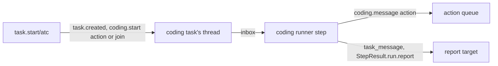

# The coding session runner: the runner

- **Status:** draft
- **Work items:** [the atc runner](https://linear.app/zgeoff/issue/GEO-1843),
  [supervised sessions in the live view](https://linear.app/zgeoff/issue/GEO-311)

A coding task's runner calls no model. Each of its steps passes the messages in the task's inbox to
the bound session, and turns what the session does into task messages and one report per task run.
This doc holds the start and the join of a coding task, the runner's definition, its records, what
one step does, and how the task ends. The adapter that the step calls is in
[the atc adapter](atc.md). The terms, such as a bound session, a joined session, a hop and a
variant, are in the [README](README.md#terms).

## Shape



## Contracts

### The start and the join

```ts
task.start({
  runner: 'atc',
  name: 'Fix the flaky login test',
  brief: 'The login test fails 1 time in 5 on CI. Find why and open a pull request with the fix.',
  repo: { url: 'https://github.com/example/shop.git', ref: 'main' },
  agent: 'coder', // optional: atc's agent ID; omitted: the configured default, else the target's
  model: 'opus', // optional: passed to atc, which checks it against what the agent offers
  report: 'wake', // optional: as in the sandbox runner's start, default 'wake'
});
// → { taskID: 't7k2' }

task.start({
  runner: 'atc',
  name: 'Your billing refactor',
  brief: 'Keep an eye on this one and tell me when it needs me.',
  session: 's7-m4x2p', // join: an atc session ID from coding.sessions; no repo, agent or model
});
// → { taskID: 't7k3' }
//   or the refusal sentence that the variant's plan returned

// coding module. A strict object, so its schema refuses `limits`, `reportShape`, `persona`,
// `memory` and `tools`. Exactly one of `repo` and `session`.
interface CodingStart extends TaskStartEnvelope {
  runner: string; // the adapter's ID, as a constant
  repo?: { url: string; ref: string }; // url: https:// or ssh form, never starting with '-'
  agent?: string; // only with repo
  model?: string; // only with repo
  session?: string; // only alone: the session to join
}
```

A join needs the sessions you can point nixie at, so the coding module adds one read tool:

```ts
coding.sessions({ adapter: 'atc' });
// → { sessions: [{ id: 's7-m4x2p', name: 'billing refactor', state: 'idle', cwd: '…/billing',
//      boundTo: null }] }
// coding module. Effects: read. Lists every session in reach that has not ended, with the task
// that binds it, if any. Names and paths are untrusted text.
```

Each start variant has a `plan` function, which checks the input and returns what the start writes.
A plan returns actions beside its envelope:

```ts
// tasks module: the port change
type RunnerStartPlan<Options> =
  | {
      status: 'planned';
      envelope: { report: TaskReport; limits: TaskLimits };
      options: Options;
      actions: readonly RunnerAction[]; // new; [] for the sandbox runner and for a join
    }
  | { status: 'refused'; sentence: string };

// actions module. An action that a runner queues. Each attempt meets the decision point, as every
// action's attempt does; the start call's approval, bound to the action hash, answers an ask rule.
interface RunnerAction {
  tool: string; // a connector tool that no tool list holds, such as 'coding.start'
  args: JSONObject; // erasable, as every action's arguments are
  hashParts: readonly string[]; // the action hash; a step that runs again with the same parts queues nothing
  causedBy: { kind: 'tool_call'; callID: string } | { kind: 'record'; sequence: number };
}
```

A join's plan reads the session through the adapter's `join` before it returns. It refuses a session
that is out of reach, has ended, or is bound to an open coding task.

### The runner definition

```ts
const { definition, runStep } = buildCodingRunner(atcAdapter, codingSettings);
// definition.key === 'atc'

// tasks module: the members the port gains. The sandbox runner and each fixed-task runner set
// meters ['turns', 'dollars'] and ended null.
export interface TaskRunnerDefinition {
  // …existing fields
  readonly meters: readonly ('turns' | 'dollars')[]; // the meters that limit this runner's task runs
  readonly ended:
    | ((
        context: RunnerContext,
        taskID: string,
        cause: 'stopped' | 'closed' | 'failed',
      ) => Promise<void>)
    | null; // called after a stop, a close or a failure commits
}

// coding module: one definition per adapter
const codingDefinition = {
  key: adapter.id,
  controls: ['pause', 'resume', 'stop', 'close'],
  start: defineRunnerStart(codingStart), // declares `task.start/<key>`
  fixedTasks: [],
  keepsSandboxes: false,
  meters: [],
  ended: releaseBoundSession, // stops a started session; only unbinds a joined one
} satisfies TaskRunnerDefinition;

// `task.start/atc`, for a start and a join alike
const codingStartDeclaration: EffectDeclaration = {
  effects: ['code_run'],
  destinations: [],
  amount: null,
  content: ['brief', 'name'],
  results: {},
};

// `coding.message`: the action each delivery queues
const codingMessageDeclaration: EffectDeclaration = {
  effects: ['send'],
  destinations: [], // filled with the adapter ID and the session ID, such as 'atc:s7-m4x2p'
  amount: null,
  content: ['text'],
  results: {},
};
```

### The records and the projection

```ts
// coding module. All 3 sit on the coding task's thread, and none is an inbox record.
// coding.session_bound: written by the step that reads the spawn's outcome, or by the join
interface CodingSessionBound {
  taskID: string;
  adapter: string; // the runner key
  sessionID: string;
  origin: 'started' | 'joined';
  actionID: string | null; // the spawn action; null for a join
  fromCursor: JSONValue; // where the coding source's catch-up read starts
}
// coding.delivered: written by the step that reads a message action's done outcome
interface CodingDelivered {
  taskID: string;
  messageID: string; // nixie's task_message or owner_message ID
  messageRef: string; // atc's ID of the message
  hop: number; // the hop of the step that queued the delivery
}
// coding.session_unbound: written by `ended` for a joined session
interface CodingSessionUnbound {
  taskID: string;
  adapter: string;
  sessionID: string;
  cause: 'stopped' | 'closed' | 'failed';
}
```

```text
coding_sessions, one appended migration. Key session_key = '<adapter>\n<sessionID>'.
  task_id          text
  adapter          text
  session_id       text
  origin           text    -- 'started' or 'joined'
  state            text    -- SessionState, or 'starting' before the first event
  hop              integer -- the hop of the newest delivery, else of the start
  from_cursor      text    -- JSON: where the catch-up read starts
  last_event_at    integer -- epoch ms; null before the first event
  unbound_at       integer -- epoch ms when the task let go of the session; null while bound
  updated_sequence integer
Folded from coding.session_bound, coding.delivered, coding.session_unbound and trigger.task_input.
```

### What one step does

A coding task's inbox holds the brief, which the start writes as the task's first waking input; the
outcomes of its actions; messages to the task; and `trigger.task_input` records, which the coding
source writes for each event of the session. The step handles every action outcome in the inbox
first, then every other record oldest first, and commits once. `state`, `answered`, `unanswered` and
`note` are the kinds of [`SessionEvent`](atc.md#the-coding-adapter). Each row ends in the next state
the step returns, as every runner does: `done` finishes the task, and `wait` leaves it waiting for
its next inbox record.

| Inbox record                                     | The step                                                                                                                                                                                                                              |
| ------------------------------------------------ | ------------------------------------------------------------------------------------------------------------------------------------------------------------------------------------------------------------------------------------- |
| the brief of a start                             | nothing: the start queued the spawn, and the task run stays open                                                                                                                                                                      |
| the brief of a join                              | sends the brief to the session as its first `coding.message`, unless the brief is only for nixie; the builder picks how a join brief says so                                                                                          |
| `coding.start` done, with a result               | writes `coding.session_bound`                                                                                                                                                                                                         |
| `coding.start` done, with no result              | reads atc's first answer with a replay-only spawn under the action's key; when atc no longer keeps the key, ends the task run with a report that says nixie cannot find the session and you can join it by its ID, and returns `done` |
| `coding.start` failed                            | ends the task run with a report that says atc refused the start, and returns `done`                                                                                                                                                   |
| `coding.start` unknown, sent to you              | ends the task run with a report that says nixie asked you whether the session started, and returns `wait`; your answer lands as the action's next outcome, one of the rows above                                                      |
| a `task_message` or `owner_message` to the task  | queues a `coding.message` action, caused by that record                                                                                                                                                                               |
| `coding.message` done                            | writes `coding.delivered`                                                                                                                                                                                                             |
| `coding.message` failed, or unknown sent to you  | replies to the message's sender that the session did not get it, or may not have                                                                                                                                                      |
| `trigger.task_input`, `answered` or `unanswered` | replies to the sender of the message that `coding.delivered` matches by `messageRef`, with `replyTo` set to it                                                                                                                        |
| `trigger.task_input`, `note`                     | sends a `progress` message to the report target, which wakes it for `blocked` and `decision` only                                                                                                                                     |
| `trigger.task_input`, `state` `waiting`          | sends a `progress` message with the session's question to the report target, which wakes it                                                                                                                                           |
| `trigger.task_input`, `state` `idle`             | for a started session, ends the open task run with a report, unless a delivery is queued or waits on an answer; for a joined session, nothing                                                                                         |
| `trigger.task_input`, `state` `ended`            | for a started session, ends the task run with a report when one is open, and returns `done`; for a joined session, as `gone`                                                                                                          |
| `trigger.task_input`, `state` `gone`             | for a joined session, ends the open task run with a report that nixie lost sight of the session, and returns `wait`; for a started one, as `ended`                                                                                    |

A runner with no model already returns its report in `StepResult.run.report`. The step result gains
one field:

```ts
// tasks module: the port change
interface StepResult {
  // …existing fields
  actions?: readonly RunnerAction[]; // queued in the commit's transaction, after its lease check
}
```

- nixie writes no record of an unknown outcome while it reconciles one, so the step sees only the
  unknown outcomes sent to you.
- A joined session runs turns you start yourself, and only an answer to nixie's own message ends its
  task run: the `answered` or `unanswered` row ends the open task run with a report once no other
  delivery is queued or waits on an answer. Its `idle` events change nothing, its `note` events wake
  the step only while a task run is open, and the step drops an answer that matches none of nixie's
  messages. Your own turns never end a task run or reach the conversation.
- An answer can reach the inbox before the outcome of its message's action. When no
  `coding.delivered` matches an answer and a `coding.message` action of the task is not yet done or
  failed (queued, held by a pause, in an attempt, or unknown), the step stops at the answer. It
  marks read every record before the answer, leaves the answer and every later record unread, and
  sets a timer 5 s out. The timer wakes the next step, which handles the answer the same way, until
  the outcome lands. When none is pending and none matches, the step sends the answer of a started
  session to the report target, marked as matching no message that nixie sent, and drops the answer
  of a joined one.
- The report's summary is the `text` of the adapter's [`results`](atc.md#the-coding-adapter) read,
  cut to 8,000 characters. When the read fails or `text` is null, the summary is "The session's turn
  ended, and nixie could not read its final reply."
- Each text the step forwards from the session is outside content: each `task_message` carries
  `source: 'untrusted'`, and the model that reads it sees its text marked as outside content.
- Each message the step sends has the hop in `coding_sessions.hop`, plus 1. A loop of messages
  between the conversation and a session therefore stops at the hop limit.

### `tasks.list` and the live view

```ts
tasks.list({ runner: 'atc', state: 'waiting', limit: 20 });
// → { tasks: [{ id: 't7k2', name: 'Fix the flaky login test', runner: 'atc', limits: null,
//      session: { origin: 'started', state: 'waiting', lastEventAt: 1_794_550_000_000 }, … }] }

// tasks module: `runner` filters on the key that each listed task already shows.
// A listed task gains `limits: null` for a runner with no meters.
// coding module: `session` comes from coding_sessions. The API stream sends each change of a row,
// so the live view shows each coding task's session state as it moves.
```

## Constraints

### The start, the join and the policy

- The composition root builds a coding runner only when the `coding.atc` config section is set, so
  `task.start/atc` and `coding.sessions` are on the tool list only then.
- The `task.start` tool runs inside the model's turn, unqueued. In one transaction, a start writes
  `task.created` with `runner: 'atc'`, then queues the spawn as a `RunnerAction` caused by the
  start's tool call. The action hash binds the call's approval, so nixie asks you at most once per
  start.
- The coding module registers `coding.start` and `coding.message` with the action queue as connector
  actions that no tool list holds, each with its declaration, its `idempotency_key` reconciliation
  and the adapter call its attempt makes.
- The queue writes the outcome of every attempt that started, as it does for every action, so a
  spawn that finishes after its task stopped still leaves its outcome on the task's thread.
- A join reads the session in its plan, then writes `task.created` and `coding.session_bound` with
  `origin: 'joined'` in one transaction, and queues nothing.
- The spawn action sits on the coding task's thread. A pause of the task therefore holds the spawn,
  and a stop cancels it before its first attempt, as the action queue does for every action.
- The [decision point](../../platform/policy/decision-point.md) checks your ask rules at stage 6 and
  consent at stage 8, the check that your own message asked for the call. A rule on `task.start/atc`
  matches only the coding variant, a start and a join alike. This work adds the starter rule
  `ask-coding-sessions`, which asks on it, so nixie asks you before every start and every join, even
  one you asked for.
- Each `coding.message` attempt meets the decision point under the tool name `coding.message`, with
  its destination. The starter rule set allows `send`, so nixie asks you before a message only when
  you add an ask rule on `coding.message`. The `task.message` call that caused it keeps its own
  declaration.

### Delivery

- A delivery's idempotency key is its action ID, and the spawn's is the spawn action's ID. atc keeps
  each key apart per principal and per procedure, so a key never collides with another caller's.
- Both actions declare `idempotency_key` reconciliation, as
  [actions](../../../architecture/core/actions.md#reconciling-an-unknown-outcome) describes: an
  unknown attempt is retried at once under the same key while atc keeps the key, and goes to you
  once atc no longer keeps it, or after the third unknown in a row.
- A message longer than the hello's `maxLine` allows gets the reply `refused` with `canClear: false`
  and the reason `too_long`. The queue fails the action at once, and the sender gets the step's
  reply that the session did not get the message.
- The adapter sends only the spawn fields in [its sketch](atc.md#the-atc-adapter). It never sends
  `atcAccess`, `scope`, `parent`, `resume`, `pluginDirs`, `cwd` or `credentialRef`, so a coding
  session never holds atc access of its own.

### Ends, stops and the sweep

- A stop, a close or a failure calls the definition's `ended` after its transaction commits. For a
  started session, `ended` calls `stop` on it and logs a failure. For a joined session, `ended`
  writes `coding.session_unbound` and calls no adapter.
- A joined session that ends or leaves reach never ends its task: the task waits, and you close it.
- The coding module sweeps when the server starts and every 10 min after, to catch an `ended` call
  that a crash cut short. For each coding task that is stopped, closed or failed, with a started
  session whose state is not `ended`, the sweep calls `stop`. A spawn can also finish after a stop.
  No step then runs to write `coding.session_bound`, so the sweep reads the session's ID from the
  spawn's outcome, which is a record on the task's thread. For a joined session still bound to such
  a task, the sweep writes `coding.session_unbound` and never calls `stop`.
- A coding runner lacks `restart` and `interrupt`, so both controls get `runner_lacks_control`. A
  stopped coding task can only be closed.
- A pause holds the task's queued deliveries. The session runs on in atc, and its events land in the
  inbox unread until the resume.
- A step never throws when an outside read fails. Only a record it cannot parse makes it throw.
- A done coding task refuses messages, as every done task does. The step that returns `done`
  releases every [message wait](../../../architecture/core/task-messages.md#message-waits) that is
  open on the task: each sender that waits on a reply from it stops waiting.

### Limits

- Before each step, the task's claim reads only the meters in the task's runner definition. A coding
  runner lists none, so its task runs never end with `limit`.
- The coding variant's plan still fills the envelope's limits with the `models.limits.taskRun`
  defaults, because the envelope's type needs them. The claim never reads them for a coding task.
- The only limits nixie puts on a coding task are your rule on each start, join and message, the hop
  limit on a loop of messages, and your stop. The coding agent's spend and wall time sit in atc,
  outside nixie's [budgets](../../platform/policy/budgets.md) and its model gateway.

## Decisions

- **The report repeats the session's final reply, even when an answer to a message carried the same
  text.** The answer closes its sender's message wait, and the report ends the task run, so each
  needs its own message.
- **Stop and close stop a started session and keep atc's record of it.** atc's record is outside
  data, and nixie deletes outside data only through a tool that declares `delete`.
- **A start declares `code_run`.** It runs a coding agent on a repo, which is code running outside
  nixie's view, one call at a time.

## Builder decides

- Internal names, file layout and test layout.
- The first line of a delivered message, which names its sender and its message ID.
- How a join's brief says it is for nixie only.
- The wording of each message the step sends.
- The query of the sweep.
