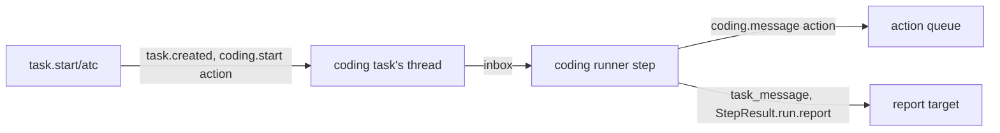

# The coding session runner: the runner

- **Status:** draft
- **Work items:** [the atc runner](https://linear.app/zgeoff/issue/GEO-1843),
  [supervised sessions in the live view](https://linear.app/zgeoff/issue/GEO-311)

The coding runner's step holds no model. It passes each message in a coding task's inbox to the
bound session, and turns what the session does into task messages and one report per task run. This
part holds the start, the definition, the records, the step and the limits. The adapter it drives is
in [the atc adapter](atc.md), and the [README](README.md) has the diagram and the terms.

## Shape



## Contracts

### The start

```ts
task.start({
  runner: 'atc',
  name: 'Fix the flaky login test',
  brief: 'The login test fails 1 run in 5 on CI. Find why and open a pull request with the fix.',
  repo: { url: 'https://github.com/example/shop.git', ref: 'main' },
  agent: 'claude', // optional: atc's agent ID; omitted: the configured default, else the target's
  model: 'opus', // optional: passed to atc, which checks it against what the agent offers
  report: 'wake', // optional: as built, default 'wake'
});
// → { taskID: 't7k2' }
//   or the plan's refusal sentence

// coding module. The variant's input: a strict object, so `limits`, `reportShape`, `persona`,
// `memory` and `tools` are refused by the schema.
interface CodingStart extends TaskStartEnvelope {
  runner: string; // the adapter's ID, as a constant
  repo: { url: string; ref: string }; // url: https:// or ssh form, never starting with '-'
  agent?: string;
  model?: string;
}

// tasks module: the port change. A plan can queue outside work in the start's transaction.
type RunnerStartPlan<Options> =
  | {
      status: 'planned';
      envelope: { report: TaskReport; limits: TaskLimits };
      options: Options;
      actions: readonly RunnerAction[]; // new; [] for the sandbox runner
    }
  | { status: 'refused'; sentence: string };

// actions module. An action the runner queues, decided by the call or the record that caused it.
interface RunnerAction {
  tool: string; // a connector tool that no tool list holds, such as 'coding.start'
  args: JSONObject; // erasable, as every action's arguments are
  hashParts: readonly string[]; // the action hash; a rerun with the same parts queues nothing
  causedBy: { kind: 'tool_call'; callID: string } | { kind: 'record'; sequence: number };
}
```

### The runner definition

```ts
const { definition, runStep } = buildCodingRunner(atcAdapter, codingSettings);
// definition.key === 'atc'

// tasks module: the members the port gains. The sandbox runner and every fixed-task runner set
// meters ['turns', 'dollars'], message null and ended null.
export interface TaskRunnerDefinition {
  // …existing fields
  readonly meters: readonly ('turns' | 'dollars')[]; // the meters a claim and a pre-step read apply
  readonly message: EffectDeclaration | null; // the declaration of `task.message/<key>`; null: none
  readonly ended:
    | ((context: RunnerContext, taskID: string, cause: 'stopped' | 'closed') => Promise<void>)
    | null;
}

// coding module: the coding runner's definition, one per adapter
const codingDefinition = {
  key: adapter.id,
  controls: ['pause', 'resume', 'stop', 'close'],
  start: defineRunnerStart(codingStart), // declares `task.start/<key>`
  fixedTasks: [],
  keepsSandboxes: false,
  meters: [],
  message: { effects: ['send'], contentArgs: ['body'] }, // `task.message/<key>`
  ended: stopBoundSession,
} satisfies TaskRunnerDefinition;
```

The start variant's declaration:

```ts
// `task.start/atc`
const codingStartDeclaration: EffectDeclaration = {
  effects: ['coding_start'],
  destinations: [],
  contentArgs: ['brief', 'name'],
};
```

### The records and the projection

```ts
// coding module. On the coding task's thread. Neither is an inbox record.
// coding.session_bound: written by the step that reads the spawn's done outcome
interface CodingSessionBound {
  taskID: string;
  adapter: string; // the runner key
  sessionID: string;
  actionID: string; // the spawn action
  fromCursor: JSONValue; // from the spawn's result: where the source's catch-up read starts
}
// coding.delivered: written by the step that reads a message action's done outcome
interface CodingDelivered {
  taskID: string;
  messageID: string; // nixie's task_message or owner_message ID
  messageRef: string; // the adapter's message ID
  hop: number; // the hop of the step that queued the delivery
}
```

```text
coding_sessions, one appended migration. Key session_key = '<adapter>\n<sessionID>'.
  task_id         text
  adapter         text
  session_id      text
  state           text    -- SessionState, or 'starting' before the first event
  hop             integer -- the hop of the newest delivery or of the start; every task_input takes it
  from_cursor     text    -- JSON: the catch-up read's start
  last_event_at   integer -- epoch ms, null before the first event
  updated_sequence integer
Folded from coding.session_bound, coding.delivered and trigger.task_input of a coding source.
tasks gains a column: runner text, null when task.created has no runner key.
```

### What one step does

The step reads the inbox oldest first and takes these actions in one commit:

| Inbox record                                     | The step                                                                                                               |
| ------------------------------------------------ | ---------------------------------------------------------------------------------------------------------------------- |
| the task's brief                                 | nothing: the start queued the spawn; the task run stays open                                                           |
| `coding.start` done                              | writes `coding.session_bound`                                                                                          |
| `coding.start` failed or unknown                 | ends the task run with a report that says so, and returns `done` on failed, `wait` on unknown                          |
| a `task_message` or `owner_message` to the task  | queues a `coding.message` action, caused by that record                                                                |
| `coding.message` done                            | writes `coding.delivered`                                                                                              |
| `coding.message` failed or unknown               | replies to the message's sender that the session never got it, or may not have                                         |
| `trigger.task_input`, `answered` or `unanswered` | replies to the sender of the message whose `coding.message` result holds its `messageRef`, with `replyTo` that message |
| `trigger.task_input`, `note`                     | sends a `progress` message to the report target, waking it for `blocked` and `decision` only                           |
| `trigger.task_input`, `state` `waiting`          | sends a `progress` message with the question to the report target, which wakes it                                      |
| `trigger.task_input`, `state` `idle`             | ends the task run with a report, when no delivery of this task is queued or waits on an answer                         |
| `trigger.task_input`, `state` `ended`            | ends the task run with a report when one is open, and returns `done`                                                   |

```ts
// tasks module: the port change that lets a runner with no model end a task run
interface StepResult {
  // …existing fields
  run?: {
    // …existing fields
    report?: { summary: string }; // the commit writes task.run_report_requested from it
  };
  actions?: readonly RunnerAction[]; // queued in the commit's transaction, after its lease check
}
```

- The step finds the message an answer belongs to from the results of the task's `coding.message`
  actions, through the built `readTaskActions`. When no result matches and one of those actions is
  still pending, the step stops at that record: it acknowledges every record before it, reads none
  after it, and sets a timer 5 s out, so it handles the answer once the outcome lands. When every
  `coding.message` action is final and none matches, the step sends the answer to the report target,
  marked as matching no message nixie sent.
- The report's summary is `results(session).text`, cut to 8,000 characters. When the read fails or
  `text` is null, the summary is "The session's turn ended, and nixie could not read its final
  reply."
- Every body the step sends from the session is outside content: each `task_message` carries
  `source: 'untrusted'`, and its text sits inside the built block for outside content.
- Each message the step sends takes the hop of `coding_sessions.hop` plus 1, so a loop between Nix
  and a session stops at the built hop limit.

### `tasks.list` and the live view

```ts
tasks.list({ runner: 'atc', state: 'waiting', limit: 20 });
// → { tasks: [{ id: 't7k2', name: 'Fix the flaky login test', runner: 'atc', limits: null,
//      session: { state: 'waiting', lastEventAt: 1_794_550_000_000 }, … }] }

// tasks module: the listed task gains `limits: null` for a runner with no meters.
// coding module: `session` comes from coding_sessions, and the API stream sends each row change.
```

## Constraints

### The start and the policy

- The composition root builds a coding runner only when its config section is set, so
  `task.start/atc` is in the input only then. This is the config key that rule 9 lets the
  composition root read, and the port's "no config key adds one" holds: no config adds a definition
  the server does not build.
- The start runs direct. In its transaction it writes `task.created` with `runner: 'atc'`, then
  queues the spawn as a `RunnerAction` caused by the start's call, under the start call's decision,
  so you are asked at most once per start.
- The spawn action sits on the coding task's thread, so a pause holds it and a stop cancels it
  before its first attempt, as built.
- A rule on `task.start/atc` matches only this variant, and its stage-6 ask runs before consent at
  stage 8, so under `ask-coding-sessions` every start asks. With no matching rule, a start you asked
  for in your own message passes at stage 8.
- `task.message` to a coding task decides under `task.message/atc` with the definition's `message`
  declaration. Its `variants.pick` resolves the receiver from the step's task directory, so the pick
  runs before the decision point and reads no argument but `to`.
- The pick never reads the receiver's state: a task message to a coding task that is done gets the
  built refusal after the decision.

### Delivery

- A delivery's idempotency key is its action ID, and the spawn's is the spawn action's ID. atc holds
  each key per principal and method, so no other caller's key collides with one.
- Inside one attempt, the adapter resends a keyed request unchanged after a dropped connection, only
  while the attempt is younger than the hello's `completedRetentionMs`. Past that, the reply is
  `unknown`.
- A new attempt after a crash never calls atc, as built: the claim marks the action unknown.
- A message longer than the hello's `maxLine` allows is `refused`, cannot clear, with the reason
  `too_long`.
- The adapter sends only the spawn fields its sketch lists. It never sends `atcAccess`, `scope`,
  `parent`, `resume`, `pluginDirs`, `cwd` or `credentialRef`, so a coding session never holds atc
  access of its own.

### Ends, stops and the sweep

- A stop or a close calls `ended` after its transaction commits. A coding runner's `ended` calls
  `stop` on the bound session and logs a failure.
- The coding module sweeps at the source's start and every 10 min: for each task that is stopped,
  closed or failed with a `coding_sessions` row whose state is not `ended`, it calls `stop`. For a
  spawn that finished after the stop, it reads the session from the spawn action's result through
  the built `readTaskActions`.
- A coding runner lacks `restart` and `interrupt`, so both get `runner_lacks_control`. A stopped
  coding task can only close.
- A pause holds the task's queued deliveries. The session runs on in atc, and its events land unread
  until the resume.
- A step never throws on an outside read. Only a record it cannot parse makes it throw.
- A done coding task refuses messages, as built, and the step that returns `done` releases the open
  waits that name it.

### Limits

- A claim and a pre-step read apply only the meters the definition lists. A coding runner lists
  none, so its task runs never end with `limit`.
- The coding variant's plan pins the built default limits in the envelope, and no reader applies
  them to a coding task.
- A session's spend is atc's. nixie bounds a coding task only by your rules on each start and
  message, the hop limit, and your stop.

## Decisions

- **The report repeats the final reply when an answer carried the same text.** An agent's call on 13
  Nov: an answer closes its sender's wait, and a report ends every task run.
- **A message to a coding task decides under `task.message/atc`, which declares `send`.** An agent's
  call on 13 Nov: the [coding design](../../platform/connectors/coding.md) has your rules decide
  every message to a session, and `send` keeps the starter set's allow, so you add an ask rule only
  when you want one.
- **Stop and close stop the session and keep atc's record.** An agent's call on 13 Nov: atc's record
  of the session is outside data, and nixie forgets no outside data without a `delete`.

## Builder decides

- Internal names, file layout and test layout.
- The first line of a delivered message, which names its sender and its message ID.
- The wording of each message the step sends.
- How `tasks.list` resolves a null `runner` and a fixed task to a key for the filter.
- The query of the sweep.
