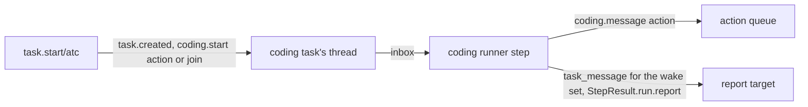

# The coding session runner: the runner

- **Status:** draft
- **Work items:** [the atc runner](https://linear.app/zgeoff/issue/GEO-1843),
  [supervised sessions in the live view](https://linear.app/zgeoff/issue/GEO-311)

A coding task's runner calls no model and judges nothing. Each of its steps moves text and events
between the task and the bound session: it forwards the events in the wake set to the report target,
and ends the task with a report when the session ends. This doc holds the start and the join of a
coding task, the runner's definition, its records, what one step does, and how the task ends. The
tools nixie calls on a coding task are in [the tools](tools.md), and the adapter that the step calls
is in [the atc adapter](atc.md). The terms, such as a bound session, a joined session, a hop and a
variant, are in the [README](README.md#terms).

## Shape



## Contracts

### The start and the join

```ts
task.start({
  runner: 'atc',
  name: 'Fix the flaky login test',
  brief: 'The login test fails 1 time in 5 on CI. Find why and open a pull request with the fix.',
  repo: { url: 'https://github.com/example/shop.git', ref: 'main' },
  target: 'cloud/cloud', // optional: '<daemon>/<target>' from coding.atc.targets; omitted: the default
  agent: 'coder', // optional: atc's agent ID; omitted: the configured default, else the target's
  model: 'opus', // optional: passed to atc, which checks it against what the agent offers
  wake: ['waiting', 'ended'], // optional: the wake set; omitted: coding.wake.started
});
// → { taskID: 't7k2' }

task.start({
  runner: 'atc',
  name: 'Your billing refactor',
  brief: 'Watch for a question, and check the migration once the work is done.',
  session: 'cloud.a1.s7-m4x2p', // join: an atc session ID from coding.sessions
  wake: ['waiting', 'idle', 'ended'], // optional: omitted: coding.wake.joined
});
// → { taskID: 't7k3' }
//   or the refusal sentence that the variant's plan returned

// coding module. A strict object, so its schema refuses `report`, `limits`, `reportShape`,
// `persona`, `memory` and `tools`. Exactly one of `repo` and `session`.
interface CodingStart extends TaskStartEnvelope {
  runner: string; // the adapter's ID, as a constant
  repo?: { url: string; ref: string }; // url: https:// or ssh form, never starting with '-'
  target?: string; // only with repo
  agent?: string; // only with repo
  model?: string; // only with repo
  session?: string; // only without repo: the session to join
  wake?: WakeEvent[]; // see the tools
}
```

- A start's brief is the session's first user turn: the spawn sends it as atc's `prompt`, under the
  spawn's idempotency key, so it reaches the agent once.
- A join's brief is nixie's own note on the task, and a join sends the session nothing.

Each start variant has a `plan` function, which checks the input and returns what the start writes.
A plan returns actions beside its envelope:

```ts
// tasks module: the port change
type RunnerStartPlan<Options> =
  | {
      status: 'planned';
      envelope: { report: TaskReport; limits: TaskLimits };
      options: Options;
      actions: readonly RunnerAction[]; // new; [] for the sandbox runner and for a join
    }
  | { status: 'refused'; sentence: string };

// actions module. An action that a runner or a tool queues on a task's thread. Each attempt meets
// the decision point, as every action's attempt does; the start call's approval, bound to the
// action hash, answers an ask rule.
interface RunnerAction {
  tool: string; // a connector tool that no tool list holds, such as 'coding.start'
  args: JSONObject; // erasable, as every action's arguments are
  hashParts: readonly string[]; // the action hash; a step that runs again with the same parts queues nothing
  causedBy: { kind: 'tool_call'; callID: string } | { kind: 'record'; sequence: number };
}
```

A join's plan reads the session through the adapter's `join` before it returns. It refuses a session
that is out of reach, has ended, or is bound to an open coding task. The coding variant's plan sets
the envelope's report mode to `next_turn`, because the step wakes the report target itself when the
wake set lists `ended`.

### The runner definition

```ts
const { definition, runStep } = buildCodingRunner(atcAdapter, codingSettings);
// definition.key === 'atc'

// tasks module: the members the port gains. The sandbox runner and each fixed-task runner set
// meters ['turns', 'dollars'] and ended null.
export interface TaskRunnerDefinition {
  // …existing fields
  readonly meters: readonly ('turns' | 'dollars')[]; // the meters that limit this runner's task runs
  readonly ended:
    | ((
        context: RunnerContext,
        taskID: string,
        cause: 'stopped' | 'closed' | 'failed',
      ) => Promise<void>)
    | null; // called after a stop, a close or a failure commits
}

// coding module: one definition per adapter
const codingDefinition = {
  key: adapter.id,
  controls: ['pause', 'resume', 'stop', 'close'],
  start: defineRunnerStart(codingStart), // declares `task.start/<key>`
  fixedTasks: [],
  keepsSandboxes: false,
  meters: [],
  ended: releaseBoundSession, // a stop queues `coding.stop`; a close or a failure releases
} satisfies TaskRunnerDefinition;

// `task.start/atc`, for a start and a join alike
const codingStartDeclaration: EffectDeclaration = {
  effects: ['code_run'],
  destinations: [],
  amount: null,
  content: ['brief', 'name'],
  results: {},
};

// `coding.stop`: the action a stop of the task queues, for a started and a joined session alike
const codingStopDeclaration: EffectDeclaration = {
  effects: ['code_run'],
  destinations: [], // the adapter ID and the session ID, such as 'atc:cloud.a1.s7-m4x2p'
  amount: null,
  content: ['origin'], // 'started' | 'joined', which the starter rules match on
  results: {},
};
```

[The tools](tools.md#steering-and-notes) hold the declarations of `coding.steer` and
`coding.message`.

### The records and the projection

```ts
// coding module. All sit on the coding task's thread, and none is an inbox record.
// coding.session_bound: written by the step that reads the spawn's outcome, or by the join
interface CodingSessionBound {
  taskID: string;
  adapter: string; // the runner key
  sessionID: string;
  origin: 'started' | 'joined';
  actionID: string | null; // the spawn action; null for a join
  fromCursor: string; // where the coding source's catch-up read starts
  wake: WakeEvent[]; // the wake set the start or the join took
}
// coding.steered: written by the step that reads a steer's done outcome
interface CodingSteered {
  taskID: string;
  actionID: string;
  hop: number; // the hop of the turn that called coding.steer
}
// coding.delivered: written by the step that reads a note's done outcome
interface CodingDelivered {
  taskID: string;
  messageID: string; // nixie's task_message or owner_message ID, or the coding.message call's
  messageRef: string; // atc's ID of the message
  hop: number;
}
// coding.wake_set: written by coding.watch
interface CodingWakeSet {
  taskID: string;
  wake: WakeEvent[];
}
// coding.session_unbound: written by `ended` for a joined session
interface CodingSessionUnbound {
  taskID: string;
  adapter: string;
  sessionID: string;
  cause: 'stopped' | 'closed' | 'failed';
}
```

```text
coding_sessions, one appended migration. Key session_key = '<adapter>\n<sessionID>'.
  task_id          text
  adapter          text
  session_id       text
  origin           text    -- 'started' or 'joined'
  state            text    -- SessionState, or 'starting' before the first event
  wake             text    -- JSON: the wake set in force
  hop              integer -- the hop of the newest steer or note, else of the start
  from_cursor      text    -- where the catch-up read starts
  last_event_at    integer -- epoch ms; null before the first event
  unbound_at       integer -- epoch ms when the task let go of the session; null while bound
  updated_sequence integer
Folded from coding.session_bound, coding.steered, coding.delivered, coding.wake_set,
coding.session_unbound and trigger.task_input.
```

### What one step does

A coding task's inbox holds the brief, which the start writes as the task's first waking input; the
outcomes of its actions; messages to the task; and the `trigger.task_input` records that the coding
source marks waking. The step handles every action outcome in the inbox first, then every other
record oldest first, and commits once. `state`, `answered`, `unanswered` and `note` are the kinds of
[`SessionEvent`](atc.md#the-coding-adapter). Each row ends in the next state the step returns:
`done` finishes the task, and `wait` leaves it waiting for its next inbox record. A row that names
no state returns `wait`.

| Inbox record                                            | The step                                                                                                                                                                                               |
| ------------------------------------------------------- | ------------------------------------------------------------------------------------------------------------------------------------------------------------------------------------------------------ |
| the brief of a start or a join                          | nothing: the start queued the spawn, and a join sends nothing                                                                                                                                          |
| `coding.start` done, with a result                      | writes `coding.session_bound`                                                                                                                                                                          |
| `coding.start` done, with no result                     | resends the spawn under the action's last key while atc keeps it; past that, ends the task run with a report that says nixie cannot find the session and you can join it by its ID, and returns `done` |
| `coding.start` failed                                   | ends the task run with a report that says atc refused the start, and returns `done`                                                                                                                    |
| `coding.start` unknown, sent to you                     | sends the report target a waking `task_message` that says nixie asked you whether the session started; your answer lands as the action's next outcome                                                  |
| `coding.steer` done                                     | writes `coding.steered`                                                                                                                                                                                |
| `coding.steer` failed, or unknown sent to you           | sends the report target a waking `task_message` that says the session did not get the steer, or may have, with the reason                                                                              |
| a `task_message` or `owner_message` to the task         | queues a `coding.message` action, caused by that record                                                                                                                                                |
| `coding.message` done                                   | writes `coding.delivered`                                                                                                                                                                              |
| `coding.message` failed, or unknown sent to you         | replies to the message's sender that the session did not get it, or may not have                                                                                                                       |
| `trigger.task_input`, `answered` or `unanswered`        | replies to the sender of the note that `coding.delivered` matches by `messageRef`, with `replyTo` set to it                                                                                            |
| `trigger.task_input`, `state` or `note` in the wake set | sends the report target a `task_message` of kind `progress` that wakes it, with the state and the question, or the note's label and text                                                               |
| `trigger.task_input`, `state` `ended`                   | ends the task run with a report, and returns `done`; when the wake set lists `ended`, also sends the report target a waking `progress` message                                                         |

- nixie writes no record of an unknown outcome while it reconciles one, so the step sees only the
  unknown outcomes sent to you.
- The step never ends the task run on `idle`, `waiting` or `gone`. nixie's conversation reads the
  session with `coding.read`, and judges whether the work is done, waits on you, or needs a steer.
- An answer can reach the inbox before the outcome of its note's action. When no `coding.delivered`
  matches an answer and a `coding.message` action of the task is not yet done or failed (queued,
  held by a pause, in an attempt, or unknown), the step stops at the answer. It marks read every
  record before the answer, leaves the answer and every later record unread, and sets a timer 5 s
  out. The timer wakes the next step, which handles the answer the same way, until the outcome
  lands. When none is pending and none matches, the step drops the answer: it answers a note that
  nixie never sent.
- The report's summary is the session's last reply from the adapter's
  [`read`](atc.md#the-coding-adapter), cut to 8,000 characters. When the read fails or the reply is
  null, the summary is "The session ended, and nixie could not read its final reply."
- Each text the step forwards from the session is outside content: each `task_message` carries
  `source: 'untrusted'`, and the model that reads it sees its text marked as outside content.
- Each message the step sends has the hop in `coding_sessions.hop`, plus 1. A loop of messages
  between the conversation and a session therefore stops at the hop limit.

A runner with no model already returns its report in `StepResult.run.report`. The step result gains
one field:

```ts
// tasks module: the port change
interface StepResult {
  // …existing fields
  actions?: readonly RunnerAction[]; // queued in the commit's transaction, after its lease check
}
```

### `tasks.list` and the live view

```ts
tasks.list({ runner: 'atc', state: 'waiting', limit: 20 });
// → { tasks: [{ id: 't7k2', name: 'Fix the flaky login test', runner: 'atc', limits: null,
//      session: { origin: 'started', state: 'waiting', lastEventAt: 1_794_550_000_000 }, … }] }

// tasks module: `runner` filters on the key that each listed task already shows.
// A listed task gains `limits: null` for a runner with no meters.
// coding module: `session` comes from coding_sessions. The API stream sends each change of a row,
// so the live view shows each coding task's session state as it moves.
```

## Constraints

### The start, the join and the policy

- The composition root builds a coding runner only when the `coding.atc` config section is set, so
  `task.start/atc` is on the tool list only then.
- The `task.start` tool runs inside the model's turn, unqueued. In one transaction, a start writes
  `task.created` with `runner: 'atc'`, then queues the spawn as a `RunnerAction` caused by the
  start's tool call. The action hash binds the call's approval, so nixie asks you at most once per
  start.
- The coding module registers `coding.start`, `coding.steer`, `coding.message` and `coding.stop`
  with the action queue as connector actions that no tool list holds, each with its declaration, its
  reconciliation and the adapter call its attempt makes.
- The queue writes the outcome of every attempt that started, as it does for every action, so a
  spawn that finishes after its task stopped still leaves its outcome on the task's thread.
- A join reads the session in its plan, then writes `task.created` and `coding.session_bound` with
  `origin: 'joined'` in one transaction, and queues nothing.
- The spawn action sits on the coding task's thread. A pause of the task therefore holds the spawn,
  and a stop cancels it before its first attempt, as the action queue does for every action.
- The [decision point](../../platform/policy/decision-point.md) checks your ask rules at stage 6 and
  consent at stage 8, the check that your own message asked for the call. A rule on `task.start/atc`
  matches only the coding variant, a start and a join alike. This work adds the starter rule
  `ask-coding-sessions`, which asks on it, so nixie asks you before every start and every join, even
  one you asked for.
- Each `coding.stop` attempt meets the decision point under the tool name `coding.stop`. This work
  adds the starter rule `ask-stop-joined-sessions`, which asks on a `coding.stop` whose `origin` is
  `joined`, so nixie asks you before it stops a session of yours. A stop of a started session runs
  under the starter rules that allow `code_run`.
- [The tools](tools.md#policy) hold the policy of a steer and a note.

### Task runs

- The brief of a start or a join opens the coding task's one task run. The task run ends with the
  task: at the session's end, a failed or lost start, a stop, a close or a failure.
- Each step that returns `wait` leaves the task run open, as every commit of a wakeable task does. A
  steer or a note therefore never opens a task run.

### Ends, stops and the sweep

- A coding task ends as `done` when its session ends, started or joined alike. It waits only on
  `gone`, because a session out of sight can come back: a daemon back up, or a host that wakes.
- A stop, a close or a failure calls the definition's `ended` after its transaction commits.
- After a stop, `ended` queues a `coding.stop` action for the bound session, started or joined. When
  it is done, the step writes `coding.session_unbound`. When you deny a joined session's stop, the
  step writes `coding.session_unbound` and the session runs on in atc.
- After a close or a failure, `ended` calls `stop` on a started session and logs a failure, and for
  a joined session writes `coding.session_unbound` and calls no adapter.
- The coding module sweeps when the server starts and every 10 min after, to catch an `ended` call
  that a crash cut short. For each coding task that is stopped, closed or failed, with a started
  session whose state is not `ended`, the sweep calls `stop`. A spawn can also finish after a stop.
  No step then runs to write `coding.session_bound`, so the sweep reads the session's ID from the
  spawn's outcome, which is a record on the task's thread. For a joined session still bound to such
  a task, the sweep queues the `coding.stop` that a stop's `ended` never queued, or writes
  `coding.session_unbound` for a closed or failed task.
- A coding runner lacks `restart` and `interrupt`, so both controls get `runner_lacks_control`. A
  stopped coding task can only be closed.
- A pause holds the task's queued steers and notes. The session runs on in atc, and its events land
  in the inbox unread until the resume.
- A step never throws when an outside read fails. Only a record it cannot parse makes it throw.
- A done coding task refuses messages, as every done task does. The step that returns `done`
  releases every [message wait](../../../architecture/core/task-messages.md#message-waits) that is
  open on the task: each sender that waits on a reply from it stops waiting.

### Limits

- Before each step, the task's claim reads only the meters in the task's runner definition. A coding
  runner lists none, so its task runs never end with `limit`.
- The coding variant's plan still fills the envelope's limits with the `models.limits.taskRun`
  defaults, because the envelope's type needs them. The claim never reads them for a coding task.
- The only limits nixie puts on a coding task are your rule on each start, join, steer and note, the
  hop limit on a loop of messages, and your stop. The coding agent's spend and wall time sit in atc,
  outside nixie's [budgets](../../platform/policy/budgets.md) and its model gateway.

## Decisions

- **A stop of the task stops its session, joined or started, as a `coding.stop` action.** Your rules
  decide each one, so a joined session stops only when they allow it.
- **Every stop keeps atc's record of the session.** atc's record is outside data, and nixie deletes
  outside data only through a tool that declares `delete`.
- **A start declares `code_run`.** It runs a coding agent on a repo, which is code running outside
  nixie's view, one call at a time.

## Builder decides

- Internal names, file layout and test layout.
- The wording of each message the step sends.
- The query of the sweep.
