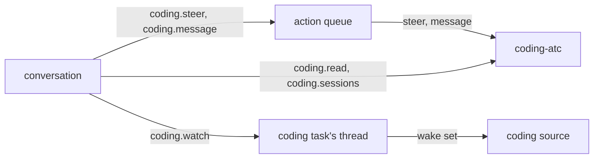

# The coding session runner: the tools

- **Status:** draft
- **Work items:** [the atc runner](https://linear.app/zgeoff/issue/GEO-1843)

nixie works with a coding session through five tools of the coding module: it lists the sessions it
can join, steers a session by typing into its input, sends a note through atc's bridge, reads a
session, and picks the events that wake it. This doc holds each tool's contract, its effect
declaration and its policy. The start and the join are in [the runner](runner.md), and the adapter
calls that each tool makes are in [the atc adapter](atc.md). The terms, such as a steer, a note, the
wake set and a bound session, are in the [README](README.md#terms).

## Shape



## Contracts

### Listing sessions

```ts
coding.sessions({ adapter: 'atc' });
// → { sessions: [{ id: 'cloud.a1.s7-m4x2p', name: 'billing refactor', state: 'idle',
//      target: 'cloud/cloud', cwd: '…/billing', boundTo: null }] }
// coding module. Effects: read. Lists every session on a configured target that has not ended,
// with the task that binds it, if any. Names and paths are untrusted text.
```

### Steering and notes

```ts
coding.steer({ task: 't7k2', text: 'Stop changing the retry count. Find why the cookie expires.' });
// → the action's view, as every action's tool shows it: done, failed, pending or unknown
// coding module. Queues a `coding.steer` action on the coding task's thread, caused by the call.
// The adapter types `text` into the session's input and presses Enter: one user turn.

coding.message({ task: 't7k2', text: 'FYI: the CI fix for the cache landed on main.' });
// → the action's view, as above
// coding module. Queues a `coding.message` action: a note through atc's bridge, which the agent
// can answer and which never steers the session. The answer comes back as a reply to the sender.

// coding module: the declarations of the two actions
const codingSteerDeclaration: EffectDeclaration = {
  effects: ['send'],
  destinations: [], // filled with the adapter ID and the session ID, such as 'atc:cloud.a1.s7-m4x2p'
  amount: null,
  content: ['text'],
  results: {},
};
const codingMessageDeclaration = codingSteerDeclaration; // the same shape, under its own tool name
```

A `task_message` or an `owner_message` to a coding task becomes a `coding.message` action, as
[what one step does](runner.md#what-one-step-does) describes.

### Reading a session

```ts
coding.read({ task: 't7k2' });
// → { state: 'idle', question: null,
//     lastReply: { text: 'I opened a pull request with the fix …', cut: false } }

coding.read({ task: 't7k2', prompt: true, tail: 3 });
// → { state: 'waiting', question: 'Claude needs your permission',
//     lastReply: { text: '…', cut: true },
//     prompt: { text: 'The login test fails 1 time in 5 …', cut: false },
//     tail: { turns: [{ user: 'Find why the cookie expires.', assistant: '…', tools: ['Bash: bun test'] }],
//             cut: true } }

// coding module. Effects: read. Every text in the result is outside content, untrusted.
interface CodingReadInput {
  task: string; // a coding task with a bound session
  prompt?: boolean; // true: the session's initial prompt, cut to 2,000 characters
  tail?: number; // the last n turns, 1 to 5, together at most 8,000 characters
}
interface CodingReadResult {
  state: SessionState; // from the adapter; see the atc adapter
  question: string | null; // the session's pending question, while it waits
  lastReply: CutText | null; // the final reply of the latest finished turn, cut to 2,000 characters
  prompt?: CutText | null; // only with `prompt: true`; null when the session had none
  tail?: { turns: TailTurn[]; cut: boolean } | { unsupported: true }; // only with `tail`
}
interface CutText {
  text: string;
  cut: boolean; // true: nixie cut the text, and the model sees a line that says so
}
interface TailTurn {
  user: string; // the user row that opens the turn
  assistant: string; // the assistant rows after it, joined
  tools: string[]; // the tool uses atc summarised
}
```

### Picking the wake set

```ts
coding.watch({ task: 't7k2', wake: ['waiting', 'ended'] });
// → { wake: ['waiting', 'ended'] }
// coding module. Effects: note. Writes `coding.wake_set` on the coding task's thread, and the
// coding source reads the new set from the next event on.

// coding module. Also the type of the `wake` option of a start and a join.
type WakeEvent =
  | 'waiting' // the session asks for a person
  | 'idle' // a turn ended and the session waits for input
  | 'ended' // the session ended; the report goes out as well
  | 'gone' // the session left sight: out of reach, its daemon's identity changed, or its host asleep
  | 'progress' // a note the session sent, by its label
  | 'blocked'
  | 'decision';
```

```yaml
# deployment config, the coding section: the default wake sets, for every adapter
coding:
  wake:
    started: [waiting, idle, blocked, decision, ended, gone]
    joined: [waiting, ended, gone]
```

## Constraints

### Tools and their tasks

- The composition root builds these tools only when a coding runner is built, so they are on the
  tool list only then.
- `coding.steer`, `coding.message`, `coding.read` and `coding.watch` refuse a task that is not a
  coding task, has no bound session, or is done, failed or closed. The refusal is one sentence the
  model reads.
- A steer and a note sit on the coding task's thread, so a pause of the task holds them, and a stop
  cancels them before their first attempt, as the action queue does for every action.
- The hop of a steer or a note is the hop of the turn that called the tool. The step that reads its
  done outcome writes it into `coding_sessions.hop`.

### Steering

- A steer types the whole text as one paste, newlines included, then presses Enter.
- The adapter reads the session's state before it types, and refuses a steer to a session in
  `waiting` with `canClear: false` and the reason `menu_open`. A waiting session shows a menu, and a
  typed Enter would pick its highlighted option.
- A steer declares `none` reconciliation. Its unknown outcome goes to you at once, because a resend
  types the line again.
- The step tells the report target when a steer fails or its unknown outcome reaches you, so a steer
  that a later turn queued still reaches nixie.
- A steer carries no label of its sender. The session takes it as user input, as a line you type.

### Reading

- `coding.read` makes one adapter `read` per call. A failed read gives a refusal sentence with atc's
  reason, and the tool never throws.
- The cut keeps the end of a reply and the newest turns. The tail keeps whole turns while they fit
  in 8,000 characters, and cuts the oldest turn it keeps only when the newest one alone is longer.
- A session whose agent has no transcript reader gives `tail: { unsupported: true }`.

### The wake set

- A start or a join takes the `wake` option. Without it, the task takes the default set for its
  origin from `coding.wake`.
- The coding source writes each event of a bound session on the coding task's thread. An event in
  the wake set wakes the step. Every other event lands as a record that wakes nothing and changes
  only `coding_sessions`.
- `ended` always wakes the step, in or out of the wake set, because the step ends the task.
- `coding.watch` takes a whole set. An empty set is valid: then only the session's end and the
  report reach nixie.

### Policy

- This work adds the starter rule `allow-coding-input`, which allows `coding.steer` and
  `coding.message` for the destinations `atc:*`. That gives each bound session standing permission
  at the decision point's stage 5, so nixie asks you before a steer or a note only when you add an
  ask rule.
- `coding.read` and `coding.sessions` declare `read`, and `coding.watch` declares `note`, so the
  starter rules allow them.

## Decisions

- **The step forwards an event and never summarises it.** The `task_message` carries the event's
  kind, the state, and the question or the note's text. nixie calls `coding.read` for more.
- **`coding.read` is lean by default.** Its default answer fits one screen, so a check on a session
  costs nixie's context little, and the prompt and the tail come only on request.
- **The tail reads atc's transcript from the start, a page at a time.** atc's transcript read has no
  tail, so the adapter pages forward with the largest page atc takes and keeps the last turns. A
  long session's tail costs one call per 200 rows.

## Builder decides

- Internal names, file layout and test layout.
- The wording of each refusal and of the cut line.
- Whether the adapter caches a transcript cursor per session between tail reads.
