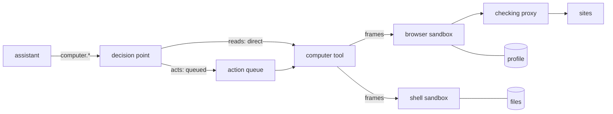

# The computer

- **Status:** draft
- **Work items:**
  [the assistant has a computer of its own](https://linear.app/zgeoff/issue/GEO-2730), then
  [its own email and accounts](https://linear.app/zgeoff/issue/GEO-2731), which sign in through its
  browser

The assistant gets a computer that stays: a browser and a terminal, each in its own long-lived
sandbox with a disk that keeps its state between uses. The browser sandbox runs headless Chromium
through Playwright and keeps the browser profile. The shell sandbox runs commands and keeps the
assistant's files. A guest program in each one talks to nixie over the same framed stdin and stdout
as the fetch guest. Reading a page runs like a web fetch. Clicking, typing and running a command
reach the outside world, so each one passes the decision point as an action.

## Shape



## Contracts

### The tools

```ts
computer.open({ url: 'https://example.org/signup' }); // a new tab
//   or { refused: 'TAB_LIMIT' } when 5 tabs are open, or the blocked and failed results web_fetch returns
// → { tab: 't1', url: 'https://example.org/signup', status: 200, title: 'Sign up', part: 1, parts: 2,
//     text: '… [L3] Terms … [E4 textbox "Name"] [E7 button "Create account"] …', isDiskNew: false }

computer.read({ tab: 't1', mode: 'snapshot', part: 2 }); // mode: 'text' | 'snapshot'
// → { tab: 't1', url, part: 2, parts: 2, text }

computer.screenshot({ tab: 't1' });
// → { tab: 't1', url, width: 1280, height: 800 } with the viewport's picture beside the result
// read and screenshot return { refused: 'TAB_GONE' } for a tab that no longer exists

computer.fill({ tab: 't1', fields: [{ element: 'E4', value: 'Ada' }], submit: false });
computer.click({ tab: 't1', element: 'E7' });
// both → { tab: 't1', url, status: 200, isNavigated: true, part: 1, parts: 1, text: '…the page after the act…' }
//   or { refused: 'STALE_ELEMENT' } | { refused: 'PAGE_CHANGED' } | { refused: 'CROSS_ORIGIN_SUBMIT' }
//   or { refused: 'TAB_GONE' }

computer.close({ tab: 't1' }); // → { closed: true }

computer.download({ tab: 't1', element: 'E9' });
// → { file: 'report.pdf', bytes: 182044, path: '~/files/downloads/report.pdf' }
//   the browser sandbox saves it, and nixie copies it into the shell sandbox

computer.run({ command: 'ls ~/files', timeoutSeconds: 30 }); // timeoutSeconds: 1 to 300
// → { exitCode: 0, stdout: { text: 'notes.md\n', isCut: false }, stderr: { text: '', isCut: false }, seconds: 0.2 }

computer.readFile({ path: '~/files/notes.md', part: 1 });
// → { path, bytes: 2210, part: 1, parts: 1, text: '…' }  or { refused: 'NOT_TEXT' } | { refused: 'NO_FILE' }
computer.writeFile({ path: '~/files/notes.md', text: '…' }); // or from: { image: 'k3x9m2p7qa' } | { file: 'f9k2m4q7ws' }
// → { path, bytes: 2318 }   `from` copies an image or a code.run file into the shell
computer.exportFile({ path: '~/files/chart.png' });
// → { file: 'f2r8k5w1mz', name: 'chart.png', bytes: 40211 }
//   a file that file.send, image.import and code.run take, as they take a code.run file; at most 25 MiB
```

```ts
// connectors module: the effects each tool declares
// computer.open, computer.read, computer.screenshot, computer.download: ['fetch'], run direct
// computer.close, readFile, writeFile, exportFile: ['note'], run direct
//   they touch only the shell's disk and nixie's own store, so nothing leaves nixie
// computer.fill, computer.click: ['send'] with the tab's host as the destination, queued
//   their "always allow" rule pins only the host: tab, element and value are free text to the card
// computer.run: ['computer_run'], a new effect, queued; it asks unless a rule allows it
// every result field except status, part, parts and the flags is untrusted, and so is the screenshot
```

- The guest numbers tabs `t1`, `t2` and on, and the `E` IDs of each page. `open`, a snapshot `read`
  and every act give a page new `E` IDs, which replace the old ones.
- nixie stores each page's text and links and pages them as `web_fetch` does, with `L` IDs from
  [link IDs](../../architecture/connectors/web-fetch.md#link-ids). `open` never reads the page
  cache, because a tab shows the live page with its cookies.
- `isDiskNew` is true on the first result after nixie created the sandbox empty.

### The guest's frames

```ts
// wire lib: length-prefixed frames, like the fetch guest's
type ComputerRequest =
  | { op: 'open'; url: string; limits: FetchLimits; deniedRanges: string[] } // both as the fetch guest takes them
  | { op: 'read'; tab: string; mode: 'text' | 'snapshot' }
  | { op: 'screenshot'; tab: string }
  | { op: 'act'; tab: string; expectURL: string; acts: Act[]; submit: boolean }
  | { op: 'close'; tab: string }
  | { op: 'download'; tab: string; element: string }
  | { op: 'run'; argv: string[]; timeoutSeconds: number }
  | { op: 'readFile'; path: string }
  | { op: 'writeFile'; path: string; bytes: Uint8Array };

type Act = { kind: 'click'; element: string } | { kind: 'fill'; element: string; value: string };

type ComputerReply =
  | {
      ok: true;
      page: { url: string; status: number; title: string; text: string; links: string[] };
    }
  | { ok: true; screenshot: { mediaType: 'image/png'; bytes: Uint8Array } }
  | { ok: true; run: RunResult }
  | { ok: true; download: { name: string; bytes: Uint8Array } } // download and readFile
  | { ok: true; written: { bytes: number } }
  | {
      ok: false;
      reason: 'stale_element' | 'page_changed' | 'cross_origin_submit' | 'tab_gone' | 'failed';
    };
```

Each guest is one long-lived process per wake, and it answers frames one at a time. While it
navigates, the browser guest sends nixie the fetch guest's hop frame for each hop and waits for the
answer, so the same hop gate and secret scan apply.

### The sandbox kinds

```ts
// sandbox module
// …existing kinds
type SandboxKind = /* … */ 'browser' | 'shell';
// sandboxKinds.browser = { egress: 'public', hasModelGrant: false, toolRoute: false }
// sandboxKinds.shell   = { egress: 'public', hasModelGrant: false, toolRoute: false }
// sandboxSizes.browser = { vcpus: 2, memoryMiB: 1024, diskMiB: 8192 }
// sandboxSizes.shell   = { vcpus: 1, memoryMiB: 512,  diskMiB: 16384 }
// owners 'computer-browser' and 'computer-shell', one each per deployment
```

## Constraints

Isolation:

- Neither sandbox ever holds a grant. Their egress is public, and the adapter refuses a grant beside
  public egress.
- No tool reads the browser sandbox's profile, process or DevTools port, and no tool runs a command
  there. A secret that the sign-in broker fills stays out of the shell's reach.
- The shell holds only the assistant's own files. A command a rule allows can send them anywhere.
- Every browser connection leaves through the guest's checking proxy, which runs the fetch guest's
  address checks and pins each resolved address. The checks move to a lib that both guests import.
  QUIC and WebRTC are off.
- The guest asks nixie to scan each navigation hop for secrets, as the fetch guest does. The secret
  scan also runs on every value `computer.fill` types and on every `computer.run` command.

Acting:

- A queued act carries the tab's URL from the moment the assistant called it. When the tab's URL
  differs at run time, the act returns `PAGE_CHANGED` and does nothing.
- A submit whose form posts to another origin returns `CROSS_ORIGIN_SUBMIT` and does nothing.
- `computer.download` refuses a tab that holds a field the sign-in broker filled. It runs direct,
  because it only moves bytes between the assistant's own sandboxes, and the file counts as
  untrusted.
- nixie counts each call that can change the shell's disk: `writeFile`, `download` and `run`. A
  `computer.run` that waits for your decision keeps the count from when it was proposed. When the
  count moved before it runs, the run returns `FILES_CHANGED`, does nothing, and the assistant
  proposes it again, so an approved command never runs a script that changed after you read the
  card. A run that a rule allows skips this check.
- Calls into each sandbox run one at a time, from the conversation or a started task. A call waits
  up to 60 seconds for its turn, and `computer.run` up to its own timeout as well.

Lifecycle:

- Recovery keeps both sandboxes when their image is outside the release. nixie replaces each one at
  its first use after the release, and copies the profile or the files into the replacement after it
  stops Chromium or the shell.
- When a sandbox is gone, the next call creates an empty one.
- The browser sandbox sleeps after 30 minutes idle, and never while a queued act on one of its tabs
  waits for your decision. The shell sandbox sleeps after 5 minutes idle.
- When a wake keeps the sandbox's memory, the tabs and their IDs survive the sleep. When it doesn't,
  Chromium restarts, every tab ID from before the sleep returns `TAB_GONE`, and the profile keeps
  the sign-ins.
- A forget never reaches inside either disk.
- The disks are working space. What must last goes in the notebook or in memory, which nixie's
  backup covers. The tools' descriptions say so, and `isDiskNew` tells the assistant that the disk
  started empty.
- A reset is an owner action in the web client, for the browser, the shell or both. It destroys the
  sandbox, and the next call creates an empty one.

Records:

- The log records each call and its result. Screenshot bytes and the browser profile never reach the
  log.
- Each screenshot passes through the same fit and reservation as a fetched image.

## Decisions

- **The browser and the shell are separate sandboxes.** In one sandbox, a command could read a
  password the broker filled into a page, from the page's memory or the DevTools port.
- **The computer keeps its disks.** Accounts, downloads and work in progress need to outlast one
  call, unlike a fetch, which gets a fresh sandbox each time.
- **Reading is a fetch, acting is a send.** A read changes nothing outside nixie. A click or a fill
  can post a form, so each one passes your rules with the site's host.
- **The terminal has its own effect.** `code_run` means a sandbox with no network, and the
  computer's shell reaches the internet.
- **Tab and element IDs are counts.** Like link IDs, they live only as long as a page or a browser
  process, so a short ID from the database would outlive what it names.
- **nixie keeps no backup of the disks.** A backup would outlive a forget, so every sandbox runs
  with backups off.

## Builder decides

- The guests' layout, the browser image, and how the browser guest starts Chromium.
- How the snapshot text lays out elements, within the `E` ID form.
- The page and part sizes, from the web fetch limits.
- The copy between sandboxes on a release.

## Out of scope

- Signing in. [Email and accounts](https://linear.app/zgeoff/issue/GEO-2731) adds the sign-in
  broker.
- A shell session that persists between `computer.run` calls.
- A desktop with a window manager, and screen sharing.

## Open questions

- **Does a wake keep the browser's memory?** The spike settles it. Until then, the build treats
  every wake as a restart.

- **Are `computer` and the `computer.*` tool names right?** The owner settles it. Until then, the
  build uses them.
- **Do the sizes and the idle timeout fit?** A spike in a sandbox settles them. Until then, the
  build uses the sizes above and the idle times in [Lifecycle](#constraints).
