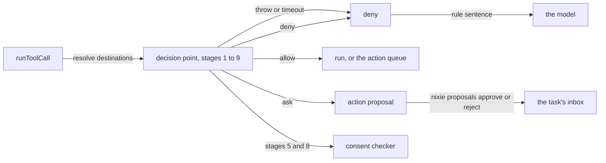

# The decision point cutover

- **Status:** draft
- **Work items:** [the full decision point](https://linear.app/zgeoff/issue/GEO-1803)

nixie's [decision point](../../architecture/policy/decision-point.md) decides every tool call. In
the code today, stages 1 and 2 deny an unknown tool and a tool outside the caller's list, and then
one rule written in code, `slice1.read-only`, allows reads, fetches and notes and denies every other
call. The cutover replaces that rule with stages 3 to 9 of the
[decision point design](../platform/policy/decision-point.md#the-pipeline):

| Stage | Decides                                                            |
| ----- | ------------------------------------------------------------------ |
| 3     | your deny rules                                                    |
| 4     | the always-ask set: `spend`, `policy_widen` and `budget_raise` ask |
| 5     | destination limits: a destination with no standing permission asks |
| 6     | your ask rules                                                     |
| 7     | your allow rules                                                   |
| 8     | consent: your own message asked for this call                      |
| 9     | no rule matched, so the call asks                                  |

A call that asks waits as an action proposal: a pending record that you approve or decline from the
host commands or the proposals screen. A decision point that throws or runs out of time denies the
call. The pipeline's meaning stays in the decision point design and the
[rules design](../platform/policy/rules.md). This doc holds what the cutover adds to make the
pipeline run, and the order of the cutover in production.

Two designs build on this one. The approval record design ([approval record](approval-record.md))
later folds the action proposal into one record for every kind of proposal, and the budgets design
([budgets and hard stop](budgets-and-hard-stop.md)) adds lifts to stage 4. Other terms are in the
[glossary](../../glossary.md).

## Shape



## Contracts

### The call and the decision

```ts
const decision = await decide({
  tool: 'mail.send',
  toolList: ['mail.send', 'memory.recall'],
  context: 'task',
  definitionID: 'weekly-report',
  args: { to: ['sam@example.org'], subject: 'Q3 numbers', body: '…' },
  destinations: [{ value: 'sam@example.org', replyTarget: false }],
  sources: ['own_data'],
  at: 1_794_550_000_000,
  turnMessageID: null,
  onBehalfOf: ['e_19c4'],
});
// → { decision: { outcome: 'ask', stage: 5, cause: 'outside_steering',
//       destinations: [{ value: 'sam@example.org', permission: null }], snapshot: '9f2e…' },
//     sentence: null }
// No permission covers the address, and the linked message does not name it, so stage 5 asks.

// policy module. Async from the cutover on, because stages 5 and 8 call the consent checker.
type DecisionPoint = (call: PolicyCall) => Promise<PolicyDecision>;

interface PolicyCall {
  // …existing fields: tool, toolList
  context: RuleContext; // policy module, existing
  definitionID: string | null; // the task definition whose task run makes the call
  args: Readonly<Record<string, unknown>>;
  destinations: readonly CallDestination[]; // the tool endpoint resolves them before stage 1
  sources: readonly RuleSource[]; // policy module, existing
  at: number;
  turnMessageID: string | null; // the message you typed that started this turn; null in a task run
  // IDs of messages you typed, which a task_message carried to this task (tasks module, existing).
  // A task passes them on when it messages the next task, so a chain of tasks can carry them.
  onBehalfOf: readonly string[];
}

interface CallDestination {
  value: string; // NFC; an address, a phone number or a host
  // true only for the sender of a message that nixie read (Reply-To, else From), or the organizer
  // of a calendar event that nixie read, resolved on the host from the ID the call names
  replyTarget: boolean;
}

interface PolicyDecision {
  decision: Decision;
  sentence: string | null; // a deny's text for the model
}

// policy module
type Decision = {
  outcome: 'allow' | 'ask' | 'deny';
  stage: 1 | 2 | 3 | 4 | 5 | 6 | 7 | 8 | 9;
  rule?: { id: string; revision: number; others: string[] }; // others: the other matching rules
  cause?: 'outside_steering' | 'always_ask' | 'ask_rule' | 'no_rule'; // set on every ask
  defect?: 'direct_request' | 'repeat';
  destinations: Array<{
    value: string;
    permission: 'owner' | 'reply_target' | 'known_contact' | 'job' | 'rule' | null;
  }>; // 'job': the allowed destinations of the task definition
  consent?: {
    messageIDs: string[];
    codeCheck: 'pass' | 'fail';
    checker: 'yes' | 'no' | 'unsure' | 'unreachable';
  };
  snapshot: string; // the snapshot hash of the definitions in force
  fault?: 'threw' | 'timed_out'; // set on a deny because the decision point failed
};
```

The causes are those of [prompt causes](../platform/policy/decision-point.md#prompt-causes):
`outside_steering` is stage 5, `always_ask` stage 4, `ask_rule` stage 6 and `no_rule` stage 9.

### The stored decision

The tool endpoint stores each decision on the envelope of its `tool_called` record. The release
before the cutover parses that `decision` with a non-strict object, so it drops a key it does not
know. It needs `rule` as null or an object, and parses `destinations` and `consent` in their old
shapes when they are present; both are optional. The stored shape therefore keeps `rule`, writes
neither old optional key, and adds new ones:

```ts
// log module: the envelope's Decision, extended. Every added key is optional.
interface StoredDecision {
  // …existing fields: outcome, stage, rule (null when Decision has none)
  ruleOthers?: string[];
  cause?: PromptCause; // log module, existing
  defect?: 'direct_request' | 'repeat';
  permissions?: Array<Permission | null>; // one per destination, in the order of erasable.destinations
  consentCheck?: { messageIDs: string[]; codeCheck: 'pass' | 'fail'; checker: CheckerResult };
  fault?: 'threw' | 'timed_out';
  inputs?: {
    // what a replay needs beyond the input and the destinations
    toolList: string[];
    context: RuleContext;
    definitionID: string | null;
    sources: RuleSource[];
    turnMessageID: string | null;
    onBehalfOf: string[];
  };
  // From the cutover on, nothing writes destinations or consent. The snapshot is the envelope's
  // definitions.snapshotHash, and `at` is the record's time.
}
```

```ts
// tool_called gains one erasable field, the resolved destinations. A record forget removes its
// erasable fields with the record's key, so no contact's address sits in a plain column.
erasable: { input, destinations: [{ value: 'sam@example.org', replyTarget: false }] }

// The tool_result record of an ask holds outcome 'queued' and actionID null, because the release
// before refuses an outcome that its codec does not list. Code that reads a tool_result tells an
// ask apart by the decision on its tool_called record.
```

### What the model reads

```text
deny:  Not allowed by rule `deny-purge` (r2): **Deny** `mail.purge`. Try another way, such as `mail.trash`.
ask:   Waiting for approval as `k3x9m2p7qa`. You can keep working; you will hear the answer in your inbox.
fault: Not allowed: nixie could not decide on this call. Try again later.
```

A deny at stage 1 or 2 keeps its existing sentence. A deny from stage 3 renders the rule's sentence
with the existing rule renderer.

### Consent

```ts
// policy module. Stage 5 calls it for a destination with no permission, and stage 8 reuses the answer.
const consent = await checkConsent(call, messages);
// → { messageIDs: ['e_19c4'], codeCheck: 'pass', checker: 'yes' }
//   or null: the call has no turn message and no link within link_max_age

// The checker is the existing RunCheck of the sessions module, run under the model role `checker`
// with a consent prompt of its own.
type CheckerResult = 'yes' | 'no' | 'unsure' | 'unreachable';
// asserted → yes; not_asserted → no; unsure → unsure; a timeout, error or unreadable answer → unreachable
```

A link is one ID in `onBehalfOf`: it lets a message you typed carry consent to a task that another
task messaged.

```yaml
# config.yaml: a new section that the policy module owns
policy:
  consent:
    link_max_age: 24 # hours from when you typed the message; a link older than this carries no consent
```

### Known contacts

```bash
nixie contacts list                                    # each known contact: ID, name, destination, since
nixie contacts mark-known sam@example.org --name Sam   # a widening that only you take
nixie contacts unmark <contactID>                      # a narrowing
```

```ts
// policy module. Record kinds of their own, so the release before skips them.
interface PolicyContactMarkedKnown {
  // kind policy.contact_marked_known
  contactID: string; // crypto.randomUUID()
  // erasable: { name: string | null; destination: string }, under this record's own key
}
interface PolicyContactUnmarked {
  // kind policy.contact_unmarked
  contactID: string;
}

// The tool nixie proposes a contact with. It declares policy_widen, so stage 4 always asks, and an
// approval marks the contact as the host command does.
// contacts.mark_known({ destination: 'sam@example.org', name: 'Sam' })
```

```text
known_contacts, a projection that one appended migration adds
  contact_id         text primary key
  marked_sequence    integer not null -- its policy.contact_marked_known, whose erasable fields hold the details
  unmarked_sequence  integer          -- set by policy.contact_unmarked; the row stays
```

### Effect overrides

```yaml
# effects/mail.yaml in the definitions repo: a map of tool name to a change of its effects
mail.trash:
  add: [delete]
mail.label:
  remove: [write]
```

```ts
// policy module. The tool's declaration in code stays the base, and an override changes only its
// effects. Destinations, amount, content and result sources stay in code.
type EffectOverride = { add: Effect[]; remove: Effect[] }; // at least one non-empty; no effect in both
```

`effects/` is a folder at the root of the definitions repo, beside `rules/` and `budgets/`. The seed
applies it from the definitions format that `definitionsFormats.effects` names, and
`definitionsLayout.folders` lists `effects`. In a repo below that format, the seed applies no
`effects/` file and lists each one as not applied.

### A definition's allowed destinations

```yaml
# tasks/weekly-report/task.yaml
destinations:
  - '*@example.org' # patterns in the rule format: `*` is the only wildcard, the whole value matches
```

The key is one of the definition-only keys of the
[task definition format](task-definition-format.md#the-folder-and-taskyaml). That design holds the
key's parsing.

### The action proposal

```ts
// policy module. Record kinds of their own on modules/proposals, as rule change proposals have.
// The approval record design folds them into one proposal record for every kind.
interface PolicyActionProposed {
  // kind policy.action_proposed
  proposalID: string; // crypto.randomUUID()
  shortID: string; // from createShortID; what the model and the host commands name, such as k3x9m2p7qa
  callSequence: number; // the tool_called record whose decision asked
  tool: string;
  effects: Effect[];
  actionHash: string; // SHA-256 over the canonical operation: tool, input, destinations
  cause: PromptCause;
  // erasable: { input, destinations }
}
interface PolicyActionAnswered {
  // kind policy.action_answered
  proposalID: string;
  answer: 'approved' | 'declined'; // `nixie proposals reject` writes 'declined'
  reason: string | null; // erasable
}
// and policy.action_lapsed { proposalID }, which the existing lapse sweep of modules/proposals writes
```

```bash
nixie proposals list                  # rule change proposals and action proposals, each with its sentence
nixie proposals approve k3x9m2p7qa
nixie proposals reject k3x9m2p7qa --reason "Not this week"
```

## Constraints

### The pipeline

- The stages run as the [pipeline table](../platform/policy/decision-point.md#the-pipeline) says,
  and the first that decides returns. A test per stage gives a call that the stage decides and that
  each later stage would decide otherwise.
- `runToolCall` reaches a tool's handler, or the action queue's `enqueue`, only after `decide`
  returns allow. A test lists every registered tool and checks that each one has no other path.
- When `decide` throws, or does not return within 30 seconds, the call is denied. The record holds
  outcome deny, `fault`, and the number of the stage that was running.
- The consent checker's own timeout is shorter than 30 seconds, so a slow checker gives
  `unreachable` and never a fault.
- A defect marks an ask that should not have happened, as
  [prompt causes](../platform/policy/decision-point.md#prompt-causes) defines. A `repeat` needs
  "always allow", which the approval record design adds, so this work never writes `repeat`.

### What the cutover removes and keeps

- `slice1.read-only` leaves the code. Old records keep its ID, and nixie never gives that ID to a
  new rule.
- `slice1.queue-check` stays, as a rule in code that allows `actions.log` alone at stage 7. The
  queue check runs that tool on every start, so it works with any set of allow rules. A deny or an
  ask rule of yours that catches `actions.log` still stops it, at stage 3 or 6.
- `test.allow-send` stays in a test build, as a rule in code that allows `test.send` at stage 7. Its
  call still meets stage 5, so each crash test marks its destination as a known contact first.
- The rule in code `definitions.chat-change` of
  [definitions from chat](definitions-from-chat.md#the-3-tools) leaves the code in the cutover.
  `task.define` and `task.undefine` then pass stages 3 to 9: your own request allows them at stage
  8, and any other call asks at stage 9 unless a rule of yours allows it.
- Each rule in code renders with the rule renderer, and the snapshot's policy part holds it in
  canonical form.
- With no rule of yours in force, stages 3, 6 and 7 match only the rules in code, so every other
  call that consent does not allow asks. This holds in 3 cases:
  - a definitions repo with no `rules/` folder;
  - a definitions repo below format 3, which applies no rules file;
  - a first seed whose allows still wait for your approval.
- In each of those cases the server start logs a warning, which names the first seed's pending
  proposal when one exists.

### Memory writes

- Memory writes declare `note`, and the approval record design moves them to `memory_write`. While
  they declare `note`, a deny or an ask rule on `memory_write` applies to `note` too, as
  [memory writes on rules](approval-record.md#memory-writes-on-rules) sets, and comes before the
  starter rule `allow-notes`. Otherwise `allow-notes` allows them at stage 7, and each memory tool's
  own gate decides whether the write applies or becomes a memory proposal, as it does in the code
  today.
- While memory writes declare `note`, a `note` call that no rule allows reaches stages 8 and 9 like
  any other call. The decision point design's rule that such a call never reaches them applies to
  `memory_write`.
- A moment note written from chat keeps the quote check of
  [0008](../../decisions/0008-memory-write-review.md) in the memory module, which refuses a note
  whose text is not word for word in your typed message. The decision point never stands in for it.

### Destinations

- The tool endpoint resolves each destination on the host before stage 1, from the declaration's
  destination arguments, or from the connector action's `resolveDestinations(input, context)` when
  it declares one. A resolution that fails returns the tool's error to the model, and the call never
  reaches the decision point.
- A reply target comes from a message or an event that a connector read, never from text the model
  wrote.
- `replyTarget` is true only in the destinations that a resolver returns for a reply to that message
  or a response to that event, such as `mail.reply` or `calendar.respond`. It covers that one call
  and no other send. An address the model puts in an argument is never a reply target, even when it
  equals a sender or an organizer.
- The action reaches only the destinations that stage 5 checked. The executor takes them from the
  resolved set on the `tool_called` record. When the provider's data gives another set at execution,
  such as a new Cc on a reply to all, the action fails and sends to none of them. A message in Spam
  or Trash, or one whose From is your own account, gives no reply target.
- Stage 5 gives each destination the first permission that covers it, in this order: `owner`,
  `reply_target`, `known_contact`, `job`, `rule`.
- `job` covers a destination that matches a pattern in the allowed destinations of the definition
  whose task run makes the call. A call with no `definitionID` gets no `job` permission.
- `rule` covers a destination that matches a pattern of an allow rule that matches the whole call.
  At stage 5 that match gives only the permission; stage 7 still decides the call's outcome.
- When a destination has no permission, stage 5 passes the call on only when consent holds: the code
  check passes and the checker answers `yes`. Otherwise that destination keeps `permission: null`,
  and the call asks.
- The first build treats the conversation and every task run as untrusted, so stage 5 runs for every
  call with a destination. A task run that reads outside content, such as a moment whose span holds
  a web page, therefore meets stage 5 on every call with a destination, like every other task run.

### Consent

- The code check passes when every destination appears word for word in the typed text of a
  consenting message. It also passes for a destination when a name typed there matches, between word
  boundaries, exactly one known contact with that destination. It uses the typed-text match of the
  memory quote check.
- Consent comes from the turn's message, which needs no age check, and from each message that an
  `onBehalfOf` ID names. A linked message counts only when you typed it, within
  `policy.consent.link_max_age` before the call's `at`. A link carries consent through any number of
  tasks.
- An `onBehalfOf` ID that names no message you typed, or a message older than `link_max_age`, adds
  nothing to `messageIDs`.
- A message whose spans read `unknown` has no typed text, so the code check fails on it.
- The checker sees each consenting message with its pasted spans marked, and the call as structured
  fields: tool, effects, destinations and arguments. It never sees tool output, and never the words
  of a task that passed the link on.
- A call with no destination passes the code check with nothing to find, so the checker's answer
  alone decides its consent.
- Stage 8 allows only when the code check passes and the checker answers `yes`.
- The decision holds `defect: 'direct_request'` when all 3 hold:
  - the code check passes;
  - the checker answers anything but `yes`;
  - the call asks at stage 5 or 9.
- The snapshot's policy part holds the consent checker's definition: its prompt hash and the model
  profile of the `checker` role. `link_max_age` is config outside the snapshot.
- A replay runs every stage again from the record's `input`, `destinations` and `inputs`, and takes
  the code check and the checker's answer from `consentCheck`, because the checker is a model.

### Known contacts

- Only the host command, and an approval of a `contacts.mark_known` proposal, mark a contact known.
  A tool call never marks a contact known without that approval.
- `mark-known` of a destination that a known contact already holds changes nothing, and prints that
  contact.
- The snapshot's policy part holds the IDs of the known contacts, never their details.
- A record forget of a `policy.contact_marked_known` record leaves its contact's row with no
  details, and stage 5 then covers no destination with that contact.

### Effect overrides

- The seed refuses the whole seed when an override names an unknown tool or an unknown effect, a
  `remove` names an effect that the tool's code declaration lacks, or an `add` names one it holds.
- The seed compares each tool's effects after its override with the effects of the seed in force.
  The seed applies an effect that joins in the same seed. An effect that leaves, by a new `remove`
  or by a dropped `add`, is a widening, because the tool can then pass an ask or deny rule on that
  effect. The seed puts it in its rule change proposal, and the tool keeps the effect until you
  approve.
- The snapshot's policy part holds each tool's declaration after its override.
- A tool whose override removes every effect is denied at stage 1.

### The action proposal

- Each ask writes one `policy.action_proposed` in the transaction of the call's `tool_called`
  record.
- An approval in this work runs nothing: it records the answer and delivers it to the task's inbox.
  The inbox message reads "Approved `<id>`. nixie runs approved actions in a later release, so this
  one did not run." Running an approved action belongs to the approval record design
  ([approval record](approval-record.md)) and to
  [actions under policy](https://linear.app/zgeoff/issue/GEO-1810).
- An action proposal lapses after 72 hours through the existing lapse sweep.
- The proposals screen lists each pending action proposal beside the rule change proposals, with the
  same controls. A decline there needs a reason, as a rule change's rejection does. The host
  command's `--reason` is optional.

### The cutover in production

1. Copy the starter rules from `deploy/compose/definitions/rules/starter.yaml` into the definitions
   repo, under `rules/`, and push them.
2. On a release that still has `slice1.read-only`, restart nixie, so its start seeds the
   definitions. Expect: `nixie proposals list` shows one rule change proposal that holds every
   starter allow.
3. Approve it with `nixie proposals approve <id>`. Expect: `nixie rules list` shows the 9 starter
   rules in force.
4. Deploy the cutover release. Expect: the server start logs no warning about rules.

### A rollback to the release before

- The release before decides every call with `slice1.read-only` again, and never reads an action
  proposal, so each pending one stays pending.

## Decisions

- **A rule in code keeps the queue check and the crash tests' send working under any rules.** An
  agent's call on 13 Nov 2026: the queue check proves the action queue on every start, so it must
  not wait on your rules.
- **`task.define` and `task.undefine` pass the full pipeline.** An agent's call on 13 Nov 2026:
  their rule in code allowed them by name only because no stage could ask, and stage 8 credits your
  own request.
- **With no rule of yours in force, every call outside consent asks.** An agent's call on 13 Nov
  2026: that state fails closed with no fallback rule, and the cutover order means a live deployment
  never reaches it.
- **Stage 5 needs both consent checks, as stage 8 does.** An agent's call on 13 Nov 2026: an address
  you typed for another reason would otherwise let `allow-sends-within-limits` send to it.
- **The stored decision keeps the old keys' shapes, and adds new keys.** An agent's call on 13 Nov
  2026: the release before then reads every record, with no oldest-reader step.
- **Destination values sit in erasable fields, and the envelope holds only their permissions.** An
  agent's call on 13 Nov 2026: a record forget then removes a contact's address, as the
  [event log design](../platform/core/event-log.md) needs.
- **A contact's details sit in its marking record's erasable fields.** An agent's call on 13 Nov
  2026: the per-contact key of the event log design is a larger change, and a record forget removes
  them in its place.
- **An effect override holds additions and removals, never a full list.** An agent's call on 13 Nov
  2026: a full list would hide an effect that a later release adds to the tool.
- **Effect overrides live in a root folder of their own.** An agent's call on 13 Nov 2026: the
  release before parses every YAML file under `rules/` as rules and would refuse the seed. Budgets
  take the same pattern.
- **A definition's allowed destinations apply at the seed, with no widening proposal.** An agent's
  call on 13 Nov 2026: a file definition's tool list applies the same way, and `task.define` refuses
  the key, so only a file you wrote grants a destination.
- **An approval runs nothing in this work.** An agent's call on 13 Nov 2026: running an approved
  action without the use-once check and the policy check before each attempt would be wider than the
  designs that own them.
- **The inbox tells the task that its approved action did not run.** The owner chose the message on
  14 Nov 2026: "Approved `<id>`. nixie runs approved actions in a later release, so this one did not
  run."
- **A deny from a fault records the stage that was running.** An agent's call on 13 Nov 2026: the
  stage stays a number from 1 to 9, and `fault` tells the fault apart.

## Builder decides

- Internal names, and where the typed-text match lives once the policy and memory modules share it.
- The consent checker's prompt, and the text of the warning at start.
- The canonical form of the action hash, within the snapshot form's rules.
- The value of `definitionsFormats.effects`, and whether it shares the next format value with
  budgets.
- The layout of the tests, and how a test makes the decision point throw or wait.

## Out of scope

- Cards, Defer, "always allow" and the digest: the approval record design
  ([approval record](approval-record.md)).
- Running an approved action, and the policy check before each attempt:
  [actions under policy](https://linear.app/zgeoff/issue/GEO-1810).
- Lifts at stage 4: the budgets design ([budgets and hard stop](budgets-and-hard-stop.md)).
- auto-mode, which the decision point design keeps off, and a taint label for each task run.
- A second guard in the model's harness. Every model session runs with no built-in tools, and every
  call passes `runToolCall`.
