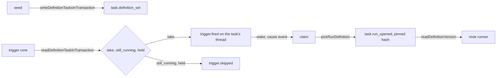

# The task of a definition

- **Status:** draft
- **Work items:** [the task of a definition](https://linear.app/zgeoff/issue/GEO-2531),
  [the `trigger` block and the reminder](https://linear.app/zgeoff/issue/GEO-2534),
  [the trigger core](https://linear.app/zgeoff/issue/GEO-2542),
  [the view procedures](https://linear.app/zgeoff/issue/GEO-2545)

nixie binds one task to each definition with `target: task`, and every task run of the definition
happens on that task, so a definition keeps one thread, one read cursor and one sleeping sandbox for
as long as it exists. A fire of the definition's trigger either opens a task run on that task or
becomes a recorded skip, so one definition never has 2 task runs at once. The tasks module owns the
binding and the fire answer, and reads the definition only through 2 readers that the server app
passes in.

Terms: a fire is one event of a trigger for one definition. The hash in force is the definition hash
that the binding holds, null while the definition is out of force. A definition is out of force when
its folder is gone, it holds `enabled: false`, or it is a spent one-shot. A pending task run is a
fire that nixie wrote and no claim has opened yet.

## Shape



## Contracts

### The seed hook and the binding

```ts
const bound = await writeDefinitionTasksInTransaction(tx, tasksContext, [
  { definitionID: 'water-the-tomatoes', definitionHash: '3f9c…' },
]);
// → { created: 1, set: 0, withdrawn: 0 }

// tasks module. The definitions module calls it in the seed's transaction, with the TasksContext
// that the server app passes into the definitions module. The list holds each definition in force
// with target: task, with or without a trigger, less each spent one-shot.
declare function writeDefinitionTasksInTransaction(
  tx: Transaction,
  context: TasksContext,
  inForce: ReadonlyArray<{ definitionID: string; definitionHash: string }>,
): Promise<{ created: number; set: number; withdrawn: number }>;
```

```ts
// tasks module: task.definition_set, on the task's own thread. Not an inbox kind. No erasable
// field. The one record that binds a definition ID to a task and holds its hash in force.
interface TaskDefinitionSet {
  taskID: string;
  definitionID: string;
  definitionHash: string | null; // null: out of force
}

// The task.created record of a definition's task holds exactly this: no starter, no options and
// no brief. The task ID is a short ID from createShortID.
interface DefinitionTaskCreated {
  taskID: string;
  isConversation: false;
  state: 'waiting';
}
```

```text
tasks projection, one appended migration:
  definition_id    text, nullable. Unique index where not null. Set once, never cleared.
  definition_hash  text, nullable. The hash in force.
Only task.definition_set folds into them.
```

### The 2 fire records

```ts
// tasks module, which exports both codecs for the trigger core. Where each value comes from:
// ./triggers.md#one-deliver-call. On the definition's task's thread, or on the conversation's
// thread for target: conversation. An inbox record: isInboxRecord accepts it, and the write wakes
// the task or the conversation with the cause `event`.
interface TriggerFired {
  definitionID: string;
  definitionHash: string; // the version a task run of this fire pins
  source: string; // the trigger source's id, such as 'schedule'
  dedupeKey: string;
  kind: 'schedule' | 'at' | 'poll'; // poll: ./mail-and-calendar-polls.md#the-records-and-the-tables
  polled?: number[]; // poll only: the sequences of the trigger.polled records, oldest first
  scheduledFor: string; // ISO instant
  firedAt: string; // ISO instant: the core's clock at the write
  isCatchUp: boolean; // firedAt is more than 60 seconds after scheduledFor
  skipped: string[]; // slots missed before this one, oldest first: the 20 newest
  skippedCount: number; // the full number
}

// tasks module. The same threads as trigger.fired. Never an inbox record; wakes nothing.
interface TriggerSkipped {
  definitionID: string;
  source: string;
  dedupeKey: string; // the key of the newest slot
  scheduledFor: string[]; // the 20 newest slots, oldest first; the last is the newest
  count: number; // the full number
  reason: SkipReason;
  recordedAt: string; // the core's clock at the write
}

type SkipReason = 'too_late' | 'catch_up_off' | 'window_closed' | 'still_running' | 'task_held';
```

### The fire answer

```ts
const answer = await readDefinitionTaskInTransaction(tx, 'water-the-tomatoes');
// → { taskID: 't4k2', fire: 'still_running' }
//   or null: no task is bound to the definition

// tasks module. The server app passes it into the trigger core as readDefinitionTask.
declare function readDefinitionTaskInTransaction(
  tx: Transaction,
  definitionID: string,
): Promise<{ taskID: string; fire: 'take' | 'still_running' | 'held' } | null>;
```

### The withdraw of a spent one-shot

```ts
// tasks module. The server app passes it into the trigger core as retireOneShot, wrapped by the
// runtime layer once that lands. Writes task.definition_set with a null hash when the
// definition's task holds a hash, and nothing otherwise.
declare function withdrawDefinitionTaskInTransaction(
  tx: Transaction,
  definitionID: string,
  cause: 'one_shot_fired' | 'one_shot_skipped',
): Promise<void>;
```

### The 2 readers

```ts
// tasks module: TasksContext
interface TasksContext {
  // …existing fields
  readonly readDefinitionVersion: ReadDefinitionVersion; // ./task-definition-format.md#the-hash-the-version-store-and-the-snapshot
  readonly readDefinitionRunPolicy: (
    taskID: string,
    definitionHash: string, // the pinned hash: a fire's version can leave force before its claim
  ) => Promise<DefinitionRunPolicy | null>;
}

// definitions module
interface DefinitionRunPolicy {
  report: TaskReport | null; // tasks module, built. null: the definition declares none, and the
  //                            task runs and reports work picks the default
  reportShape: ReportShape | null; // the report shape work owns the type
  wakeable: boolean;
  limits: Readonly<Record<string, number>>; // turns, dollars and calls:<tool>, as task.run_opened carries them
}
```

## Constraints

### The binding

- A definition with `target: task` has one task, and every task run of the definition happens on it.
  A definition with `target: conversation` has no task.
- nixie creates the task inside the first seed that holds the definition in force.
- For each definition in the list, and for each row that holds a hash, the hook does the first that
  fits:
  1. In the list and no row: it writes `task.created` and `task.definition_set`.
  2. In the list, and the row holds another hash or null: it writes `task.definition_set` with the
     list's hash.
  3. In the list, and the row holds the same hash: it writes nothing.
  4. Not in the list, and the row holds a hash: it writes `task.definition_set` with a null hash.
- A second task for one definition fails the unique index, and the seed's transaction fails with it.
- When a definition comes back in force under the same ID, the hook writes the hash on the same row,
  so the task, the thread and the read cursor are the ones from before.
- When nixie dies before the seed's commit, it has written no task. After the commit, the next seed
  finds case 3.
- A rebuild of the projections from the log produces the same `tasks` rows.

### Between task runs

- Between task runs the task holds the binding, the thread, the read cursor, the session boundary,
  each message that did not wake it, and its sleeping sandbox. It holds no timer, no options and no
  count toward a limit.
- The states of a definition's task are `waiting`, `ready`, `running`, `paused`, `stopped` and
  `failed`. nixie never sets it to `done` or `closed`, and refuses a close with the reason
  `definition_task_never_closes`.
- After the seed that puts a definition out of force commits, neither a fire nor a message opens a
  task run on its task. A task run that is pending or open at that commit runs to its end on its
  pinned version and limits, and you end it sooner with the stop control.

### What opens a task run

When a claim finds no open task run on a definition's task and no limit hold, the first of these
that holds decides:

1. An unread `trigger.fired` whose dedupe key no task run of the task holds: a task run with
   `origin.kind` `trigger` that pins the fire's hash, with the fire's dedupe key as `triggerKey`. It
   ignores the hash in force, so a one-shot runs although its own fire puts it out of force. When 2
   such fires are unread, the newest opens the task run, and its first step marks both as read and
   renders only the newest.
2. The last task run ended with `limit`, `stopped` or `failed`, and you raised the limit or
   restarted the task after that end: a carrying task run with `origin.kind` `raise` or `restart`.
   It pins the ended task run's hash, resumes its model session under `context: fresh` too, copies
   its `triggerKey` and `briefID`, and names it in `carriesRunID`. An unread message is read in it.
3. An unread waking message, and the hash in force is not null: a task run with `origin.kind`
   `message` that pins the hash in force.
4. Anything else, such as a resume, a server start, a recovery, or a message while the hash in force
   is null: no task run. `runTaskStep` commits the step with `hold` and calls no runner, the task is
   `waiting`, and an unread message stays unread.

- A claim marks read a `trigger.fired` whose `kind` its codec does not know, and opens no task run
  for it, so a release meets a fire of a later release's source safely after a rollback.
- When a claim finds an open task run that is active or waiting on a reply, the step runs inside it.
  When it finds an idle one and an unread fire with another dedupe key, it ends the idle task run
  with the cause `no_report` and opens the fire's task run in the same transaction.
- Under `context: fresh`, each task run opens a model session of its own, except a carrying task
  run. Under `context: continuing`, each step resumes at `tasks.session_boundary`.
- A task run of a definition gets no limit of its own on effects: the decision point treats its
  calls as it treats the conversation's. The owner chose this on 5 Nov and again on 13 Nov. Today
  the built rule `slice1.read-only` denies every call past `read`, `fetch` and `note` for every
  caller, so a run sends, writes or spends once that rule goes, with no change here.

### The fire answer

`readDefinitionTaskInTransaction` runs in the transaction that delivers the fire, before nixie
writes the fire's record. The first answer that holds decides:

1. `held`: the task is `paused`, `stopped` or `failed`, or held at its limit. The trigger core
   writes `trigger.skipped` with `task_held`, and the definition fires again at the first slot after
   you resume, restart or raise it.
2. `still_running`: the task has a pending task run, or an open task run that is active or waiting
   on a reply. The core writes `trigger.skipped` with `still_running`.
3. `take`: no pending task run, and the open task run is idle or absent. The core writes
   `trigger.fired`.

- No table holds a pending task run, so the function computes it: with no open task run, a task run
  is pending when rule 1, 2 or 3 of "What opens a task run" holds; with an idle open task run, when
  the inbox holds an unread fire whose dedupe key no task run holds.
- A task therefore holds at most one unread `trigger.fired`, wakeable or not, except after a stop,
  when it can hold 2.
- nixie skips a fire and never queues it: a queue would hide a task run that never ends. A fire
  written before a hold opens a task run after the hold ends, however old it is.
- nixie writes no record for a fire of a disabled definition.
- The fire answer never reads the pause. While nixie is paused, the trigger core delivers no
  schedule fire, and a poll fire lands to open its task run after the resume
  ([mail and calendar polls](mail-and-calendar-polls.md#one-deliver-call-of-a-poll-batch)). For a
  schedule, the catch-up rule decides the first fire after the resume, as
  [the pause](pause.md#triggers-while-paused) says.

### How the built task code handles a definition's task

- The `started` pool of `claimTask` takes a task with a starter or with `definition_id` set. The
  other pool takes neither.
- `reviveHeldTasks` keeps selecting only tasks with a starter.
- `pickNextState` returns `waiting` for a task with `definition_id` set where it returns `done` for
  a started task.
- Pause, resume, stop, restart and interrupt act as on a started task. Of these, only a restart can
  open a task run.
- `readTaskSetup` returns a `definition` member for a task with `definition_id` set. The task runner
  port work owns the type.
- The nixie runner reads the options through `readDefinitionVersion` with the open task run's pinned
  hash, and the report mode and the limits from `task.run_opened`.
- `readTurnContext` builds no start note for a definition's task. The first input of a task run is
  its `trigger.fired` record or the message that opened it.
- `readTaskDirectory` returns a definition's task only while its hash in force is not null, so
  `task.message` cannot address a task out of force.
- `tasks.list` and the dashboard show a definition's task while its hash in force is not null, with
  the name, brief and model of the version in force. While a task run of a task out of force is
  pending or open, they show it with the name of the pinned version, so you reach its stop control.
- `writeTaskLimitPause` sends the limit notice to the report target that the open task run pinned,
  and sends none when that target is null.
- `readStartedTaskIDs` returns a definition's task while its hash in force is not null or one of its
  task runs is pending or open. The runner destroys the sandbox of any other definition's task.
- A forget's session cleanup covers every task with `definition_id` set.
- The time a definition was first enabled is the time of the first `task.definition_set` of its task
  that holds a hash.

## Decisions

- **One task per definition, for its whole life.** One thread and one read cursor let a `continuing`
  definition and a wakeable one carry state between task runs.
- **Skip, never queue.** Two task runs at once would write to one thread, and a queue hides a task
  run that never ends.
- **The tasks module reads definitions only through 2 readers that the server app passes in.** The
  tasks module then imports neither the definitions module nor the triggers module.
- **The fire answer has no answer of its own for the pause.** The trigger core delivers no schedule
  fire while nixie is paused, and a poll fire waits in the inbox, because no claim starts until the
  resume.
- **An unread fire opens a task run before a raise or a restart, and a raise or a restart before an
  unread message.** An agent's call on 13 Nov, which the owner accepted: a fire can be unread at a
  carry only after a stop of an idle task run, which has nothing to carry, while a message after a
  `limit` end belongs to the unfinished work that the raise carries on.

## Builder decides

- How the hook loads the `tasks` rows it compares.
- The names of internal functions and the input type of the claim's pick.
- The layout of the tests.

## Out of scope

- Binding a built task to a definition. No work item needs it: the delete of the built-in memory
  tasks removes the only candidates.
- A stop of a task run by the seed.
- The enforcement of `maxCalls`, which the task run limits work owns.

## Open questions

None.
