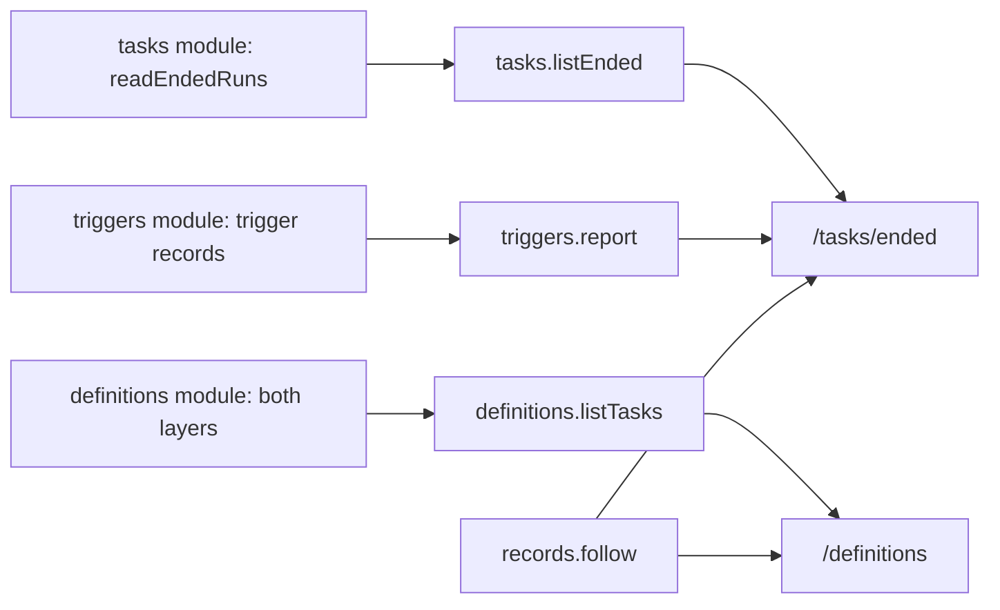

# The views of definitions, triggers and ended task runs

- **Status:** draft
- **Work items:** [the view procedures](https://linear.app/zgeoff/issue/GEO-2545),
  [the view routes](https://linear.app/zgeoff/issue/GEO-1837)

The web client shows read views of work that started without you: the list of task definitions, the
trigger report, and the list of ended task runs. Together they answer why a task run happened or why
it did not. The API serves each from nixie's own database through one `signedIn` procedure, and the
client follows the record kinds that change them.

Terms: the trigger report lists catch-ups, the fires nixie delivered late, and skips, the fires it
skipped. An ended task run is a task run that has ended with any cause, and its sequence is the
sequence of its `task.run_ended` record.

## Shape



## Contracts

```ts
const ended = await api.tasks.listEnded({ limit: 50 });
// → { tasks: [ListedTask], runs: [EndedRun], next: 8121 }
const report = await api.triggers.report({ since: '2027-03-01' });
// → { entries: [{ definitionID: 'water-the-tomatoes', name: 'Water the tomatoes', kind: 'skipped',
//     scheduledFor: '2027-03-11T21:00:00.000Z', firedAt: null, lateBySeconds: null,
//     reason: 'task_held', sequence: 8044 }] }
const definitions = await api.definitions.listTasks();
// → { definitions: [{ definitionID: 'water-the-tomatoes', rendered: 'every Friday at 08:00',
//     next: 'Fri 12 Mar', origin: 'nixie', createdBy: { sequence: 7990, kind: 'definition.changed' }, … }] }
```

```ts
// contract lib. Each procedure is signedIn.

// tasks.listEnded: served from readEndedRuns of the tasks module (task runs and reports work)
interface TasksListEndedInput {
  limit: number; // 1 to 100
  before?: number; // a sequence: only task runs that ended before it
  definitionID?: string; // only task runs of that definition
}
interface TasksListEndedOutput {
  tasks: ListedTask[]; // built: listedTaskSchema. One entry per task of the page's task runs.
  runs: EndedRun[]; // the task runs and reports work owns it; each carries its sequence
  next: number | null; // the `before` of the next page; null when no ended task run is left
}

// triggers.report: served from a read of the triggers module
interface TriggersReportInput {
  since: string; // a date, 'YYYY-MM-DD': entries scheduled from its start in your zone
  definitionID?: string;
}
interface TriggersReportOutput {
  entries: Array<{
    definitionID: string;
    name: string;
    kind: 'late' | 'skipped'; // late: a trigger.fired with isCatchUp; skipped: a trigger.skipped
    scheduledFor: string;
    firedAt: string | null; // late only
    lateBySeconds: number | null; // late only
    reason: SkipReason | null; // skipped only
    sequence: number; // the record's sequence
  }>;
}

// definitions.listTasks: served from a read of the definitions module. No input.
interface DefinitionsListTasksOutput {
  definitions: Array<{
    definitionID: string;
    name: string;
    enabled: boolean;
    target: 'task' | 'conversation';
    trigger: Trigger | null;
    rendered: string | null; // renderTrigger at each call; null with no trigger
    next: string | null; // null for a spent one-shot or no trigger
    tools: string[];
    origin: 'definitions' | 'nixie';
    createdBy: { sequence: number; kind: 'definition.changed' | 'definitions_seeded' };
    taskID: string | null; // null for target: conversation
    isUnreadable: boolean; // the key of its definition.changed `version` is lost
  }>;
}
```

## Constraints

- `tasks.listEnded` returns ended task runs newest first, one page per call.
- `triggers.report` holds one `skipped` entry per `trigger.skipped` record and one `late` entry per
  `trigger.fired` record whose `isCatchUp` is true.
- `definitions.listTasks` returns one entry per definition from the repo and one per runtime
  definition in force.
- `createdBy` names the record that put the version in force: for a runtime definition, the
  `definition.changed` of its change in force; for a definition from the repo, the seed record.
- The `next` of `definitions.listTasks` is a fire time, and the `next` of `tasks.listEnded` is a
  sequence.
- Each read queries nixie's own database, so the views add no interface to an outside system.
- The client has the routes `/tasks/ended`, with the ended task runs and the trigger report, and
  `/definitions`, with the definitions and an undo control on each runtime definition that calls
  `definitions.undo`.
- The client follows `trigger.fired`, `trigger.skipped`, `definition.changed` and `task.run_ended`
  through `records.follow`, so each view updates without a poll.
- The client renders a definition's `name` and `brief` as plain text, because the agent wrote the
  text of a runtime definition.
- Where a view would show a field whose key is lost, it shows the marker for missing content.

## Decisions

- **An ended task run is named "ended".** The owner chose this on 13 Nov. The task wake work gives
  "finished" another meaning, a listed state of a wakeable task, and `task.run_ended` already names
  the record.

## Builder decides

- The layout of each route, and where the trigger report sits on `/tasks/ended`.
- The wording of each entry and of the missing-content marker.
- The layout of the tests.

## Out of scope

- An edit of a definition in the web client.
- A view of supervised agents, or of the inputs of a model turn.
- `rendered` and `next` as stored members of a record.
- A control that shows a record in raw form: the task route has none to reuse.

## Open questions

None.
