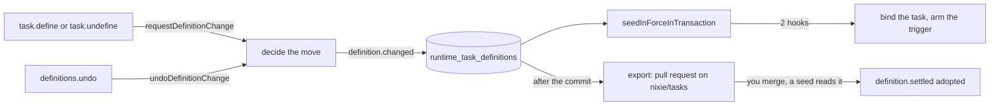

# Task definitions from chat

- **Status:** draft
- **Work items:** [the runtime layer](https://linear.app/zgeoff/issue/GEO-2533),
  [the chat tools, the notice and the undo](https://linear.app/zgeoff/issue/GEO-1836),
  [the export](https://linear.app/zgeoff/issue/GEO-2540),
  [the view procedures](https://linear.app/zgeoff/issue/GEO-2545),
  [the view routes](https://linear.app/zgeoff/issue/GEO-1837)

The agent creates, alters and deletes a task definition from the conversation with `task.define` and
`task.undefine`, and lists them with `tasks.definitions`. nixie puts each change in force at once,
as a runtime layer over the definitions repo, and writes a notice with an undo. The change ends when
you undo it, when nixie retires it, or when nixie exports it to a pull request and adopts it once a
seed reads your merge.

## Shape



| Term               | Meaning                                                                                          |
| ------------------ | ------------------------------------------------------------------------------------------------ |
| runtime change     | one define, undefine or undo of one definition, made outside the repo                            |
| runtime definition | the version a runtime change holds                                                               |
| head               | a definition's runtime change with the greatest `changed_sequence`                               |
| base               | the repo's version of the definition when it got its runtime layer; null when the repo held none |
| conflict           | the repo's version differs from both the base and the change's own version                       |

## Contracts

### The 3 tools

```ts
await tools['task.define']({
  name: 'Water the tomatoes',
  brief: 'Water the tomatoes.',
  target: 'conversation',
  trigger: { schedule: { every: 'week', on: 'fri', at: '08:00' } },
});
// → { definitionID: 'water-the-tomatoes', rendered: 'every Friday at 08:00', next: 'Fri 12 Mar',
//     changeID: 'c7k2' }
//   or { refused: { code: 'ID_TAKEN' } }
```

```ts
// definitions module. Effect `schedule`. Held by the conversation alone.
interface TaskDefineInput {
  definitionID?: string; // names a definition to replace; without it, the ID is the slug of `name`
  name: string;
  brief: string;
  target: 'task' | 'conversation';
  trigger: Trigger; // contract lib. An `at` without an offset is read in your zone and stored with it.
  model?: string;
  persona?: TaskPersona;
  memory?: TaskMemory;
  tools?: string[];
  report?: TaskReport;
}

type TaskDefineOutput =
  | { definitionID: string; rendered: string; next: string | null; changeID: string } // changeID: the short ID
  | { refused: DefinitionRefusal }; // the whole refusal, payload included, so the model can retry

// tasks.definitions. Effect `read`. Held by the conversation alone. No input.
interface TasksDefinitionsOutput {
  definitions: Array<{
    definitionID: string;
    name: string | null; // null when unreadable
    enabled: boolean;
    isInForce: boolean; // false when disabled, spent, or removed by a runtime change in force
    isUnreadable: boolean; // the key of its definition.changed `version` is lost
    trigger: Trigger | null;
    rendered: string | null; // null with no trigger or when unreadable
    next: string | null; // null when out of force
    target: 'task' | 'conversation' | null;
    tools: string[];
    origin: 'definitions' | 'nixie';
  }>;
}

// task.undefine. Effect `schedule`. Held by the conversation alone.
type TaskUndefineInput = { definitionID: string };
type TaskUndefineOutput =
  | { definitionID: string; changeID: string }
  | { refused: DefinitionRefusal };
```

```ts
// policy module: a fixed rule, in getFixedRules after slice1.queue-check and before
// slice1.read-only. PolicyCall holds no caller, so the rule allows by name, and the tools stay out
// of every task's list: both names join TaskStartBounds.conversationTools, which planTaskStart
// refuses on any start.
const definitionsChatChangeRule: FixedRule = {
  id: 'definitions.chat-change',
  revision: 1,
  sentence: 'Allow task.define and task.undefine, which only the conversation holds.',
  pickOutcome: (call) =>
    call.tool === 'task.define' || call.tool === 'task.undefine' ? 'allow' : null,
};
```

### The change and the undo

```ts
// definitions module. Only the 2 write tools call it, so its caller is always the conversation.
declare function requestDefinitionChange(
  context: DefinitionsContext,
  request: { kind: 'define'; input: TaskDefineInput } | { kind: 'undefine'; definitionID: string },
): Promise<DefinitionChangeResult>;

// definitions module. Only the definitions.undo procedure calls it.
declare function undoDefinitionChange(
  context: DefinitionsContext,
  changeID: string, // a change ID or a short ID
): Promise<DefinitionChangeResult>;

type DefinitionChangeResult =
  | {
      status: 'changed';
      definitionID: string;
      changeID: string; // random
      shortID: string;
      restored?: 'repo'; // set when an undo put the repo's version in force
    }
  | { status: 'refused'; refusal: DefinitionRefusal };

type DefinitionRefusal =
  | { code: 'ID_TAKEN' }
  | { code: 'NOT_FOUND' } // the named definition or change does not exist
  | { code: 'UNCHANGED' } // the built version's hash is the hash in force
  | { code: 'FILE_ONLY_KEYS' } // the named definition holds a file-only key or file
  | { code: 'INVALID'; reasons: string[] } // the schema or CheckTaskStart refuses the version
  | { code: 'ONE_SHOT_OVER_REPO' } // a one-shot for a definition the repo holds
  | { code: 'ONE_SHOT_PAST' } // an undo would restore a one-shot whose time has passed
  | {
      code: 'REPLACED';
      head: { changeID: string; shortID: string; operation: DefinitionOperation };
    }
  | { code: 'REPO_MOVED'; seedSequence: number } // the seed record that found the other version
  | { code: 'NOT_IN_FORCE'; cause: 'one_shot_fired' | 'one_shot_skipped' | 'kept_repo' };
```

```ts
// contract lib. A checked action, so it takes a clientActionID. No tool reaches it.
api.definitions.undo({ clientActionID: '5e2d…', changeID: 'c7k2' }); // a change ID or a short ID
// → { definitionID: 'water-the-tomatoes', changeID: '0b9d…', restored: 'repo' }
//   or a typed error, such as REPLACED with { head: { changeID, shortID, operation } }
interface DefinitionsUndoOutput {
  definitionID: string;
  changeID: string; // the undo's own change
  restored?: 'repo';
}
// .errors: NOT_FOUND 404; REPLACED 409 with { head }; REPO_MOVED 409 with { seedSequence };
// NOT_IN_FORCE 409 with { cause }; ONE_SHOT_OVER_REPO 409; ONE_SHOT_PAST 409. The undo never
// returns ID_TAKEN, UNCHANGED, FILE_ONLY_KEYS or INVALID.
```

```sh
nixie definitions resolve water-the-tomatoes --keep nixie
nixie definitions resolve water-the-tomatoes --keep repo
```

### The records

```ts
// definitions module. On the conversation's thread. One per define, undefine and undo, written in
// the transaction that puts the change in force.
interface DefinitionChanged {
  changeID: string; // random
  shortID: string; // from createShortID: what the model and the notice show
  definitionID: string;
  operation: DefinitionOperation;
  hash: string | null; // the version in force after the change; null after an undefine
  previous: string | null; // the version in force just before
  caller: 'conversation' | 'owner'; // 'owner' for an undo
  undoes: string | null; // the change an undo reverses
  replaces: string | null; // the runtime change in force that this one superseded
  base: string | null;
  definitions: string | null; // the repo's version at this change
  // erasable field `version`: StoredTaskDefinition, the body of `hash` for a version made here
}

type DefinitionOperation = 'add' | 'change' | 'remove' | 'undo';

interface StoredTaskDefinition {
  definitionID: string;
  hash: string;
  form: TaskDefinition; // parsed, defaults filled
  files: Record<string, string>; // the exact text of each file
}

// The 4 records below sit on no thread.
interface DefinitionSettled {
  changeID: string;
  definitionID: string;
  outcome: 'adopted' | 'retired';
  cause: 'seed' | 'one_shot_fired' | 'one_shot_skipped';
  hash: string | null; // the version in force after it
}
interface DefinitionRepoMoved {
  changeID: string;
  definitionID: string;
  definitions: string | null;
}
interface DefinitionConflictResolved {
  changeID: string;
  definitionID: string;
  keep: 'nixie' | 'repo';
  definitions: string | null; // the repo's version at the choice: the base from then on for 'nixie'
}
interface DefinitionExportMoved {
  exportID: string;
  branch: string;
  to: 'exporting' | 'opened' | 'closed'; // DefinitionsExportState, built
  pullRequest: PullRequestRef | null; // built
}
```

### The notice on the wire

```ts
// contract lib: the record schema gains one optional field, filled for a definition.changed record.
// toContractRecord builds it at read time from the record, the change's row and its version.
interface DefinitionNotice {
  definitionID: string;
  name: string | null; // null when the key of `version` is lost
  operation: DefinitionOperation;
  shortID: string;
  changeID: string;
  rendered: string | null; // renderTrigger of the change's own version, at read time
  next: string | null; // null once the change is out of force
  state: RuntimeChangeState; // in_force, superseded, adopted or retired
  isUnreadable: boolean;
}
```

### The tables

```text
2 projections, one appended migration. Each fold reads its record and the rows the record names.

runtime_task_definitions
  change_id         key
  short_id          unique
  definition_id     unique where state = 'in_force'
  operation, definition_hash, previous_hash, base_hash, definitions_hash, replaces, undoes, caller
  state             RuntimeChangeState, built: in_force, superseded, adopted, retired
  state_cause       later_change | seed | one_shot_fired | one_shot_skipped | kept_repo | null
  changed_sequence, updated_sequence
  From definition.changed, definition.settled, definition.repo_moved, definition.conflict_resolved.
  The fold of definition.changed stores `version` in task_definition_versions when the hash is missing.

task_definition_exports
  export_id         key
  branch, state ('opened' | 'closed' | null), pull_request_number, pull_request_url,
  attempt_started_sequence, updated_sequence
  From definition.export_moved.
```

## Constraints

### What `task.define` accepts

- `task.define` takes a `schedule` or an `at` trigger, and parses its input with the
  [task definition schema](task-definition-format.md#the-folder-and-taskyaml).
- nixie checks the input through `CheckTaskStart` with the starter `conversation`, so a runtime
  definition holds only what a `task.start` from the conversation can hold.
- The input is the whole version: an optional key it omits takes its default, never the value in
  force.
- The file-only keys are `context`, `wakeable`, `maxCalls`, `step`, `reportShape` and `log`, and the
  file-only files are `instructions.md` and a step file. `task.define` sets none of them. A change
  to a definition whose version in force holds one at a value other than its default, or holds
  either file, is refused with `FILE_ONLY_KEYS`.
- A change may alter `target`, and may turn a schedule into a one-shot, except over a definition the
  repo holds (`ONE_SHOT_OVER_REPO`).
- The slug of `name` is its lowercase form with each run of characters outside `a-z` and `0-9`
  turned into one hyphen, hyphens trimmed from both ends, cut to 64 characters. An empty slug is
  refused with `INVALID`.
- An ID is taken when the repo's last accepted seed holds it, enabled or not, or a runtime change in
  force holds it. An ID whose runtime definition was undone or undefined is free, and a new
  definition under it gets the same task back.
- nixie writes the notice for every define, with no approval.

### One runtime change, in one write transaction

1. For an undefine and an undo, nixie first runs a seed of the definitions source outside the
   transaction, so a merge that no seed has read counts.
2. For a define, nixie builds, parses and checks the version.
3. In one write transaction, nixie reads the definition's state and decides the move. A refusal
   writes nothing.
4. It writes `definition.changed`. The fold marks the change in force `superseded` and inserts this
   one as `in_force`.
5. It runs `seedInForceInTransaction`, which writes the seed record and calls the 2 seed hooks.
6. It commits, then wakes the export. The tool call does not wait for the export.

- When the seed of step 1 fails or is refused, nixie goes on with the repo version it last read. The
  change records that version in `definitions`, and the next seed compares it with the repo, so a
  merge the decision missed ends as an adoption or a conflict, never as a silent overwrite.
- When any step throws, the transaction rolls back: no notice, no runtime change and no armed
  trigger.
- A fire that nixie wrote before the change keeps the hash it holds.
- One definition has at most one runtime change in force, so a second fails the unique index and its
  transaction.
- A runtime change moves once from `in_force` to `superseded`, `adopted` or `retired`, as
  `canMoveRuntimeChange` allows.

### The runtime layer

- nixie stores no table of the definitions in force. Each read lays the runtime changes in force
  over the repo's definitions through `buildRuntimeOverlay`. `tasks.definitions` and
  `definitions.listTasks` share that one read.
- An undefine's change holds a null hash, and while it is in force the definition is out of force,
  even when the repo holds it.
- At each seed, for each runtime change in force: when the repo holds its hash, null on both sides
  included, nixie writes `definition.settled` `adopted`; when the repo holds the base, the change
  stays in force; when the repo holds another version, nixie writes `definition.repo_moved`.
- nixie derives a conflict from `base_hash` and `definitions_hash` and stores no flag. A change with
  a conflict stays in force.
- `--keep nixie` sets the base to the repo's version and ends the conflict. `--keep repo` retires
  the change, and the repo's version is in force at the commit. Both write
  `definition.conflict_resolved`.
- When the key store has lost the key of a `version`, a rebuild cannot read the runtime definition.
  Its row stays, the next seed puts the definition out of force, and the lists show it as
  unreadable. `conversation.forget` refuses a `definition.changed` record, so no forget reaches the
  key.
- For a runtime one-shot, the `retireOneShot` that the server app passes writes `definition.settled`
  `retired` with its cause and a null hash, besides the withdraw of
  [the trigger core](triggers.md#the-spent-one-shot).

### The undo

The first row that fits the named change X decides. Each example starts from the repo holding
`water-the-tomatoes` at version R.

| #   | When                                             | Result                                                                                                                                                  | Example                                                               |
| --- | ------------------------------------------------ | ------------------------------------------------------------------------------------------------------------------------------------------------------- | --------------------------------------------------------------------- |
| 1   | X is not the head of its definition              | `REPLACED`, with the head                                                                                                                               | undo C1 after C2 changed the same definition                          |
| 2   | X is in force and replaced a runtime change      | the previous version goes in force as a runtime definition, with the base of X                                                                          | C1 moved to Saturday, C2 to Sunday; undo C2 puts Saturday back over R |
| 3   | X is in force, replaced none, no conflict        | the base goes in force, and the seed in the transaction adopts the undo                                                                                 | undo C1 puts R back, with no runtime change left in force             |
| 4   | X is in force, replaced none, conflict           | the repo's version goes in force, the seed adopts it, the result holds `restored: 'repo'`                                                               | you merged R2 after C1; undo C1 leaves R2 in force                    |
| 5   | X is adopted, and the repo holds its hash        | the previous version goes in force as a runtime definition over the merged one, and the next export writes it, or deletes `tasks/<id>/` when it is null | you merged C1; undo C1 puts R in force over it and exports R          |
| 6   | X is adopted, and the repo holds another version | `REPO_MOVED`                                                                                                                                            | you merged C1, then edited the file; undo C1                          |
| 7   | X is retired                                     | `NOT_IN_FORCE`, with the cause                                                                                                                          | undo the change of a one-shot that has fired                          |

- When rows 2 to 5 would restore a one-shot, nixie refuses `ONE_SHOT_OVER_REPO` when the repo holds
  the definition, and `ONE_SHOT_PAST` when its time is before the clock reading that the caller
  passes in.
- An undo is a runtime change with its own notice, and an undo of an undo follows the same rows.
- nixie reads `replaces` to tell whether X replaced a runtime change, and compares change IDs only,
  after it resolves a short ID.

A merge that races an undo:

1. The agent defines C1 over R, and the export opens a pull request with C1.
2. You merge the pull request. No seed has read the merge yet.
3. You undo C1. The undo's own seed reads the merge, adopts C1, and row 5 applies: R goes in force
   over the merged C1, and the next export writes R back.
4. When that seed fails, row 3 applies to the stale state: R goes in force and the undo is adopted.
   The next seed reads the merged C1, which differs from R, and C1 is in force from the repo. The
   seed record shows the folder came from the repo, and the merge wins.

### The notice

- The web client renders `definitionNotice` as a notice. The notice of an `add` in force reads:
  `Scheduled: Water the tomatoes, every Friday at 08:00 (next: Fri 12 Mar). [Undo]`.
- The undo control shows while `state` is `in_force` or `adopted`. Once the change is `superseded`
  or `retired`, the notice shows its state in place of the next fire and offers no undo.
- When `isUnreadable` is true, the notice shows the missing-content marker in place of the name and
  the trigger, and still offers the undo while the state allows it.
- When `definitions.undo` refuses, the client shows one sentence for the error's code beside the
  notice. On `REPLACED`, the sentence names the head's short ID.
- nixie never stores the rendered trigger or the next fire on a record.

### Boundaries

- The definitions module owns the 5 records, the 2 tables and the functions above.
- The server app passes the definitions module `CheckTaskStart`, the seed of the definitions source,
  and the tasks context for the seed hook.
- These pieces that main lacks come from these items: `task_definition_versions` and
  `CheckTaskStart` from [the format and the seed](https://linear.app/zgeoff/issue/GEO-1834);
  `withdrawDefinitionTaskInTransaction` as `retireOneShot` from
  [the trigger core](https://linear.app/zgeoff/issue/GEO-2542); `seedInForceInTransaction` and the
  `definition.settled` wrap of `retireOneShot` from
  [the runtime layer](https://linear.app/zgeoff/issue/GEO-2533).
- This work adds no config key.

## Decisions

- **A change from chat takes effect at once, with a notice and an undo.** Every runtime change in
  force has a notice, because the notice commits in the change's transaction.
- **An undefine and an undo read the repo first.** You can merge a pull request at any time, and a
  decision on a stale repo version would undo your merge.
- **One function decides a define, an undefine and an undo.** The undo rows and the refusals then
  hold for every caller.
- **Only you undo.** The agent has no tool that reaches `definitions.undo`.
- **The conflict command is `nixie definitions resolve`,** beside the built `nixie rules resolve`.

## Builder decides

- The text of the notice for a change, a removal and an undo, in the form of the `add` notice, and
  the sentence for each refusal code.
- The input type of the pure move decision and of the seed plan.
- Internal names, and the layout of the tests.

## Out of scope

- A definition that a task proposes. It needs a decision point that asks you for an approval.
- `poll` triggers from chat, the file-only keys on `task.define`, and keeping a file's
  `instructions.md` through a change from chat.
- A write to the definitions source outside the export.
- A check of the previous hash when the agent alters a definition, such as an `expectedHash` input.
