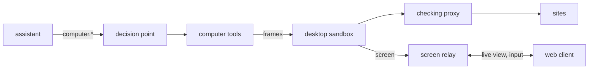

# The desktop and take-over

- **Status:** draft

The assistant's browser and shell become one computer: a virtual desktop with Chromium and a
terminal on one disk. You can watch that desktop live in the web client and take it over with your
own mouse and keyboard, and the assistant can ask you to take over when it meets a CAPTCHA, a bank
check or a page that wants a person. The assistant keeps its page tools and gains tools for the
whole screen, so it can scroll and reach what the page tools can't.

## Shape



The desktop sandbox runs a virtual display, a window manager, headed Chromium on the browser
profile, a terminal on the files folder, and a VNC server on the display. The server relays the VNC
stream to the web client over a WebSocket, and drops your input unless you hold the desktop.

## Contracts

### The tools

Every tool keeps the `computer.` namespace. The 7 built browser tools gain the `browser_` prefix and
keep their inputs, results, effects and refusals, except where the sketch below shows a change.
`computer.run` and the file tools keep their names.

| Tool                                                     | Status                                              | Runs                         |
| -------------------------------------------------------- | --------------------------------------------------- | ---------------------------- |
| `computer.browser_open`, `_read`, `_click`, `_fill`      | renamed from `computer.open` etc.                   | as today                     |
| `computer.browser_close`, `_download`                    | renamed                                             | as today                     |
| `computer.browser_screenshot`                            | renamed from `computer.screenshot`, gains `control` | direct, `note`               |
| `computer.browser_scroll`                                | new                                                 | direct, `note`               |
| `computer.screenshot`, `computer.screen_scroll`          | new                                                 | direct, `note`               |
| `computer.screen_click`, `computer.screen_type`          | new                                                 | queued                       |
| `computer.handover`, `computer.handover_cancel`          | new                                                 | direct, `note`               |
| `computer.take_back`                                     | new                                                 | direct, `computer_take_back` |
| `computer.run`, `read_file`, `write_file`, `export_file` | unchanged                                           | as today                     |

A direct call runs inside the turn when its rules allow it, and a queued call goes to the action
queue, as [reads and acts](../../architecture/connectors/computer.md#reads-and-acts) describes.

```ts
// connectors module
computer.browser_scroll({ tab: 't3', to: 'down' }); // to: 'up' | 'down' | a control such as 'E12'
// → { tab: 't3', isAtEnd: false } with the viewport's picture beside the result; no page is stored
//   refusals: TAB_GONE, STALE_ELEMENT

computer.browser_screenshot({ tab: 't3', control: 'E12' }); // control is optional
// → the control's box, or the viewport without one; STALE_ELEMENT for a control that moved

computer.screenshot({}); // the whole desktop
// → { width: 1280, height: 800, focus: { kind: 'browser', tab: 't3', url: 'https://…' }, isWatched: false }
//   isWatched: true while a device session has the live view open; every screenshot and screen act
//   result carries it
//   the picture sits beside the result at 1280 by 800, so its points are the ones a click takes
//   focus.kind: 'browser' | 'terminal' | 'other'

computer.screen_scroll({ x: 640, y: 400, by: 5 }); // by: wheel steps; negative scrolls up

computer.screen_click({ x: 412, y: 233, button: 'left' }); // button: 'left' | 'right'
// → { focus } with a picture beside it, or SCREEN_CHANGED

computer.screen_type({ text: 'hello' }); // exactly one of text (at most 1,000 characters) or keys
computer.screen_type({ keys: 'ctrl+l' }); // keys: one chord, such as 'enter' or 'shift+tab'
// → { focus } with a picture beside it, or SCREEN_CHANGED

computer.handover({ reason: 'itch.io asks for a CAPTCHA' }); // conversation only
// → { asked: true } or ALREADY_ASKED (an ask is open until a take-over starts, the assistant
//   cancels it, or it expires) | TAKEN_OVER

computer.handover_cancel({}); // conversation only; for a problem the assistant got past or gave up on
// → { cancelled: true } or NOT_ASKED

computer.take_back({}); // conversation only
// → { durationSeconds: 63 } or NOT_TAKEN_OVER
```

```ts
// connectors module: each screen act binds to the window the assistant saw
interface ScreenBinding {
  windowID: string;
  kind: 'browser' | 'terminal' | 'other';
  tab?: string;
  url?: string;
  // read in the tool's prepare hook and held in memory, as expectURL is; the action hash covers
  // it, and the guest refuses with SCREEN_CHANGED when the focused window differs on any field
  // when the action runs. A restart between the call and the action makes it refuse.
}
```

### Effects

| Call                             | Effect               | Destination            |
| -------------------------------- | -------------------- | ---------------------- |
| a screen act on a browser window | `send`               | the focused tab's host |
| a screen act on another window   | `send`               | none                   |
| `computer.take_back`             | `computer_take_back` | none                   |

The card for a screen act shows its screenshot with the point marked, or the text or keys it types.
Its "always allow" pins the host alone, so one answer covers every later screen act on that site,
and a rule of yours that names the host covers them too.

A screen act on a terminal window returns `USE_RUN`, with the message "Use the computer.run tool
instead". A screen act on Chromium's address bar or tab strip, and a chord that focuses the address
bar, such as `ctrl+l`, returns `USE_BROWSER_OPEN`, with the message "Use the computer.browser_open
tool instead". The guest checks both against the focused window when the act runs.

```yaml
# deploy/compose/definitions: a new starter rule
allow-take-back:
  outcome: allow
  effects: [computer_take_back]
```

### Records

```text
computer.handover_asked    -- payload: reason (erasable)
computer.handover_closed   -- payload: by: 'assistant' | 'expired'; an ask that no take-over answered
computer.takeover_started  -- payload: device (the session that holds the desktop)
computer.takeover_ended    -- payload: by, durationSeconds, origins, now (erasable)
  -- by: 'user' | 'assistant' | 'idle' | 'restart'
  -- origins: each site the browser showed during the hold, in order, scheme and host only, at most 20
  -- now: the focused window's kind and tab, and its text as computer.browser_read returns its
  --      first part, or the terminal's visible lines; read from the guest at the hand-back
```

The four records sit on the conversation's thread.

### The messages the assistant reads

The server renders each record for the model, with `owner.name`, or "the user" when it is unset:

```text
Sam took over the computer. You can read the screen and your tabs; your clicks, typing and commands
wait until it comes back.

Sam handed the computer back after 3 min.
Sites: itch.io → accounts.itch.io → itch.io
Now: browser tab t4
<the now text>
```

When the assistant took the computer back, the first line reads "You took the computer back from Sam
after 1 min." An idle hand-back reads "The computer came back to you after 30 min with no input from
Sam." A restart reads "The computer came back to you when nixie restarted." An expired ask reads
"Your handover ask lapsed after 60 min with no take-over."

### The web client's calls

```ts
// contract lib; each is a checked action, and only a device session may call them
computer.watch({ clientActionID }); // → { streamURL } a WebSocket URL with a one-use ticket
computer.takeOver({ clientActionID }); // → { takenOverAt } or BUSY_TOO_LONG | HELD_ELSEWHERE
computer.handBack({ clientActionID }); // → { durationSeconds } or NOT_TAKEN_OVER
```

The live stream carries the four records. A `computer.handover_asked` shows as a banner with Take
over on every open client, until a take-over starts or a `computer.handover_closed` clears it. It
also goes out as a [push notice](push-notice.md), so an ask reaches you with no client open.

### Config

```yaml
computer:
  idle_hand_back_minutes: 30 # a hold with no input from its device this long ends with by 'idle'
  handover_expiry_minutes: 60 # an ask with no take-over this long closes with by 'expired'
```

### The sandbox and its size

| Role     | Used by                 | vCPUs | Memory   | Disk      |
| -------- | ----------------------- | ----- | -------- | --------- |
| computer | the assistant's desktop | 2     | 1536 MiB | 24576 MiB |

The `computer` row replaces the `browser` and `shell` rows, and reserves what they reserved
together. The [desktop memory spike](../../../research/desktop-memory/) held a watched, scrolling
desktop in 1024 MiB with about 370 MiB spare, and the other 512 MiB is the shell row's room for
commands. One sandbox of kind `computer`, owned by `computer-desktop`, replaces the two. Its image
`nixie-computer` comes from `guests/computer`, which takes the place of `guests/browser` and
`guests/shell`.

## Constraints

The desktop:

- The display is 1280 by 800.
- Chromium runs headed on the display, with the existing profile and proxy settings.
- The guest scans every request Chromium makes, whether or not a tool call is running. The scan
  channel stays open for the guest's life, and a request made during a hold is scanned the same way.
- Every process that the terminal starts, and every `computer.run`, runs in a network namespace that
  holds a loopback and the bridge to the proxy alone, as each `computer.run` does today. The proxy
  refuses CONNECT from the namespace.
- The display listens on an abstract socket alone, which a separate network namespace can't reach,
  so no process in the namespace can drive Chromium or read the screen.
- The VNC server listens on loopback inside the sandbox, with its clipboard turned off, and no port
  of the sandbox is reachable from outside it.
- A tab that you or a page opens gets the next tab ID when the guest sees it, and every tab in a
  result has an ID.
- When the first call after the release finds the old browser and shell sandboxes, it copies the
  profile and the files folder into the new disk, then destroys the two. Until a copy succeeds,
  every computer tool returns `COMPUTER_MOVING`, and the next call tries again.
- The copy checks that the new disk holds the same file count and bytes as each old folder before it
  destroys the old sandboxes.
- The build updates each rule in the deployment's definitions that names an old tool. An action
  pending under an old name returns `TAB_GONE`, as any act on a replaced sandbox does.
- Chromium runs as one user and the terminal and every `computer.run` as another. The profile folder
  is readable by Chromium's user alone, and the two users can't trace or signal each other's
  processes. `browser_download` saves into the files folder for the terminal's user.
- The terminal's processes and every `computer.run` share a memory limit of 512 MiB, so a heavy
  command ends itself before it takes Chromium's memory.

Watching:

- Only a device session watches or takes over. A read-only token never does, because the screen can
  show a signed-in account.
- A `computer.watch` ticket opens one WebSocket within 30 seconds, is then spent, and never reaches
  a log.
- The relay drops every key, pointer and clipboard message from a client whose device session does
  not hold the desktop.
- Watching writes no record. The assistant learns of it only through `isWatched`, which turns true
  when a watch's WebSocket opens and false when the last one closes.
- A watch holds the sandbox awake, as a call does, and opening the view wakes a sleeping sandbox.
- nixie stores no frame of the stream.

Taking over and handing back:

- `computer.handover` writes `computer.handover_asked` and changes nothing else. The hold starts
  when you press Take over.
- `computer.takeOver` waits for the call in progress to finish, up to that call's own timeout, and
  returns `BUSY_TOO_LONG` past it. One device session holds the desktop at a time, and a second
  device gets `HELD_ELSEWHERE`.
- While you hold the desktop, the assistant's direct reads run: `browser_read`,
  `browser_screenshot`, `screenshot` and `read_file`. Both scroll tools return `TAKEN_OVER`, so the
  assistant never moves your view.
- While you hold the desktop, every queued computer act stays pending: the runner claims none, as it
  claims none for a paused task, and records no attempt and no wake. The runner claims them after
  the hand-back, and the `expectURL` or `ScreenBinding` check refuses one whose page moved. A task's
  act waits the same way, and its outcome wakes that task.
- While you hold the desktop, the other direct calls return `TAKEN_OVER`: `browser_open`,
  `browser_close`, `browser_download`, `write_file` and `export_file`.
- A hold counts as a change to the disk at its start and its end, so a `computer.run` that waits for
  a decision returns `FILES_CHANGED`.
- The runner asks the computer connector whether a hold is open before it claims an action whose
  tool is in the `computer.` namespace. The hold lives in memory.
- From the moment `computer.takeOver` is called, the hold rules above apply to each new call and
  claim. The take-over then waits for the calls already running.
- The `now` text reaches the model inside the same untrusted-content markers as a page that
  `computer.browser_read` returns.
- Each of the four records takes a short ID from `createShortID`.
- An expired ask writes `computer.handover_closed` with `by: 'expired'`, which wakes the
  conversation. A cancel writes it with `by: 'assistant'`, which wakes nothing.
- When the scan refuses a request that no tool call made, the guest writes no record, and the
  request fails in the page.
- `computer.take_back` ends the hold at once, and the relay drops your input after it.
- The hand-back record wakes the conversation. The start record and the handover record wake
  nothing.
- A server or sandbox restart ends a hold. The server writes `computer.takeover_ended` with
  `by: 'restart'` at its next start, with no origins and no `now`.

The tools:

- `computer.handover`, `computer.handover_cancel` and `computer.take_back` are on the conversation's
  tool list alone.
- The descriptions of `computer.browser_open` and `computer.run` say when to reach for the computer:
  when the result must still be there tomorrow, or when a site needs the assistant signed in.

## Decisions

- **One desktop holds the browser and the terminal.** You drive one computer, as a person uses one.
  The namespace around each terminal process and the display's abstract socket keep the shell's
  network rules inside that machine.
- **You watch through VNC.** It shows every window, the terminal included, where Chromium's own
  screen stream shows one tab.
- **The assistant knows when you watch, and watching leaves no record.** Knowing lets it narrate for
  you, as the notebook tells it when you read its notes. You hold the keys to everything it has, so
  a record would add nothing.
- **A hand-back message records sites, never keystrokes or paths.** You type passwords and card
  codes while you hold the desktop, and a reset link can carry its token in the path.
- **The assistant's page tools stay its main way in.** Page text costs far fewer tokens than a
  screenshot, and a control ID tells you what a click presses.
- **The assistant never drives the terminal window or the address bar.** nixie's rules read a
  command from `computer.run` and a site from `computer.browser_open`, and see only keystrokes in a
  window. The terminal window is yours when you take over.

## Builder decides

- The window manager, the terminal app, the VNC server and the web client's VNC viewer library,
  within the spike's measurements; the PR names each for the owner.
- How the relay reaches the VNC server through the sandbox runtime, and how the test build runs the
  guest without a display.
- The layout of the computer page in the web client, and where the handover banner sits.
- The wording of refusals and tool descriptions.
- How the work splits into PRs.

## Out of scope

- Audio from the desktop.
- Copy and paste between your machine and the desktop.
- Files dragged in from your machine.
- A desktop on a phone-sized screen.
