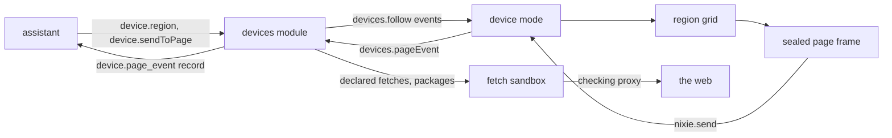

# Device layouts

- **Status:** draft
- **Work items:** [the device layout](https://linear.app/zgeoff/issue/GEO-2805), after
  [a signed-in browser as a device](https://linear.app/zgeoff/issue/GEO-2804)

Layouts are built: a grid of named regions, each holding markdown, an image or a live value, as
[layouts and regions](../../architecture/channels/devices.md#layouts-and-regions) describes. One
part remains: a region that holds a web page the assistant writes. A page runs sealed in a sandboxed
frame. It can load packages you approved, read the URLs declared with it, take messages from the
assistant, and send events back when you touch it. The assistant sees a preview of the screen and
each page's errors. Until pages are built, `device.region` refuses a page with `PAGE_NOT_BUILT`.

## Shape



## Contracts

### Pages in a region

```ts
// devices module: a page is one more kind of region content
device.region({
  device: 'tb8r3k6m1q',
  region: 'pond',
  content: { kind: 'html', html: '<canvas id="pond"></canvas><script>…</script>' },
});
// → { device: 'tb8r3k6m1q', region: 'pond', until: null }
//   or the refusals device.region returns today, and UNKNOWN_PACKAGE

type RegionContent =
  // …existing kinds: markdown, image, live
  HTMLContent;

type HTMLContent = {
  kind: 'html';
  html: string; // at most 200,000 characters
  packages?: string[]; // 'name@version', each one approved through device.addPackage
  fetches?: { url: string; refreshMinutes?: number }[]; // exact URLs, at most 8; refresh 5 to 1,440
  images?: string[]; // image store short IDs the page may show, at most 20
};
// device.region with fetches declares the existing `read` effect, with each URL's host as a
// destination, so the decision point judges the URLs when the page is sent. Without fetches the
// page reads nothing.
```

```ts
// devices module: a message into a page that shows, with no reload
device.sendToPage({ device: 'tb8r3k6m1q', region: 'pond', data: { ripples: 3 }, retain: true });
// data: JSON, at most 16 KiB. retain: true keeps this message as the page's state: the server holds
// the last retained message of each page region, and the device hands it to nixie.onMessage each
// time the page loads, after a reload or a reconnect. A new content for the region drops it.
// → { delivered: true } or UNKNOWN_REGION | NOT_A_PAGE | OFFLINE; with retain, OFFLINE still keeps it

// devices module: what the screen looks like, and what went wrong on it
device.preview({ device: 'tb8r3k6m1q' });
// → { width: 1280, height: 276, pixelRatio: 2, errors: [{ region: 'pond', at, message: 'TypeError: …' }],
//     picture: 'shown' } with the picture beside it,
//   or picture: 'busy' | 'unavailable' with no picture when the computer is busy or not set up
//   UNKNOWN_DEVICE | SCREEN_OFF; a device that is offline still returns its last errors.
// The tool's description says the picture is a render in the computer's browser, not a capture of
// the device: fonts and drawing can differ, so it is no proof of what the device shows.
```

The server sends the layout to the computer sandbox over the wire as files: the device page's grid,
each region's content, the package files the pages name, the images they declare, and the last body
of each declared fetch. The computer's browser opens them as a local page at the device's CSS size
and pixel ratio, takes the picture, and fetches nothing. The preview takes the computer's busy slot,
as a browser tool does.

The errors come from the device: the last 20 uncaught errors and console errors of each page region
since its content last changed, which the server keeps in memory.

| Tool                                  | Effect                                             | Runs                                     |
| ------------------------------------- | -------------------------------------------------- | ---------------------------------------- |
| `device.sendToPage`, `device.preview` | `note`                                             | direct                                   |
| `device.region` with a page           | `note`, and a `read` of each declared fetch's host | direct when the rules allow, else queued |
| `device.addPackage`                   | `install_package`, in the always-ask risk class    | queued                                   |

### The page's bridge

A page runs in a frame with no network and no access to the device page around it. The device page
injects one global into the frame:

```ts
// web client: the bridge a page sees
nixie.send(name: string, data?: JSONValue, options?: { wake?: boolean }): void;
// name: 1 to 64 characters; data at most 2 KiB. wake: true wakes the assistant; without it the
// event waits for the conversation's next turn
nixie.onMessage((data: JSONValue) => void): void; // device.sendToPage delivers here
nixie.data(url: string): Promise<{ status: number; type: string; body: string; fetchedAt: string }>;
// one of the page's declared fetches, as the server last fetched it; NOT_DECLARED for any other URL
nixie.onData((url: string) => void): void; // a declared fetch refreshed
nixie.size(): { width: number; height: number }; // the region's size in CSS pixels, kept current
nixie.image(image: string): string; // the URL of a declared image; throws NOT_DECLARED for any other
```

```ts
// contract lib: device session calls; shown is the device.region_shown short ID of the page
devices.pageEvent({ region, shown, name, data, wake }); // from nixie.send
devices.pageData({ region, shown, url }); // from nixie.data; a declared URL of that page alone
devices.pageError({ region, shown, message }); // each uncaught error and console error
// A call whose shown no longer matches the region's content returns STALE and changes nothing.

// contract lib: the devices.follow event for a page region carries shown, a frame ticket and an
// image ticket for each declared image. A region_data event { region, shown, url } follows each
// refresh of a declared fetch.
```

The frame's opaque origin sends no session cookie, so the API's session check skips three paths
under `/rpc/device/`, which the reverse proxy already sends to the API:

| Path                                           | Serves                     | Checked by                                             |
| ---------------------------------------------- | -------------------------- | ------------------------------------------------------ |
| `/rpc/device/frames/<ticket>`                  | the page, with its CSP     | a ticket that ends when the region's content changes   |
| `/rpc/device/images/<ticket>`                  | one declared image         | a ticket that ends when the region's content changes   |
| `/rpc/device/packages/<name>@<version>/<path>` | an approved package's file | nothing: public npm code, and nothing else lives there |

Each ticket comes from `crypto.randomUUID()` when the region shows. The device page's own CSP gains
`frame-src 'self'`, and the frame's CSP names the API's origin for the package and image paths,
because an opaque origin can't use `'self'`. Image and markdown regions keep using
`devices.readImage`.

The three page calls join the device session's allowed calls. A full session may make them only for
a device it holds.

```text
device.page_event     -- payload: device, region, shown, name, data (erasable), wake; on the conversation's thread
device.package_added  -- payload: name, version, integrity, size, publisher
```

Every page event goes to the conversation, whichever conversation or task wrote the region.

A `device.page_event` with `wake` reaches the conversation through its inbox and wakes it, as a
fired timer does. One without `wake` waits in the events block of the conversation's next turn.
Either way the assistant reads the event's name and data inside an untrusted block, after the line
"a page event from <device name>, region <region>".

### Packages

```ts
// devices module
device.addPackage({ name: 'chart.js', version: '4.4.6' }); // an exact version; no ranges or tags
// → { package: 'chart.js@4.4.6', files: ['dist/chart.umd.js', …] }
//   or UNKNOWN_PACKAGE | TOO_BIG (over 5 MiB unpacked) | PACKAGE_KNOWN
// declares ['install_package'], a new effect in the always-ask risk class, queued; destination:
//   the registry's host. No starter rule allows it, and the card offers no "always allow".
```

```ts
// contract lib: the proposal gains a package block, which the card shows
type ProposalPackage = {
  name: string;
  version: string;
  unpackedBytes: number;
  publisher: string; // the registry's _npmUser
  description: string; // the publisher's own text; the card marks it as the publisher's words
  integrity: string; // the registry's sha512; part of the action hash, so the approval binds it
};
// unpackedBytes is null when the registry leaves it out; the unpack then checks the 5 MiB limit.
// The registry's address is a config value, registry.npmjs.org by default.
```

`install_package` is a new effect in the definitions schema, open to rules with destinations. The
always-ask risk class gives it the passkey and the card with no "always allow", as it does for every
always-ask effect.

The name must be a valid npm package name and the version an exact semver version. The tool reads
the registry's metadata through the fetch sandbox when it proposes the call. On approval, the fetch
sandbox downloads the tarball, checks it against the approved integrity hash, and unpacks it. It
refuses the whole package when an entry is a link, holds an absolute path or a `..` segment, or
lands outside the package's own folder, or when the files pass 5 MiB. It hands the files back over
the wire, and the server stores them in its data folder and writes `device.package_added`. A page
then loads a file with
`<script src="/rpc/device/packages/chart.js@4.4.6/dist/chart.umd.js"></script>`.

Backups leave package files out. On start, the server downloads again each package whose
`device.package_added` record has no files, and checks the same hash.

## Constraints

The frame:

- A page runs in an `<iframe sandbox="allow-scripts">`, with no `allow-same-origin`, so it has an
  opaque origin and can't read the device page's cookie, storage or DOM.
- The frame's content-security policy is `default-src 'none'`, with `script-src` and `style-src`
  open to inline code and to the package paths of the packages the page names, `font-src` open to
  those package paths and `data:`, `img-src` open to `nixie.image` URLs and `data:`, and
  `connect-src 'none'`. A page reaches the web only through its declared fetches.
- `device.region` returns `UNKNOWN_PACKAGE`, and leaves the region as it was, for a page that names
  a package nixie doesn't hold.
- The bridge talks to the device page by `postMessage` and checks that each message comes from its
  own frame's window.

Page events:

- A page event carries no authority. The assistant weighs it like any page it reads, and anything it
  does next goes through the rules and approval cards as before.
- A page event can carry what the page read from its declared fetches. It reaches the assistant only
  inside an untrusted block, and the preview's errors reach it the same way.
- Each region sends at most 1 page event a second and 30 a minute; the device drops the rest, and
  the server enforces the same limits in memory and logs one line for each drop. Each device wakes
  the conversation at most 6 times an hour, counted from its `device.page_event` records; a later
  event marked `wake` waits for the next turn.
- Page events come only from a device whose screen is on and whose region shows a page.

The network:

- The fetch sandbox fetches each declared URL, through its checking proxy, when the region shows and
  every `refreshMinutes` after, while the device is online. The page's script can't name a URL of
  its own, so it can't put what it holds into a query string.
- Before each refresh the server checks the rules again, with no card. When the rules no longer
  allow the host, the refreshes stop and `nixie.data` returns `REFUSED` for that URL.
- A fetch takes GET alone, follows at most 3 redirects within the declared URL's host, and keeps at
  most 1 MiB of body as text. A redirect to another host fails that fetch.
- A refresh stops when the region's content changes, its minutes pass, or a forget erases it.
- The server keeps the last body of each declared fetch in memory, drops it when a refresh stops,
  and fetches again after a restart.
- A refresh runs with the mandate of the call that sent the page, and counts toward the web fetch
  rate limits and the spending budget as a `web.fetch` does.
- Each declared URL is `https`, may hold a query string, and goes through the web fetch URL parser
  and its private-address check when the page is sent and at each fetch.
- The checking proxy refuses private and internal addresses after each DNS lookup and each redirect,
  as it does for every fetch.

Regions:

- `devices.list` shows a page region's packages and fetch URLs beside its kind, and never the page's
  HTML.
- While a `device.show` covers the layout, a page stays loaded and hidden, and still takes messages,
  events and refreshes.

The preview:

- In the computer's local render, the bridge serves `nixie.data` and `nixie.image` from the bundled
  files, and the render runs with the computer's network off.

## Decisions

- **The assistant writes pages, and nixie supplies the grid.** The assistant writes HTML fluently,
  so a page puts looks on its side. The grid lets it update one part of a screen without redrawing
  the rest.
- **A page event is not proof of a touch.** The page's own script handles each touch, so it could
  send an event without one. Events carry no authority, so a fake one fools only the assistant into
  doing what its own page said.
- **Packages come from an approved list, pinned by version and hash.** A page never loads code from
  outside nixie, and nothing updates by itself: a new version is a new approval.
- **A page reads only the URLs declared with it.** The decision point judges the URLs when the page
  is sent, and the page's script can't build new ones, so it can't leak what it holds to an allowed
  host.
- **The preview renders in the computer sandbox.** A web page can't take a picture of its own screen
  without a prompt on the device, so the assistant sees a render of the same layout at the same
  size, and the real device's errors beside it.

## Builder decides

- How a region fades between contents.
- The fonts the device page offers a page.
- How the server stores package files, and how it serves them with their content types.
- The wire frames that carry a fetch, a package and a preview to and from their sandboxes.
- The tool descriptions and the refusal wording.

## Out of scope

- The camera, the speaker and the microphone, in the [devices design](devices.md).
- POST and other writes from a page. A page that needs to change something asks the assistant with a
  page event.
- Packages from anywhere but the npm registry.
