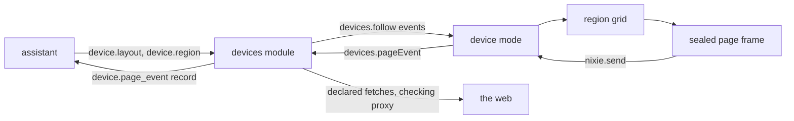

# Device layouts

- **Status:** draft
- **Work items:** [the device layout](https://linear.app/zgeoff/issue/GEO-2805), after
  [a signed-in browser as a device](https://linear.app/zgeoff/issue/GEO-2804)

A device screen shows one thing at a time today: a block of markdown or an image. The assistant
gains layouts: a grid of named regions, each showing its own content and updated or timed out on its
own. A region holds markdown, an image, a live value that the device keeps fresh, or a web page the
assistant writes. A page runs sealed in a sandboxed frame. It can load packages the owner approved,
read the URLs declared with it, take messages from the assistant, and send events back when the
owner touches it. The assistant sees a preview of the screen and each page's errors.

## Shape



## Contracts

### Layouts and regions

```ts
// connectors module: the device tools
device.layout({
  device: 'tb8r3k6m1q',
  columns: ['1fr', '2fr', '1fr'], // each a whole number of fr, 1 to 12; at most 6 columns
  rows: ['1fr'], // the same, at most 6 rows
  regions: [
    { name: 'pond', column: 1, row: 1 }, // 1-based; span with columnSpan and rowSpan
    { name: 'note', column: 2, row: 1 },
    { name: 'clock', column: 3, row: 1 },
  ],
});
// → { device: 'tb8r3k6m1q', regions: ['pond', 'note', 'clock'] }
//   or UNKNOWN_DEVICE | SCREEN_OFF | BAD_LAYOUT (overlapping or out-of-grid regions, bad names) | OFFLINE
//   A new layout clears every region. device.show still shows one thing on the whole screen and
//   leaves the layout; the next device.region puts the layout back.

device.region({
  device: 'tb8r3k6m1q',
  region: 'note',
  content: { kind: 'markdown', markdown: 'Bins go out **tonight**' },
  minutes: 90, // optional; without it the region keeps its content until the next device.region
});
// → { device: 'tb8r3k6m1q', region: 'note', until: '2026-11-22T21:30:00Z' }
//   or UNKNOWN_REGION, and the refusals device.show returns for its content
//   A region whose minutes pass goes blank; the other regions stay.

type RegionContent =
  | { kind: 'markdown'; markdown: string } // at most 20,000 characters
  | { kind: 'image'; image: string; fit: 'whole' | 'fill' } // an image store short ID
  | { kind: 'live'; live: 'clock'; format: 'HH:mm' | 'HH:mm:ss' | 'EEE d MMM' }
  | { kind: 'live'; live: 'countdown'; to: string; label?: string } // ISO time; shows 0 after it
  | PageContent;

type PageContent = {
  kind: 'page';
  html: string; // at most 200,000 characters
  packages?: string[]; // 'name@version', each one approved through device.addPackage
  fetches?: { url: string; refreshMinutes?: number }[]; // exact URLs, at most 8; refresh 5 to 1,440
};
// device.region with fetches declares a read of each URL's host as its destination, so the
// decision point judges the URLs when the page is sent. Without fetches the page reads nothing.
```

```ts
// connectors module: a message into a page that shows, with no reload
device.sendToPage({ device: 'tb8r3k6m1q', region: 'pond', data: { ripples: 3 } }); // data: JSON, at most 16 KiB
// → { delivered: true } or UNKNOWN_REGION | NOT_A_PAGE | OFFLINE

// connectors module: what the screen looks like, and what went wrong on it
device.preview({ device: 'tb8r3k6m1q' });
// → { width: 2560, height: 551, errors: [{ region: 'pond', at, message: 'TypeError: …' }] } with a picture
//   beside it. The picture comes from rendering the device's current layout in the computer
//   sandbox's browser at the device's size. The errors come from the device itself: the last 20
//   uncaught errors and console errors of each page region since its content last changed.
//   UNKNOWN_DEVICE | SCREEN_OFF; a device that is offline still returns its last errors.
```

All five tools declare the `note` effect and run direct, as `device.show` does, except where a
page's `fetches` add a read.

### The page's bridge

A page runs in a frame with no network and no access to the device page around it. The device page
injects one global into the frame:

```ts
// web client: the bridge a page sees
nixie.send(name: string, data?: JSONValue, options?: { wake?: boolean }): void;
// name: 1 to 64 characters; data at most 2 KiB. wake: true wakes the assistant; without it the
// event waits for the conversation's next turn
nixie.onMessage((data: JSONValue) => void): void; // device.sendToPage delivers here
nixie.data(url: string): Promise<{ status: number; type: string; body: string; fetchedAt: string }>;
// one of the page's declared fetches, as the server last fetched it; NOT_DECLARED for any other URL
nixie.onData((url: string) => void): void; // a declared fetch refreshed
nixie.size(): { width: number; height: number }; // the region's size in pixels, kept current
nixie.image(image: string): string; // a URL for an image store short ID the frame may load
```

```ts
// contract lib: device session calls
devices.pageEvent({ region, name, data, wake }); // from nixie.send
devices.pageData({ region, url }); // from nixie.data; a declared URL of the region's page alone
devices.pageError({ region, message }); // the bridge reports each uncaught error and console error
```

The frame's opaque origin sends no session cookie, so the web server serves package files under
`/device/packages/` with no session: they are public npm code. `nixie.image` returns a URL that
carries a ticket for that one image, made with `crypto.randomUUID()` and valid for 10 minutes while
the image shows in that region.

```text
device.layout_set     -- payload: columns, rows, regions
device.region_shown   -- payload: region, content (sealed under the record's own key), until
device.page_event     -- payload: device, region, name, data (erasable), wake; on the conversation's thread
device.package_added  -- payload: name, version, integrity, size, publisher
```

A `device.page_event` with `wake` wakes the conversation, and one without it waits in the events
block of the conversation's next turn. The assistant reads each inside the untrusted-content
markers, as "a page event from <device name>, region <region>: <name> <data>".

### Packages

```ts
// connectors module
device.addPackage({ name: 'chart.js', version: '4.4.6' }); // an exact version; no ranges or tags
// → { package: 'chart.js@4.4.6', files: ['dist/chart.umd.js', …] }
//   or UNKNOWN_PACKAGE | TOO_BIG (over 5 MiB unpacked) | PACKAGE_KNOWN
// declares ['install_package'], a new effect in the always-ask risk class, queued; destination:
//   the registry's host. Its card shows the name, the version, the unpacked size, the publisher and
//   the package's own description. No starter rule allows it, and the card offers no "always allow".
```

On approval, the server downloads the tarball from the npm registry, checks it against the
registry's integrity hash, unpacks it into nixie's data folder, and writes `device.package_added`. A
page then loads a file with
`<script src="/device/packages/chart.js@4.4.6/dist/chart.umd.js"></script>`.

## Constraints

The frame:

- A page runs in an `<iframe sandbox="allow-scripts">`, with no `allow-same-origin`, so it has an
  opaque origin and can't read the device page's cookie, storage or DOM.
- The frame's content-security policy is `default-src 'none'`, with `script-src` and `style-src`
  open to inline code and to the package paths of the packages the page names, `img-src` open to
  `nixie.image` URLs and `data:`, and `connect-src 'none'`. A page reaches the web only through its
  declared fetches.
- `device.region` returns `UNKNOWN_PACKAGE`, and leaves the region as it was, for a page that names
  a package nixie doesn't hold.
- The bridge talks to the device page by `postMessage` and checks that each message comes from its
  own frame's window.

Page events:

- A page event carries no authority. The assistant weighs it like any page it reads, and anything it
  does next goes through the rules and approval cards as before.
- The device sends at most 1 page event a second and 30 a minute from one region, and drops the
  rest. The server enforces the same limit. At most 6 events an hour from one device wake the
  conversation; the rest wait for its next turn.
- Page events come only from a device whose screen is on and whose region shows a page.

The network:

- The server fetches each declared URL when the region shows and every `refreshMinutes` after,
  through the checking proxy. The page's script can't name a URL of its own, so it can't put what it
  holds into a query string.
- A fetch takes GET alone, follows at most 3 redirects within the declared URL's host, and keeps at
  most 1 MiB of body as text. A redirect to another host fails that fetch.
- A refresh stops when the region's content changes or its minutes pass.

Regions:

- A layout has at most 12 regions. A region name is 1 to 32 characters of lowercase letters, digits
  and hyphens.
- A region's content replaces the one before it. A forget of a `device.region_shown` record erases
  its content, and the region goes blank.
- `devices.list` shows each device's layout and what each region shows.
- A live value runs in the device page, with no event from the server after it starts.

## Decisions

- **The assistant writes pages, and nixie supplies the grid.** The assistant writes HTML fluently,
  so a page puts looks on its side. The grid lets it update one part of a screen without redrawing
  the rest.
- **A page event is not proof of a touch.** The page's own script handles each touch, so it could
  send an event without one. Events carry no authority, so a fake one fools only the assistant into
  doing what its own page said.
- **Packages come from an approved list, pinned by version and hash.** A page never loads code from
  outside nixie, and nothing updates by itself: a new version is a new approval.
- **A page reads only the URLs declared with it.** The decision point judges the URLs when the page
  is sent, and the page's script can't build new ones, so it can't leak what it holds to an allowed
  host.
- **The preview renders in the computer sandbox.** A web page can't take a picture of its own screen
  without a prompt on the device, so the assistant sees a render of the same layout at the same
  size, and the real device's errors beside it.

## Builder decides

- How the device page draws the grid, and how a region fades between contents.
- The look of a live value, and the fonts the device page offers a page.
- How the server stores package files, and how it serves them with their content types.
- The tool descriptions and the refusal wording.

## Out of scope

- The camera, the speaker and the microphone, in the [devices design](devices.md).
- POST and other writes from a page. A page that needs to change something asks the assistant with a
  page event.
- Packages from anywhere but the npm registry.
