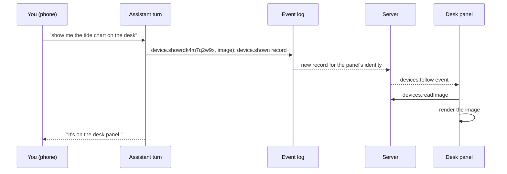

# Devices

- **Status:** draft
- **Work items:** [the assistant uses your devices](https://linear.app/zgeoff/issue/GEO-2758), with
  [images](https://linear.app/zgeoff/issue/GEO-2728) and
  [the notebook](https://linear.app/zgeoff/issue/GEO-2726) for what a screen shows

Any device with a browser can lend the assistant what it has: a desk panel, a tablet, a TV or a
phone. You open the web client's device mode on it, enrol it with a code, name it, and switch on its
capabilities: a screen first, and later a camera, a speaker and a microphone. The assistant lists
your devices and puts things on a screen while you talk, and an idle screen shows a scene the
assistant keeps. Each device signs in with a session that can only follow its own device stream, so
a panel left on a shelf can't read the conversation.

## Shape



## Contracts

### The assistant's tools

```ts
devices.list({});
// → { devices: [{ device: 'dk4m7q2w9x', name: 'desk panel', screen: 'on', camera: 'off', online: true,
//                 pixels: { width: 1920, height: 480 },          // the screen's size, from the device
//                 showing: { kind: 'image', image: 'k3x9m2p7qa', until: '2026-11-21T08:20:00Z' } }] }
//   showing is { kind: 'idle' } when the idle scene shows, and null when the device is offline

device.show({ device: 'dk4m7q2w9x', content: { kind: 'image', image: 'k3x9m2p7qa' }, minutes: 10 });
// → { shown: true, until: '2026-11-21T08:20:00Z' }   // until: null when minutes is absent
//   or { refused: 'SCREEN_OFF' } | { refused: 'OFFLINE' } | { refused: 'UNKNOWN_DEVICE' }
//   or { refused: 'IMAGE_FORGOTTEN' } | { refused: 'UNKNOWN_IMAGE' }
//   an input outside the schema, such as minutes: 0 or markdown past 20,000 characters, fails the input check

device.setIdle({
  device: 'dk4m7q2w9x',
  scene: [{ kind: 'markdown', text: '# Saturday\nLow tide 14:05' }],
});
// → { idle: true }   // scene: [] leaves the screen black

device.look({ device: 'tb8r3k6m1q' });
// → { device: 'tb8r3k6m1q', at: '2026-11-21T09:02:11Z', width: 1280, height: 720 } with the still beside it
//   or { refused: 'CAMERA_OFF' } | { refused: 'OFFLINE' } | { refused: 'UNKNOWN_DEVICE' }
```

```ts
// devices module
type Capability = 'screen' | 'camera' | 'speaker' | 'microphone';

type ScreenContent =
  | { kind: 'markdown'; text: string } // up to 20,000 characters; rendered like a reply: no raw HTML, safe links only
  | { kind: 'image'; image: string } // an image's short ID
  | { kind: 'page'; page: string }; // a notebook page's short ID; the notebook's build adds it

interface DeviceShowInput {
  device: string; // a device's short ID
  content: ScreenContent;
  minutes?: number; // 1 to 1,440; the idle scene returns after it. Absent: until the next show
}
// devices.list, device.show and device.setIdle declare effects ['note'], execution 'direct'
// device.look declares ['sense'], a new effect for reading a room, execution 'direct';
//   your starter rules hold no rule for it, so each look asks until you write one
```

### The device's calls

```ts
// contract lib: "Add a device" on a signed-in client issues a code with the scope in it
sessions.issueCode({ scope: 'device' }); // → { code: '4K7-Q2M' }
sessions.enrol({ code: '4K7-Q2M', deviceName: 'desk panel', tokenDelivery: 'cookie' });
// enrolment with a device code creates the devices row, with every capability off

// contract lib: the calls a device session may make
devices.follow({ pixels: { width: 1920, height: 480 } }); // the screen's size, sent again on each reconnect
// yields { kind: 'show'; content: ScreenContent; until: string | null } | { kind: 'idle'; scene: ScreenContent[] }
//   | { kind: 'look'; lookID: string }   // take one still now
// the first event is what the screen shows now

devices.sendStill({ lookID, still: Uint8Array }); // a JPEG, at most 2 MiB; only for an open look

devices.setCapability({ capability: 'screen', isOn: true }); // → { screen: 'on' }; writes device.capability_changed
devices.readImage({ image: 'k3x9m2p7qa' }); // → the bytes, or NOT_SHOWN
// only for an image in what the device shows at the moment of the call
sessions.signOut({});
```

### The device record

```text
devices                        -- devices module
  device_id      text          -- short ID from createShortID; the only ID the model sees
  identity_id    text          -- the enrolled identity; a revoke removes the device
  name           text          -- the identity's label, from deviceName
  capabilities   json          -- { screen: false, camera: false, … } at enrolment
  idle_scene     json null     -- ScreenContent[], sealed under the device's own key
  updated_at     integer
```

## Constraints

- The scope comes from the code. `sessions.enrol` takes no scope, so a device code can't make a full
  session, and a normal code can't make a device session.
- The server refuses every call from a device session except the five in
  [the device's calls](#the-devices-calls).
- A capability switches on only from the device itself. No tool and no other device can switch one
  on.
- The screen builds first, then the camera. The speaker and the microphone come with their own work
  items.
- A screen shows an image whole, scaled to fit and centred on black. An empty scene is a black
  screen.
- `device.show` reaches only a device enrolled to you. Your starter rules allow it.
- A device is online while it has at least one open `devices.follow` stream. A show goes to every
  open stream of that device, and returns `OFFLINE` at once when there is none.
- A new show replaces the one before it. When a show's `until` passes, the server sends the idle
  event, and never an older show.
- The server works out what each screen shows from the latest `device.shown` record. A device that
  reconnects gets that state as its first event, and a device with no idle scene gets an idle event
  with an empty scene.
- The devices module keeps the open streams, and `device.show` asks it whether a device is online.
- A revoke of the device's session closes its open streams and removes its row.
- A device session takes its token as a cookie or a bearer token, like any session.
- The server decrypts the idle scene and each `device.shown` record. A device session never holds a
  key.
- The `device.shown` record seals its content under its own key, so a forget erases it.
- When an image or a page is forgotten while it shows, the server sends the idle event.
- The device page sets a Content-Security-Policy and `frame-ancestors 'none'`.
- Device mode keeps the screen awake with the Wake Lock API while a stream is open.

The camera:

- A look takes one still. The device never streams or records video, and no tool asks for more than
  one still per call.
- While a look runs, the device's screen shows a bright border and the words "Nix is looking", for
  at least 3 seconds.
- The browser's own camera permission stays on the device. The device asks for it when you switch
  the camera on, and a look fails with `CAMERA_OFF` when the browser refuses.
- The still goes beside the result and into the tool_result record's sealed attachments, so a forget
  erases it. It never becomes an image the assistant can edit or send unless it imports it.
- A look that gets no still within 10 seconds returns `OFFLINE`.
- A device session lapses after 30 idle days, like every session, and an open stream keeps it
  active.

## Decisions

- **A device is a browser.** Device mode is a route of the web client, so a device needs no code of
  its own.
- **A device session is scoped.** A panel stays signed in for weeks in a shared room, so its session
  can't read or send messages.
- **Screens show 3 kinds of content.** Markdown, an image and a notebook page cover what the
  assistant makes today. A chart is an image the assistant draws with `code.run`. HTML stays out
  until a work item settles its sandbox.
- **Looking has its own effect.** A still from a shared room is private to everyone in it, so your
  rules can treat looking apart from every other read.
- **Showing is a note, not an action.** The `device` effect means an actuator, such as a lock, and
  queues. Putting a picture on your own screen changes nothing outside nixie.

## Builder decides

- The device mode's route and layout, and how the idle scene lays out its blocks.
- Where the web client puts "Add a device".
- How the server tracks the open streams.
- The tools' descriptions and the refusal wording.

## Out of scope

- Taps on a screen that come back to the assistant as events.
- HTML content on a screen.
- The speaker and microphone tools.
- Dimming a screen on a schedule. The assistant sets an empty scene at night.

## Open questions

- **Who in the house agrees to the camera?** The owner settles it before the camera's build ships to
  prod. Until then, the camera builds and stays switched off on every device.

- **Are "device", "capability" and "screen" the right names?** The owner settles it before the
  build, because the model reads them in the tools. Until then, the build uses them.
