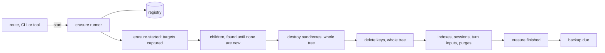

# One way to forget

- **Status:** draft

You can forget a memory item, a moment, a note, a record, an image or the whole conversation. nixie
forgets by destroying the keys that seal a thing, then cleaning up every index, session and spool
that could still show it. Today each of those has its own pipeline, with its own records, its own
catch-up after a crash and its own reply, and two lists that must name every pipeline are kept by
hand. So a moment's destroy reports no backup state, a conversation reset can't finish after a
crash, and the vault and locked entries would each add another pipeline. After this design, each
store registers what it can forget, one runner takes every forget through the same steps, the same
two records mark each forget, and both lists come from the registry. Each store switches to the
runner and its records directly, and writes no old record after it moves.

Once the owner approves this design, build its work items from it and the built
[forgetting in the memory store](../../architecture/memory/store.md#forgetting) it generalises.
Notes and moments move first; memory items, records, images and the reset follow, each in its own
work item.

## Shape



## Terms

- An **erasable** is one kind of thing a store can forget, such as a memory item or a note.
- An **erasure** is one forget of one target, from `erasure.started` to `erasure.finished`.
- A **child** is an erasure that must finish before its parent, such as the images a record holds.
- An **evidence purge** re-keys a memory item that quotes a forgotten record, so the quote goes and
  the item's own text stays. It isn't an erasure. An erasure starts it, and a purge an older release
  started may have no erasure.
- The **floor** is the lowest log sequence where a target's text can exist. A null floor covers
  every captured turn input on the erasure's threads.

## Contracts

### The registry

Each module exports a static descriptor for every kind it can forget, which the server registers at
start and the list generator imports without starting anything. A store gains its runner methods in
the work item that moves it; until then the runner leaves it to its own pipeline.

```ts
// log module: the descriptor types. The runner lives in the server, which can reach sessions,
// turn inputs and sandboxes.
interface ErasableDescriptor {
  kind: ErasableKind; // 'memory_item' | 'moment' | 'note' | 'record' | 'image' | 'conversation'
  //                     | 'vault_entry' | 'locked_entry' | 'credential' (these three join when
  //                     they are built; 'credential' is a credential in the database backend)
  recordKinds: {
    erasable: readonly string[]; // records this erasable's own forget erases
    forgettable: readonly string[]; // records a record forget may target (the record erasable only)
    unforgettable: readonly string[]; // records no forget may target, such as definition.changed
  };
  // The old end records that make a backup due, with any payload filter, such as
  // { kind: 'moment_destroyed', where: { stage: 'done' } }. The server passes these to the backup
  // module, which imports no store.
  legacyEnds: readonly { kind: string; where?: Record<string, string> }[];
}

interface Erasable<Target> extends ErasableDescriptor {
  // Throws the store's refusal error, so a client action written in the same transaction rolls
  // back: not_found, stale, action_not_finished.
  start(tx: Transaction, target: Target): Promise<ErasureCapture>;
  // After the start commits, under the store's lock, or with none for a store that has none: makes
  // the target unreachable at once, such as dropping it from search and from image.list.
  hide(target: Target): Promise<void>;
  readChildren(tx: Transaction, target: Target): Promise<ErasureTarget[]>;
  cleanIndexes(target: Target): Promise<void>; // after the keys go; repeats hide's work safely
  before?(target: Target): Promise<void>; // the reset's stop-work barrier and guest destroy
  // A credential's one revocation at its provider. The start records the attempt; the runner calls
  // revoke once, after the start commits. A catch-up that finds no outcome records 'unknown'.
  revoke?(target: Target): Promise<'confirmed' | 'refused' | 'unknown'>;
}

// Captured in the start transaction, while the target still reads, and stored in erasure.started.
type ErasureCapture = {
  keys: KeySelection; // { ids: string[] } | { family: string } | { thread: string }
  cleanupKeys: string[]; // keys found through readable data: report copies, briefs, pictures
  sandboxCallIDs: string[]; // code sandboxes that hold clear text
  purges: { recordSequence: number; itemIDs: string[] }[]; // the purge set, saved at start
  sessionCause: SessionCleanupCause; // …existing, such as { noteID }
  // fixed threads, plus the threads the session cleanup reports when cleaned is true
  turnInputs: { threads: string[] | 'all'; cleaned: boolean; floor: number | null };
};

// targetID: the target's stable ID: a UUID, a record's sequence as text, or the conversation's
// task ID. The model never sees it; a tool passes the target's short ID or event number.
type ErasureTarget = { kind: ErasableKind; targetID: string; version: number | null };
```

### The records

```text
erasure.started   { erasureID, kind, targetID, shortID, version, parentID, by, capture }
erasure.finished  { erasureID, kind, targetID, shortID, by, removedKeys }
```

- `by` is `user` or `assistant`, as the note forget records today. `version` is null for a kind with
  no version.
- Both records hold IDs and sequences only, carry no erasable field, and are written in clear.
- Each store's projection folds `erasure.started` and `erasure.finished` for its own kind, as it
  folds its old start and end records, so a rebuild reproduces every state a forget sets: the
  forgotten-evidence block, the removed-record readers, a note's forget notice. When both an old
  record and its new one exist, the two folds set the same state.
- `erasureID` is a UUID and never reaches the model.
- The runner writes only the new records. Each store's old record codecs and folds stay, so a
  rebuild still reads every old record.
- The evidence purge keeps its own three records.

### The runner

1. Run `before`, if any. Then, under the store's lock, or in the write transaction for a store with
   no lock: call `start`, write `erasure.started` with the capture, and commit. Then call `hide`.
2. Close every open turn-input capture, on every thread, so no spool file lands after the sweep.
   Capture stays closed while any erasure is between this step and step 8.
3. Find the children, start each as an erasure with `parentID` in its own transaction under its
   store's lock, and repeat until a pass finds no new target.
4. Run `revoke` for each erasure that has one, then destroy every code sandbox in the tree. When one
   destroy fails, no key goes.
5. Delete every key in the tree, then checkpoint the key store.
6. Scan for children again. A new one runs steps 3 to 5 before the parent goes on.
7. Clean the indexes and close the sessions for each erasure, then run the evidence purges. A purge
   waits for an item forget already under way.
8. Remove the turn inputs from the floor on, on the captured threads and the cleaned ones. Reopen
   capture when no other erasure holds it closed.
9. Write `erasure.finished` for each child, then the parent.

- A target that already has an open erasure joins it: the open erasure does the work, and a parent
  that reached the target waits for it to finish. A target seen once in a tree is skipped, so shared
  and cyclic children finish once.
- At each start, after the session-cleanup parts and before any claim pool or turn-input intake
  starts, the runner finishes every `erasure.started` with no `erasure.finished`, children before
  parents, and every evidence purge with no erasure. A crash in step 3 leaves the parent open, and
  the catch-up runs step 3 again.
- The work item that moves a store finishes, at the first start, any forget that the store's old
  pipeline left open, then deletes the old catch-up.
- A forget still open 5 minutes after it started is stuck. nixie shows a "forget stuck" flag to you
  and to the model with a retry, and raises an alert. Turn-input capture stays closed until the
  forget finishes. The 5 minutes is a config value.
- Each step runs again after a crash with the same result.
- A note forget from a tool runs step 1 at once, and steps 2 to 9 after the calling step ends,
  retried until they succeed.

### The conversation reset

- A reset is an erasure of kind `conversation`. Its `before` stops work on the thread, invalidates
  the conversation's session, and destroys its guest; when the destroy fails, nothing is written and
  no key goes.
- It writes the `log_reset` boundary in the transaction of `erasure.finished`, after the keys are
  gone, so the inbox moves and a backup falls due only once the reset is done.
- It cleans the fetch pages and the fetch pauses it stored, and purges memory quotes of the thread's
  records, as a record forget does. A memory item whose evidence a forget purged reads "backed by
  your words, since forgotten", never as unconfirmed.
- `erasure.finished.removedKeys` holds the count of keys it deleted, which the reply reports.

### The reply

- Every screen, route and tool calls each removal that can't be undone "Forget": a memory item, a
  moment, a note, a record, an image and the conversation alike. "Retire" stays for a memory item,
  because a retire can be undone.
- Each route keeps its output. Every backup state uses `forgetBackupSchema` as it is. A route with
  no backup state today, such as the moment destroy, gains one as an optional field, in the work
  item that moves its store.
- A route runs the forget to its end before it replies, as today. When a step fails, it replies
  pending. A retry with the same client action returns the stored result when the forget is done, or
  finds the open erasure by target and finishes it.
- A bulk forget replies with the targets done and the targets pending.

## Constraints

- A forget reports done only after its keys and every child's keys are gone.
- The backup state follows
  [a forget's backup state](../../architecture/deployment/backups.md#a-forgets-backup-state):
  complete only once a set at or after `erasure.finished` is published.
- A set falls due on `erasure.finished`, on each descriptor's `legacyEnds`, and on a vault lock, an
  unlock or a passkey wrapper's removal. The backup job never publishes a set staged before a
  finished erasure that no published set covers yet.
- A script generates the contract's forgettable kinds list from the descriptors, because the
  published contract lib can't import a module. A check fails when the committed list differs.
- Every record kind of the server sits in exactly one descriptor list, or carries no erasable field.
  The partition test reads the descriptors.
- A vault entry's forget resolves any of its `vault.*` records to the entry, through the entry ID in
  the record, and never to its group. It erases the entry's page dumps, locked or not. The route
  asks for a passkey, as in the [vault design](accounts.md).
- A locked entry's forget deletes every passkey wrapper and waits for an attempt to drop its
  unwrapped key. A lock or an unlock writes a record that makes a backup due.
- Who may forget each kind stays as it is: nixie forgets notes without asking, asks before it
  forgets a record, and has no tool for the rest.

## Builder decides

- The generator's file name and the check's command.
- How the web client shows the backup state for kinds that show none today.
- How each store's runner methods attach to its descriptor at registration.

## Out of scope

- The wording of each forget's confirmation and its button.
- What each store keeps after a forget, such as a note's links from other notes.
