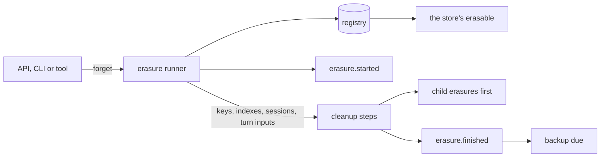

# One way to forget

- **Status:** draft

You can forget a memory item, a moment, a note, a record, an image or the whole conversation. nixie
forgets by destroying the keys that seal a thing, then cleaning up the indexes and sessions that
could still show it. Today each of those has its own pipeline, with its own records, its own
catch-up after a crash and its own reply, and two lists that must name every pipeline are kept by
hand. So a moment's destroy reports no backup state, a conversation reset can't finish after a
crash, and the vault and locked entries would each add another pipeline. After this design, each
store registers what it can forget, one runner does every forget in the same order, two records mark
each one, and both lists come from the registry.

Once the owner approves this design, build its work items from it and the built
[forgetting in the memory store](../../architecture/memory/store.md#forgetting) it generalises.

## Shape



## Terms

- An **erasable** is one kind of thing a store can forget, such as a memory item or a note.
- An **erasure** is one forget of one target, from `erasure.started` to `erasure.finished`.
- The **floor** is the lowest log sequence where a target's text can exist. The runner removes the
  turn inputs it captured from the floor on.
- A **refusal** is a reason a forget can't start, such as a stale version or an action that hasn't
  finished.

## Contracts

### The registry

```ts
const reply = await erasure.forget(tx, { kind: 'note', targetID: 'N12', version: 4 }, provenance);
// → { erasureID: '7e0a…', state: 'deleting' } or a refusal: { refused: 'stale_version' }
```

```ts
// log module, so the runner, the backup module and the contract generator read one list.
interface Erasable<Target> {
  kind: ErasableKind; // 'memory_item' | 'moment' | 'note' | 'record' | 'image' | 'conversation'
  //                     | 'vault_entry' | 'locked_entry'
  refuse(tx: Transaction, target: Target): Promise<ErasureRefusal | null>;
  preview(tx: Transaction, target: Target): Promise<ErasurePreview>;
  // Under the start lock, in the start transaction: hide the target from reads and indexes.
  hide(tx: Transaction, target: Target): Promise<void>;
  readFloor(tx: Transaction, target: Target): Promise<number | null>;
  // Erasures that must finish before this one, such as a record's images and the evidence purges
  // of the memory items that quote it.
  readChildren(tx: Transaction, target: Target): Promise<ErasureTarget[]>;
  readKeys(tx: Transaction, target: Target): Promise<KeySelection>; // one ID, a family or a thread
  cleanIndexes(target: Target): Promise<void>; // idempotent
  sessionScope: SessionScope; // which sessions to close: conversation, tasks that read this store
  recordKinds: { erasable: readonly string[]; forgettable: readonly string[] };
}

type ErasurePreview = {
  sentence: string; // what goes, in one line, such as "the note Trip ideas and its 3 versions"
  lost: readonly { what: string; count: number }[]; // such as { what: 'links from other notes', count: 2 }
};
```

### The records

```text
erasure.started   { erasureID, kind, targetID, version, parentID, floor, by }
erasure.finished  { erasureID }
```

- Every new forget writes these two records. The old start and end kinds keep their codecs and their
  projections, so a rebuild folds every forget made before this design.
- The evidence purge keeps its own three records. It re-keys a memory item that quotes a forgotten
  record, which isn't a forget, and runs as a child step of the record's erasure.

### The runner

1. Check the refusal and write `erasure.started` under the store's start lock, with `hide` in the
   same transaction.
2. Run each child erasure to its end.
3. Destroy the target's code sandboxes, then delete its keys and checkpoint the key store.
4. Clean the indexes, close the sessions in `sessionScope`, and remove the turn inputs from the
   floor on.
5. Write `erasure.finished`.

- At each start, before any runner claims work, the runner finishes every erasure that has a start
  and no end, children before their parents.
- Each step can run again after a crash and gives the same result.

### The reply

```ts
// libs/contract. Every forget route, CLI command and tool returns this.
type ForgetReply = {
  erasureID: string;
  forgottenAt: Date | null; // null while it still runs
  backup: ForgetBackup; // …existing: off | pending | failed | complete | unknown
};
```

## Constraints

- A target's keys go before `erasure.finished`, and `erasure.finished` goes before the backup sees
  the forget as due.
- The backup module reads `erasure.finished` and the old end kinds to decide a set is due. Its list
  comes from the registry.
- The contract's forgettable kinds list is generated from the registry's `recordKinds` by a script,
  because the published contract lib can't import the log module. A check fails when the committed
  list differs from the registry.
- Every erasable registers its record kinds in exactly one of `erasable` and `forgettable`. A test
  holds each record kind of the server to one group, as the partition test does today.
- A conversation reset is an erasure of kind `conversation`, so a reset that a crash stops finishes
  at the next start.
- A vault entry and a locked entry register as erasables. Their designs' forget sections follow this
  design's records and runner.
- Who may forget each kind stays as it is: nixie forgets notes without asking, asks before it
  forgets a record, and has no tool for the rest.

## Builder decides

- How the stores pass their erasables to the registry at start.
- The generator's file name and the check's command.
- How the web client shows the reply's backup state for kinds that show none today.

## Out of scope

- The wording of each forget's confirmation and its button.
- What each store keeps after a forget, such as a note's links from other notes.

## Open questions

- **One verb.** You forget items, records and notes, destroy moments, delete retired items, and
  shred a conversation. The owner may want one word everywhere, such as "Forget". Until the owner
  decides, each screen keeps its word.
