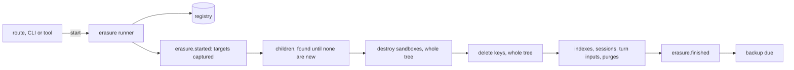

# One way to forget

- **Status:** draft

You can forget a memory item, a moment, a note, a record, an image or the whole conversation. nixie
forgets by destroying the keys that seal a thing, then cleaning up every index, session and spool
that could still show it. Today each of those has its own pipeline, with its own records, its own
catch-up after a crash and its own reply, and two lists that must name every pipeline are kept by
hand. So a moment's destroy reports no backup state, a conversation reset can't finish after a
crash, and the vault and locked entries would each add another pipeline. After this design, each
store registers what it can forget, one runner takes every forget through the same steps, two
records mark each forget, and both lists come from the registry.

Once the owner approves this design, build its work items from it and the built
[forgetting in the memory store](../../architecture/memory/store.md#forgetting) it generalises.

## Shape



## Terms

- An **erasable** is one kind of thing a store can forget, such as a memory item or a note.
- An **erasure** is one forget of one target, from `erasure.started` to `erasure.finished`.
- A **child** is an erasure that must finish before its parent, such as the images a record holds.
- An **evidence purge** re-keys a memory item that quotes a forgotten record, so the quote goes and
  the item's own text stays. It belongs to an erasure but isn't one.
- The **floor** is the lowest log sequence where a target's text can exist. A null floor covers
  every captured turn input on the erasure's threads.

## Contracts

### The registry

Each module exports a static descriptor, which the server registers at start and the list generator
imports without starting anything.

```ts
// log module: the descriptor types. The runner lives in the server, which can reach sessions,
// turn inputs and sandboxes.
interface ErasableDescriptor {
  kind: ErasableKind; // 'memory_item' | 'moment' | 'note' | 'record' | 'image' | 'conversation'
  //                     | 'vault_entry' | 'locked_entry'
  recordKinds: {
    erasable: readonly string[]; // records this erasable's own forget erases
    forgettable: readonly string[]; // records a record forget may target (the record erasable only)
    unforgettable: readonly string[]; // records no forget may target, such as definition.changed
  };
  // The old end records that make a backup due, with any payload filter, such as
  // { kind: 'moment_destroyed', where: { stage: 'done' } }.
  legacyEnds: readonly { kind: string; where?: Record<string, string> }[];
}

interface Erasable<Target> extends ErasableDescriptor {
  // Throws the store's refusal error, so a client action written in the same transaction rolls
  // back: not_found, stale, action_not_finished.
  start(tx: Transaction, target: Target): Promise<ErasureCapture>;
  hide(target: Target): Promise<void>; // after commit, under the store's lock; drops index entries
  readOpen(tx: Transaction): Promise<Target[]>; // targets in the store's in-progress state
  readChildren(tx: Transaction, target: Target): Promise<ErasureTarget[]>;
  cleanIndexes(target: Target): Promise<void>;
  before?(target: Target): Promise<void>; // the reset's stop-work barrier and guest destroy
}

// Captured in the start transaction, while the target still reads, and stored in erasure.started.
type ErasureCapture = {
  keys: KeySelection; // { ids: string[] } | { family: string } | { thread: string }
  cleanupKeys: string[]; // keys found through readable data: report copies, briefs, pictures
  sandboxCallIDs: string[]; // code sandboxes that hold clear text
  purges: number[]; // record sequences whose quotes to purge from memory items
  sessionCause: SessionCleanupCause; // …existing, such as { noteID }
  turnInputs: { threads: string[] | 'all'; floor: number | null };
};

type ErasureTarget = { kind: ErasableKind; targetID: string; version: number | null }; // targetID: UUID
```

### The records

```text
erasure.started   { erasureID, kind, targetID, shortID, version, parentID, by, capture }
erasure.finished  { erasureID, kind, targetID, shortID, by }
```

- Each store's projection folds `erasure.started` and `erasure.finished` for its own kind, as it
  folds its old start and end records, so a rebuild reproduces every state a forget sets: the
  forgotten-evidence block, the removed-record readers, a note's forget notice.
- `erasureID` is a UUID and never reaches the model. A tool passes the target's short ID.
- For one release, the runner also writes each store's old start and end records, so the release
  before can finish a forget the new release began. The release after stops them.
- The release before skips a record kind it doesn't know. The first work item checks this, and ships
  the skip a release ahead of the rest when it is missing.
- The evidence purge keeps its own three records.

### The runner

1. Under the store's lock, or in the write transaction for a store with no lock: call `start`, write
   `erasure.started` with the capture, and commit. Then call `hide`, still under the lock.
2. Close the turn-input capture for the erasure's threads, so no spool file lands after the sweep.
3. Find the children, start each as an erasure with `parentID`, and repeat until a pass finds no new
   target. A target already open joins its erasure, and a target seen once in this tree is skipped,
   so shared and cyclic children finish once.
4. Run `before`, then destroy every code sandbox in the tree. When one destroy fails, no key goes.
5. Delete every key in the tree, then checkpoint the key store.
6. Clean the indexes and close the sessions for each erasure, then run the evidence purges. A purge
   waits for an item forget already under way.
7. Remove the turn inputs on the captured threads from the floor on.
8. Write `erasure.finished` for each child, then the parent.

- At each start, after the session-cleanup parts and before any claim pool starts, the runner
  finishes every erasure that `readOpen` returns, children before parents. `readOpen` reads row
  state, so it also finds a forget an older release began with its old records.
- Each step runs again after a crash with the same result.
- A note forget from a tool runs steps 1 to 5 at once, and steps 6 to 8 after the calling step ends,
  retried until they succeed.

### The conversation reset

- A reset is an erasure of kind `conversation`. Its `before` stops work on the thread and destroys
  the conversation's guest before any key goes; when the destroy fails, the keys stay.
- Its start writes the `log_reset` boundary that the inbox and history read, and cleans the fetch
  pages it stored.
- It purges memory quotes of the thread's records, as a record forget does.
- A crash between key batches finishes at the next start, and the reply keeps its count.

### The reply

```ts
// Each route keeps its output. A route with no backup state today, such as the moment destroy,
// gains an optional one; the contract change is additive.
type ForgetBackup = 'off' | 'pending' | { failed: string } | 'complete' | 'unknown'; // …existing
```

- A route runs the forget to its end before it replies, as today. When a step fails, it replies
  pending, and a retry with the same client action finds the open erasure by target and finishes it.
- A bulk forget replies with the targets done and the targets pending.

## Constraints

- A forget reports done only after its keys and every child's keys are gone.
- The backup state follows
  [a forget's backup state](../../architecture/deployment/backups.md#a-forgets-backup-state):
  complete only once a set at or after `erasure.finished` is published.
- The backup module reads `erasure.finished` and each descriptor's `legacyEnds` to decide a set is
  due.
- A script generates the contract's forgettable kinds list from the descriptors, because the
  published contract lib can't import a module. A check fails when the committed list differs.
- Every record kind of the server sits in exactly one descriptor list, or carries no erasable field.
  The partition test reads the descriptors.
- A vault entry's forget resolves any of its `vault.*` records to the entry, through the entry ID in
  the record, and never to its group. The route asks for a passkey, as the
  [vault design](accounts.md) says.
- A locked entry's forget deletes every passkey wrapper, waits for an attempt to drop its unwrapped
  key, and erases the page dumps the vault stores. A lock or an unlock makes a backup due.
- Who may forget each kind stays as it is: nixie forgets notes without asking, asks before it
  forgets a record, and has no tool for the rest.

## Builder decides

- The generator's file name and the check's command.
- How the web client shows the backup state for kinds that show none today.
- The order the stores move onto the runner, notes and moments first.

## Out of scope

- The wording of each forget's confirmation and its button.
- What each store keeps after a forget, such as a note's links from other notes.

## Open questions

- **One verb.** You forget items, records and notes, destroy moments, delete retired items, and
  shred a conversation. The owner may want one word everywhere, such as "Forget". Until the owner
  decides, each screen keeps its word.
- **Purging quotes on a reset.** A reset today leaves memory items that quote the conversation
  readable. This design purges those quotes, so a reset removes more than it does today. The owner
  may keep today's reset. Until the owner decides, the reset purges.
