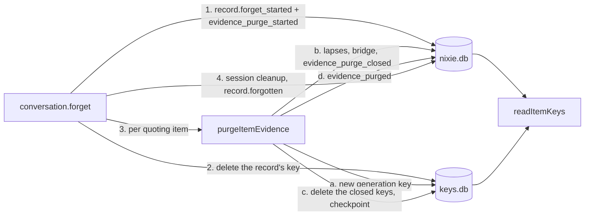

# The evidence purge

- **Status:** draft
- **Work item:** [evidence-purge](https://linear.app/zgeoff/issue/GEO-2605), Part 5 of
  [redaction](redaction.md)

When you remove a record, each memory item whose evidence quotes it loses every copy of the record's
text that nixie holds live, and keeps its ID, its current text and its state. Nothing gets
re-encrypted under an old key ID. A quote is sealed under the quoted record's key as well as the
item's, so the record's forget kills it. Everything else the item holds beside its current text sits
under a generation key that the purge deletes and replaces, and each version written from the second
stage on sits under a version key of its own.

The purge ships in 2 stages, one release apart:

1. **The key lookup:** every memory reader and writer finds its key through one lookup that knows
   generations, version keys and removal marks. It finishes a purge that stage 2 started, and starts
   none.
2. **The purge:** each new version gets its own version key, and the record forget purges every
   quoting item before it writes `record.forgotten`.

## Shape



## Contracts

### Key IDs

```ts
// memory module. Every key of an item has an ID that starts with the item's UUID, so a memory
// forget finds every one from the key store alone, even on a restored nixie.db that lacks the
// records naming the newer ones. Each ID stays random under the key-store ID rule.
type ItemKeyID =
  | ItemID // generation 0: the built key, which seals every value written before stage 2
  | `${ItemID}/${string}`; // a later generation key or a version key: `${itemID}/${crypto.randomUUID()}`
```

### What each key seals

| Value                                                                                      | Sealed under                                                 |
| ------------------------------------------------------------------------------------------ | ------------------------------------------------------------ |
| A version's text, from stage 2                                                             | its version key                                              |
| A version's text, before stage 2                                                           | the generation in force at its record                        |
| A version's quote, from stage 2                                                            | the quoted record's key inside, then the version key outside |
| A proposal, a rating note, change text, a change comment, a summary share, any other value | the item's generation in force when its record commits       |
| A proposal for a new item                                                                  | generation 0 of that item, as built                          |

### The lookup

```ts
const [note] = await readItemKeys(log, [{ itemID: 'c1f0…', value: 'rating-note', sequence: 9120 }]);
// → { status: 'open', keyID: 'c1f0…/7d2e…', key }
//   or { status: 'removed' } // a purge closed the key that sealed it
//   or { status: 'shredded' } // the key is gone and no purge says why
//   or { status: 'unreadable' } // the key fails to unwrap

// memory module: the one lookup. Every file that reads an item's key today through readItemKey,
// readVersionKey or readRecordKeys(log, itemIDs) calls it, and the import-zones lint rule refuses
// readRecordKeys in the memory module outside this lookup and the key cleanups.
declare function readItemKeys(
  log: Pick<Log, 'deploymentKey' | 'writer'>,
  refs: readonly ItemValueRef[],
): Promise<readonly ItemValueKey[]>;

interface ItemValueRef {
  itemID: string;
  value:
    | 'version'
    | 'version-quote'
    | 'proposal'
    | 'rating-note'
    | 'change'
    | 'comment'
    | 'summary';
  sequence: number; // the record that holds the ciphertext
  version?: number; // for 'version' and 'version-quote'
}
```

```text
memory_item_keys, a projection added in stage 1, one row per key after generation 0
  key_id            text primary key       -- an ItemKeyID with a "/"
  item_id           text not null
  kind              text not null          -- 'generation' or 'version'; no check, under the migration rule
  version           integer                -- set for a version key
  from_sequence     integer not null       -- the record that opened the key
  removed_sequence  integer                -- the evidence_purge_closed record that closed it; null while open
```

### The records

```ts
// memory module. Each is a kind of its own, as the subject and sensitive marks are, so the
// release before skips it and the built records keep their strict shapes.

// Stage 2 writes it in the transaction of every memory.version_added it writes.
interface VersionKeyed {
  itemID: string;
  version: number;
  keyID: string; // the version key; version_added.sealed holds the text with both quotes null
  evidenceQuote: string | null; // sealed twice: under the quoted record's key, then the version key
  intentQuote: string | null; // the same, for the intent quote
}

// Stage 2's API writes it in the transaction that writes record.forget_started, so a forget that
// owes a purge says so in the same commit that starts it.
interface EvidencePurgeStarted {
  recordSequence: number;
}

// The one commit after which readers see the item purged.
interface EvidencePurgeClosed {
  recordSequence: number;
  itemID: string;
  closedKeyIDs: readonly string[]; // the generation in force, and every version key but the current one's
  generationKeyID: string; // the next generation, created in keys.db before this commits
  bridgeVersion: number | null; // set when the item's current version was sealed under the closed generation
}

interface EvidencePurged {
  recordSequence: number;
  itemID: string;
}
```

```ts
// memory store: the purge of one item, which the record forget calls
await store.purgeItemEvidence({ recordSequence: 4190, itemID: 'c1f0…' });
// → 'purged' | 'skipped' // skipped: the item is forgetting or forgotten, or was purged for this record

// memory module: one list, read from plain pointers alone. Part 3's preview calls it to list the
// items, and the record forget calls it after the record's key is gone.
declare function readQuotingItems(
  db: Kysely<unknown>,
  recordSequence: number,
): Promise<readonly string[]>;
```

### The bridge version

```ts
// The memory.version_added that a purge writes when the current text sits under the closed
// generation, so the text survives under a version key. It takes only fields and values that the
// release before's strict parser accepts.
const bridge = {
  change: 'edited',
  state: current.state,
  until: current.until,
  origin: 'owner', // the user's removal wrote it
  source: current.source, // a copy never raises the source
  evidence: current.evidence?.recordSequence === recordSequence ? null : current.evidence,
  intentEvidence:
    current.intentEvidence?.recordSequence === recordSequence ? null : current.intentEvidence,
  taskID: null,
  proposalID: null,
  checks: null,
  model: null,
  noticeKey: null,
  shortID: null,
}; // no thread; its memory.version_keyed carries each kept quote of another record
```

### The history and the export

```ts
// memory module: the history's version status grows one value
type HistoryStatus = 'readable' | 'shredded' | 'unreadable' | 'removed';

// API: an undo or a restore whose source version reads removed answers VERSION_REMOVED
```

```ts
// memory module: the export's version grows one field, under the export version rule
// in redaction.md
const exportVersionSchema = z.strictObject({
  // …existing fields
  isRemoved: z.boolean(), // text and evidenceQuote null because a purge removed them
});
```

## Constraints

### The record forget

- The record forget runs in this order: `record.forget_started` with
  `memory.evidence_purge_started`, the record's key, the image offer keys, `purgeItemEvidence` for
  each item `readQuotingItems` returns, the session cleanup, and `record.forgotten`.
- `readQuotingItems` returns each active or retired item that has a version of any number, or a
  proposal of any status, whose `evidence` or `intent_evidence` names the record. An intent quote
  counts as evidence.
- A pending proposal for a new item that quotes the record lapses through the built lapse, which
  deletes that item's key.
- The forget reads the list after it deletes the record's key, so no item that a later write adds
  can quote the record.
- The purge runs inside the session cleanup closure that the server builds once memory starts. While
  `readSessionCleanup()` returns null, neither the purge nor `record.forgotten` runs, and the
  server's start finishes both.
- The record's own session cleanup runs after every item's purge, so a session rebuilt after it
  renders no purged quote. The purge runs no cleanup per item: the conversation's and the tasks'
  cleanups run the same steps whatever their cause.
- `record.forgotten` comes after every item's `memory.evidence_purged`, so the backup due check and
  a forget's backup state, which both read `record.forgotten`, cover every key the purge deletes.
- A stage 2 forget without `memory.evidence_purge_started`, which stage 1 started, still purges when
  stage 2 finishes it, because it has not written `record.forgotten` yet.
- A record forgotten before stage 2 keeps its quotes in memory items.

### One item's purge

- The purge holds the delivery lock from its key reads to the closing commit, as a memory write
  does.
- It creates the next generation key in keys.db first. When the current version sits under the
  closed generation, it also creates a version key for the bridge.
- It writes one transaction:
  - `memory.proposal_lapsed` for each pending proposal of the item;
  - `memory.consolidation_lapsed` for each pending consolidation change whose inputs include the
    item;
  - the bridge's `memory.version_added` and its `memory.version_keyed`, when it needs one;
  - `memory.evidence_purge_closed`.
- After the commit, it deletes each closed key with `removeRecordKey`, which checkpoints, then
  writes `memory.evidence_purged`.
- An item whose current version has its own version key needs no bridge. Its quote of the record
  died with the record's key, and its text stays under its key.
- When the current text does not open, the purge writes no bridge and closes the keys anyway, so
  every value of the item reads removed. The preview lists it, and you forget it there.
- When the item is forgetting or forgotten, the purge skips it, because the memory forget deletes
  every key of the item.
- A bridge or a new generation changes the current version only for a built item, and the store
  updates the item's index entry after the commit as it does for any version.

| A kill after                          | The start finds                                        | It does                                    |
| ------------------------------------- | ------------------------------------------------------ | ------------------------------------------ |
| the keys, before the commit           | no `evidence_purge_closed` for the item and the record | the purge again, with fresh keys           |
| the commit, before the key deletes    | the closing record, and a closed key still in keys.db  | the deletes from `closedKeyIDs`            |
| the key deletes, before the last mark | no `evidence_purged`                                   | `evidence_purged`                          |
| every item                            | no `record.forgotten`                                  | the session cleanup and `record.forgotten` |

- A key created for a commit that never landed opens nothing, and the memory forget's prefix delete
  removes it with the item.
- A second run of any step finds its record or a missing key, and writes nothing more.

### Readers and writers

- The lookup reads the key rows, then the keys, then the removal marks again. A key missing at the
  key read whose mark shows at the last read reads removed, so a reader that races the purge never
  reads a purged value as shredded.
- A value sealed under a key with a removal mark reads removed. A version quote whose inner record
  key is gone, and whose record has a `record.forget_started`, reads removed too.
- No reader tries a second key. No key ID ever seals 2 different keys' ciphertext.
- A writer that seals before its transaction checks inside it that its generation has no removal
  mark, and seals again once under the current one when it has. This covers proposals, rating notes,
  change comments, the consolidation diff and the consolidation summary.
- A version's quote binds the item ID, the record sequence and the offsets as its inner additional
  data, so a retire, a restore or an undo copies the inner seal unchanged and seals the outer one
  under its own version key.
- A memory forget deletes every key whose ID is the item's UUID or starts with it and a `/`, then
  checkpoints. A key-store primitive in the log module deletes by that prefix, under the writer
  epoch check, and keys.db keeps its one table.
- An undo whose earlier version reads removed refuses with `VERSION_REMOVED`. A restore copies the
  current text and works.
- The history shows each removed version with its date and provenance and no text. The pending diff
  never shows a purged item's change, because the purge lapsed it.
- A consolidation summary with a removed share reads as no summary, as one with a missing key does.

### The 2 stages and a rollback

- Stage 1 adds the `memory_item_keys` table, which the release before never meets, and writes none
  of the 4 record kinds unless a stage 2 forget left a purge unfinished.
- Stage 1 seals each new value under the item's current generation key, which is the UUID for an
  item no purge has reached, so the release before reads every value stage 1 writes on such an item.
- Stage 1 reads `memory.version_keyed` and the 3 purge records, and the start of stage 1 finishes
  every purge that a `memory.evidence_purge_started` owes before it writes `record.forgotten`.
- Stage 2 raises `nixieSchema.oldestReader` to stage 1's schema version and carries a migration of
  its own, so the stored oldest reader rises and the release before stage 1 refuses to start on a
  stage 2 database with the built error.
- A rollback from stage 2 to stage 1 takes no step: stage 1's start finishes every purge.
- A rollback from stage 1 to the release before takes no step: stage 1 wrote nothing that release
  cannot read.
- Stage 1 holds the stage 2 writers behind one constant that is off. Its tests turn the constant on
  to write each stage 2 record and each kill point's state, then read and finish them with it off.

### Backups

An `older-data` restore pairs a data copy from before a purge with the newest key copy:

| The item in the data copy                    | Unchanged between the copy and the purge                                                          | Edited between them        |
| -------------------------------------------- | ------------------------------------------------------------------------------------------------- | -------------------------- |
| current version written before stage 2       | every value reads shredded                                                                        | every value reads shredded |
| current version written from stage 2 onwards | the current text reads, and its quote of the record, older versions and side values read shredded | every value reads shredded |

- Every item that exists when stage 2 ships is in the first row, until it gets a version from stage
  2 onwards.
- A pending proposal whose key is gone stays out of the proposal list, as built.
- The restore steps that offer an `older-data` pair warn of the first row.

## Decisions

- **A removal purges the quote from each memory item that quotes the record.** The owner chose this
  on 13 Nov. The item stays; the preview lists its text, so you can forget it apart.
- **A purge never puts a new key under an old key ID.** An agent's call on 13 Nov: a release or a
  restore that meets an old ciphertext under a new key reads it as corrupt, and the purge would need
  a reader fallback between 2 keys.
- **Every key of an item starts with the item's UUID.** An agent's call on 13 Nov: a memory forget
  then finds every key from the key store alone, as it does today, so
  [0007](../../decisions/0007-crypto-shredding.md) still holds after a restore.
- **A quote needs both the item's key and the quoted record's key.** An agent's call on 13 Nov: the
  record forget kills the quote with no purge step, and the memory forget still kills it.
- **The purge drops every pending proposal, consolidation change and rating note of the item, and
  keeps no copy.** An agent's call on 13 Nov: any of them can hold the record's text, and a reseal
  would need records that the release before reads under the wrong key.
- **The purge ships in 2 stages, one release apart.** An agent's call on 13 Nov: the release before
  each stage then reads everything that stage writes, so neither rollback takes a step.
- **A record forgotten before stage 2 keeps its quotes.** An agent's call on 13 Nov: a catch-up
  purge would finish after its `record.forgotten`, outside the forget's backup state. You forget
  such an item from the memory view.

## Builder decides

- The internal names, and the place strings each sealed value binds.
- The migration stage 2 carries to raise the stored oldest reader.
- The wording of `VERSION_REMOVED` and of the history's removed version.
- The layout of the tests, and the fault points of the kill tests.

## Out of scope

- A purge of the record's text from a model provider, which keeps what a turn sent it.
- A removal of part of a record, as [redaction](redaction.md#out-of-scope) says.
- A purge for records forgotten before stage 2.

## Open questions

None.
