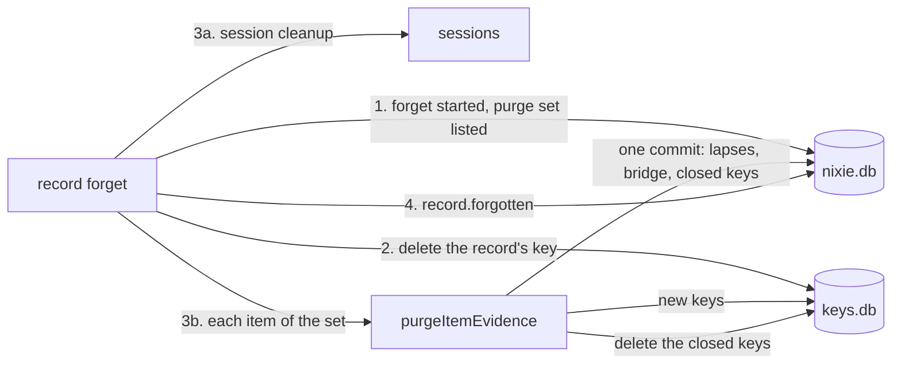

# The evidence purge

- **Status:** draft
- **Work item:** [evidence-purge](https://linear.app/zgeoff/issue/GEO-2605), Part 5 of
  [redaction](redaction.md)

You remove one record of a conversation with `conversation.forget`, the record forget of
[redaction](redaction.md). A [memory item](../../architecture/memory/store.md) whose evidence quotes
that record holds copies of the record's text that the record's own key does not reach: the quote,
and any older version, proposal, rating note or
[consolidation](../../architecture/memory/consolidation.md) text the model wrote from it. The
evidence purge deletes those copies in the same forget. The item keeps its ID, its current text and
its state. Its current text can still hold what you removed, so the forget's preview
([Part 3](redaction.md#part-3)) lists that text, and you forget the item from the memory view.

The purge deletes keys and never puts a new key under an old key ID. Each item gets 3 kinds of key:

- **A version key** seals one version's text, from stage 2 on, so the purge can keep the current
  text and delete the rest.
- **A generation key** seals every other value of the item. The purge deletes it and creates the
  next one.
- **The quoted record's key** seals a quote inside its version key, so the record forget deletes the
  quote with the record.

The purge ships in 2 stages, one release apart:

1. **The key lookup:** every memory reader and writer finds its key through one lookup that knows
   generation keys, version keys and purges. Stage 1 starts no purge. After a rollback from stage 2,
   it finishes any purge that stage 2 left unfinished.
2. **The purge:** each new version gets its own version key, and the record forget purges each item
   before it writes `record.forgotten`.

## Shape



## Contracts

### Key IDs

```ts
// memory module. Every key of an item has an ID that starts with the item's UUID, so a memory
// forget finds every one in the key store alone, even on a restored nixie.db that lacks the
// records naming the newer ones. Each ID is random, as the key store's IDs must be
// (database.md, "Key store IDs").
type ItemKeyID =
  | ItemID // generation 0: the item's key today, which seals every value written before stage 2
  | `${ItemID}/${string}`; // a later generation key or a version key: `${itemID}/${crypto.randomUUID()}`
```

### What each key seals

| Value                                                                                                                                 | Sealed under                                                 |
| ------------------------------------------------------------------------------------------------------------------------------------- | ------------------------------------------------------------ |
| A version's text, written from stage 2                                                                                                | its version key                                              |
| A version's text, written before stage 2                                                                                              | the generation key in force at its record                    |
| A version's evidence or intent quote, written from stage 2                                                                            | the quoted record's key inside, then the version key outside |
| Any other value: a proposal, a rating note, a consolidation change's text, a comment on a change, a consolidation summary's key share | the item's generation key in force when its record commits   |
| A proposal for a new item                                                                                                             | generation 0 of that item, as today                          |
| A rejection's reason                                                                                                                  | the rejection record's own key, as today                     |

A record's generation key in force is the item's generation key with the greatest `from_sequence`
below that record's sequence, and generation 0 starts at 0. An item is **shared-key** while its
current version has no version key, so its current text shares generation 0 with every other value.
Every item that exists when stage 2 ships is shared-key until it gets a new version.

### The lookup

```ts
const [note] = await readItemKeys(log, [{ value: 'rating-note', itemID: 'c1f0…', sequence: 9120 }]);
// → { status: 'readable', keyID: 'c1f0…/7d2e…', key }
//   or { status: 'removed' } // a purge deleted, or is about to delete, the key that sealed it
//   or { status: 'shredded' } // the key is gone and no purge says why
//   or { status: 'unreadable' } // the key fails to unwrap

// memory module: the one lookup for every key that seals an item's values, the quoted record's
// key included. Every file that reads an item's key today through readItemKey, readVersionKey or
// readRecordKeys(log, itemIDs) calls it, readers and writers alike.
declare function readItemKeys(
  log: Pick<Log, 'deploymentKey' | 'writer'>,
  refs: readonly ItemValueRef[],
): Promise<readonly ItemValueKey[]>;

type ItemValueRef =
  | {
      value: 'version';
      itemID: string;
      version: number;
      sequence: number; // the version's record
    }
  | {
      // a version with a version key only. A version of a shared-key item holds its quotes inside
      // its text, so its caller reads them from the 'version' answer.
      value: 'version-quote';
      itemID: string;
      version: number;
      quote: 'evidence' | 'intent';
      recordSequence: number; // the quoted record
    }
  | {
      // 'proposal' covers a new item's proposal and a rejected edit. A rejection's reason stays a
      // field of its own record, which the log reads.
      value: 'proposal' | 'rating-note' | 'change' | 'comment' | 'summary';
      itemID: string;
      sequence: number; // the record that holds the ciphertext
    };

type ItemValueKey =
  | { status: 'readable'; keyID: string; key: CryptoKey; recordKey?: CryptoKey } // recordKey: a quote's inner key
  | { status: 'removed' | 'shredded' | 'unreadable' };
```

```text
memory_item_keys, a projection that stage 1 adds, one row per key of an item
  key_id                 text primary key -- an ItemKeyID; generation 0 gets its row when a purge deletes it
  item_id                text not null
  kind                   text not null    -- 'generation' or 'version'; no check, so the release before can insert
  version                integer          -- set for a version key
  sealed_evidence_quote  text             -- a version key's quote ciphertext, from memory.version_keyed
  sealed_intent_quote    text
  from_sequence          integer not null -- the closing record that created the key; 0 for generation 0
  removed_sequence       integer          -- the closing record that deleted it

memory_evidence_purges, a projection that stage 1 adds, one row per item of a purge
  record_sequence        integer not null -- (record_sequence, item_id) is the primary key
  item_id                text not null
  closed_sequence        integer          -- its memory.evidence_purge_closed record
  purged_sequence        integer          -- its memory.evidence_purged record
```

### The records

```ts
// memory module. Each is a record kind of its own, so the release before stage 1 skips it, and the
// existing records keep the strict shapes that release parses. The subject and sensitive marks
// follow the same rule (store.md, "Items and versions").

// Stage 2 writes it in the transaction of each memory.version_added it writes.
interface VersionKeyed {
  itemID: string;
  version: number;
  keyID: string; // the version key; version_added.sealed holds the text with both quotes null
  evidenceQuote: string | null; // sealed twice; null when the quoted record has no key
  intentQuote: string | null;
}

// Stage 2's API writes it in the transaction that writes record.forget_started.
interface EvidencePurgeStarted {
  recordSequence: number;
  itemIDs: readonly string[]; // the purge set, fixed here
}

// The one commit after which the purge deletes the item's closed keys.
interface EvidencePurgeClosed {
  recordSequence: number;
  itemID: string;
  closedKeyIDs: readonly string[]; // the generation key in force, and every version key but the current one's
  closedRecordKeyIDs: readonly string[]; // the keys of the item's rejection records
  generationKeyID: string; // the next generation key, created in keys.db before this commits
  bridgeVersion: number | null; // set for a shared-key item whose current text decrypts
}

interface EvidencePurged {
  recordSequence: number;
  itemID: string;
}
```

```ts
// memory module: the purge set, read from the evidence offsets in plain columns, with no key.
// Part 3's preview lists these items, and the forget fixes the list in
// memory.evidence_purge_started.
declare function readPurgeSet(
  db: Kysely<unknown>,
  recordSequence: number,
): Promise<readonly string[]>;

// memory store: the purge of one item of the set, which the record forget calls
await store.purgeItemEvidence({ recordSequence: 4190, itemID: 'c1f0…' });
// → 'purged' | 'skipped' // skipped: the item is forgetting or forgotten, or already purged
```

### The bridge version

```ts
// The memory.version_added that a purge writes for a shared-key item, so its current text survives
// under a version key. It copies the current version's provenance (writes.md, "Provenance"), and
// takes only fields and values that the release before stage 1 parses.
const bridge = {
  change: 'edited',
  state: current.state,
  until: current.until,
  origin: 'owner', // your removal wrote it
  source: current.source, // a copy keeps the source of the text it copies
  evidence: current.evidence?.recordSequence === recordSequence ? null : current.evidence,
  intentEvidence:
    current.intentEvidence?.recordSequence === recordSequence ? null : current.intentEvidence,
  taskID: current.taskID,
  proposalID: current.proposalID,
  checks: current.checks, // keeps a photo's image source and the check verdicts, which hold no text
  model: current.model,
  noticeKey: null,
  shortID: null,
}; // its memory.version_keyed reseals each quote of another record
```

### What readers show

```ts
// API contract, memory view: an item's history version grows 2 fields, so a client built without
// them still shows a removed version as shredded
const historyVersionSchema = z.object({
  // …existing fields, status still 'readable' | 'shredded' | 'unreadable'
  isRemoved: z.boolean(), // the server sets status 'shredded' because a purge removed the text
  isBridge: z.boolean(), // this version is a purge's bridge
});

// API contract: an undo whose earlier version reads removed answers VERSION_REMOVED
```

```ts
// memory module: the export's version grows one field in stage 1, which takes the next export
// version when it lands (redaction.md, "The export version, shared with the photos work")
const exportVersionSchema = z.strictObject({
  // …existing fields
  isRemoved: z.boolean(), // text and evidenceQuote are null because a purge removed them
}); // the release before refuses a file of that version, because its version record is strict
```

## Constraints

### The record forget

- The record forget runs these steps in order:
  1. One transaction writes `record.forget_started` and `memory.evidence_purge_started`.
  2. It deletes the record's key, the keys of the record's
     [image offer records](../../architecture/memory/writes.md#image-offer-records), and the key of
     each `memory.self_note_flagged` record whose `sourceSequence` is the record, because the memory
     writer's flag text can copy the record.
  3. It runs the
     [session cleanup](../../architecture/memory/context.md#forgetting-and-the-live-session), then
     `purgeItemEvidence` for each item of the set. Both run inside the cleanup function that
     `readSessionCleanup()` returns once memory starts.
  4. `runRecordForgetCleanup` writes `record.forgotten` after that function returns.
- The purge set holds each active or retired item, and each pending proposal for a new item, that
  has a version of any number or a proposal of any status whose `evidence` or `intent_evidence`
  names the record. An intent quote counts as evidence.
- The purge set also holds each item whose key seals a consolidation change, or a comment on one,
  whose inputs include an item that quotes the record. An item that joins this way brings no further
  items with it.
- From `record.forget_started`, the
  [content gate](../../architecture/memory/writes.md#the-content-gate) refuses a quote in the record
  as forgotten evidence, so no later write joins the set. Stage 1 ships this for every record
  forget.
- From the first transaction, every reader reads each value of an item in the set as removed, except
  the current version's text and its quotes of other records.
- From the first transaction until the item's `memory.evidence_purged`, a write of a proposal, a
  rating note, a change comment, a consolidation diff or a summary for the item fails with
  `ItemPurgingError`, checked inside its transaction. The model reads that the item is changing and
  that it can try again later. A write that encrypted its value before the forget started fails the
  same check, and nothing encrypts it again.
- The session cleanup runs before the purges. It aborts every turn that read a value the purge
  deletes before any key goes, and the session it rebuilds reads those values as removed.
- The session cleanup runs once for the record. The conversation's cleanup and the task sessions'
  cleanup run the same steps for a forgotten record as for a forgotten item, so the purge adds no
  cleanup per item.
- Before memory starts, `readSessionCleanup()` returns null. The forget then runs neither step 3 nor
  `record.forgotten`, and the server's start runs both.
- `record.forgotten` comes after every item's `memory.evidence_purged`, so the backup due check and
  a forget's backup state, which both read `record.forgotten`, cover every key the purge deletes.
- When a server start of stage 2 finishes a forget that stage 1 began, the forget has no
  `memory.evidence_purge_started`. The start writes the purge set first, then purges, because the
  forget has not written `record.forgotten` yet.
- A record forget that writes `record.forgotten` with no purge set, before stage 2 or during a
  rollback to stage 1, leaves its quotes in memory items.
- `readPurgeSet` ships with whichever of this work and [Part 3's preview](redaction.md#part-3) lands
  first, and the other calls it.

### One item's purge

- The purge holds the [delivery lock](../../architecture/memory/store.md#the-delivery-lock) from its
  key reads to its closing commit, as a memory write does, so no recall or write of the item runs in
  between. It deletes the closed keys after it releases the lock.
- It creates the next generation key in keys.db first, and for a shared-key item a version key for
  the bridge.
- It writes one transaction:
  - `memory.proposal_lapsed` for each pending proposal of the item;
  - `memory.consolidation_lapsed` for each pending change that the item's key seals or whose inputs
    include the item;
  - for a shared-key item, the bridge's `memory.version_added` and its `memory.version_keyed`;
  - `memory.evidence_purge_closed`.
- After the commit, it deletes each key in `closedKeyIDs` and `closedRecordKeyIDs` with
  `removeRecordKey`, which also clears the key store's write-ahead log, then writes
  `memory.evidence_purged`.
- An item with a version key on its current version needs no bridge. The record forget already
  deleted its quote of the record with the record's key, and its current text stays under its own
  version key.
- When a shared-key item's current text fails to decrypt, the purge writes no bridge and deletes the
  keys anyway, so every value of the item reads removed.
- A pending proposal for a new item lapses through the existing lapse, which deletes that item's
  key, and the purge writes its closing record with no keys.
- When the item is forgetting or forgotten, the purge skips it, because the memory forget deletes
  every key of the item.
- The bridge goes through the store's version writer and skips the write checks, because it changes
  no text, subject or pin. The store updates the item's index entry after the commit, as for any
  version.
- The memory change line of
  [the events block](../../architecture/core/conversation-turns.md#the-events-block) and the memory
  notices leave out a bridge version, so the conversation never reports your removal as an edit.

| A kill after                          | The start finds                                                | The start does                          |
| ------------------------------------- | -------------------------------------------------------------- | --------------------------------------- |
| the first transaction                 | `record.forget_started` with no session cleanup for the record | steps 2 and 3 of the record forget      |
| the new keys, before the commit       | no `closed_sequence` for the item                              | the item's purge again, with fresh keys |
| the commit, before the key deletes    | a key of the closing record still in keys.db                   | the deletes                             |
| the key deletes, before the last mark | no `purged_sequence` for the item                              | `memory.evidence_purged`                |
| every item                            | no `record.forgotten`                                          | `record.forgotten`                      |

- A key created for a commit that never landed decrypts nothing, and the memory forget deletes it
  with the item by its prefix.
- A second run of any step finds its record or a missing key, and writes nothing more.

### Readers and writers

- The lookup answers removed for a value in 3 cases: the key that sealed it has a
  `removed_sequence`; its item has an unfinished row in `memory_evidence_purges` and the value is
  not the current text; or the value is a quote whose record has a `record.forget_started`.
- The version decoder blanks a shared-key version's in-text quote whose evidence names a record with
  a `record.forget_started`, so a session rebuilt before the bridge never renders it.
- The lookup reads the key rows, then the keys, then the removal marks again. A key the purge
  deleted between the first 2 reads then reads removed, and never shredded.
- A reader never tries a second key, and a key ID never names 2 different keys.
- A writer seals a quote only while the quoted record's key exists. When the key is gone, the
  version keeps the quote's offsets and stores no quote.
- A quote's inner seal binds the item ID, the record sequence and the offsets, so a retire, a
  restore or an undo copies the inner seal unchanged and seals the outer one under its own version
  key.
- An evidence offset `{ recordSequence, start, end }` left in an older row holds no text. A later
  memory forget lists its sequence among the forgotten evidence, which changes nothing, because the
  record is gone.
- A memory forget deletes every key whose ID is the item's UUID, or starts with that UUID and a `/`,
  then clears the key store's write-ahead log. A new key-store function in the log module deletes by
  that prefix after the writer epoch check that `removeRecordKey` makes, and keys.db keeps its one
  table.
- An undo whose earlier version reads removed fails with `VERSION_REMOVED`. A restore copies the
  current text and works.
- The history shows each removed version with its date and provenance and no text. Every other API
  status reports a removed value as `shredded`, so the API contract only grows.
- A consolidation summary with a removed key share reads as no summary, as one with a missing key
  does.

### The 2 stages and a rollback

- Stage 1 ships the lookup, both tables, the readers of the 4 record kinds, what readers show, the
  content gate's refusal, `VERSION_REMOVED`, `ItemPurgingError`, the memory forget's delete by
  prefix and the purge.
- Stage 1's record forget writes no `memory.evidence_purge_started`, so stage 1 starts no purge, and
  new values written from stage 1 get no version key.
- Stage 1 seals each new value under the item's current generation key. For an item that no purge
  has reached, that key is the UUID, so the release before stage 1 reads every value stage 1 writes
  on it.
- Stage 1's server start finishes every purge that a `memory.evidence_purge_started` owes, bridge
  included, before it writes `record.forgotten`. Only a stage 2 forget writes that record, and the
  release before stage 1 refuses a stage 2 database, so that release never meets what the purge
  writes.
- Stage 2 turns on version keys and the purge in the record forget. It raises
  `nixieSchema.oldestReader` to stage 1's schema version and carries a migration of its own, so the
  stored oldest reader rises and the release before stage 1 refuses to start, with the existing
  error ([the database](../../architecture/core/database.md)).
- A rollback from stage 2 to stage 1 takes no step: stage 1's start finishes every purge.
- A rollback from stage 1 to the release before it takes no step: stage 1 writes nothing that
  release cannot read, and that release never meets the 2 tables.
- Stage 1 holds the stage 2 writes of a new forget behind one constant that is off. Its tests turn
  the constant on to write each stage 2 record and each kill point's state, then read and finish
  them with it off.

### Backups

An `older-data` restore, from [the backup pair](backup-pair.md#the-pick), pairs a data copy from
before a purge with the newest key copy, which lacks the keys the purge deleted:

| The item in the data copy | Unchanged between the copy and the purge                                                                   | Edited between them        |
| ------------------------- | ---------------------------------------------------------------------------------------------------------- | -------------------------- |
| shared-key                | every value reads shredded                                                                                 | every value reads shredded |
| with a version key        | the current text reads, and its quote of the record, its older versions and its other values read shredded | every value reads shredded |

- Every item that exists when stage 2 ships stays shared-key until it gets a new version.
- A pending proposal whose key is gone stays out of the proposal list, as today.
- The warning in the restore steps belongs to [the backup pair](backup-pair.md#the-fetch).

## Decisions

- **A removal purges the quote from each memory item that quotes the record.** The owner chose this
  on 13 Nov. The item stays; the preview lists its text, so you can forget it apart.
- **A purge never puts a new key under an old key ID.** An agent's call on 13 Nov: a release or a
  restore that meets an old ciphertext under a new key reads it as corrupt, and every reader would
  need a fallback between 2 keys.
- **Every key of an item starts with the item's UUID.** An agent's call on 13 Nov: a memory forget
  then finds every key in the key store alone, as it does today, so
  [0007](../../decisions/0007-crypto-shredding.md) still holds after a restore.
- **A quote needs both its version key and the quoted record's key.** An agent's call on 13 Nov: the
  record forget deletes the quote with no purge step, and the memory forget still deletes it.
- **The purge drops every older version, pending proposal, consolidation change and rating note of
  the item, and keeps no copy.** An agent's call on 13 Nov: any of them can hold the record's text,
  and a copy encrypted again would need records that the release before reads under the wrong key.
- **Every reader treats what the purge deletes as removed from the forget's first transaction.** An
  agent's call on 13 Nov: a session or a writer that runs before the keys go then never copies the
  text under a key that survives.
- **The purge ships in 2 stages, one release apart.** An agent's call on 13 Nov: the release before
  each stage then reads everything that stage writes, so neither rollback takes a step.
- **A record forgotten with no purge set keeps its quotes.** An agent's call on 13 Nov: a catch-up
  purge would finish after its `record.forgotten`, outside the forget's backup state. You forget
  such an item from the memory view.

## Builder decides

- The internal names, and the additional-data strings each sealed value binds.
- How the build keeps `readRecordKeys` out of the memory module outside the lookup and the key
  cleanups: a lint rule, or a test that lists the files that import it.
- The migration stage 2 carries to raise the stored oldest reader.
- The wording of `VERSION_REMOVED`, of `ItemPurgingError`, and of the history's removed and bridge
  versions.
- The layout of the tests, and the fault points of the kill tests.

## Out of scope

- A purge of the record's text from a model provider, which keeps what a turn sent it.
- A removal of part of a record, as [redaction](redaction.md#out-of-scope) says.
- A purge for records forgotten with no purge set.

## Open questions

None.
