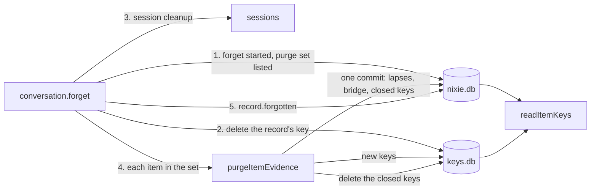

# The evidence purge

- **Status:** draft
- **Work item:** [evidence-purge](https://linear.app/zgeoff/issue/GEO-2605), Part 5 of
  [redaction](redaction.md)

A memory item keeps copies of the record its evidence quotes: the quote itself, and any older
version, proposal, rating note or consolidation text the model wrote from it. When you remove that
record, each such item loses all of those and keeps its ID, its current text and its state. Its
current text can still hold what you removed, so the preview lists that text and you forget the item
there.

The purge deletes keys and never re-encrypts under an old key ID:

- **A version key** seals each version's text, from stage 2 on, so the current text outlives the
  purge.
- **A generation key** seals everything else the item holds. The purge deletes it and opens the next
  one.
- **A quote** needs both its version key and the quoted record's key, so the record's own forget
  kills it.

The purge ships in 2 stages, one release apart:

1. **The key lookup:** every memory reader and writer finds its key through one lookup that knows
   generations, version keys and purges. It finishes a purge that stage 2 started, and starts none.
2. **The purge:** each new version gets its own version key, and the record forget purges each item
   before it writes `record.forgotten`.

## Shape



## Contracts

### Key IDs

```ts
// memory module. Every key of an item has an ID that starts with the item's UUID, so a memory
// forget finds every one from the key store alone, even on a restored nixie.db that lacks the
// records naming the newer ones. Each ID stays random under the key-store ID rule.
type ItemKeyID =
  | ItemID // generation 0: the built key, which seals every value written before stage 2
  | `${ItemID}/${string}`; // a later generation key or a version key: `${itemID}/${crypto.randomUUID()}`
```

### What each key seals

A **built item** is one whose current version has no version key: every item that exists when stage
2 ships, until it gets a new version.

| Value                                                                                      | Sealed under                                                 |
| ------------------------------------------------------------------------------------------ | ------------------------------------------------------------ |
| A version's text, from stage 2                                                             | its version key                                              |
| A version's text, before stage 2                                                           | the generation in force at its record                        |
| A version's evidence or intent quote, from stage 2                                         | the quoted record's key inside, then the version key outside |
| A proposal, a rating note, change text, a change comment, a summary share, any other value | the item's generation in force when its record commits       |
| A proposal for a new item                                                                  | generation 0 of that item, as built                          |
| A rejection's reason                                                                       | the rejection record's own key, as built                     |

### The lookup

```ts
const [note] = await readItemKeys(log, [{ value: 'rating-note', itemID: 'c1f0…', sequence: 9120 }]);
// → { status: 'open', keyID: 'c1f0…/7d2e…', key }
//   or { status: 'removed' } // a purge closed, or will close, the key that sealed it
//   or { status: 'shredded' } // the key is gone and no purge says why
//   or { status: 'unreadable' } // the key fails to unwrap

// memory module: the one lookup for every key that seals an item's values, the quoted record's
// key included. Every file that reads an item's key today through readItemKey, readVersionKey or
// readRecordKeys(log, itemIDs) calls it, readers and writers alike.
declare function readItemKeys(
  log: Pick<Log, 'deploymentKey' | 'writer'>,
  refs: readonly ItemValueRef[],
): Promise<readonly ItemValueKey[]>;

type ItemValueRef =
  | {
      value: 'version';
      itemID: string;
      version: number;
      sequence: number; // the version's record
    }
  | {
      // a version with a version key only; a built version's quotes sit inside its text, so a
      // caller reads them from its 'version' answer
      value: 'version-quote';
      itemID: string;
      version: number;
      quote: 'evidence' | 'intent';
      recordSequence: number; // the quoted record
    }
  | {
      // 'proposal' covers a new item's proposal and a rejected edit; a rejection's reason stays
      // a field of its own record
      value: 'proposal' | 'rating-note' | 'change' | 'comment' | 'summary';
      itemID: string;
      sequence: number; // the record that holds the ciphertext
    };

type ItemValueKey =
  | { status: 'open'; keyID: string; key: CryptoKey; recordKey?: CryptoKey } // recordKey: a quote's inner key
  | { status: 'removed' | 'shredded' | 'unreadable' };
```

```text
memory_item_keys, a projection added in stage 1, one row per key of an item
  key_id                 text primary key -- an ItemKeyID; generation 0 gets its row when a purge closes it
  item_id                text not null
  kind                   text not null    -- 'generation' or 'version'; no check, under the migration rule
  version                integer          -- set for a version key
  sealed_evidence_quote  text             -- a version key's quote ciphertext, from memory.version_keyed
  sealed_intent_quote    text
  from_sequence          integer not null -- the closing record that opened the key; 0 for generation 0
  removed_sequence       integer          -- the evidence_purge_closed record that closed it

memory_evidence_purges, a projection added in stage 1, one row per item of a purge
  record_sequence        integer not null -- (record_sequence, item_id) is the primary key
  item_id                text not null
  closed_sequence        integer          -- its evidence_purge_closed record
  purged_sequence        integer          -- its evidence_purged record
```

The generation in force at a record is the item's generation with the greatest `from_sequence` below
that record's sequence.

### The records

```ts
// memory module. Each is a kind of its own, as the subject and sensitive marks are, so the
// release before skips it and the built records keep their strict shapes.

// Stage 2 writes it in the transaction of every memory.version_added it writes.
interface VersionKeyed {
  itemID: string;
  version: number;
  keyID: string; // the version key; version_added.sealed holds the text with both quotes null
  evidenceQuote: string | null; // sealed twice; null when the quoted record has no key
  intentQuote: string | null;
}

// Stage 2's API writes it in the transaction that writes record.forget_started.
interface EvidencePurgeStarted {
  recordSequence: number;
  itemIDs: readonly string[]; // the purge set, frozen here
}

// The one commit after which an item's closed keys can go.
interface EvidencePurgeClosed {
  recordSequence: number;
  itemID: string;
  closedKeyIDs: readonly string[]; // the generation in force, and every version key but the current one's
  closedRecordKeyIDs: readonly string[]; // the keys of the item's rejection records
  generationKeyID: string; // the next generation, created in keys.db before this commits
  bridgeVersion: number | null; // set for a built item whose current text opens
}

interface EvidencePurged {
  recordSequence: number;
  itemID: string;
}
```

```ts
// memory module: one list, read from plain pointers alone. Part 3's preview lists these items, and
// the forget freezes the list in memory.evidence_purge_started.
declare function readPurgeSet(
  db: Kysely<unknown>,
  recordSequence: number,
): Promise<readonly string[]>;

// memory store: the purge of one item of the set, which the record forget calls
await store.purgeItemEvidence({ recordSequence: 4190, itemID: 'c1f0…' });
// → 'purged' | 'skipped' // skipped: the item is forgetting or forgotten, or already purged
```

### The bridge version

```ts
// The memory.version_added that a purge writes for a built item, so its current text survives
// under a version key. It takes only fields and values that the release before's strict parser
// accepts.
const bridge = {
  change: 'edited',
  state: current.state,
  until: current.until,
  origin: 'owner', // the user's removal wrote it
  source: current.source, // a copy never raises the source
  evidence: current.evidence?.recordSequence === recordSequence ? null : current.evidence,
  intentEvidence:
    current.intentEvidence?.recordSequence === recordSequence ? null : current.intentEvidence,
  taskID: current.taskID,
  proposalID: current.proposalID,
  checks: current.checks, // keeps a photo's image source and the check verdicts, which hold no text
  model: current.model,
  noticeKey: null,
  shortID: null,
}; // no thread; its memory.version_keyed carries each kept quote of another record
```

### What readers show

```ts
// API contract, memory view: an item's history version grows 2 fields, so a client built without
// them still reads a removed version as shredded
const historyVersionSchema = z.object({
  // …existing fields, status still 'readable' | 'shredded' | 'unreadable'
  isRemoved: z.boolean(), // status is 'shredded' because a purge removed the text
  isRemoval: z.boolean(), // this version is a purge's bridge
});

// API contract: an undo whose earlier version reads removed answers VERSION_REMOVED
```

```ts
// memory module: the export's version grows one field in stage 1, which takes the next export
// version when it lands, under the export version rule in redaction.md
const exportVersionSchema = z.strictObject({
  // …existing fields
  isRemoved: z.boolean(), // text and evidenceQuote are null because a purge removed them
}); // the release before refuses a file of that version, because its version record is strict
```

## Constraints

### The record forget

- The record forget runs in this order:
  1. one transaction with `record.forget_started` and `memory.evidence_purge_started`;
  2. the record's key, the image offer keys, and the key of each `memory.self_note_flagged` record
     whose `sourceSequence` is the record;
  3. the session cleanup, then `purgeItemEvidence` for each item of the set, both inside the closure
     that `readSessionCleanup()` returns;
  4. `record.forgotten`, which `runRecordForgetCleanup` writes after the closure returns.
- The purge set is each active or retired item, and each pending proposal for a new item, that has a
  version of any number or a proposal of any status whose `evidence` or `intent_evidence` names the
  record. An intent quote counts as evidence.
- The set also holds each item whose key seals a consolidation change, or a comment on one, whose
  inputs include an item of the first list. The second list adds no further items.
- From `record.forget_started`, the content gate refuses a quote in the record with the
  forgotten-evidence reason, so no later write joins the set. Stage 1 ships this for every record
  forget.
- From the first transaction, every reader reads every value of an item in the set as removed,
  except the current version's text and its quotes of other records. A session the cleanup rebuilds
  therefore never meets a value the purge deletes.
- From the first transaction until the item's `memory.evidence_purged`, a write of a proposal, a
  rating note, a change comment, a consolidation diff or a summary that names the item refuses with
  `ItemPurgingError`, checked inside its transaction. The model reads that the item is changing and
  to try again later. A write that sealed before the forget started fails the same check, and
  nothing reseals it.
- The session cleanup runs before the purges, so a turn that read a value the purge deletes is
  aborted before any key goes, and the session it rebuilds reads those values as removed.
- The session cleanup runs once for the record. The conversation's and the tasks' cleanups run the
  same steps whatever their cause, so the purge adds no cleanup per item.
- While `readSessionCleanup()` returns null, neither the purge nor `record.forgotten` runs, and the
  server's start finishes both.
- `record.forgotten` comes after every item's `memory.evidence_purged`, so the backup due check and
  a forget's backup state, which both read `record.forgotten`, cover every key the purge deletes.
- A stage 2 start that finishes a forget with no `memory.evidence_purge_started`, which stage 1
  began, writes the purge set first, then purges, because the forget has not written
  `record.forgotten` yet.
- A record forget that writes `record.forgotten` with no purge set, before stage 2 or during a
  rollback to stage 1, leaves its quotes in memory items.
- `readPurgeSet` ships with whichever of this work and [Part 3's preview](redaction.md#part-3) lands
  first, and the other calls it.

### One item's purge

- The purge holds the delivery lock from its key reads to the closing commit, as a memory write
  does, and deletes the closed keys after it releases the lock.
- It creates the next generation key in keys.db first, and for a built item a version key for the
  bridge.
- It writes one transaction:
  - `memory.proposal_lapsed` for each pending proposal of the item;
  - `memory.consolidation_lapsed` for each pending change that the item's key seals or whose inputs
    include the item;
  - for a built item, the bridge's `memory.version_added` and its `memory.version_keyed`;
  - `memory.evidence_purge_closed`.
- After the commit, it deletes each key in `closedKeyIDs` and `closedRecordKeyIDs` with
  `removeRecordKey`, which checkpoints, then writes `memory.evidence_purged`.
- An item that is not built needs no bridge. Its quote of the record died with the record's key, and
  its current text stays under its version key.
- When a built item's current text does not open, the purge writes no bridge and closes the keys
  anyway, so every value of the item reads removed.
- A pending proposal for a new item lapses through the built lapse, which deletes its key, and the
  purge writes its closing record with no keys.
- When the item is forgetting or forgotten, the purge skips it, because the memory forget deletes
  every key of the item.
- The bridge goes through the store's version writer with no write gate, because it changes no text,
  subject or pin, and it updates the item's index entry after the commit as any version does.
- The events block's memory change line and the memory notices leave out a bridge version, so the
  conversation never reads the removal as an edit of yours.

| A kill after                          | The start finds                                | It does                                  |
| ------------------------------------- | ---------------------------------------------- | ---------------------------------------- |
| the first transaction                 | the record's key, or no session cleanup record | the record forget's built steps, then on |
| the new keys, before the commit       | no `closed_sequence` for the item              | the purge again, with fresh keys         |
| the commit, before the key deletes    | a closed key still in keys.db                  | the deletes from the closing record      |
| the key deletes, before the last mark | no `purged_sequence`                           | `memory.evidence_purged`                 |
| every item                            | no `record.forgotten`                          | `record.forgotten`                       |

- A key created for a commit that never landed opens nothing, and the memory forget's prefix delete
  removes it with the item.
- A second run of any step finds its record or a missing key, and writes nothing more.

### Readers and writers

- A value reads removed when the key that sealed it has a removal mark, when its item has an
  unfinished row in `memory_evidence_purges` and the value is not the current text, or when it is a
  quote whose record has a `record.forget_started`.
- The version decode blanks a built version's in-text quote whose pointer names a record with a
  `record.forget_started`, so a session rebuilt before the bridge never renders it.
- A pointer `{ recordSequence, start, end }` left in an older row holds offsets and no text. A later
  memory forget lists its sequence among the forgotten evidence, which changes nothing, because the
  record is gone.
- The lookup reads its rows, then the keys, then the removal marks again, so a key the purge deleted
  between the first and second reads reads removed and never shredded.
- No reader tries a second key. No key ID ever holds 2 different keys.
- A writer seals a quote only while the quoted record's key exists. With no key, the version keeps
  its pointer and stores no quote.
- A quote binds the item ID, the record sequence and the offsets as its inner additional data, so a
  retire, a restore or an undo copies the inner seal unchanged and seals the outer one under its own
  version key.
- A memory forget deletes every key whose ID is the item's UUID, or starts with it and a `/`, then
  checkpoints. A key-store primitive in the log module deletes by that prefix under the writer epoch
  check, and keys.db keeps its one table.
- An undo whose earlier version reads removed refuses with `VERSION_REMOVED`. A restore copies the
  current text and works.
- The history shows each removed version with its date and provenance and no text. Every other
  status in the API contract reads a removed value as `shredded`, so the contract only grows.
- A consolidation summary with a removed share reads as no summary, as one with a missing key does.

### The 2 stages and a rollback

- Stage 1 ships the lookup, both tables, the readers of the 4 record kinds, what readers show, the
  gate's refusal, `VERSION_REMOVED`, `ItemPurgingError`, the memory forget's prefix delete and the
  purge. Its record forget writes no `memory.evidence_purge_started`, so it starts no purge.
- Stage 1 seals each new value under the item's current generation key, which is the UUID for an
  item no purge has reached, so the release before reads every value stage 1 writes on such an item.
- Stage 1's start finishes every purge that a `memory.evidence_purge_started` owes before it writes
  `record.forgotten`.
- Stage 2 turns on version keys and the purge in the record forget. It raises
  `nixieSchema.oldestReader` to stage 1's schema version and carries a migration of its own, so the
  stored oldest reader rises and the release before stage 1 refuses to start on a stage 2 database
  with the built error.
- A rollback from stage 2 to stage 1 takes no step: stage 1's start finishes every purge.
- A rollback from stage 1 to the release before takes no step: stage 1 wrote nothing that release
  cannot read, and that release never meets the 2 tables.
- Stage 1 holds the stage 2 writers behind one constant that is off. Its tests turn the constant on
  to write each stage 2 record and each kill point's state, then read and finish them with it off.

### Backups

An `older-data` restore pairs a data copy from before a purge with the newest key copy:

| The item in the data copy | Unchanged between the copy and the purge                                                           | Edited between them        |
| ------------------------- | -------------------------------------------------------------------------------------------------- | -------------------------- |
| built                     | every value reads shredded                                                                         | every value reads shredded |
| not built                 | the current text reads, and its quote of the record, older versions and other values read shredded | every value reads shredded |

- Every item that exists when stage 2 ships is built until it gets a new version.
- A pending proposal whose key is gone stays out of the proposal list, as built.
- The warning in the restore steps belongs to [the backup pair](backup-pair.md#the-fetch).

## Decisions

- **A removal purges the quote from each memory item that quotes the record.** The owner chose this
  on 13 Nov. The item stays; the preview lists its text, so you can forget it apart.
- **A purge never puts a new key under an old key ID.** An agent's call on 13 Nov: a release or a
  restore that meets an old ciphertext under a new key reads it as corrupt, and the purge would need
  a reader fallback between 2 keys.
- **Every key of an item starts with the item's UUID.** An agent's call on 13 Nov: a memory forget
  then finds every key from the key store alone, as it does today, so
  [0007](../../decisions/0007-crypto-shredding.md) still holds after a restore.
- **A quote needs both the item's key and the quoted record's key.** An agent's call on 13 Nov: the
  record forget kills the quote with no purge step, and the memory forget still kills it.
- **The purge drops every older version, pending proposal, consolidation change and rating note of
  the item, and keeps no copy.** An agent's call on 13 Nov: any of them can hold the record's text,
  and a reseal would need records that the release before reads under the wrong key.
- **The purge hides what it removes from the first transaction.** An agent's call on 13 Nov: a
  session or a writer that runs before the keys go never copies the text again under a key that
  survives.
- **The purge ships in 2 stages, one release apart.** An agent's call on 13 Nov: the release before
  each stage then reads everything that stage writes, so neither rollback takes a step.
- **A record forgotten with no purge set keeps its quotes.** An agent's call on 13 Nov: a catch-up
  purge would finish after its `record.forgotten`, outside the forget's backup state. You forget
  such an item from the memory view.

## Builder decides

- The internal names, and the additional-data strings each sealed value binds.
- How the build keeps `readRecordKeys` out of the memory module outside the lookup and the key
  cleanups: a lint rule or a test that lists the importing files.
- The migration stage 2 carries to raise the stored oldest reader.
- The wording of `VERSION_REMOVED` and of the history's removed and bridge versions.
- The layout of the tests, and the fault points of the kill tests.

## Out of scope

- A purge of the record's text from a model provider, which keeps what a turn sent it.
- A removal of part of a record, as [redaction](redaction.md#out-of-scope) says.
- A purge for records forgotten with no purge set.

## Open questions

None.
