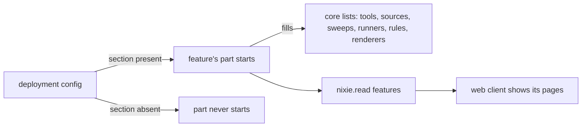

# Feature switches

- **Status:** draft
- **Decision records:** [0057](../../decisions/0057-every-optional-feature-has-a-switch.md)
- **Work items:** [feature switches](https://linear.app/zgeoff/issue/GEO-2877)

Each optional feature, such as the computer, calls or Google, is on only when its section is in the
deployment config, and a feature that is off leaves no trace in the server or the web client. A
feature plugs into the core by filling lists that core modules own, so no core module names it. The
web client asks the server which features are on before it shows a feature's pages.

## Shape



## Contracts

```yaml
# deployment config. A feature is on when its key is present, even as an empty map; absent is off.
computer: {} # the desktop, browser and shell; needs the computer image
code: {} # the code tool; needs the code image
voice: { speech: gpt-live } # calls, as today
devices: {} # devices and client devices
google: {} # the Gmail, Calendar and Drive tools and their polls
mcp: { servers: [] } # the MCP proxy, as today
coding: { atc: {} } # coding sessions, as today
```

```ts
// libs/contract. The one list of switchable features; every union and schema derives from it.
export const featureIDs = [
  'computer',
  'code',
  'voice',
  'devices',
  'google',
  'mcp',
  'coding',
  'search',
  'images',
  'mail',
  'spend',
] as const;
export type FeatureID = (typeof featureIDs)[number];

// nixie.read gains the features that are on.
const nixieReadOutput = z.object({
  paused: pauseStateSchema,
  features: z.array(z.enum(featureIDs)),
});
```

```ts
// apps/server. A part declaration names the feature it belongs to. When the feature is off, the
// part never starts, its images are not needed, and parts.find returns null for it.
{
  name: 'computer',
  feature: 'computer',
  needs: ['inputs', 'context', 'sandbox_adapter'],
  images: () => ['computer'],
  start: (parts) => startComputerPart(/* …existing inputs */),
}
```

```ts
// Each core module that today names a feature owns a list type instead, and the composition root
// fills it from the parts that are on. Examples of the lists and their owners:
type AlwaysAllowRule = { tool: string; reason: string }; // policy
type InboxRenderer = { kind: string; render: RenderInboxItem }; // sessions
type TaskRunnerEntry = { key: string; runStep: RunStep }; // tasks
type BodyFieldReader = (log: LogReader, request: ActionRequest) => Promise<BodyFields>; // api
type Mailbox = { source: string; key: string }; // triggers; replaces { kind: 'gmail' }
```

```ts
// apps/web. The nav and the providers above the router read the features once per session.
const { features } = useNixie();
const showComputer = features.includes('computer');
// a feature that is off has no nav entry, no route, and no provider mounted (CallProvider among them)
```

## Constraints

- These parts are core and have no switch: the sandbox host, the conversation, tasks, memory and the
  notebook, web fetch, policy, the model gateway and the event log.
- When a feature is off:
  - its parts never start, and nixie needs none of its images;
  - the model is offered none of its tools;
  - none of its pollers, sweeps or task runners run, and its readiness keys are absent;
  - its procedures answer `FEATURE_OFF` with the feature's ID;
  - the web client shows none of its nav entries, routes or banners.
- Outside the composition root and the feature's own packages, no code names a feature or an outside
  service. A test in `apps/server` lists the feature IDs and the outside service names and fails
  when a core module or the contract holds one outside its allowed files.
- Each outside service is an adapter named `<interface>-<system>`. Google's code moves out of the
  connectors module into a `connector-google` adapter behind a `Connector` interface that the
  connections module owns.
- The contract names no provider: a connection's connector is `z.string()`, not
  `z.literal('google')`.
- Migrations still run for every feature, so a feature's tables exist while it is off. A migration
  never assumes a provider, such as a column default of `'google'`.
- A feature that needs another feature names it, and the config load fails when the needed one is
  off (the wallet and accounts need the computer, for example).
- Turning a feature off keeps its records. Turning it on again finds them as it left them.
- [The ports doc](../../architecture/ports.md) replaces its rule that a port exists only when a
  second real provider is in sight with this design's rule, and lists each place the code still
  breaks it until the retrofit lands.
- Each release that adds a switch to a feature that was on by default adds that feature's section to
  the deployment configs it ships to, so no running deployment loses a feature.
- The planned designs follow the rule before they are built: the push notice names no `'telegram'`
  literal outside its adapter, the mail and calendar polls take their source from a list that the
  connector fills, and mail and phone keep each provider in its own adapter.

## Builder decides

- The test that enforces the naming rule, and how it lists the allowed files.
- The error wording of `FEATURE_OFF` and of a config load that fails for a needed feature.
- The names of the core list types and where each is filled.
- The order of the retrofit, one work item per feature.

## Out of scope

- Switching a core part off.
- Loading a feature's code at runtime.
- A settings page that turns features on and off; the config file is the switch.
