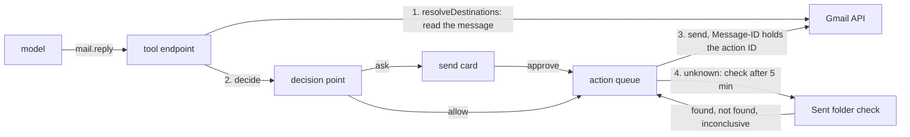

# Gmail, Calendar and Drive tools

- **Status:** draft
- **Work items:** [Gmail](https://linear.app/zgeoff/issue/GEO-1825), and
  [Calendar and Drive](https://linear.app/zgeoff/issue/GEO-1826). Both build on the Google
  connection (`docs/design/queue/google-connections.md`) and on
  [actions under policy](https://linear.app/zgeoff/issue/GEO-1810).

nixie reads, searches and labels your mail, sends mail, and reads and changes your calendar and the
Drive files you give it, through one Google connection. Each read runs in the turn. Each change and
each send is an [action](../platform/core/actions.md) that the
[decision point](../platform/policy/decision-point.md) decides before every attempt, and an action
whose outcome is unknown settles by a check at Google, never by a blind second attempt. A sent mail
carries its action ID in its `Message-ID`, so a check of the Sent folder settles an unknown send.

The Google connection design owns the tokens, the consent, the scopes and the setup steps. The
[connector interface](../platform/connectors/connector.md) owns the shape of a connector action, and
[serving nixie's tools](../platform/connectors/tools.md) owns how a call and its errors reach the
model. Other terms are in the [glossary](../../glossary.md).

## Shape



## Contracts

### The tools

The Google connector's actions become these tools. Each takes the
[connection argument](../platform/connectors/connector.md#the-connection-argument) when the caller
can reach 2 or more Google connections, except a tool that acts on an item a connection returned,
which takes its connection from the item.

| Tool                                | Effect  | Runs   | Scope                            | Reconciliation                    |
| ----------------------------------- | ------- | ------ | -------------------------------- | --------------------------------- |
| `mail.search`                       | `read`  | direct | `gmail.modify`                   | none                              |
| `mail.read`                         | `read`  | direct | `gmail.modify`                   | none                              |
| `mail.read_attachment`              | `read`  | direct | `gmail.modify`                   | none                              |
| `mail.label`                        | `write` | queued | `gmail.modify`                   | check: the threads' labels        |
| `mail.send`                         | `send`  | queued | `gmail.modify`                   | check: the Sent folder            |
| `mail.reply`                        | `send`  | queued | `gmail.modify`                   | check: the Sent folder            |
| `calendar.list_calendars`           | `read`  | direct | `calendar.calendarlist.readonly` | none                              |
| `calendar.list_events`              | `read`  | direct | `calendar.events`                | none                              |
| `calendar.read_event`               | `read`  | direct | `calendar.events`                | none                              |
| `calendar.create_event`             | `write` | queued | `calendar.events`                | check: the event ID               |
| `calendar.create_event_with_guests` | `send`  | queued | `calendar.events`                | check: the event ID               |
| `calendar.change_event`             | `write` | queued | `calendar.events`                | check: the event's marker         |
| `calendar.change_event_with_guests` | `send`  | queued | `calendar.events`                | check: the event's marker         |
| `calendar.cancel_event`             | `write` | queued | `calendar.events`                | check: the event is cancelled     |
| `calendar.cancel_event_with_guests` | `send`  | queued | `calendar.events`                | check: the event is cancelled     |
| `calendar.respond`                  | `send`  | queued | `calendar.events`                | check: your response on the event |
| `drive.search`                      | `read`  | direct | `drive.file`                     | none                              |
| `drive.read`                        | `read`  | direct | `drive.file`                     | none                              |
| `drive.create`                      | `write` | queued | `drive.file`                     | check: the file's marker          |
| `drive.change`                      | `write` | queued | `drive.file`                     | check: the file's marker          |

A guest is an attendee of an event other than you. "You" is the attendee whose `self` is true, or
whose address is the connection's account. A room or other resource counts as a guest, because
Google emails its owner.

### Reads

```ts
mail.search({ query: 'from:sam@example.org newer_than:7d', limit: 20 });
// → { messages: [{ message: '18c2f0a9b4d1e7c3', thread: '18c2f0a9b4d1e7c3',
//       from: 'Sam Lee <sam@example.org>', to: ['you@example.com'], subject: 'Q3 numbers',
//       date: '2026-11-12T23:04:00Z', snippet: 'Here are the…', labels: ['INBOX', 'Reports'],
//       isUnread: true, hasAttachments: true }],
//     next: 'eyJwIjoyfQ' }   // null on the last page; pass it back as `after`

mail.read({ message: '18c2f0a9b4d1e7c3', part: 1 });
// → { message, thread, from, replyTo: null, to, cc, subject, date, labels,
//     text: 'Hi, the numbers are in the sheet [L3]…', part: 1, parts: 2,
//     attachments: [{ attachment: '1.2', name: 'q3.csv', type: 'text/csv', bytes: 18233 }] }

mail.read_attachment({ message: '18c2f0a9b4d1e7c3', attachment: '1.2', part: 1 });
// → { name: 'q3.csv', type: 'text/csv', bytes: 18233, text: 'region,total\n…', part: 1, parts: 1 }
//   an image: text null, with the image beside the result, as web fetch images sets
//   any other type: text null, parts 0, unsupported: true

calendar.list_events({
  calendar: 'primary',
  from: '2026-11-14T00:00:00+11:00',
  to: '2026-11-21T00:00:00+11:00',
});
// → { events: [{ event: 'a1b2c3d4e5', title: 'Dentist', start: '2026-11-15T09:30:00+11:00',
//       end: '2026-11-15T10:15:00+11:00', isAllDay: false, location: '12 High St',
//       organizer: 'you@example.com', guests: [], yourResponse: null, status: 'confirmed' }],
//     next: null }

drive.read({ file: '1Bx9QvR2…', part: 1 });
// → { file, name: 'Trip plan', type: 'google_doc', modifiedAt: '2026-11-10T04:12:00Z',
//     text: '# Trip plan\n…', part: 1, parts: 3 }
```

```ts
// connectors module. The source of content of each result field, in the declaration's
// `results`, with the code's ContentSource values. A field marked endorsed carries
// 'x-endorsed' in the output schema.
const mailResultSources = {
  message: 'owner_data', // Gmail's own IDs; never endorsed, because a string is never endorsed
  thread: 'owner_data',
  labels: 'owner_data', // label names you or nixie made, and Gmail's system labels
  from: 'untrusted', // every header the sender wrote
  replyTo: 'untrusted',
  to: 'untrusted',
  cc: 'untrusted',
  subject: 'untrusted',
  snippet: 'untrusted',
  text: 'untrusted', // the body, whoever sent it, your own sent mail included
  attachments: 'untrusted', // names and types come from the sender
  date: 'untrusted', // endorsed: a time
  isUnread: 'untrusted', // endorsed: a boolean
  hasAttachments: 'untrusted', // endorsed: a boolean
  part: 'owner_data', // endorsed: a number
  parts: 'owner_data', // endorsed: a number
} as const;
// Calendar: event, calendar and next are 'owner_data'; title, location, description,
// organizer and guests are 'untrusted'; start, end, isAllDay, status and yourResponse are
// 'untrusted' and endorsed. Drive: file and next are 'owner_data'; name and text are
// 'untrusted'; type, bytes and modifiedAt are 'untrusted' and endorsed.
```

### The changes

```ts
mail.label({ threads: ['18c2f0a9b4d1e7c3'], add: ['Reports'], remove: ['INBOX', 'UNREAD'] });
// → done: { threads: ['18c2f0a9b4d1e7c3'], created: [] }   created: user labels the call made

mail.send({ to: ['sam@example.org'], cc: [], bcc: [], subject: 'Q3 numbers', text: 'Hi Sam, …' });
// → done: { message: '18c2f1…', thread: '18c2f1…' }

mail.reply({ message: '18c2f0a9b4d1e7c3', text: 'Thanks, got it.', replyAll: false });
// → done: { message, thread }

calendar.create_event_with_guests({
  calendar: 'primary',
  title: 'Q3 review',
  start: '2026-11-18T14:00:00+11:00',
  end: '2026-11-18T14:30:00+11:00',
  guests: ['sam@example.org'],
});
// → done: { event: '0b9d3c4e7a214f0e8c551e6f2a9d4c03', link: 'https://www.google.com/calendar/event?eid=…' }

calendar.change_event_with_guests({
  event: 'a1b2c3d4e5',
  start: '…',
  end: '…',
  addGuests: [],
  removeGuests: [],
});
calendar.cancel_event({ event: 'a1b2c3d4e5' });
calendar.respond({ event: 'k9x8w7v6u5', response: 'accepted' }); // accepted | declined | tentative

drive.create({ name: 'Trip plan', text: '# Trip plan\n…', as: 'google_doc' }); // google_doc | text
drive.change({ file: '1Bx9QvR2…', name: null, text: '# Trip plan\n…' }); // replaces the whole content
```

- `mail.label` takes up to 50 threads. `add` and `remove` take user label names and the system
  labels `INBOX`, `UNREAD`, `STARRED` and `IMPORTANT`, and nothing else. A user label name that no
  label holds becomes a new label.
- `mail.send` takes up to 20 addresses across `to`, `cc` and `bcc`, and a plain-text body of up to
  100 KB. It sends no attachment and no HTML.
- `mail.reply` takes its recipients from the message, never from the model: the message's
  `Reply-To`, else its `From`, and with `replyAll` the message's `To` and `Cc` too, without your own
  address. It threads the reply with `In-Reply-To`, `References`, the thread ID and the subject.
- The create, change and cancel tools without guests have no guest argument. A with-guests tool
  needs a guest before or after the change.
- `drive.create` with `google_doc` imports the text as Markdown into a Google Doc. With `text` it
  makes a plain text file.

### Destinations

```ts
// connectors module: an optional member of ConnectorAction (connector design). The endpoint
// calls it on the host before stage 1, in place of reading destination arguments, when it is set.
interface ConnectorAction<Input, Output> {
  // …existing fields
  resolveDestinations?(
    input: Input,
    context: ConnectorContext,
  ): Promise<ActionResponse<readonly CallDestination[]>>; // CallDestination: the cutover's type
}
```

| Tool                                | Its destinations                                     | Reply target            |
| ----------------------------------- | ---------------------------------------------------- | ----------------------- |
| `mail.send`                         | each address in `to`, `cc` and `bcc`                 | none                    |
| `mail.reply`                        | the recipients it reads from the message             | `Reply-To`, else `From` |
| `calendar.create_event_with_guests` | each guest                                           | none                    |
| `calendar.change_event_with_guests` | each guest before the change, and each guest it adds | none                    |
| `calendar.cancel_event_with_guests` | each guest of the event                              | none                    |
| `calendar.respond`                  | the event's organizer                                | the organizer           |
| every other tool                    | none                                                 | none                    |

- A destination is the bare address, with no display name, in lowercase NFC.
- A message in Spam or Trash gives no reply target, and neither does a message whose `From` is your
  own account. Its recipients are destinations with no permission.
- The resolution is a direct read, with the direct call's time budget. A failure returns the error
  of [a failed direct call](../platform/connectors/tools.md#a-failed-direct-call), and the call
  never reaches the decision point.
- The action hash covers the resolved destinations. At the attempt, the connector reads the message
  or event again. When the recipients or guests differ from the hashed destinations, it answers
  `refused` with `destinations_changed`, and the model proposes again.

### The send card

Each queued tool declares a sentence template, which
[proposals and approvals](../platform/policy/approvals.md#the-proposal) fills from the structured
fields, and the fields the card shows beside it. The card layout is in
[approvals in the client](../platform/channels/approvals.md#cards).

| Tool                                | Sentence                                                   | Approve button   |
| ----------------------------------- | ---------------------------------------------------------- | ---------------- |
| `mail.send`                         | Send an email from {from} to {to}: "{subject}"             | Send email       |
| `mail.reply`                        | Reply to {replyTo} from {from}: "{subject}"                | Send reply       |
| `mail.label`                        | Label {count} threads: add {add}, remove {remove}          | Label            |
| `calendar.create_event_with_guests` | Invite {guests} to "{title}" on {start}                    | Send invitations |
| `calendar.change_event_with_guests` | Change "{title}" on {start} and email {guests}             | Send changes     |
| `calendar.cancel_event_with_guests` | Cancel "{title}" on {start} and email {guests}             | Cancel and email |
| `calendar.respond`                  | Tell {organizer} you {response} "{title}" on {start}       | Send response    |
| `calendar.create_event`             | Add "{title}" on {start} to {calendar}                     | Add event        |
| `calendar.change_event`             | Change "{title}" on {start}                                | Change event     |
| `calendar.cancel_event`             | Cancel "{title}" on {start}                                | Cancel event     |
| `drive.create`, `drive.change`      | Create "{name}" in Drive / Replace the content of "{name}" | Create / Replace |

```ts
// The fields of a mail card, in order. ProposalBody.fields of the approval record.
type MailCardFields = {
  From: string; // the connection's account
  To: string;
  Cc: string; // left out when empty, and so is Bcc
  Bcc: string;
  Subject: string;
  'In reply to': string; // mail.reply only: the original's sender, date and subject
  Body: string; // the whole body, as plain text
};
```

- The card shows each destination with the permission that covered it, and marks each one with none.
  That mark tells you why the card asked.
- The card shows the body as plain text, never as HTML, and shows all of it.
- A calendar card shows the event's title, times with their zone, calendar, location, and each
  guest. A change card shows each changed field before and after.
- A time in a sentence shows the date, the time and the zone, in the zone the time tool answers in.

### The Sent-folder check

```text
Message-ID: <0b9d3c4e-7a21-4f0e-8c55-1e6f2a9d4c03@example.com>   the action ID @ the sender's domain
```

```ts
// connectors module: the declaration of mail.send and mail.reply
const reconcile = { kind: 'check', action: 'mail.find_sent', settleAfter: '5m' };
```

The check runs at least 5 minutes after the attempt started, and asks Gmail 2 ways:

1. A search with `rfc822msgid:<the Message-ID>` and `includeSpamTrash`.
2. A list of the `SENT` label with `includeSpamTrash`, newest first, reading the `Message-ID` and
   `X-Google-Original-Message-ID` headers of each message, until a message is older than 10 minutes
   before the attempt started.

| What the check sees                                             | It answers   |
| --------------------------------------------------------------- | ------------ |
| Either way finds a message whose header holds the Message-ID    | found        |
| Both ways finish and find none                                  | not found    |
| The list passes 200 messages before it reaches the cut-off time | inconclusive |
| Any call fails, or Gmail answers in a way the check cannot read | inconclusive |

- Found makes the action done, with the found message's ID and thread as its result.
- Not found returns the action to pending, and the retry sends with the same Message-ID.
- The check reads both headers, because Gmail can replace a `Message-ID` that a client set and keep
  the old one in `X-Google-Original-Message-ID`. The check works whichever Gmail does.
- A sent mail carries no other header that names nixie or the action.

### Calendar and Drive reconciliation

```ts
// Calendar create: the event ID is the action ID without its hyphens, which fits Google's
// base32hex event IDs. Google does not promise to refuse a second insert of one ID, so the
// create reconciles by a check, and a 409 on any insert answers done with the event read by its ID.
const calendarCheck = { kind: 'check', action: 'calendar.find_change', settleAfter: '1m' };

// Drive create and change: the check finds a new file through a search, which can lag
const driveCheck = { kind: 'check', action: 'drive.find_change', settleAfter: '5m' };
```

```ts
// The marker that a change, a Drive create and a Drive change write in the same request as the
// change: one private property per action. Calendar: extendedProperties.private. Drive: appProperties.
// key: 'nixie' + the action ID without hyphens (37 characters; Calendar allows 44)
// value: the attempt's start time, as epoch seconds
{ 'nixie0b9d3c4e7a214f0e8c551e6f2a9d4c03': '1794550000' }
```

| Action             | Found when                                                  | Not found when                             |
| ------------------ | ----------------------------------------------------------- | ------------------------------------------ |
| a calendar create  | the calendar holds an event with the action's event ID      | the read by ID answers 404                 |
| a calendar change  | the event holds the action's marker                         | the event lacks it, with under 10 markers  |
| a calendar cancel  | the event reads `cancelled`, or 404 or 410                  | the event reads `confirmed` or `tentative` |
| `calendar.respond` | your attendee entry holds the response                      | it holds another response                  |
| `drive.create`     | a file holds the marker, found by `appProperties` search    | the search finds none                      |
| `drive.change`     | the file holds the action's marker                          | the file lacks it, with under 10 markers   |
| `mail.label`       | each thread holds every label in `add` and none in `remove` | any thread differs                         |

- Each write keeps the 10 newest markers of nixie's on the item and deletes the older ones, in the
  same request. A check that finds no marker of its own and 10 newer ones answers inconclusive.
  **Why:** a later action on the same item can run while this one is unknown, and its marker must
  not hide this one.
- Every other answer, a failed call included, is inconclusive.
- A cancel's retry treats a 410 as done.

### The Drive picker

`drive.file` lets nixie see only the files it created and the files you pick for it. You pick files
in the web client, on the connection's page, with Google Picker:

1. You press "Choose Drive files". The page asks Google's sign-in library for an access token of its
   own, with `drive.file` alone, the connection's OAuth client ID, and the connection's account as
   `login_hint`.
2. The page opens Google Picker with that token, the client's Picker API key, and the client's Cloud
   project number as the app ID. Google grants each file you pick to the app, for the account that
   picked it.
3. The page sends the picked file IDs to `connections.checkPicked`. The server reads each file with
   the connection's own token, and the page shows the result.

```ts
// libs/contract, under `connections`: a read procedure
connections.checkPicked({ connection: 'k3x9m2p7qa', files: ['1Bx9QvR2…', '1Zq7…'] });
// → [{ file: '1Bx9QvR2…', name: 'Trip plan', isVisible: true },
//    { file: '1Zq7…', name: null, isVisible: false }]   false: picked under another Google account

// The OAuth client's picker settings, which the Google connection design stores with the client.
// Neither is a secret: the page needs both, and Google limits the key to the Picker API and
// nixie's origin.
type PickerSettings = { pickerKey: string; projectNumber: string };
```

- The connection's tokens never reach the browser, because they carry `gmail.modify`. The browser's
  own token lives only in the page's memory, and the server never receives it.
- The page shows each file that `checkPicked` cannot read as "picked under another Google account".
- Without picker settings, the page hides the button and links the setup step that adds them.
- Picking a file sends nothing to the model. `drive.search` finds it from then on, and the
  description of `drive.search` tells the model where you pick files.
- The setup adds 3 things to the Google connection's steps: the Picker API enabled, nixie's origin
  as an Authorized JavaScript origin on the Web client, and an API key restricted to the Picker API
  and that origin.

## Constraints

### Every tool

- A tool's effects never depend on its arguments or on the item it acts on. A no-guests tool reads
  the event at its resolution and again at its attempt, and refuses an event with a guest with
  `has_guests`, so the model uses the with-guests tool.
- A no-guests tool sends with `sendUpdates: 'none'`, and a with-guests tool with `'all'`, so a write
  never emails anyone.
- The change and cancel tools refuse an event you do not organize with `not_organizer`. You answer
  such an event through `calendar.respond`.
- Each tool that reads text returns it in parts of web fetch's `text_bytes`, cut as web fetch cuts a
  page, and reads the item from Google again for each part. No mail, attachment or file text is
  stored in nixie beyond the records of the call.
- A mail whose body has only an HTML part goes to a fetch sandbox for its text, as a web page does,
  so nixie never parses mail HTML on the host. The links of a body take link IDs, as a fetched
  page's links do.
- `mail.read_attachment` reads text types (`text/*` and `application/json`) as UTF-8 text, and
  images through the [web fetch image](../../architecture/connectors/web-fetch-images.md) decode and
  caps. It reads up to 25 MB, and every other type answers `unsupported`.
- `drive.read` exports a Google Doc as Markdown, a Sheet's first sheet as CSV and a Slides file as
  plain text, and reads other files as `mail.read_attachment` does.
- Each provider error maps to an action response as the
  [connector design](../platform/connectors/connector.md#the-interface) sets, and a Gmail 403 with
  `rateLimitExceeded` or `userRateLimitExceeded` is `retry`.

### Sends

- No tool saves a draft. Every send passes the decision point, and the starter rule
  `allow-sends-within-limits` sends at once only when every destination has standing permission or
  your consent, as [destination limits](../platform/policy/decision-point.md#destination-limits)
  sets. Every other send waits on its card.
- A send never carries an attachment.
- A retry after not found sends the same bytes with the same Message-ID, so a mail that Gmail did
  send under a replaced ID shows up in the next check.
- 3 unknown outcomes in a row bring the action to you, as
  [reconciliation](../platform/core/actions.md#reconciliation-per-connector) sets.

### Scopes

- The connector's `check` reads the calendar list with `calendarList.list`, so a connection without
  `calendar.calendarlist.readonly` lists `calendar.list_calendars` as missing and keeps every other
  Calendar tool. `calendar.events` alone never permits the calendar list.
- With the calendar list missing, the Calendar tools take `primary` or a calendar ID you give.

### A rollback

| The change                              | The release before                                                                             |
| --------------------------------------- | ---------------------------------------------------------------------------------------------- |
| the 20 tools                            | lists none; a queued action of one fails without an attempt, because its tool has no connector |
| an unknown action of one of the tools   | finds no reconciliation for it, so the action comes to you                                     |
| `resolveDestinations`                   | never calls it, because it has none of the tools                                               |
| markers on events and files             | never meets them; they stay at Google and change nothing                                       |
| the fetch sandbox's HTML text request   | never sends it                                                                                 |
| `connections.checkPicked`               | answers `NOT_FOUND`; a picked file stays granted at Google                                     |
| the picker settings on the OAuth client | as the Google connection design's rollback sets for the client's columns                       |

- The design adds no record kind, no migration and no config key.

## Decisions

- **Every with-guests change is its own `send` tool.** An agent's call on 13 Nov 2026: a tool's
  effects are fixed per tool, and the owner made an event with guests a `send`.
- **`calendar.respond` is a `send`, and the organizer is its reply target.** An agent's call on 13
  Nov 2026: Google emails the organizer, and an invitation reaches you as a message does, so an
  answer to it needs no more permission than a reply.
- **The action ID rides in `Message-ID` alone.** An agent's call on 13 Nov 2026: the check needs one
  header, and a header that names nixie would tell each recipient you use an assistant.
- **The Sent-folder check waits 5 minutes, and every doubt is inconclusive.** An agent's call on 13
  Nov 2026: not found sends the mail again, so the check says it only when both ways finish clean.
- **Markers are one property per action, 10 kept.** An agent's call on 13 Nov 2026: a single marker
  would let a later action hide an earlier one, and Drive allows 30 private properties.
- **Recipients and guests come from Google, never from the model's text.** The decision point's
  reply target rule, extended to the event a with-guests tool acts on.
- **The picker runs on a browser token of its own.** An agent's call on 13 Nov 2026: the
  connection's token carries `gmail.modify`, which must never reach page code.
- **Text is read again from Google for each part, never stored.** An agent's call on 13 Nov 2026: no
  new store means no new forget path.
- **The Calendar tools ask for `calendar.calendarlist.readonly`.** An agent's call on 13 Nov 2026:
  the narrowest scope that lists calendars, kept apart from event access.

## Builder decides

- Internal names, file layout, and how the connector batches metadata reads for `mail.search`.
- The MIME encoding of a sent mail, within plain text and the headers above.
- The wording of each refusal, and of each tool's description.
- How the card lays out the fields, within the rules above.
- The layout of the tests, and the fake Gmail, Calendar and Drive the tests use.

## Out of scope

- Drafts, attachments on a send, forwards, and sending HTML mail.
- Trashing mail, and deleting a Drive file.
- Sharing a Drive file, until a rule for it is designed.
- The Gmail and Calendar polls: [polls](https://linear.app/zgeoff/issue/GEO-1827).
- PDF and other document text, until nixie has a parser for them in a sandbox.

## Open questions

- **The tool names, and the words of each card.** The owner settles them in
  [the Gmail issue](https://linear.app/zgeoff/issue/GEO-1825). Until then the names and the card
  sentences here hold.
