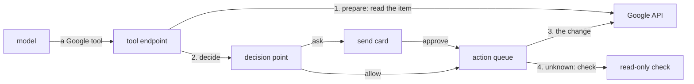

# Google tools

- **Status:** agreed
- **Work items:** [Calendar and Drive](https://linear.app/zgeoff/issue/GEO-1826), which builds on
  the [Google connection](google-connections.md) and the built
  [Gmail tools](../../architecture/connectors/gmail-tools.md).

nixie reads, searches and labels your Gmail, sends mail, and reads and changes your calendar and the
Drive files you give it, through one Google connection. Every read asks Google live, inside the
model's turn: nixie syncs nothing. The only copies of your mail, events or files it keeps are in a
call's own records: the text the call returned, and the card fields its `prepare` read. A change or
a send runs as an [action](../../architecture/core/actions.md), and the
[decision point](../../architecture/policy/decision-point.md) decides it before every attempt from
the effects the tool declares and the destinations nixie reads from Google. When an attempt's
outcome is unknown, a read-only check at Google settles it, and nixie never repeats a send blind.

Below are the rules every Google tool keeps, and what the Gmail tools leave to build. Find the rest
in [Calendar and Drive tools](google-calendar-drive-tools.md). The Gmail tools are `gmail.*`. The
`mail.*` tools belong to the assistant's own mailbox, in the
[mail design](https://github.com/zgeoff/nixie/pull/1420). That design also holds `gmail.wake_set`,
`gmail.wake_list` and `gmail.wake_cancel`, and the `replyWake` argument of `gmail.send` and
`gmail.reply`, which the mail polls work item builds. The tokens, the consent and the scopes belong
to the [Google connection](google-connections.md). How a call and its errors reach the model is in
[tool calls](../../architecture/connectors/tool-calls.md).

Read this page to build the [Calendar and Drive](https://linear.app/zgeoff/issue/GEO-1826) work
item. The owner settles its open questions.

## Shape

## Contracts

### Every Google tool

The connector's `actions`, the tool endpoint's `resolveInput` and `prepare`, the reply targets, and
the item and connection IDs are built, and the
[Gmail tools](../../architecture/connectors/gmail-tools.md) doc describes them. A Calendar or Drive
tool uses the same shapes:

- Every event and file ID a Google tool returns starts with its connection's short ID and a dot. A
  tool that takes an item ID takes its connection from that prefix, and every other tool takes the
  connection argument when its caller can reach 2 or more Google connections.
- Each tool declares an `EffectDeclaration`, and its effects never depend on its arguments or on the
  item it acts on. A tool whose destinations or card fields come from an item at Google reads them
  in `prepare`, before the decision point, and seals the card's facts as an attachment of the call's
  record.
- Each destination is a bare address, with no display name, in lowercase NFC. A reply target covers
  only the reply or response whose `prepare` returned that address, and an address the model writes
  in an argument is never one.
- In its attempt, the connector reads the item again. When the guests or a reply target differ, it
  answers `destinations_changed`, and the action fails and sends to none of them.

Each result field has a source: `untrusted` is outside content, and `owner_data` is your own data. A
field that holds a list or an object takes the least trusted source of its members, so `messages`
and `events` are `untrusted`. An endorsed field has a type that cannot carry words: a boolean, a
number, a time or a value from a fixed list. Its output schema carries `x-endorsed`, and its source
stays as its table gives it. No decision reads endorsement yet; a later taint stage will.

### Not built yet

The Gmail tools leave these to build:

- The connection argument's job pins and the model's status line, as the connector design and
  [serving nixie's tools](../platform/connectors/tools.md#what-the-model-learns-about-a-connection)
  set them out.
- You can edit the subject and the text body on a mail card before you approve it. nixie sends
  exactly what you approved, and the result's `edited` gives the model the final subject and text,
  or `null`. An edit of the text body of a mail with an HTML body drops the HTML body.
- An HTML body of a mail card shows rendered in a sandboxed frame that runs no script and loads
  nothing remote.

## Constraints

### Checks

- Found wins over every other answer. A check never answers not found while any read it makes fails.
  An answer that no found or not-found row names is inconclusive, including a response or a label
  that differs, because a later change can have replaced it.
- An inconclusive answer brings the action to you, as
  [reconciliation](../../architecture/core/actions.md#reconciling-an-unknown-outcome) sets.

### The read path

- Every read calls Google at the time of the call. nixie keeps no index or cache of mail, events or
  files.
- The text the model read sits in the call's `tool_result` record under that record's own key, so a
  forget of the record removes it.
- Every send, a draft's send included, passes the decision point. The starter rule
  `allow-sends-within-limits` ([rules](../platform/policy/rules.md)) allows a send, and the send
  runs at once only when each destination has a permission at stage 5 or your consent. Every other
  send waits on its card.

## Decisions

- **The Google tools are `gmail.*`, `calendar.*` and `drive.*`, with the names in
  [the Gmail tools](../../architecture/connectors/gmail-tools.md#the-tools) and
  [Calendar and Drive tools](google-calendar-drive-tools.md#the-tools).** `mail.*` names only the
  assistant's own mailbox.
- **The card sentences and approve buttons are those in the
  [Gmail card table](../../architecture/connectors/gmail-tools.md#the-card).**
- **Reads are live.** No store means no sync to keep and no new forget path.
- **Each item ID carries its connection.** nixie keeps no copy of mail to map a Gmail ID back to an
  account, and the reply leaves from the account that received the message.
- **The action ID rides in `Message-ID` alone.** The check needs one header, and a header that names
  nixie would tell each recipient you use an assistant.
- **A mail the Sent-folder check does not find comes to you, and nixie never resends it on its
  own.** A duplicate mail to someone outside is worse than asking you once.
- **Recipients and guests come from Google, never from the model's text.**

## Builder decides

- Internal names and file layout.
- The wording of each refusal, and of each tool's description.
- The layout of the tests.

## Out of scope

- Forwards.
- Trashing mail.
