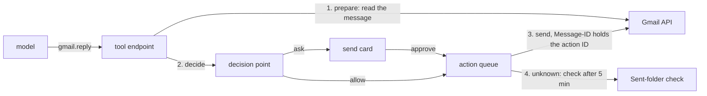

# Google tools

- **Status:** draft
- **Work items:** [Gmail](https://linear.app/zgeoff/issue/GEO-1825), and
  [Calendar and Drive](https://linear.app/zgeoff/issue/GEO-1826). Both build on the
  [Google connection](google-connections.md).

nixie reads, searches and labels your Gmail, sends mail, and reads and changes your calendar and the
Drive files you give it, through one Google connection. Every read asks Google live, inside the
model's turn: nixie syncs nothing and keeps no copy of your mail, events or files. A change or a
send runs as an [action](../../architecture/core/actions.md), and the
[decision point](../../architecture/policy/decision-point.md) decides it before every attempt from
the effects the tool declares and the destinations nixie reads from Google. When an attempt's
outcome is unknown, a read-only check at Google settles it, and nixie never repeats a send blind.

This page holds the rules every Google tool keeps, and the Gmail tools.
[Calendar and Drive tools](google-calendar-drive-tools.md) holds the rest. The Gmail tools are
`gmail.*`. The `mail.*` tools belong to the assistant's own mailbox in the
[mail design](https://github.com/zgeoff/nixie/pull/1420), which also holds `gmail.wake_set`,
`gmail.wake_list` and `gmail.wake_cancel`, and the `replyWake` argument of `gmail.send` and
`gmail.reply`, which the mail polls work item builds. The [Google connection](google-connections.md)
owns the tokens, the consent and the scopes.
[Tool calls](../../architecture/connectors/tool-calls.md) owns how a call and its errors reach the
model.

## Shape



## Contracts

### Every Google tool

The Google connector builds each tool as a `ToolDefinition` (tools module), and each queued tool's
attempt and check as an `ActionConnector` (connectors module), the shapes the tool endpoint and the
action queue run today. A read's `run` returns a `ToolOutcome`, so it can carry an image or write
link IDs as `web_fetch` does. Each of them reaches its connection through `connections.readContext`
from the [Google connection](google-connections.md#the-connector).

- Every item ID a Google tool returns starts with its connection's short ID and a dot, such as
  `k3x9m2p7qa.18c2f0a9b4d1e7c3`, and the model passes it back whole. A tool that takes an item ID
  takes its connection from that prefix. Every other tool takes the
  [connection argument](../platform/connectors/connector.md#the-connection-argument) when its caller
  can reach 2 or more Google connections.
- The `ActionAttempt` that the queue hands an attempt and a check gains `attemptStartedAt`, the
  epoch ms when the attempt began.
- A queued tool's attempt answers a `ProviderResponse` (connectors module), whose kinds include
  `refused_retryable` and `destinations_changed`.
- Each tool that reads text returns at most one part of it per call: `part` names the part, counted
  from 1, and `parts` gives how many there are.

### The declarations

Each tool declares an `EffectDeclaration` (policy module), and its effects never depend on its
arguments or on the item it acts on. A tool whose destinations or card fields come from an item at
Google reads them in `prepare` on its tool definition (tools module), before the decision point.

```ts
// gmail.reply's declaration
const gmailReplyDeclaration: EffectDeclaration = {
  effects: ['send'],
  destinations: [], // prepare reads them from the message
  amount: null,
  content: ['text'],
  results: { message: 'owner_data', thread: 'owner_data' },
};

// gmail.reply's prepare, for a message from sam@example.org with Cc kim@example.org and replyAll
// → { destinations: [{ value: 'sam@example.org', replyTarget: true },
//                    { value: 'kim@example.org', replyTarget: false }],
//     effects: ['send'],
//     card: { from: 'you@example.com', replyTo: 'sam@example.org', subject: 'Q3 numbers',
//             inReplyTo: 'Sam Lee, 12 Nov 2026, "Q3 numbers"' } }
```

```ts
// tools module: …existing fields of Prepared
interface Prepared {
  card?: Record<string, string>; // the card's fields that come from the provider; nixie seals them
  //                                as erasable fields of the call's tool_called record
}
// policy module: …existing fields of BodyFields
interface BodyFields {
  approveLabel?: string; // the approve button, such as 'Send reply'
}
```

- Each destination is a bare address, with no display name, in lowercase NFC. The decision point
  gives each one a permission at stage 5, as
  [destinations](../../architecture/policy/decision-point.md#destinations) sets, and the
  [trusted-places design](https://github.com/zgeoff/nixie/pull/1410) reads each as an `address`
  place.
- A reply target covers only the reply or response whose `prepare` returned that address. An address
  the model writes in an argument is never a reply target, even when it equals a sender or an
  organizer.
- `prepare` is a direct read, with the direct call's time budget. When it fails, the call fails as a
  direct call does, and never reaches the decision point.
- The [action hash](../platform/policy/approvals.md#the-proposal) covers the destinations and their
  reply targets. In its attempt, the connector reads the item again. When the recipients, the guests
  or a reply target differ, such as a message moved to Spam since, it answers
  `destinations_changed`, and the action fails and sends to none of them.
- `policy.action_proposed` gains each destination's permission from the decision, and
  `libs/contract` passes it to the card. The card lists each destination beside its permission, and
  marks one that no permission covered with "no permission".
- nixie fills each card's sentence from the call's structured fields and its `card` fields, as
  [proposals and approvals](../platform/policy/approvals.md#the-proposal) sets, and the model writes
  none of it. [Approvals in the client](../platform/channels/approvals.md#cards) holds the card's
  layout.

Each result field has a source: `untrusted` is outside content, and `owner_data` is your own data. A
field that holds a list or an object takes the least trusted source of its members, so `messages`
and `events` are `untrusted`. An endorsed field has a type that cannot carry words: a boolean, a
number, a time or a value from a fixed list. Its output schema carries `x-endorsed`, and its source
stays as its table gives it. No decision reads endorsement yet; a later taint stage will.

### The Gmail tools

| Tool                    | Effect  | Runs   | Destinations                          | Reconciliation            |
| ----------------------- | ------- | ------ | ------------------------------------- | ------------------------- |
| `gmail.search`          | `read`  | direct | none                                  | none                      |
| `gmail.read`            | `read`  | direct | none                                  | none                      |
| `gmail.read_attachment` | `read`  | direct | none                                  | none                      |
| `gmail.label`           | `write` | queued | none                                  | check `gmail.find_labels` |
| `gmail.send`            | `send`  | queued | each address in `to`, `cc` and `bcc`  | check `gmail.find_sent`   |
| `gmail.reply`           | `send`  | queued | the recipients it reads, in `prepare` | check `gmail.find_sent`   |

Every Gmail tool needs the scope `gmail.modify`.

```ts
gmail.search({ query: 'from:sam@example.org newer_than:7d', limit: 20 });
// → { messages: [{ message: 'k3x9m2p7qa.18c2f0a9b4d1e7c3', thread: 'k3x9m2p7qa.18c2f0a9b4d1e7c3',
//       from: 'Sam Lee <sam@example.org>', to: ['you@example.com'], subject: 'Q3 numbers',
//       date: '2026-11-12T23:04:00Z', snippet: 'Here are the…', labels: ['INBOX', 'Reports'],
//       isUnread: true, hasAttachments: true }],
//     next: 'eyJwIjoyfQ' }   // null on the last page; pass it back as `after`

gmail.read({ message: 'k3x9m2p7qa.18c2f0a9b4d1e7c3', part: 1 });
// → { message, thread, from, replyTo: null, to, cc, subject, date, labels,
//     text: 'Hi, the numbers are in the sheet [L3]…', part: 1, parts: 2,
//     attachments: [{ attachment: '1.2', name: 'q3.csv', type: 'text/csv', bytes: 18233 }] }

gmail.read_attachment({ message: 'k3x9m2p7qa.18c2f0a9b4d1e7c3', attachment: '1.2', part: 1 });
// → { name: 'q3.csv', type: 'text/csv', bytes: 18233, text: 'region,total\n…', part: 1, parts: 1 }
//   an image: text null, and the model gets the image beside the result
//   any other type: text null, parts 0, unsupported: true

gmail.label({
  threads: ['k3x9m2p7qa.18c2f0a9b4d1e7c3'],
  add: ['Reports'],
  remove: ['INBOX', 'UNREAD'],
});
// → done: { threads: ['k3x9m2p7qa.18c2f0a9b4d1e7c3'], created: [] }   created: user labels the call made

gmail.send({ to: ['sam@example.org'], cc: [], bcc: [], subject: 'Q3 numbers', text: 'Hi Sam, …' });
// → done: { message: 'k3x9m2p7qa.18c2f1…', thread: 'k3x9m2p7qa.18c2f1…' }

gmail.reply({ message: 'k3x9m2p7qa.18c2f0a9b4d1e7c3', text: 'Thanks, got it.', replyAll: false });
// → done: { message, thread }
```

| `owner_data`                                    | `untrusted`                                                      | `untrusted` and endorsed                                 |
| ----------------------------------------------- | ---------------------------------------------------------------- | -------------------------------------------------------- |
| message, thread, labels, next, threads, created | from, replyTo, to, cc, subject, snippet, text, attachments, name | date, isUnread, hasAttachments, type, bytes, unsupported |

`part` and `parts` are `owner_data` and endorsed.

- `gmail.label` takes up to 50 threads of one connection, and refuses with `mixed_connections` when
  they name 2. `add` and `remove` take user label names and the system labels `INBOX`, `UNREAD`,
  `STARRED` and `IMPORTANT`. When `add` names a user label that does not exist, the tool creates it.
- `gmail.send` takes up to 20 addresses across `to`, `cc` and `bcc`, and a plain-text body of up to
  100 KB. It sends no attachment and no HTML.
- `gmail.reply` takes its recipients from the message, never from the model: `Reply-To`, else
  `From`, and with `replyAll` the message's `To` and `Cc` too, without your own address. A reply to
  your own message goes to its `To`, and with `replyAll` its `Cc` too, as Gmail does. It threads the
  reply with `In-Reply-To`, `References`, the thread ID and the subject.
- `gmail.reply`'s reply target is the message's `From`. A `Reply-To` address that differs from
  `From` is a destination with no reply target, so a sender cannot point a reply that runs without
  asking at someone else.
- `gmail.reply` marks no reply target when the message sits in Spam or Trash, or when the message's
  `From` is the connection's own account.

### The Gmail cards

| Tool          | Sentence                                          | Approve button |
| ------------- | ------------------------------------------------- | -------------- |
| `gmail.send`  | Send an email from {from} to {to}: "{subject}"    | Send email     |
| `gmail.reply` | Reply to {replyTo} from {from}: "{subject}"       | Send reply     |
| `gmail.label` | Label {count} threads: add {add}, remove {remove} | Label          |

A mail card shows From (the connection's account), To, Cc, Bcc, Subject, In reply to (`gmail.reply`
only: the original's sender, date and subject) and the whole body as plain text, never HTML. It
leaves out an empty Cc or Bcc.

### The Sent-folder check

```text
Message-ID: <0b9d3c4e-7a21-4f0e-8c55-1e6f2a9d4c03@example.com>   the action ID @ the sender's domain
```

```ts
// connectors module: the Reconcile of gmail.send and gmail.reply. 'gmail.find_sent' is a read-only
// check that only the action queue calls; no tool list holds it.
const reconcile: Reconcile = {
  kind: 'check',
  tool: 'gmail.find_sent',
  trustNegativeAfterMs: 300_000,
  onNotFound: 'ask',
};
```

The check runs at least 5 minutes after the attempt started, and asks Gmail 2 ways:

1. A search with `rfc822msgid:<the Message-ID>` and `includeSpamTrash`.
2. A list of the `SENT` label with `includeSpamTrash` and `after:` 10 minutes before
   `attemptStartedAt`, read to its last page, with the `Message-ID` and
   `X-Google-Original-Message-ID` headers of each message. The check never relies on the list's
   order.

| What the check sees                                             | It answers                           |
| --------------------------------------------------------------- | ------------------------------------ |
| Either way finds a message whose header holds the Message-ID    | found; this row wins over the others |
| Both ways finish and find none                                  | not found                            |
| The list holds more than 200 messages                           | inconclusive                         |
| Any call fails, or Gmail answers in a way the check cannot read | inconclusive                         |

- Found makes the action done, with the found message's ID and thread as its result.
- Not found brings the action to you: "nixie can't tell whether this mail went out". Gmail keeps no
  other trace of a sent mail, so a Sent copy deleted for good looks the same as a mail that never
  went out.
- Only your answer sends the mail again, and that attempt sends the same message with the same
  Message-ID.
- The check reads both headers, because Gmail can replace a `Message-ID` that a client set and keep
  the old one in `X-Google-Original-Message-ID`.
- A sent mail carries no other header that names nixie or the action.
- `gmail.find_labels` answers found when each thread holds every label in `add` and none in
  `remove`, and inconclusive otherwise. A `gmail.label` that it finds done answers `created: null`,
  because the check cannot tell which labels the action made.

## Constraints

### Checks

- Found wins over every other answer. A check never answers not found while any read it makes fails.
  Every other answer is inconclusive, a response or a label that differs included, because a later
  change can have replaced it.
- An inconclusive answer brings the action to you, as
  [reconciliation](../../architecture/core/actions.md#reconciling-an-unknown-outcome) sets.

### The read path

- Every read calls Google at the time of the call. nixie keeps no index, cache or copy of mail,
  events or files.
- Each text part is at most the `text_bytes` of the `web_fetch` config section, cut as
  [pages and parts](../../architecture/connectors/web-fetch.md#pages-and-parts) sets. The tool reads
  the item from Google again for each part.
- The text the model read sits in the call's `tool_result` record under that record's own key, so a
  forget of the record removes it.
- A mail whose body has only an HTML part goes to a
  [fetch sandbox](../../architecture/connectors/web-fetch.md#the-fetch-sandbox) for its text, so
  nixie never parses mail HTML on the host. Each link in a body reads as a
  [link ID](../../architecture/connectors/web-fetch.md#link-ids), such as `[L3]`.
- The fetch guest gains a request kind that carries HTML bytes and opens no connection, so no
  tracking pixel loads. A server whose fetch image lacks that kind answers an HTML-only mail with
  `text: null` and `unsupported: true`, so the image and the server still roll out in either order.
- `gmail.read_attachment` reads `text/*` and `application/json` as UTF-8 text, and decodes images as
  [web fetch images](../../architecture/connectors/web-fetch-images.md) does. Every other type
  answers `unsupported`. An item over 25 MB answers `too_large`.

### Sends and errors

- nixie has no draft tool. Every send passes the decision point. The starter rule
  `allow-sends-within-limits` ([rules](../platform/policy/rules.md)) allows a send, and it runs at
  once only when each destination has a permission at stage 5 or your consent. Every other send
  waits on its card.
- A send never carries an attachment.
- Each Google error maps to one `ProviderResponse` kind, and a Gmail 403 with `rateLimitExceeded` or
  `userRateLimitExceeded` is `refused_retryable`.

## Decisions

- **The Google tools are `gmail.*`, `calendar.*` and `drive.*`, with the names in
  [the Gmail tools](#the-gmail-tools) and
  [Calendar and Drive tools](google-calendar-drive-tools.md#the-tools).** `mail.*` names only the
  assistant's own mailbox.
- **The card sentences and approve buttons are those in the card tables.**
- **Reads are live.** No store means no sync to keep and no new forget path.
- **Each item ID carries its connection.** nixie keeps no copy of mail to map a Gmail ID back to an
  account, and the reply leaves from the account that received the message.
- **The action ID rides in `Message-ID` alone.** The check needs one header, and a header that names
  nixie would tell each recipient you use an assistant.
- **A mail the Sent-folder check does not find comes to you, and nixie never resends it.** A
  duplicate mail to someone outside is worse than asking you once.
- **Recipients and guests come from Google, never from the model's text.**

## Builder decides

- Internal names, file layout, and how the connector batches metadata reads for `gmail.search`.
- The MIME encoding of a sent mail, within plain text and the headers above.
- The wording of each refusal, and of each tool's description.
- The layout of the tests, and the fake Gmail they use.

## Out of scope

- Drafts, attachments on a send, forwards, and HTML mail.
- Trashing mail.

## Open questions

- **Is your connected account you?** Connecting could add the account's address as one of your own
  destinations, so a mail or an invitation to it runs without a card. The owner settles it in
  [GEO-2838](https://linear.app/zgeoff/issue/GEO-2838); the recommendation is yes, added at connect
  and removed by Forget. Until then, connecting adds nothing, and a send to the account's own
  address is decided like any other.
- **Is a `Reply-To` address a reply target?** Mailing lists and support desks set `Reply-To`, so
  treating it as a reply target saves a card for each reply to them. A sender writes `Reply-To`,
  though, so it could aim a reply that runs without asking at anyone. The owner settles it in
  [GEO-2839](https://linear.app/zgeoff/issue/GEO-2839); the recommendation is `From` only. Until
  then, only `From` is a reply target.
