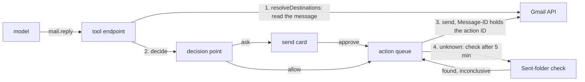

# Gmail, Calendar and Drive tools

- **Status:** draft
- **Work items:** [Gmail](https://linear.app/zgeoff/issue/GEO-1825), and
  [Calendar and Drive](https://linear.app/zgeoff/issue/GEO-1826). Both build on the Google
  connection (`docs/design/queue/google-connections.md`) and on
  [actions under policy](https://linear.app/zgeoff/issue/GEO-1810).

nixie reads, searches and labels your mail, sends mail, and reads and changes your calendar and the
Drive files you give it, through one Google connection. A read runs inside the model's turn and
returns its result at once. A change or a send runs as an [action](../platform/core/actions.md) on
the action queue, and the [decision point](../platform/policy/decision-point.md) decides it before
every attempt. When an attempt's outcome is unknown, a read-only check at Google settles it, and
nixie never repeats the action blind. A sent mail carries its action ID in its `Message-ID`, so a
check of the Sent folder can find an unknown send. When it finds none, nixie asks you and never
sends again on its own.

The Google connection design owns the tokens, the consent, the scopes and the setup steps. The
[connector interface](../platform/connectors/connector.md) owns the shape of a connector action, and
[serving nixie's tools](../platform/connectors/tools.md) owns how a call and its errors reach the
model. Other terms are in the [glossary](../../glossary.md).

## Shape



In this path, the tool endpoint first reads the message to learn whom the reply reaches, the
decision point then allows the reply or asks on a card, and the action queue sends it.
[Destinations](#destinations) and [the send card](#the-send-card) hold those 2 steps.

## Contracts

### The tools

The Google connector's actions become these tools. The Effect column holds the
[effect](../platform/policy/decision-point.md#effects) that rules match on. A `direct` tool runs in
the turn, and a `queued` tool runs as an action, as
[a tool definition](../platform/connectors/tools.md#a-tool-definition) sets.

A tool that acts on an item a connection returned, such as `mail.reply` on a message, takes its
connection from the item. Every other tool takes the
[connection argument](../platform/connectors/connector.md#the-connection-argument) when the tool
list of its conversation, task or worker names 2 or more Google connections for it.

| Tool                                | Effect  | Runs   | Scope                            | Reconciliation                    |
| ----------------------------------- | ------- | ------ | -------------------------------- | --------------------------------- |
| `mail.search`                       | `read`  | direct | `gmail.modify`                   | none                              |
| `mail.read`                         | `read`  | direct | `gmail.modify`                   | none                              |
| `mail.read_attachment`              | `read`  | direct | `gmail.modify`                   | none                              |
| `mail.label`                        | `write` | queued | `gmail.modify`                   | check: the threads' labels        |
| `mail.send`                         | `send`  | queued | `gmail.modify`                   | check: the Sent folder            |
| `mail.reply`                        | `send`  | queued | `gmail.modify`                   | check: the Sent folder            |
| `calendar.list_calendars`           | `read`  | direct | `calendar.calendarlist.readonly` | none                              |
| `calendar.list_events`              | `read`  | direct | `calendar.events`                | none                              |
| `calendar.read_event`               | `read`  | direct | `calendar.events`                | none                              |
| `calendar.create_event`             | `write` | queued | `calendar.events`                | check: the event ID and marker    |
| `calendar.create_event_with_guests` | `send`  | queued | `calendar.events`                | check: the event ID and marker    |
| `calendar.change_event`             | `write` | queued | `calendar.events`                | check: the event's marker         |
| `calendar.change_event_with_guests` | `send`  | queued | `calendar.events`                | check: the event's marker         |
| `calendar.cancel_event`             | `write` | queued | `calendar.events`                | check: the event is cancelled     |
| `calendar.cancel_event_with_guests` | `send`  | queued | `calendar.events`                | check: the event is cancelled     |
| `calendar.respond`                  | `send`  | queued | `calendar.events`                | check: your response on the event |
| `drive.search`                      | `read`  | direct | `drive.file`                     | none                              |
| `drive.read`                        | `read`  | direct | `drive.file`                     | none                              |
| `drive.create`                      | `write` | queued | `drive.file`                     | check: the file's marker          |
| `drive.change`                      | `write` | queued | `drive.file`                     | check: the file's marker          |

nixie counts every attendee of an event as a guest, except the connection's own account: the
attendee whose `self` is true, or whose address is the account. A room or other resource counts as a
guest, because Google emails its owner.

A marker is a private property that a change writes on the item it changes, so a later check can
tell whether the change happened.
[Reconciliation of the other changes](#reconciliation-of-the-other-changes) defines it.

### Reads

Each tool that reads text returns at most one part of it per call: `part` names the part, counted
from 1, and `parts` gives how many there are. [Every tool](#every-tool) sets the part size.

```ts
mail.search({ query: 'from:sam@example.org newer_than:7d', limit: 20 });
// → { messages: [{ message: '18c2f0a9b4d1e7c3', thread: '18c2f0a9b4d1e7c3',
//       from: 'Sam Lee <sam@example.org>', to: ['you@example.com'], subject: 'Q3 numbers',
//       date: '2026-11-12T23:04:00Z', snippet: 'Here are the…', labels: ['INBOX', 'Reports'],
//       isUnread: true, hasAttachments: true }],
//     next: 'eyJwIjoyfQ' }   // null on the last page; pass it back as `after`

mail.read({ message: '18c2f0a9b4d1e7c3', part: 1 });
// → { message, thread, from, replyTo: null, to, cc, subject, date, labels,
//     text: 'Hi, the numbers are in the sheet [L3]…', part: 1, parts: 2,
//     attachments: [{ attachment: '1.2', name: 'q3.csv', type: 'text/csv', bytes: 18233 }] }

mail.read_attachment({ message: '18c2f0a9b4d1e7c3', attachment: '1.2', part: 1 });
// → { name: 'q3.csv', type: 'text/csv', bytes: 18233, text: 'region,total\n…', part: 1, parts: 1 }
//   an image: text null, and the model gets the image beside the result, as for a fetched image
//   any other type: text null, parts 0, unsupported: true

calendar.list_events({
  calendar: 'primary',
  from: '2026-11-14T00:00:00+11:00',
  to: '2026-11-21T00:00:00+11:00',
});
// → { events: [{ event: 'a1b2c3d4e5', title: 'Dentist', start: '2026-11-15T09:30:00+11:00',
//       end: '2026-11-15T10:15:00+11:00', isAllDay: false, location: '12 High St',
//       organizer: 'you@example.com', guests: [], yourResponse: null, status: 'confirmed' }],
//     next: null }

drive.read({ file: '1Bx9QvR2…', part: 1 });
// → { file, name: 'Trip plan', type: 'google_doc', modifiedAt: '2026-11-10T04:12:00Z',
//     text: '# Trip plan\n…', part: 1, parts: 3 }
```

```ts
// connectors module: the source of content of each result field, in the declaration's `results`.
// 'untrusted' is outside content and 'owner_data' is your own data, as taint in the first build
// (../platform/policy/decision-point.md#taint-in-the-first-build) sets. Endorsed marks a field
// whose type cannot carry words (a boolean, a
// number, a time, a value from a fixed list); it goes in the output schema as 'x-endorsed' and
// leaves the field's source as it is.
// In the first build, endorsement changes no decision; a later taint stage reads it.
const mailResultSources = {
  message: 'owner_data', // Gmail's own IDs; not endorsed, because a string can carry words
  thread: 'owner_data',
  labels: 'owner_data', // label names you or nixie made, and Gmail's system labels
  from: 'untrusted', // every header the sender wrote
  replyTo: 'untrusted',
  to: 'untrusted',
  cc: 'untrusted',
  subject: 'untrusted',
  snippet: 'untrusted',
  text: 'untrusted', // the body, whoever sent it, your own sent mail included
  attachments: 'untrusted', // names and types come from the sender
  date: 'untrusted', // endorsed: a time
  isUnread: 'untrusted', // endorsed: a boolean
  hasAttachments: 'untrusted', // endorsed: a boolean
  part: 'owner_data', // endorsed: a number
  parts: 'owner_data', // endorsed: a number
} as const;
// Calendar: event, calendar and next are 'owner_data'; title, location, description,
// organizer and guests are 'untrusted'; start, end, isAllDay, status and yourResponse are
// 'untrusted' and endorsed. Drive: file and next are 'owner_data'; name and text are
// 'untrusted'; type, bytes and modifiedAt are 'untrusted' and endorsed.
```

### The changes

```ts
mail.label({ threads: ['18c2f0a9b4d1e7c3'], add: ['Reports'], remove: ['INBOX', 'UNREAD'] });
// → done: { threads: ['18c2f0a9b4d1e7c3'], created: [] }   created: user labels the call made

mail.send({ to: ['sam@example.org'], cc: [], bcc: [], subject: 'Q3 numbers', text: 'Hi Sam, …' });
// → done: { message: '18c2f1…', thread: '18c2f1…' }

mail.reply({ message: '18c2f0a9b4d1e7c3', text: 'Thanks, got it.', replyAll: false });
// → done: { message, thread }

calendar.create_event_with_guests({
  calendar: 'primary',
  title: 'Q3 review',
  start: '2026-11-18T14:00:00+11:00',
  end: '2026-11-18T14:30:00+11:00',
  guests: ['sam@example.org'],
});
// → done: { event: '0b9d3c4e7a214f0e8c551e6f2a9d4c03', link: 'https://www.google.com/calendar/event?eid=…' }

calendar.change_event_with_guests({
  event: 'a1b2c3d4e5',
  start: '…',
  end: '…',
  addGuests: [],
  removeGuests: [],
});
calendar.cancel_event({ event: 'a1b2c3d4e5' });
calendar.respond({ event: 'k9x8w7v6u5', response: 'accepted' }); // accepted | declined | tentative

drive.create({ name: 'Trip plan', text: '# Trip plan\n…', as: 'google_doc' }); // google_doc | text
drive.change({ file: '1Bx9QvR2…', name: null, text: '# Trip plan\n…' }); // replaces the whole content
```

- `mail.label` takes up to 50 threads. `add` and `remove` take user label names and the system
  labels `INBOX`, `UNREAD`, `STARRED` and `IMPORTANT`, and nothing else. When `add` names a user
  label that does not exist, the tool creates it.
- `mail.send` takes up to 20 addresses across `to`, `cc` and `bcc`, and a plain-text body of up to
  100 KB. It sends no attachment and no HTML.
- `mail.reply` takes its recipients from the message, never from the model: the message's
  `Reply-To`, else its `From`, and with `replyAll` the message's `To` and `Cc` too, without your own
  address. It threads the reply with `In-Reply-To`, `References`, the thread ID and the subject.
- The create, change and cancel tools without guests have no guest argument.
- A with-guests tool refuses with `no_guests` when the event has no guest before the change and none
  after it, so the model uses the tool without guests.
- In its attempt, `drive.change` reads the file first. It refuses with `shared_file` when the file
  is shared with anyone or sits in a shared drive. **Why:** a change to a shared file reaches each
  person who can read it, which is a `send`, and sharing is out of scope.
- `drive.create` makes the file in your My Drive root, shared with no one.
- `drive.create` with `google_doc` imports the text as Markdown into a Google Doc. With `text` it
  makes a plain text file.

### Destinations

```ts
// connectors module: an optional member of ConnectorAction (connector design). When it is set,
// the tool endpoint calls it on the host before the first stage of the decision point's
// pipeline (../platform/policy/decision-point.md#the-pipeline), in place of
// reading destination arguments.
interface ConnectorAction<Input, Output> {
  // …existing fields
  resolveDestinations?(
    input: Input,
    context: ConnectorContext,
  ): Promise<ActionResponse<readonly CallDestination[]>>; // CallDestination: policy module, in the cutover design
}
```

The decision point holds back a send to a destination that has no standing permission, as
[destination limits](../platform/policy/decision-point.md#destination-limits) sets. A reply target
is one of those permissions. `CallDestination` is defined in the decision point cutover design
(`docs/design/queue/decision-point-cutover.md`).

| Tool                                | Its destinations                                     | Reply target            |
| ----------------------------------- | ---------------------------------------------------- | ----------------------- |
| `mail.send`                         | each address in `to`, `cc` and `bcc`                 | none                    |
| `mail.reply`                        | the recipients it reads from the message             | `Reply-To`, else `From` |
| `calendar.create_event_with_guests` | each guest                                           | none                    |
| `calendar.change_event_with_guests` | each guest before the change, and each guest it adds | none                    |
| `calendar.cancel_event_with_guests` | each guest of the event                              | none                    |
| `calendar.respond`                  | the event's organizer                                | the organizer           |
| every other tool                    | none                                                 | none                    |

- The resolver writes each destination as its bare address, with no display name, in lowercase NFC.
- A reply target covers only the reply or response whose resolver returned that address, and never
  another send. An address the model writes in an argument is never a reply target, even when it
  equals a sender or an organizer.
- `mail.reply` marks no recipient as a reply target when the message sits in Spam or Trash, or when
  the message's `From` is the connection's own account. Each recipient of such a reply then needs
  another permission or your consent. Without one, the reply waits on its card.
- The resolution is a direct read, with the direct call's time budget. A failure returns the error
  of [a failed direct call](../platform/connectors/tools.md#a-failed-direct-call), and the call
  never reaches the decision point.
- The [action hash](../platform/policy/approvals.md#the-proposal), the hash an approval binds to,
  covers the resolved destinations. The action reaches only the destinations that the decision point
  checked. In its attempt, the connector reads the message or event again. When the recipients or
  guests differ, such as a new Cc on a reply to all, it answers `refused` with
  `destinations_changed`. The action fails and sends to none of them, and the model can propose
  again.

### The send card

Each queued tool declares 2 things for its card: a sentence template, and the fields the card shows
beside the sentence. nixie fills the template from the call's structured fields, as
[proposals and approvals](../platform/policy/approvals.md#the-proposal) sets, and the model writes
none of it. [Approvals in the client](../platform/channels/approvals.md#cards) holds the card's
layout.

| Tool                                | Sentence                                             | Approve button   |
| ----------------------------------- | ---------------------------------------------------- | ---------------- |
| `mail.send`                         | Send an email from {from} to {to}: "{subject}"       | Send email       |
| `mail.reply`                        | Reply to {replyTo} from {from}: "{subject}"          | Send reply       |
| `mail.label`                        | Label {count} threads: add {add}, remove {remove}    | Label            |
| `calendar.create_event_with_guests` | Invite {guests} to "{title}" on {start}              | Send invitations |
| `calendar.change_event_with_guests` | Change "{title}" on {start} and email {guests}       | Send changes     |
| `calendar.cancel_event_with_guests` | Cancel "{title}" on {start} and email {guests}       | Cancel and email |
| `calendar.respond`                  | Tell {organizer} you {response} "{title}" on {start} | Send response    |
| `calendar.create_event`             | Add "{title}" on {start} to {calendar}               | Add event        |
| `calendar.change_event`             | Change "{title}" on {start}                          | Change event     |
| `calendar.cancel_event`             | Cancel "{title}" on {start}                          | Cancel event     |
| `drive.create`                      | Create "{name}" in Drive                             | Create file      |
| `drive.change`                      | Replace the content of "{name}"                      | Replace content  |

```ts
// The fields of a mail card, in order. ProposalBody.fields of the approval record.
type MailCardFields = {
  From: string; // the connection's account
  To: string;
  Cc: string; // left out when empty, and so is Bcc
  Bcc: string;
  Subject: string;
  'In reply to': string; // mail.reply only: the original's sender, date and subject
  Body: string; // the whole body, as plain text
};
```

- The card lists each destination beside the permission that covered it. The card marks a
  destination that no permission covered with "no permission", which is the reason the card asks.
- The card shows the body as plain text, never as HTML, and shows all of it.
- A calendar card shows the event's title, times with their zone, calendar, location, and each
  guest. A change card shows each changed field before and after.
- A time in a sentence shows the date, the time and the zone, in the zone that the
  [time tool](../../architecture/connectors/time.md) answers in.

### The Sent-folder check

```text
Message-ID: <0b9d3c4e-7a21-4f0e-8c55-1e6f2a9d4c03@example.com>   the action ID @ the sender's domain
```

```ts
// connectors module: the declaration of mail.send and mail.reply. 'mail.find_sent' is a read-only
// connector action that only the action queue calls; no tool list holds it.
const reconcile = { kind: 'check', action: 'mail.find_sent', settleAfter: '5m' };
```

The check runs at least 5 minutes after the attempt started, and asks Gmail 2 ways:

1. A search with `rfc822msgid:<the Message-ID>` and `includeSpamTrash`.
2. A list of the `SENT` label with `includeSpamTrash` and `after:` 10 minutes before the attempt
   started, read to its last page, with the `Message-ID` and `X-Google-Original-Message-ID` headers
   of each message. The check never relies on the order of the list, which Gmail does not promise.

| What the check sees                                             | It answers                           |
| --------------------------------------------------------------- | ------------------------------------ |
| Either way finds a message whose header holds the Message-ID    | found; this row wins over the others |
| Both ways finish and find none                                  | inconclusive                         |
| The list holds more than 200 messages                           | inconclusive                         |
| Any call fails, or Gmail answers in a way the check cannot read | inconclusive                         |

- Found makes the action done, with the found message's ID and thread as its result.
- Inconclusive brings the action to you, as for every check. Its card says "nixie can't tell whether
  this mail went out".
- The mail check never answers not found, so nixie never sends a mail again on its own. When you
  send it again from the card, the attempt sends the same message with the same Message-ID.
- The check reads both headers, because Gmail can replace a `Message-ID` that a client set and keep
  the old one in `X-Google-Original-Message-ID`. Google does not document which header it keeps, so
  the check finds the mail whichever header Gmail keeps.
- A sent mail carries no other header that names nixie or the action.
- When someone deletes the Sent copy for good before the check runs, the check finds none. It cannot
  tell that case from a mail that never went out, because Gmail keeps no other trace of a sent mail.
  So both ways finding none is inconclusive, never not found.

### Reconciliation of the other changes

```ts
// Calendar create: the event ID is the action ID without its hyphens, which fits Google's
// base32hex event IDs. Google does not promise to refuse a second insert of one ID, so the
// create reconciles by a check, and a 409 on any insert answers done with the event read by its ID.
// Each check is a read-only connector action that only the action queue calls.
const calendarCheck = { kind: 'check', action: 'calendar.find_change', settleAfter: '5m' };

// Drive create and change: the check finds a new file through a search, which can lag.
const driveCheck = { kind: 'check', action: 'drive.find_change', settleAfter: '5m' };
```

```ts
// The marker: one private property per action, which the action writes in the same request as
// its change. Each calendar create and change (with or without guests), drive.create and
// drive.change writes one; a calendar cancel or respond writes none. Calendar keeps it in
// extendedProperties.private, and Drive in appProperties.
// key: 'nixie' + the action ID without hyphens (37 characters; Calendar allows 44)
// Only nixie's OAuth client reads the property: a Calendar private property belongs to your copy of
// the event, which guests never see, and Drive app properties belong to the app.
// value: the attempt's start time, as epoch seconds. A write reads these times to keep the
// newest markers and delete the rest; a check reads only whether its own key is there.
{ 'nixie0b9d3c4e7a214f0e8c551e6f2a9d4c03': '1794550000' }
```

- Each write keeps the 10 newest markers of nixie's on the item and deletes the older ones, in the
  same request. When a check finds no marker of its own and 10 markers newer than its attempt's
  start, it answers inconclusive. **Why:** a later action on the same item can run while this one is
  unknown, and its marker must not hide this one.
- The calendar create searches with `privateExtendedProperty` as well as reading by ID, because
  Google does not promise that a read by a client-chosen ID finds the event at once.

| Action             | Found when                                                  | Not found when                             |
| ------------------ | ----------------------------------------------------------- | ------------------------------------------ |
| a calendar create  | a read by the event ID, or a search by the marker, finds it | both answer with nothing                   |
| a calendar change  | the event holds the action's marker                         | the event lacks it, with under 10 markers  |
| a calendar cancel  | the event reads `cancelled`, or 404 or 410                  | the event reads `confirmed` or `tentative` |
| `calendar.respond` | the account's attendee entry holds the response             | never                                      |
| `drive.create`     | a file holds the marker, found by `appProperties` search    | the search finds none                      |
| `drive.change`     | the file holds the action's marker                          | the file lacks it, with under 10 markers   |
| `mail.label`       | each thread holds every label in `add` and none in `remove` | never                                      |

- Found wins over every other answer. A check never answers not found while any read it makes fails.
- Every other answer, a failed call included, is inconclusive. A response or a label that differs is
  inconclusive too: a later change, yours or nixie's, can have replaced it, and a retry would undo
  that change.
- A cancel's retry treats a 410 as done.

### The Drive picker

`drive.file` lets nixie see only the files it created and the files you pick for it. You pick files
in the web client, on the connection's page, with Google Picker:

1. You press "Choose Drive files". The page asks Google's sign-in library for an access token of its
   own, with the scope `drive.file`, `include_granted_scopes: false`, the connection's OAuth client
   ID, and the connection's account as `login_hint`. Google opens its sign-in in a popup, so the web
   server sends `Cross-Origin-Opener-Policy: same-origin-allow-popups` on that page.
2. The page opens Google Picker with that token, the client's Picker API key, and the client's Cloud
   project number as the app ID. Google grants each file you pick to the app, for the account that
   picked it.
3. The page sends the picked file IDs to `connections.checkPicked`. The server reads each file with
   the connection's own token, and the page shows the result.

```ts
// libs/contract, under `connections`: a read procedure
connections.checkPicked({ connection: 'k3x9m2p7qa', files: ['1Bx9QvR2…', '1Zq7…'] });
// → [{ file: '1Bx9QvR2…', name: 'Trip plan', isVisible: true },
//    { file: '1Zq7…', name: null, isVisible: false }]   false: the server cannot read it

// The OAuth client's picker settings, which the Google connection design stores with the client.
// Neither is a secret: the page needs both, and Google limits the key as the setup bullet below lists.
type PickerSettings = { pickerKey: string; projectNumber: string };
```

- The connection's tokens never reach the browser, because they carry `gmail.modify`. The browser's
  own token lives only in the page's memory, and the server never receives it.
- The page reads the token response's `scope` and drops a token that holds any scope besides
  `drive.file`, with an error, before the picker sees it. Google's sign-in library defaults
  `include_granted_scopes` to true, which would add every scope the client was granted before.
- The page shows each file that `checkPicked` cannot read as one nixie cannot see, and names the
  likely cause: a pick under another Google account.
- Without picker settings, the page hides the button and links the setup step that adds them.
- Picking a file sends nothing to the model. `drive.search` finds it from then on, and the
  description of `drive.search` tells the model where you pick files.
- The setup adds 3 things to the Google connection's steps: the Picker API enabled, nixie's origin
  as an Authorized JavaScript origin on the Web client, and an API key restricted to the Picker API,
  to that origin and to `https://docs.google.com/*`, where the picker runs.

## Constraints

### Every tool

- A tool's declared effects never depend on its arguments or on the item it acts on. A change or
  cancel tool without guests reads the event before the decision point and again in its attempt.
  When the event has a guest, it refuses with `has_guests`, so the model uses the with-guests tool.
- A calendar tool without guests calls Google with `sendUpdates: 'none'`, and a with-guests tool
  with `'all'`, so a tool with the `write` effect never makes Google email anyone.
- The change and cancel tools refuse with `not_organizer` when the connection's account does not
  organize the event. `calendar.respond` answers such an event.
- Each tool that reads text returns it in parts, each at most the `text_bytes` of the `web_fetch`
  config section, cut as
  [pages and parts](../../architecture/connectors/web-fetch.md#pages-and-parts) sets for a page. The
  tool reads the item from Google again for each part. The text the model read sits in the call's
  `tool_result` record, under that record's own encryption key, as every tool result does, so a
  forget of the record removes the text. nixie keeps no other copy of mail, attachment or file text.
- A mail whose body has only an HTML part goes to a
  [fetch sandbox](../../architecture/connectors/web-fetch.md#the-fetch-sandbox) for its text, as a
  web page does, so nixie never parses mail HTML on the host. Each link in a body reads as a
  [link ID](../../architecture/connectors/web-fetch.md#link-ids), such as `[L3]`, as a fetched
  page's links do.
- `mail.read_attachment` reads text types (`text/*` and `application/json`) as UTF-8 text, and
  decodes images as [web fetch images](../../architecture/connectors/web-fetch-images.md) does,
  under the same caps. Every other type answers `unsupported`. An item over 25 MB answers
  `too_large`, whatever its type.
- `drive.read` exports a Google Doc as Markdown, a Sheet's first sheet as CSV and a Slides file as
  plain text, and reads other files as `mail.read_attachment` does.
- Each provider error maps to an action response as the
  [connector design](../platform/connectors/connector.md#the-interface) sets, and a Gmail 403 with
  `rateLimitExceeded` or `userRateLimitExceeded` is `retry`.

### Sends

- nixie has no draft tool. Every send passes the decision point. The starter rule
  `allow-sends-within-limits` allows a send, and the destination limits then let it run at once only
  when each destination has a standing permission or your consent, as
  [destination limits](../platform/policy/decision-point.md#destination-limits) sets. Every other
  send waits on its card.
- A send never carries an attachment.
- 3 unknown outcomes in a row bring the action to you, as
  [reconciliation](../platform/core/actions.md#reconciliation-per-connector) sets.

### Scopes

- The connector's health check after consent, its `check` function, which is apart from the
  reconciliation checks, reads the calendar list with `calendarList.list`, so a connection without
  `calendar.calendarlist.readonly` lists `calendar.list_calendars` as missing and keeps every other
  Calendar tool. `calendar.events` alone never permits the calendar list.
- With the calendar list missing, the Calendar tools take `primary` or a calendar ID you give.

### A rollback

| The change                                                    | The release before                                                          |
| ------------------------------------------------------------- | --------------------------------------------------------------------------- |
| the 20 tools                                                  | lists none of them; a queued action of any of them fails without an attempt |
| an unknown action of one of the tools                         | finds no reconciliation for it, so the action comes to you                  |
| `resolveDestinations`                                         | never calls it, because it has none of the tools                            |
| markers on events and files                                   | never meets them; they stay at Google and change nothing                    |
| the request that asks a fetch sandbox for an HTML body's text | never sends it                                                              |
| `connections.checkPicked`                                     | answers `NOT_FOUND`; a picked file stays granted at Google                  |
| the picker settings on the OAuth client                       | as the Google connection design's rollback sets for the client's columns    |

- The design adds no record kind, no migration and no config key.

## Decisions

- **Every with-guests change is its own `send` tool.** An agent's call on 13 Nov 2026: a tool's
  effects are fixed per tool, and the owner made an event with guests a `send`.
- **`calendar.respond` is a `send`, and the organizer is its reply target.** An agent's call on 13
  Nov 2026: Google emails the organizer, and an invitation arrives in your calendar as a message
  arrives in your mail, so an answer to it needs no more permission than a reply.
- **The action ID rides in `Message-ID` alone.** An agent's call on 13 Nov 2026: the check needs one
  header, and a header that names nixie would tell each recipient you use an assistant.
- **The Sent-folder check waits 5 minutes, and never answers not found.** An agent's call on 13 Nov
  2026: an empty Sent folder can mean a mail that never went out or a copy deleted for good, and a
  second send to a person cannot be undone, so every doubt goes to you.
- **Markers are one property per action, 10 kept.** An agent's call on 13 Nov 2026: a single marker
  would let a later action hide an earlier one, and Drive allows 30 private properties.
- **Recipients and guests come from Google, never from the model's text.** The decision point's
  reply target rule, extended to the event a with-guests tool acts on.
- **The picker runs on a browser token of its own.** An agent's call on 13 Nov 2026: the
  connection's token carries `gmail.modify`, which must never reach page code.
- **Text is read again from Google for each part, never stored.** An agent's call on 13 Nov 2026: no
  new store means no new forget path.
- **`drive.change` refuses a shared file.** An agent's call on 13 Nov 2026: the smaller rule until
  sharing has a design, so a Drive write never reaches another person.
- **The Calendar tools ask for `calendar.calendarlist.readonly`.** An agent's call on 13 Nov 2026:
  the narrowest scope that lists calendars, kept apart from event access.

## Builder decides

- Internal names, file layout, and how the connector batches metadata reads for `mail.search`.
- The MIME encoding of a sent mail, within plain text and the headers above.
- The wording of each refusal, and of each tool's description.
- How the card lays out the fields, within the rules above.
- The layout of the tests, and the fake Gmail, Calendar and Drive the tests use.

## Out of scope

- Drafts, attachments on a send, forwards, and sending HTML mail.
- Trashing mail, and deleting a Drive file.
- Sharing a Drive file, and changing a shared one:
  [Drive sharing](https://linear.app/zgeoff/issue/GEO-2648).
- The Gmail and Calendar polls: [polls](https://linear.app/zgeoff/issue/GEO-1827).
- PDF and other document text: [document text](https://linear.app/zgeoff/issue/GEO-2649).

## Open questions

- **The tool names, and the words of each card.** The owner settles them in
  [the Gmail issue](https://linear.app/zgeoff/issue/GEO-1825). Until then the names and the card
  sentences here hold.
