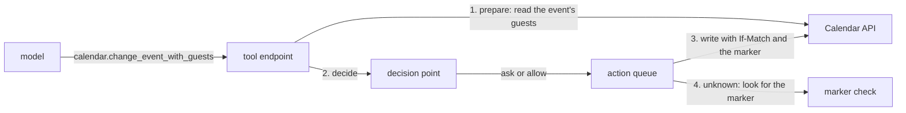

# Calendar and Drive tools

- **Status:** agreed
- **Work items:** [Calendar and Drive](https://linear.app/zgeoff/issue/GEO-1826). It builds on the
  [Google connection](google-connections.md) and the [Google tools](gmail-calendar-drive-tools.md),
  which hold the rules every Google tool keeps.

nixie reads and changes your calendar, and reads and writes the Drive files you give it. nixie asks
Google live for each read. Each change runs as an action under the decision point, and an event
change that emails guests is a send with its own tool. When an attempt's outcome is unknown, a
read-only check settles it: for a create or a change, it looks for a private marker that the change
wrote on the event or the file, and for a cancel or a response, it reads the event's status.

Read this page to build the [Calendar and Drive](https://linear.app/zgeoff/issue/GEO-1826) work
item, after the Gmail work item, whose shared attachment reader and `prepare` card fields it reuses.

## Shape



## Contracts

### The tools

| Tool                                | Effect  | Runs   | Scope                            | Reconciliation                    |
| ----------------------------------- | ------- | ------ | -------------------------------- | --------------------------------- |
| `calendar.list_calendars`           | `read`  | direct | `calendar.calendarlist.readonly` | none                              |
| `calendar.list_events`              | `read`  | direct | `calendar.events`                | none                              |
| `calendar.read_event`               | `read`  | direct | `calendar.events`                | none                              |
| `calendar.create_event`             | `write` | queued | `calendar.events`                | check: the event ID and marker    |
| `calendar.create_event_with_guests` | `send`  | queued | `calendar.events`                | check: the event ID and marker    |
| `calendar.change_event`             | `write` | queued | `calendar.events`                | check: the event's marker         |
| `calendar.change_event_with_guests` | `send`  | queued | `calendar.events`                | check: the event's marker         |
| `calendar.cancel_event`             | `write` | queued | `calendar.events`                | check: the event is cancelled     |
| `calendar.cancel_event_with_guests` | `send`  | queued | `calendar.events`                | check: the event is cancelled     |
| `calendar.respond`                  | `send`  | queued | `calendar.events`                | check: your response on the event |
| `drive.search`                      | `read`  | direct | `drive.file`                     | none                              |
| `drive.read`                        | `read`  | direct | `drive.file`                     | none                              |
| `drive.create`                      | `write` | queued | `drive.file`                     | check: the file's marker          |
| `drive.change`                      | `write` | queued | `drive.file`                     | check: the file's marker          |

nixie counts every attendee of an event as a guest, except the connection's own account: the
attendee whose `self` is true, or whose address is the account. A room or other resource counts as a
guest, because Google emails its owner.

```ts
calendar.list_events({
  calendar: 'primary',
  from: '2026-11-14T00:00:00+11:00',
  to: '2026-11-21T00:00:00+11:00',
});
// → { events: [{ event: 'k3x9m2p7qa.a1b2c3d4e5', title: 'Dentist', start: '2026-11-15T09:30:00+11:00',
//       end: '2026-11-15T10:15:00+11:00', isAllDay: false, location: '12 High St',
//       organizer: 'you@example.com', guests: [], yourResponse: null, status: 'confirmed' }],
//     next: null }

drive.read({ file: 'k3x9m2p7qa.1Bx9QvR2…', part: 1 });
// → { file, name: 'Trip plan', type: 'google_doc', modifiedAt: '2026-11-10T04:12:00Z',
//     text: '# Trip plan\n…', part: 1, parts: 3 }

calendar.create_event_with_guests({
  calendar: 'primary',
  title: 'Q3 review',
  start: '2026-11-18T14:00:00+11:00',
  end: '2026-11-18T14:30:00+11:00',
  guests: ['sam@example.org'],
});
// → done: { event: 'k3x9m2p7qa.0b9d3c4e7a214f0e8c551e6f2a9d4c03', link: 'https://www.google.com/calendar/event?eid=…' }

calendar.change_event_with_guests({
  event: 'k3x9m2p7qa.a1b2c3d4e5',
  start: '…',
  end: '…',
  addGuests: [],
  removeGuests: [],
});
calendar.cancel_event({ event: 'k3x9m2p7qa.a1b2c3d4e5' });
calendar.respond({ event: 'k3x9m2p7qa.k9x8w7v6u5', response: 'accepted' }); // accepted | declined | tentative

drive.create({ name: 'Trip plan', text: '# Trip plan\n…', as: 'google_doc' }); // google_doc | text
drive.change({ file: 'k3x9m2p7qa.1Bx9QvR2…', name: null, text: '# Trip plan\n…' }); // replaces the whole content
```

| Tool family | `owner_data`          | `untrusted`                                     | `untrusted` and endorsed                   |
| ----------- | --------------------- | ----------------------------------------------- | ------------------------------------------ |
| Calendar    | event, calendar, next | title, location, description, organizer, guests | start, end, isAllDay, status, yourResponse |
| Drive       | file, next            | name, text                                      | type, bytes, modifiedAt                    |

### Destinations and cards

| Tool                                | Its destinations                                     | Reply target  | Sentence                                             | Approve button   |
| ----------------------------------- | ---------------------------------------------------- | ------------- | ---------------------------------------------------- | ---------------- |
| `calendar.create_event_with_guests` | each guest                                           | none          | Invite {guests} to "{title}" on {start}              | Send invitations |
| `calendar.change_event_with_guests` | each guest before the change, and each guest it adds | none          | Change "{title}" on {start} and email {guests}       | Send changes     |
| `calendar.cancel_event_with_guests` | each guest of the event                              | none          | Cancel "{title}" on {start} and email {guests}       | Cancel and email |
| `calendar.respond`                  | the event's organizer                                | the organizer | Tell {organizer} you {response} "{title}" on {start} | Send response    |
| `calendar.create_event`             | none                                                 | none          | Add "{title}" on {start} to {calendar}               | Add event        |
| `calendar.change_event`             | none                                                 | none          | Change "{title}" on {start}                          | Change event     |
| `calendar.cancel_event`             | none                                                 | none          | Cancel "{title}" on {start}                          | Cancel event     |
| `drive.create`                      | none                                                 | none          | Create "{name}" in Drive                             | Create file      |
| `drive.change`                      | none                                                 | none          | Replace the content of "{name}"                      | Replace content  |

- `calendar.respond` and the change and cancel tools with guests read their destinations and card
  fields in `prepare`, as [the declarations](gmail-calendar-drive-tools.md#the-declarations) set
  out. `calendar.create_event_with_guests` takes its `guests` argument as its destinations.
- A calendar card shows the event's title, times with their zone, calendar, location and each guest.
  A change card shows each changed field before and after.
- A time in a sentence shows the date, the time and the zone, in the zone of the
  [time tool](../../architecture/connectors/time.md).

### The marker checks

Calendar uses `calendar.find_change`, and Drive uses `drive.find_change`, each a read-only check
with `trustNegativeAfterMs: 300_000`. A calendar create's event ID is the action ID without its
hyphens, which fits Google's base32hex event IDs. When that insert gets a 409, nixie reads the event
by its ID and answers done.

```ts
// The marker: one private property per action, written in the same request as its change. Each
// calendar create and change, drive.create and drive.change writes one; a cancel or a respond
// writes none. Calendar keeps it in extendedProperties.private, and Drive in appProperties, which
// only nixie's OAuth client reads.
// key: 'nixie' + the action ID without hyphens; value: the time the action was queued, as epoch
// seconds, the same for every attempt, so a search by key and value finds any attempt's write
{ 'nixie0b9d3c4e7a214f0e8c551e6f2a9d4c03': '1794550000' }
```

| Action             | Found when                                                  | Not found when                             |
| ------------------ | ----------------------------------------------------------- | ------------------------------------------ |
| a calendar create  | a read by the event ID, or a search by the marker, finds it | both answer with nothing                   |
| a calendar change  | the event holds the action's marker                         | the event lacks it, with under 10 markers  |
| a calendar cancel  | the event reads `cancelled`, or 404 or 410                  | the event reads `confirmed` or `tentative` |
| `calendar.respond` | the account's attendee entry holds the response             | never                                      |
| `drive.create`     | a file holds the marker, found by `appProperties` search    | the search finds none                      |
| `drive.change`     | the file holds the action's marker                          | the file lacks it, with under 10 markers   |

- Each write keeps the 10 newest of nixie's markers on the item and deletes the older ones, in the
  same request. A later action on the same item can run while an earlier one is unknown, and its
  marker must not hide the earlier one.
- A cancel's retry treats a 410 as done.

### The Drive picker

`drive.file` lets nixie see only the files it created and the files you pick for it. You pick files
on the connection's page in the web client:

1. You press "Choose Drive files". The page asks Google's sign-in library for an access token of its
   own, with the scope `drive.file`, `include_granted_scopes: false`, the connection's OAuth client
   ID, and the connection's account as `login_hint`. The page is served with
   `Cross-Origin-Opener-Policy: same-origin-allow-popups`, for Google's sign-in popup.
2. The page opens Google Picker with that token, the client's `picker_key`, and its `project_number`
   as the app ID.
3. The page sends the picked file IDs to `connections.checkPicked`, and shows the result.

```ts
// libs/contract, under `connections`: a read procedure. The server reads each file with the
// connection's own token. Files are Drive's own IDs, as the picker returns them.
connections.checkPicked({ connection: 'k3x9m2p7qa', files: ['1Bx9QvR2…', '1Zq7…'] });
// → [{ file: '1Bx9QvR2…', name: 'Trip plan', isVisible: true },
//    { file: '1Zq7…', name: null, isVisible: false }]   false: the server cannot read it
```

- A `drive.search` that finds nothing tells the model that it searched only the files you picked for
  nixie and the files nixie made, so the model can ask you to pick a file.
- The connection's tokens never reach the browser, because they carry `gmail.modify`. The browser's
  own token lives only in the page's memory, and the server never receives it.
- The page drops a token whose `scope` holds anything besides `drive.file`, with an error, before
  the picker sees it.
- The page shows each file that `checkPicked` cannot read as one nixie cannot see, and names the
  likely cause: a pick under another Google account.
- Without `picker_key` and `project_number`, the page hides the button and links the setup step.
- Picking a file sends nothing to the model. The description of `drive.search` tells the model where
  you pick files.

## Constraints

- A calendar tool without guests calls Google with `sendUpdates: 'none'`, and a with-guests tool
  with `'all'`, so a `write` tool never makes Google email anyone. `calendar.respond` is a `send`
  and calls Google with `'all'`, so the organizer gets your answer.
- A tool without guests has no guest argument. A with-guests tool refuses with `no_guests` when the
  event has no guest before the change and none after it.
- A change or cancel tool without guests reads the event before the decision point and again in its
  attempt, and refuses with `has_guests` when the event has one.
- The change and cancel tools refuse with `not_organizer` when the connection's account does not
  organize the event.
- The change and cancel tools with guests send the `etag` of the attempt's read in `If-Match`, so
  Google refuses the write with 412 when the event changed after that read. On a 412 the connector
  reads the event again: when the guests differ, it answers `destinations_changed`, and otherwise
  `refused_retryable`.
- With `calendar.calendarlist.readonly` missing, the Calendar tools take `primary` or a calendar ID
  you give.
- `drive.read` exports a Google Doc as Markdown, a Sheet's first sheet as CSV and a Slides file as
  plain text, and reads other files as `gmail.read_attachment` does. Each part returns the file's
  `modifiedAt`, so the model can tell when 2 parts come from different versions.
- `drive.change` reads the file in its attempt, and refuses with `shared_file` when the file is
  shared with anyone or sits in a shared drive, because a change there reaches each person who can
  read it.
- `drive.create` makes the file in your My Drive root, shared with no one. With `google_doc` it
  imports the text as Markdown into a Google Doc, and with `text` it makes a plain text file.

## Decisions

- **Every event change that emails guests is its own `…_with_guests` tool, with the `send` effect.**
  A tool's effects are fixed per tool, and an event with guests is a send.
- **`calendar.respond` is a `send`, and the organizer is its reply target.** Google emails the
  organizer, and an answer to an invitation needs no more permission than a reply.
- **Markers are one property per action, 10 kept.** A single marker would let a later action hide an
  earlier one, and Drive allows 30 private properties.
- **The picker runs on a browser token of its own.** The connection's token carries `gmail.modify`,
  which must never reach page code.
- **`drive.change` refuses a shared file**, so a Drive write never reaches another person.

## Builder decides

- Internal names and file layout.
- The wording of each refusal, and of each tool's description.
- The fake Calendar and Drive the tests use.

## Out of scope

- Deleting a Drive file.
- Sharing a Drive file, and changing a shared one:
  [Drive sharing](https://linear.app/zgeoff/issue/GEO-2648).
- PDF and other document text: [document text](https://linear.app/zgeoff/issue/GEO-2649).
- The calendar poll: [mail and calendar polls](mail-and-calendar-polls.md).
