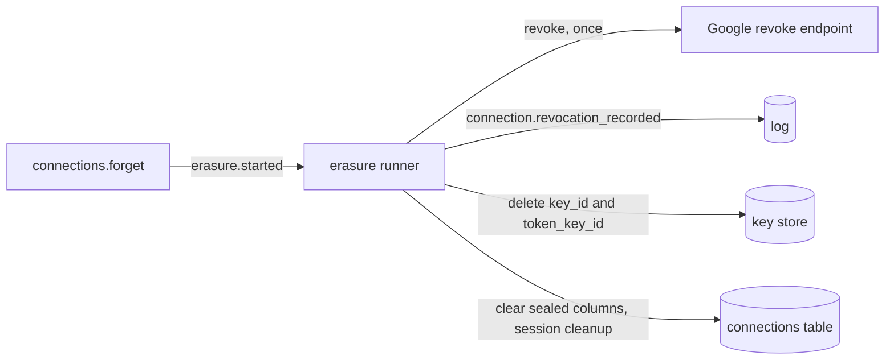

# Google connection store

- **Status:** draft
- **Work items:** [the connections](https://linear.app/zgeoff/issue/GEO-1824)
- **Decision records:** [0007](../../decisions/0007-crypto-shredding.md)

nixie keeps each Google connection in plain tables in `nixie.db`, with the refresh token, the
account and the label sealed under keys of the connection's own in the key store. It refreshes the
token, tracks the connection's status, and forgets the connection through the erasure runner: one
revocation at Google, then the keys go. This part is the credential store's database backend for
Google. [Google connections](google-connections.md) holds the connector, consent and the API that
read and write it.

## Shape



## Contracts

### The tables

```text
oauth_clients            plain table, connections module
  oauth_client_id        text  random UUID
  short_id               text  createShortID
  connector_id           text  'google'
  google_client_id       text  plain; it is no secret
  key_id                 text  random UUID in the key store; seals the secret
  secret_sealed          blob
  secret_fingerprint     text  the credential store's keyed fingerprint
  redirect_uri           text  origin + returnPath, fixed at registration
  picker_key             text? plain; the browser reads it
  project_number         text? plain
  created_at             int
  removed_at             int?  the key is gone

connections              plain table, connections module
  connection_id          text  random UUID
  short_id               text  createShortID
  connector_id           text
  oauth_client_id        text  FK
  key_id                 text  random UUID in the key store; seals account_sealed and label_sealed
  account_sealed         blob  { sub, email }
  label_sealed           blob
  token_key_id           text  random UUID in the key store; a new one at each rotation and consent
  refresh_token_sealed   blob  sealed under token_key_id
  token_fingerprint      text  the keyed fingerprint of the refresh token
  refresh_expires_at     int?  from refresh_token_expires_in, set when you grant access for a limited time
  granted_scopes         text  JSON array
  missing_scopes         text  JSON array of MissingScope
  status                 text  ConnectionStatus
  status_reason          text? unauthorised | service_error | no_answer
  status_since           int
  last_success_at        int?
  binding                text  enabled | removing | removed
  removal_counter        int   0 at creation

consent_requests         plain table, connections module
  consent_id             text  random UUID
  state_hash             text  SHA-256 of the state; the state is 32 random bytes
  device_session_id      text  the device session that started it
  oauth_client_id        text
  connection_id          text? set when you consent again
  scopes                 text  JSON array asked for
  key_id                 text  seals the PKCE verifier
  verifier_sealed        blob
  expires_at             int   10 min after the start
```

- Every sealed value binds its key ID, its table and its column as additional data, as
  [erasable fields](../../architecture/core/erasable-fields.md#keys) do. Each key is a row of the
  key store.
- `binding` and `removal_counter` are the credential store's binding and its counter. Forget and
  each consent again advance the counter, and every save checks it, so a refresh that began before
  either saves nothing.
- Access tokens stay in the server's memory, keyed by connection ID and removal counter, and never
  reach a table, a record or a log.

### The records

```text
connection.client_registered   { client, fingerprint }
connection.client_removed      { client }
connection.picker_set          { client }
connection.connected           { connection, shortID, scopes, missing, fingerprint, again }
connection.label_set           { connection }
credential.refreshed           { connection, counter, fingerprint, rotated }
credential.status_changed      { connection, status, reason }   reason: unauthorised | service_error | no_answer | null
connection.revocation_recorded { connection, outcome, status, googleError }
connection.consent_discarded   { reason, revocation }            reason: account_mismatch | connection_forgotten | forget_in_progress
```

- The connections module writes these. No kind belongs to a task thread or holds free text, so the
  log creates no record key for any of them.
- `again` is true for a consent that renews a connection. Every `fingerprint` is the credential
  store's keyed fingerprint.
- `outcome` is `confirmed`, `refused`, `unknown` or `not_attempted`. `status` is Google's HTTP
  status, and `googleError` comes from a fixed set.
- These records never hold a label, an account address or a `sub`, so the connection's keys cover
  every copy that the connection keeps. A Forget writes the erasure runner's `erasure.started` and
  `erasure.finished`, with the kind `credential`, beside these.

## Constraints

### Refresh and use

The store refreshes as [the credential store](https://github.com/zgeoff/nixie/pull/1414) sets out,
with these mappings of Google's answers:

| Google answers                               | The store                                                                 |
| -------------------------------------------- | ------------------------------------------------------------------------- |
| a token, with or without a new refresh token | saves it, records `credential.refreshed`, sets `active`                   |
| `invalid_grant`, `admin_policy_enforced`     | `needs_consent`                                                           |
| `invalid_client`, `unauthorized_client`      | `failing` with `unauthorised`, at once                                    |
| a 5xx, or no answer within 10 s              | backs off; `failing` with `service_error` or `no_answer` after 3 in a row |

- A rotated refresh token goes in the transaction of `credential.refreshed`, sealed under a new
  `token_key_id`, as the credential store sets out for a rotation.
- The key store holds keys and no owner, and a key is minted before the row that names it commits.
  So the connections module records each key ID in `nixie.db` before it mints the key, and clears
  the mark when the row that names it commits. The start and the hourly sweep delete each marked key
  that no row names, and each old token key a rotation left.
- A crash after Google answers and before that commit loses a rotated refresh token. When Google has
  spent the old one, the next refresh gets `invalid_grant` and the connection becomes
  `needs_consent`. The crash test checks that outcome, and that the row keeps the old token whole.
- A connection whose `refresh_expires_at` falls within 3 days is `expiring`. Past it, the connection
  is `needs_consent`. The refresh schedule checks the time on each pass and at start.
- When 2 statuses hold, the first of `needs_consent`, `failing` and `expiring` wins.
- The fetcher holds a shared lock on the connection for each request it sends. Forget takes the lock
  exclusive, after it aborts every request in flight on the connection. A request Google already
  received stays with Google.
- The fetcher refuses the hosts of `authorizeURL`, `tokenURL` and `revokeURL`, and every path under
  `/oauth2/` on any host, because `www.googleapis.com` also serves an older token endpoint. No tool
  then reaches a token or revocation endpoint.

### Forget

A Google connection has Forget and no Disconnect. Forget is an erasure of the kind `credential`,
which the connections module registers with the
[erasure runner](https://github.com/zgeoff/nixie/pull/1413):

- `start` sets the binding to `removing`, advances the counter and sets `forgotten`, in the
  transaction of `erasure.started`. The store refuses every fetch and refresh from then on.
  `erasure.started` marks the revocation attempt: a crash after it commits and before Google answers
  reads as `unknown`, whether or not the request went out.
- Its capture holds `key_id` and `token_key_id`, and the session cause `{ connectionID }`, a new
  cause for the conversation's
  [session cleanup](../../architecture/memory/context.md#forgetting-and-the-live-session).
- `readChildren` returns the connection's Gmail wake rules and held arrivals, which the
  [mail design](https://github.com/zgeoff/nixie/pull/1420) erases as children. Until that design is
  built, it returns none.
- `revoke` calls the store's `revoke`, which sends the refresh token to `revokeURL` once, with a 10
  s timeout, and writes `connection.revocation_recorded`: 200 is `confirmed`, 400 is `refused` with
  Google's error code, and anything else is `unknown`. It returns that outcome to the runner.
- When the key store lacks the token's key, such as after a restore, `revoke` sends nothing, records
  `not_attempted` and returns `unknown`.
- The runner's catch-up, which finds an attempt with no outcome, writes
  `connection.revocation_recorded` with `unknown` and never sends again.
- `cleanIndexes` clears the sealed columns and sets the binding to `removed`. The session cleanup
  deletes every session summary of the conversation and opens a new session, as a memory forget
  does, because a summary can hold the status line or the connection argument that named the
  connection.
- `readForgetStatus` reads `revocation` from `connection.revocation_recorded`, and is `pending`
  until one exists.
- The web client shows erasure, revocation and backup state apart. Beside a revocation that is not
  `confirmed`, it links the guide's section on revoking by hand.
- A forgotten connection keeps its row, with its short ID and scopes and no sealed value, so a job
  pin can name it.
- Forget erases nixie's own copies of the connection: its tokens, label and account. Text that names
  the account elsewhere, such as a message, a summary or a tool result, keeps its own key, and you
  remove it with the forget of that record.
- `removeClient` deletes the client's key and checkpoints the key store, and needs no revocation:
  Google keeps the client until you delete it in the console.

### Backups, resets and rollbacks

- A full [reset](../../architecture/core/event-log.md#the-reset) makes one revocation attempt per
  live connection before it deletes the keys, 10 s each. Its answer gains
  `revocations: { connection: string; outcome: Revocation }[]`. A failed attempt never stops the
  reset. A reset of the conversation leaves connections alone. This work adds the revocations to the
  reset.
- A restore of a data copy from before a Forget meets a connection whose keys are gone. At start,
  the server begins a Forget of each connection whose binding is `enabled` and whose `token_key_id`
  the key store lacks, and that Forget records `not_attempted`.
- A restore of a data copy from before a connection existed loses the connection, and its grant
  stays live at Google. The restore steps ask you to check the third-party access page of each
  Google account you connected.
- A Forget left part way finishes only at the server start of a release that has this design.

## Decisions

- **Forget only, with no Disconnect.** A paused token still sits in the database and its backups,
  and a pause is rare for one person.
- **Connections are plain tables beside audit records.** A token changes at runtime, and a
  projection would put every value into the append-only log.
- **Label, account and tokens sit under the connection's keys, and no record carries them.** Forget
  then erases every copy the connection keeps.
- **Access tokens stay in memory.** A restart costs one refresh, and the database holds one secret
  per connection.
- **One revocation attempt, recorded before it is sent.** A crash then reads as `unknown`, and a
  second request could revoke a grant that a consent made after the Forget.

## Builder decides

- Which module holds the store's code beside its tables.
- How the connections module marks a key ID before it mints the key.
- How the fetcher's lock and abort are built, within the constraint.
- The layout of the tests, and the kill points of the crash tests.

## Out of scope

- A Disconnect or a pause for a Google connection.
- Finding and forgetting the records whose text names a forgotten account.
