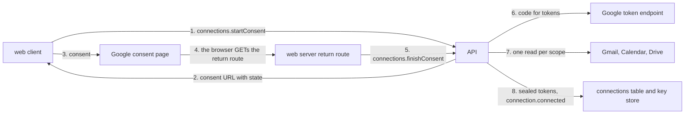

# Google connections

- **Status:** agreed
- **Work items:** [the connections](https://linear.app/zgeoff/issue/GEO-1824).
- **Decision records:** [0010](../../decisions/0010-oauth-clients.md),
  [0007](../../decisions/0007-crypto-shredding.md)

You connect a Google account from the web client. You register your own OAuth client once, consent
on Google's page, and Google sends your browser back to nixie. nixie keeps the refresh token sealed
in its database, refreshes it, and shows each connection's status. To stop nixie using the account,
you Forget the connection: nixie revokes the grant at Google and deletes the connection's keys, so
the tokens are unreadable at once in the database, and in every backup once the backup job prunes
the key repository ([backups](../../architecture/deployment/backups.md)). Using the account again
takes a fresh consent.

Every Google tool reads Google live. nixie keeps no copy of your mail, events or files, and the text
a tool returned lives only in that call's record.

The owner reads this page to approve the Google design and settle its open questions. A builder
reads it, then the part that their work item builds. The Google design has these parts:

| Part                                                        | What it holds                                                                        |
| ----------------------------------------------------------- | ------------------------------------------------------------------------------------ |
| this page                                                   | the connector, the setup steps, the API, consent and fewer scopes                    |
| [the connection store](google-connection-store.md)          | the tables, the records, refresh, Forget and resets                                  |
| [the Google tools](gmail-calendar-drive-tools.md)           | the rules every Google tool keeps, and the `gmail.*` tools                           |
| [Calendar and Drive tools](google-calendar-drive-tools.md)  | the `calendar.*` and `drive.*` tools, their checks and the Drive picker              |
| [Gmail arrivals](https://github.com/zgeoff/nixie/pull/1420) | the Gmail source that wakes a task, and the `gmail.wake_*` tools, in the mail design |
| [the calendar poll](mail-and-calendar-polls.md)             | calendar changes that wake a task                                                    |

The connection work item:

- **Needs first** the parts of 2 unbuilt designs that Google uses, each built by its own work items
  once the owner approves it: from the
  [credential store](https://github.com/zgeoff/nixie/pull/1414), at that pull request's version, the
  fetcher, the keyed fingerprint, the own-value set, the binding with its removal counter,
  `exchange` and `refresh`; from the [erasure runner](https://github.com/zgeoff/nixie/pull/1413),
  the runner with the `credential` kind.
- **Adds** the store's database backend, for Google alone; the Google parts of the
  [connector interface](../platform/connectors/connector.md), with the existing connectors moved
  onto the new `Connector` shape; the picker settings, which the Calendar and Drive work reads; and
  the filter that leaves out a tool whose scope is missing, tested against a fixture action.
- **Leaves** the connection argument, job pins and the model's status line to the first Google
  tools, in [Gmail](https://linear.app/zgeoff/issue/GEO-1825).

The connections module depends on the credentials module and never the other way. The connections
module writes every `connection.*` and `credential.*` record.

## Shape



## Contracts

### The connector

```ts
// connectors module. Extends Connector and HealthReport; OAuthSpec and SetupStep are new.
// The connections module owns the tables of the connection store in nixie.db and their keys in
// keys.db, and is the credential store's database backend. A CredentialRef there is a connection ID.
const googleConnector: Connector = {
  id: 'google',
  auth: googleOAuth,
  setup: googleSetup, // see "The setup steps"
  // …existing fields: actions, check
};

interface OAuthSpec {
  kind: 'oauth';
  authorizeURL: string; // 'https://accounts.google.com/o/oauth2/v2/auth'
  tokenURL: string; // 'https://oauth2.googleapis.com/token'
  revokeURL: string; // 'https://oauth2.googleapis.com/revoke'
  identityScopes: string[]; // ['openid', 'email']: the account, whatever else you untick
  // ['gmail.modify', 'calendar.events', 'calendar.calendarlist.readonly', 'drive.file']: every
  // consent asks for all 4. nixie stores, records and shows the short name; it adds
  // 'https://www.googleapis.com/auth/' at Google and strips it from Google's answers.
  scopes: string[];
  authorizeParams: Record<string, string>; // { access_type: 'offline', prompt: 'consent', include_granted_scopes: 'true' }
  origins: string[]; // ['https://gmail.googleapis.com', 'https://www.googleapis.com']: the fetcher's origins
  returnPath: string; // '/connections/google/return'
}

interface SetupStep {
  id: string; // stable, such as 'client'; the guide's sections match these one to one
  title: string;
  body: string; // template text; {redirectURI} and {origin} are the only placeholders
  links: { label: string; url: string }[];
  input?: 'oauth_client'; // the step that shows the OAuth client form
}

interface HealthReport {
  // …existing fields; Google's check reports accountName null
  missing: MissingScope[]; // each scope in OAuthSpec.scopes that check found missing
}

// connections module: what a Google tool, attempt or check gets for one connection. The tool
// endpoint maps a short ID to the connection ID before it calls.
connections.readContext('6f1c2a9e-…'); // the connection ID, a UUID, as the Gmail source passes it
// → { connectionID: '6f1c2a9e-…', connection: 'k3x9m2p7qa', account: 'you@example.com', fetch }
//   or null when the connection is not live
interface ConnectorContext {
  connectionID: string;
  connection: string; // the short ID
  account: string; // the ID token's email, decrypted at each call
  fetch: typeof fetch; // the credential store's fetcher for this connection, limited to OAuthSpec.origins
}

// credentials module: the database backend's methods (credential store design), plus revoke.
// A connection's binding ID is its connection ID, and an OAuth client's is its client ID; the
// store registers both from their rows at start.
interface HeldCredentials {
  // …existing methods: exchange, refresh
  // revoke sits beside them because it sends the refresh token, which only the store reads
  revoke(binding: BindingRef): Promise<RevokeResult>; // sends the refresh token once
}
type TokenResult = {
  idToken: { sub: string; email: string } | null; // checked as below; null on a refresh
  grantedScopes: string[]; // short names
  refreshExpiresAt: number | null; // from refresh_token_expires_in
  accessExpiresAt: number; // the access token stays in the store's memory
};
type RevokeResult = {
  outcome: 'confirmed' | 'refused' | 'unknown' | 'not_attempted';
  status: number | null;
  googleError: string | null;
};
```

`Connector.auth` gains `OAuthSpec`, and `check` takes `(connection, context)` as the connector
design sets. The existing connectors keep `{ kind: 'none' }`, an empty `setup`, and their behaviour.
`StaticSpec` comes with the first connector that needs it. The default label of a Google connection
is the ID token's `email`.

nixie reads the account from the ID token in the token response, never from `check`. Google sends
that ID token straight to nixie over TLS, so nixie checks no signature. An ID token from any other
path would need its signature checked, and nixie reads none. It checks the issuer, the audience and
the expiry, then reads `sub` as the account's identity and `email` as its account name.

### The setup steps

The web client shows these steps in order, from the connector's data. Each step links its page in
the Google Auth Platform console or the API library.

| `id`       | Title                         | What it says                                                                                                                                                                                                                                                                                                  |
| ---------- | ----------------------------- | ------------------------------------------------------------------------------------------------------------------------------------------------------------------------------------------------------------------------------------------------------------------------------------------------------------- |
| `project`  | Create a Google Cloud project | Create one project for this nixie alone. A revocation reaches every client of a project, so one deployment's revocation would end another deployment's grant.                                                                                                                                                 |
| `apis`     | Turn on the APIs              | Enable the Gmail, Google Calendar, Google Drive and Google Picker APIs.                                                                                                                                                                                                                                       |
| `branding` | Fill in the branding          | Give an app name, your email, and a home page and a privacy policy URL on a domain you control. Publishing needs both URLs.                                                                                                                                                                                   |
| `audience` | Publish the app               | Choose External, then publish to production with no test users. In testing status, Google ends each consent after 7 days.                                                                                                                                                                                     |
| `client`   | Create a web client           | Create a Web application client with `{redirectURI}` as its only redirect URI and `{origin}` as its JavaScript origin. Create an API key restricted to the Picker API, with `{origin}` and `https://docs.google.com/*` as its websites. Paste the client ID, the secret, the key and the project number here. |
| `consent`  | Connect an account            | Consent on Google's page. An account that does not own the project sees "Google hasn't verified this app" first.                                                                                                                                                                                              |

The setup guide, `docs/guides/google.md`, holds the same 6 steps under the same titles, with what to
click. It adds a section on the warning page, and one on revoking a grant by hand at your Google
Account's third-party access page. The guide and the step data ship in one PR.

### The API

```ts
// libs/contract, under `connections`. Each procedure that takes a clientActionID is a checked action.
// readSetup, list and readForgetStatus are reads, and finishConsent is keyed by state.
connections.readSetup({ connector: 'google', origin: 'https://nixie.example.org' });
// → { steps: [{ id: 'project', title, body, links }, …],   placeholders filled from the registered
//     client's origin, or from the page's origin before you register one
//     client: null | { client: 'q7m2x9k4ta', origin, redirectURI, fingerprint, pickerKey, projectNumber } }

connections.registerClient({
  clientActionID,
  connector: 'google',
  clientID,
  clientSecret,
  origin: 'https://nixie.example.org',
  pickerKey: 'AIza…', // optional; the Drive picker's API key, which the browser reads
  projectNumber: '123456789012', // optional; the picker's app ID
});
// → { client: 'q7m2x9k4ta', redirectURI: 'https://nixie.example.org/connections/google/return' }
//   or INVALID_ORIGIN: not https, holds a path, a query or a user name, or differs from the call's Origin header
//   or CLIENT_EXISTS: one client per connector that is not removed

connections.setPicker({
  clientActionID,
  client: 'q7m2x9k4ta',
  pickerKey: 'AIza…',
  projectNumber: '123456789012',
});
// → ok; both values, or null for both to remove them

connections.removeClient({ clientActionID, client: 'q7m2x9k4ta' });
// → ok, or CLIENT_IN_USE while a connection that is not forgotten, or a consent request that has
//   not lapsed, uses it

connections.startConsent({ clientActionID, connector: 'google', connection: null });
// → { consentURL: 'https://accounts.google.com/o/oauth2/v2/auth?…&state=…', expiresAt }
//   connection: null for a new account; a connection's short ID to consent again, which renews
//   it after needs_consent or asks again for its missing scopes
//   or CLIENT_MISSING, CONNECTION_NOT_FOUND

connections.finishConsent({ state, code: '4/0Ab…', error: null });
// → { connection: 'k3x9m2p7qa', missing: [{ scope: 'gmail.modify', reason: 'not_granted' }] }
//   or CONSENT_NOT_FOUND: unknown, used, lapsed, or started by another device session
//   or CONSENT_REFUSED: Google returned an error, such as access_denied
//   or TOKEN_EXCHANGE_FAILED { googleError: 'invalid_client' }: from a fixed set, never free text
//   or NO_REFRESH_TOKEN, ACCOUNT_MISMATCH
//   or FORGET_IN_PROGRESS: the account's Forget did not finish within 30 s; consent again later

connections.setLabel({ clientActionID, connection: 'k3x9m2p7qa', label: 'Work' });
// → ok, or LABEL_TAKEN under the label rule of the connection argument (connector design)

connections.forget({ clientActionID, connection: 'k3x9m2p7qa' });
// → { erasure: 'done', revocation: 'confirmed', backup: { state: 'pending' } }
//   it runs the Forget to its end before it answers, as every forget route does; the backup stays
//   pending until a published backup set covers the Forget
//   after a failed step: { erasure: 'pending', revocation: 'unknown', … }, which the runner's
//   catch-up finishes

connections.readForgetStatus({ connections: ['k3x9m2p7qa'] });
// → [{ connection: 'k3x9m2p7qa', erasure: 'done', revocation: 'confirmed', backup: { state: 'complete' } }]
//   or CONNECTION_NOT_FOUND for a short ID that no connection holds

connections.list();
// → [{ connection, connector, label, account, status, reason, statusSince, lastSuccessAt,
//      scopes, missing, fingerprint, forget: null | ForgetStatus }]
//   a forgotten connection lists with label and account null
```

```ts
// libs/contract
type Erasure = 'pending' | 'done';
type Revocation = 'pending' | 'confirmed' | 'refused' | 'unknown' | 'not_attempted';
type ConnectionStatus = 'active' | 'failing' | 'needs_consent' | 'expiring' | 'forgotten'; // expiring: a time-limited grant ends within 3 days
type ForgetStatus = { erasure: Erasure; revocation: Revocation; backup: ForgetBackup };
type ForgetBackup = z.infer<typeof forgetBackupSchema>; // libs/contract: off, pending, failed, complete, unknown
type MissingScope = { scope: string; reason: 'not_granted' | 'api_disabled' };
```

[Checked actions](../../architecture/channels/api.md#checked-actions) keep each action's first
result beside a hash of its input, so a retry with the same `clientActionID` gets that result.

- The hash leaves out `clientSecret` and `label`. To allow that, the shared input hash gains a list
  of fields to leave out. A hash of a secret is a copy of it, and a hash of a label outlives a
  Forget and confirms a guess at the label. A retry with another secret gets the first result.
- `startConsent` stores its consent ID and `expiresAt` as its result, never the URL. A retry gets a
  fresh `state` and consent URL, which replace the first ones and keep the first `expiresAt`.
- The API passes the request's `Origin` header to `registerClient`, which compares it with `origin`.
- `finishConsent` takes no `clientActionID`, because each `state` works once.

### The return route

```http
GET /connections/google/return?state=…&code=4/0Ab…&scope=… HTTP/1.1
Cookie: <the device session>

HTTP/1.1 303 See Other
Location: /settings/connections/k3x9m2p7qa
Cache-Control: no-store
Referrer-Policy: no-referrer
```

The web server serves the route, because every path outside `/rpc` reaches it. Its handler calls
`connections.finishConsent` with the browser's session as a bearer token, as a render does
([the client path](../../architecture/overview.md#the-client-path)). On success it answers 303 to
the connection's page, which shows `missing`. On an error it renders an error page with status 400,
which shows the error code, and Google's error code for `TOKEN_EXCHANGE_FAILED`. Every API procedure
stays a `POST` with nixie's custom client header
([a call's way in](../../architecture/channels/api.md#a-calls-way-in)).

## Constraints

### Consent

- `startConsent` asks for `identityScopes` and `scopes`, with `state`, PKCE S256 and
  `authorizeParams`. `prompt: 'consent'` makes Google issue a refresh token on every consent.
- `state` is bound to the device session that started it. A call from another session, or after
  `expires_at`, answers `CONSENT_NOT_FOUND`, so a link that an attacker sends you cannot attach the
  attacker's account.
- The token exchange runs through the store's `exchange`, which sends the OAuth client secret, the
  PKCE verifier and the stored `redirect_uri`. The security of the return rests on `state` and the
  client secret, never on PKCE.
- `finishConsent` deletes the consent request's key, then deletes the request in the transaction
  that records the outcome, success or refusal. A sweep at start and every hour deletes each lapsed
  request, and each request whose key is gone, with its key.
- A token response without a refresh token answers `NO_REFRESH_TOKEN` and keeps nothing.
- A consent whose `sub` matches a live connection counts as a consent again for that connection. It
  replaces the refresh token under a new `token_key_id`, the scopes and `missing`, sets `active`,
  and advances the counter.
- A consent again whose `sub` differs from its connection's answers `ACCOUNT_MISMATCH`.
- A consent whose `sub` matches a connection under Forget waits up to 30 s for the Forget to finish,
  then makes a new connection. When the Forget is still running, it answers `FORGET_IN_PROGRESS`.
- To match a `sub` or check `LABEL_TAKEN`, nixie decrypts the account or label of each live
  connection, because it keeps no hash of either.
- `removeClient` answers `CLIENT_IN_USE` while a consent request that has not lapsed names the
  client, so no token exchange runs on a removed client. `finishConsent` refuses a lapsed request
  before it exchanges.
- After `ACCOUNT_MISMATCH` or `FORGET_IN_PROGRESS`, or when its connection was forgotten during the
  consent, `finishConsent` keeps no token. After its transaction commits, it makes one revocation
  attempt and records `connection.consent_discarded` with the outcome. It skips that attempt when a
  live connection reaches the same account, because Google's revocation ends the whole grant.
- The return route's handler and the web server's request log never record the query string.

### Fewer scopes

| Scope                            | The tools it holds                                       |
| -------------------------------- | -------------------------------------------------------- |
| `gmail.modify`                   | every `gmail.*` tool                                     |
| `calendar.events`                | every `calendar.*` tool except `calendar.list_calendars` |
| `calendar.calendarlist.readonly` | `calendar.list_calendars`                                |
| `drive.file`                     | every `drive.*` tool, and the Drive picker               |

- `check` makes one read call per scope in `scopes`, after each consent and once a day. For
  `calendar.calendarlist.readonly` it reads the calendar list. A scope Google did not grant is
  `not_granted`. A scope whose call Google refuses because the project has not enabled its API is
  `api_disabled`, and the daily `check` clears it once you enable the API.
- The tool endpoint of each task run and worker run leaves out each tool whose scope is in
  `missing`.
- The connection's page shows each missing scope with its reason and the tools it holds back, and
  one button that runs `startConsent` for the connection. The connections list marks the connection
  the same way. The conversation never shows the notice. The notice stays until a `check` clears
  `missing`.
- A connection with only the identity scopes still connects, and lists no tools.

### Tasks that already run

- The conversation's endpoint builds its tool list at each turn from the live connections, so a new
  connection, a Forget or a change in `missing` reaches the conversation at its next turn. A worker
  run keeps its list for its life, and a job run keeps its pins, as
  [the connection argument](../platform/connectors/connector.md#the-connection-argument) sets.
- Every call checks the connection at the time of the call. A call to a forgotten connection fails
  with the error for a `forgotten` credential, which never holds the connection's label or status.
- A job whose pins all name forgotten connections lists none of the connector's tools.

## Decisions

- **One OAuth client per connector, registered by you.** Each deployment registers its own client.
  [0010](../../decisions/0010-oauth-clients.md)
- **The names are the `connections.*` procedures, the `connection.*` and `credential.*` record
  kinds, "Settings → Connections" and `/connections/google/return`.**
- **The fewer-scopes notice shows on the connection's page and in the connections list, never in the
  conversation.**
- **The account comes from the ID token, with `openid` and `email` asked for.** Google grants the
  sign-in scopes without a checkbox, so nixie knows the account when you untick Gmail, and `sub`
  survives an address change.
- **The return route is a web server route that calls a procedure.** The API keeps one way in, and
  the browser's `Lax` cookie reaches a top-level navigation from Google.
- **The redirect URI comes from the page's origin at registration.** Google checks it against the
  OAuth client, and a config key would be one more value to keep in step with the client.
- **A consent for an account already connected updates that connection.** A second connection would
  leave a second grant at Google, and revoking either would end both.
- **The return route lives on the deployment's own https name, even one that resolves only inside
  its private network, and nixie always sends PKCE.** The browser, not Google, follows the redirect,
  and Google accepts both on a Web application client, as
  [the OAuth spike](../../../research/google-oauth/results.md#the-web-application-client) found.

## Builder decides

- Internal names and file layout.
- The wording of each error, of the setup steps' bodies and of the guide.
- The read call that `check` makes per scope.
- Where Settings → Connections sits in the web client's navigation, and the layout of its pages,
  which the owner reviews on the build's pull request.

## Out of scope

- A second OAuth client per connector, and connectors from other providers.
