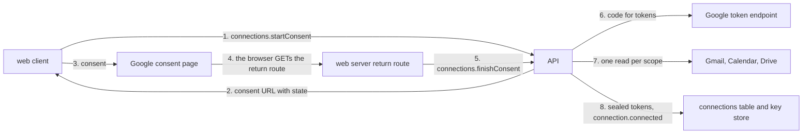

# Google connections

- **Status:** draft
- **Work items:** [the connections](https://linear.app/zgeoff/issue/GEO-1824). The return route
  waits on [the OAuth return spike](https://linear.app/zgeoff/issue/GEO-267).
- **Decision records:** [0010](../../decisions/0010-oauth-clients.md),
  [0007](../../decisions/0007-crypto-shredding.md)

You connect a Google account from the web client. You register your own OAuth client once, consent
on Google's page, and Google sends your browser back to nixie. nixie keeps the refresh token sealed
in its database, refreshes it, and shows each connection's status. To stop nixie using the account,
you Forget the connection: nixie revokes the grant at Google and deletes the connection's keys, so
the tokens are unreadable at once in the database, and in every backup once the backup job prunes
the key repository ([backups](../../architecture/deployment/backups.md)). Using the account again
takes a fresh consent.

The Google design has 4 parts:

| Part                                                        | What it holds                                                                        |
| ----------------------------------------------------------- | ------------------------------------------------------------------------------------ |
| this page                                                   | the connector, consent, scopes, refresh, re-consent and Forget                       |
| [the Google tools](gmail-calendar-drive-tools.md)           | the `gmail.*`, `calendar.*` and `drive.*` tools, their effects and destinations      |
| [Gmail arrivals](https://github.com/zgeoff/nixie/pull/1420) | the Gmail source that wakes a task, and the `gmail.wake_*` tools, in the mail design |
| [the calendar poll](mail-and-calendar-polls.md)             | calendar changes that wake a task                                                    |

Every Google tool reads Google live. nixie keeps no copy of your mail, events or files, and the text
a tool returned lives only in that call's record.

This page builds the database backend of the
[credential store](https://github.com/zgeoff/nixie/pull/1414) for its one connector, Google, and the
[connector interface](../platform/connectors/connector.md) in code. Forget runs on the
[erasure runner](https://github.com/zgeoff/nixie/pull/1413).

## Shape



## Contracts

### The connector

```ts
// connectors module. Extends Connector and HealthReport; OAuthSpec and SetupStep are new.
// The connections module owns the tables below in nixie.db and their keys in keys.db, and is the
// credential store's database backend. A CredentialRef there is a connection ID.
const googleConnector: Connector = {
  id: 'google',
  auth: googleOAuth,
  setup: googleSetup, // see "The setup steps"
  // …existing fields: actions, check
};

interface OAuthSpec {
  kind: 'oauth';
  authorizeURL: string; // 'https://accounts.google.com/o/oauth2/v2/auth'
  tokenURL: string; // 'https://oauth2.googleapis.com/token'
  revokeURL: string; // 'https://oauth2.googleapis.com/revoke'
  identityScopes: string[]; // ['openid', 'email']: the account, whatever else you untick
  scopes: string[]; // ['gmail.modify', 'calendar.events', 'calendar.calendarlist.readonly', 'drive.file']: every consent asks for all 4
  authorizeParams: Record<string, string>; // { access_type: 'offline', prompt: 'consent', include_granted_scopes: 'true' }
  origins: string[]; // ['https://gmail.googleapis.com', 'https://www.googleapis.com']: the fetcher's origins
  returnPath: string; // '/connections/google/return'
}

interface SetupStep {
  id: string; // stable, such as 'client'; the guide's sections match these one to one
  title: string;
  body: string; // template text; {redirectURI} and {origin} are the only placeholders
  links: { label: string; url: string }[];
  input?: 'oauth_client'; // the step that shows the OAuth client form
}

interface HealthReport {
  // …existing fields
  missing: MissingScope[]; // each scope in OAuthSpec.scopes that check found missing
}
```

nixie reads the account from the ID token in the token response, never from `check`. Google sends
the ID token straight to nixie over TLS, so nixie checks no signature. It checks the issuer, the
audience and the expiry, then reads `sub` as the account's identity and `email` as its account name.

### The setup steps

The web client shows these steps in order, from the connector's data. Each step links its page in
the Google Auth Platform console or the API library.

| `id`       | Title                         | What it says                                                                                                                                                                                                                                                                                                  |
| ---------- | ----------------------------- | ------------------------------------------------------------------------------------------------------------------------------------------------------------------------------------------------------------------------------------------------------------------------------------------------------------- |
| `project`  | Create a Google Cloud project | Create one project for this nixie alone. A revocation reaches every client of a project, so one deployment's revocation would end another deployment's grant.                                                                                                                                                 |
| `apis`     | Turn on the APIs              | Enable the Gmail, Google Calendar, Google Drive and Google Picker APIs.                                                                                                                                                                                                                                       |
| `branding` | Fill in the branding          | Give an app name, your email, and a home page and a privacy policy URL on a domain you control. Publishing needs both URLs.                                                                                                                                                                                   |
| `audience` | Publish the app               | Choose External, then publish to production with no test users. In testing status, Google ends each consent after 7 days.                                                                                                                                                                                     |
| `client`   | Create a web client           | Create a Web application client with `{redirectURI}` as its only redirect URI and `{origin}` as its JavaScript origin. Create an API key restricted to the Picker API, with `{origin}` and `https://docs.google.com/*` as its websites. Paste the client ID, the secret, the key and the project number here. |
| `consent`  | Connect an account            | Consent on Google's page. An account that does not own the project sees "Google hasn't verified this app" first.                                                                                                                                                                                              |

The setup guide, `docs/guides/google.md`, holds the same 6 steps under the same titles, with what to
click. It adds a section on the warning page, and one on revoking a grant by hand at your Google
Account's third-party access page. The guide and the step data ship in one PR.

### The API

```ts
// libs/contract, under `connections`. Each procedure that takes a clientActionID is a checked action.
// list and readForgetStatus are reads, and finishConsent is keyed by state.
connections.registerClient({
  clientActionID,
  connector: 'google',
  clientID,
  clientSecret,
  origin: 'https://nixie.example.org',
  pickerKey: 'AIza…', // optional; the Drive picker's API key, which the browser reads
  projectNumber: '123456789012', // optional; the picker's app ID
});
// → { client: 'q7m2x9k4ta', redirectURI: 'https://nixie.example.org/connections/google/return' }
//   or INVALID_ORIGIN: not https, holds a path, a query or a user name, or differs from the call's Origin header
//   or CLIENT_EXISTS: one client per connector that is not removed

connections.removeClient({ clientActionID, client: 'q7m2x9k4ta' });
// → ok, or CLIENT_IN_USE while a connection that is not forgotten, or a consent request, uses it

connections.startConsent({ clientActionID, connector: 'google', connection: null });
// → { consentURL: 'https://accounts.google.com/o/oauth2/v2/auth?…&state=…', expiresAt }
//   connection: null for a new account; a connection's short ID to consent again, which renews
//   it after needs_consent or asks again for its missing scopes
//   or CLIENT_MISSING, CONNECTION_NOT_FOUND

connections.finishConsent({ state, code: '4/0Ab…', error: null });
// → { connection: 'k3x9m2p7qa', missing: [{ scope: 'gmail.modify', reason: 'not_granted' }] }
//   or CONSENT_NOT_FOUND: unknown, used, lapsed, or started by another device session
//   or CONSENT_REFUSED: Google returned an error, such as access_denied
//   or TOKEN_EXCHANGE_FAILED { googleError: 'invalid_client' }: from a fixed set, never free text
//   or NO_REFRESH_TOKEN, ACCOUNT_MISMATCH

connections.setLabel({ clientActionID, connection: 'k3x9m2p7qa', label: 'Work' });
// → ok, or LABEL_TAKEN under the label rule of the connection argument (connector design)

connections.forget({ clientActionID, connection: 'k3x9m2p7qa' });
// → { erasure: 'pending', revocation: 'pending', backup: { state: 'pending' } }

connections.readForgetStatus({ connections: ['k3x9m2p7qa'] });
// → [{ connection: 'k3x9m2p7qa', erasure: 'done', revocation: 'confirmed', backup: { state: 'complete' } }]
//   or CONNECTION_NOT_FOUND for a short ID that no connection holds

connections.list();
// → [{ connection, connector, label, account, status, reason, statusSince, lastSuccessAt,
//      scopes, missing, fingerprint, forget: null | ForgetStatus }]
//   a forgotten connection lists with label and account null
```

```ts
// libs/contract
type Erasure = 'pending' | 'done';
type Revocation = 'pending' | 'confirmed' | 'refused' | 'unknown' | 'not_attempted';
type ConnectionStatus = 'active' | 'failing' | 'needs_consent' | 'expiring' | 'forgotten';
type ForgetStatus = { erasure: Erasure; revocation: Revocation; backup: ForgetBackup };
type ForgetBackup = z.infer<typeof forgetBackupSchema>; // libs/contract: off, pending, failed, complete, unknown
type MissingScope = { scope: string; reason: 'not_granted' | 'api_disabled' };
```

[Checked actions](../../architecture/channels/api.md#checked-actions) keep each action's first
result beside a hash of its input, so a retry with the same `clientActionID` gets that result.

- The hash leaves out `clientSecret` and `label`. A hash of a secret is a copy of it, and a hash of
  a label outlives a Forget and confirms a guess at the label.
- A retry of `startConsent` gets a fresh `state` and consent URL, which replace the first ones and
  keep the first `expiresAt`.
- `finishConsent` takes no `clientActionID`, because each `state` works once.

### The return route

```http
GET /connections/google/return?state=…&code=4/0Ab…&scope=… HTTP/1.1
Cookie: <the device session>

HTTP/1.1 303 See Other
Location: /settings/connections/k3x9m2p7qa
Cache-Control: no-store
Referrer-Policy: no-referrer
```

The web server serves the route, because every path outside `/rpc` reaches it. Its handler calls
`connections.finishConsent` with the browser's session as a bearer token, as a render does
([the client path](../../architecture/overview.md#the-client-path)). On success it answers 303 to
the connection's page, which shows `missing`. On an error it renders an error page with status 400,
which shows the error code, and Google's error code for `TOKEN_EXCHANGE_FAILED`. Every API procedure
stays a `POST` with nixie's custom client header
([a call's way in](../../architecture/channels/api.md#a-calls-way-in)).

### The tables

```text
oauth_clients            plain table, connections module
  oauth_client_id        text  random UUID
  short_id               text  createShortID
  connector_id           text  'google'
  google_client_id       text  plain; it is no secret
  key_id                 text  random UUID in the key store; seals the secret
  secret_sealed          blob
  secret_fingerprint     text  the credential store's keyed fingerprint
  redirect_uri           text  origin + returnPath, fixed at registration
  picker_key             text? plain; the browser reads it
  project_number         text? plain
  created_at             int
  removed_at             int?  the key is gone

connections              plain table, connections module
  connection_id          text  random UUID
  short_id               text  createShortID
  connector_id           text
  oauth_client_id        text  FK
  key_id                 text  random UUID in the key store; seals account_sealed and label_sealed
  account_sealed         blob  { sub, email }
  label_sealed           blob
  token_key_id           text  random UUID in the key store; a new one at each rotation and consent
  refresh_token_sealed   blob  sealed under token_key_id
  token_fingerprint      text  the keyed fingerprint of the refresh token
  refresh_expires_at     int?  from refresh_token_expires_in, set when you grant access for a limited time
  granted_scopes         text  JSON array
  missing_scopes         text  JSON array of MissingScope
  status                 text  ConnectionStatus
  status_reason          text? unauthorised | service_error | no_answer
  status_since           int
  last_success_at        int?
  binding                text  enabled | removing | removed
  removal_counter        int   0 at creation

consent_requests         plain table, connections module
  consent_id             text  random UUID
  state_hash             text  SHA-256 of the state; the state is 32 random bytes
  device_session_id      text  the device session that started it
  oauth_client_id        text
  connection_id          text? set when you consent again
  scopes                 text  JSON array asked for
  key_id                 text  seals the PKCE verifier
  verifier_sealed        blob
  expires_at             int   10 min after the start
```

- Every sealed value binds its key ID, its table and its column as additional data, as
  [erasable fields](../../architecture/core/erasable-fields.md#keys) do. Each key is a row of the
  key store.
- `binding` and `removal_counter` are the credential store's binding and its counter. Forget and
  each consent again advance the counter, and every save checks it, so a refresh that began before
  either saves nothing.
- Access tokens stay in the server's memory, keyed by connection ID and removal counter, and never
  reach a table, a record or a log.

### The records

```text
connection.client_registered   { client, fingerprint }
connection.client_removed      { client }
connection.connected           { connection, shortID, scopes, missing, fingerprint, again }
connection.label_set           { connection }
credential.refreshed           { connection, counter, fingerprint, rotated }
credential.status_changed      { connection, status, reason }   reason: unauthorised | service_error | no_answer | null
connection.revocation_recorded { connection, outcome, status, googleError }
connection.consent_discarded   { reason, revocation }            reason: account_mismatch | connection_forgotten
```

- The connections module writes these. No kind belongs to a task thread or holds free text, so the
  log creates no record key for any of them.
- `again` is true for a consent that renews a connection. Every `fingerprint` is the credential
  store's keyed fingerprint.
- `outcome` is `confirmed`, `refused`, `unknown` or `not_attempted`. `status` is Google's HTTP
  status, and `googleError` comes from a fixed set.

These records never hold a label, an account address or a `sub`, so the connection's keys cover
every copy that the connection keeps. A Forget writes the erasure runner's `erasure.started` and
`erasure.finished`, with the kind `credential`, beside these.

## Constraints

### Consent

- `startConsent` asks for `identityScopes` and `scopes`, with `state`, PKCE S256 and
  `authorizeParams`. `prompt: 'consent'` makes Google issue a refresh token on every consent.
- `state` is bound to the device session that started it. A call from another session, or after
  `expires_at`, answers `CONSENT_NOT_FOUND`, so a link that an attacker sends you cannot attach the
  attacker's account.
- The token exchange runs through the store's `exchange`, which sends the OAuth client secret, the
  PKCE verifier and the stored `redirect_uri`. The security of the return rests on `state` and the
  client secret, never on PKCE.
- `finishConsent` deletes the consent request's key, then deletes the request in the transaction
  that records the outcome, success or refusal. A sweep at start and every hour deletes each lapsed
  request, and each request whose key is gone, with its key.
- A token response without a refresh token answers `NO_REFRESH_TOKEN` and keeps nothing.
- A consent whose `sub` matches a live connection counts as a consent again for that connection. It
  replaces the refresh token under a new `token_key_id`, the scopes and `missing`, sets `active`,
  and advances the counter.
- A consent again whose `sub` differs from its connection's answers `ACCOUNT_MISMATCH`.
- A consent whose `sub` matches a connection under Forget waits until the Forget finishes, then
  makes a new connection.
- To match a `sub` or check `LABEL_TAKEN`, nixie decrypts the account or label of each live
  connection, because it keeps no hash of either.
- After `ACCOUNT_MISMATCH`, or when its connection was forgotten during the consent, `finishConsent`
  keeps no token. After its transaction commits, it makes one revocation attempt and records
  `connection.consent_discarded` with the outcome. It skips that attempt when a live connection
  reaches the same account, because Google's revocation ends the whole grant.
- The return route's handler and the web server's request log never record the query string.

### Fewer scopes

- `check` makes one read call per scope in `scopes`. For `calendar.calendarlist.readonly` it reads
  the calendar list. A scope Google did not grant is `not_granted`. A scope whose call Google
  refuses because the project has not enabled its API is `api_disabled`.
- The tool endpoint of each task run and worker run leaves out each tool whose scope is in
  `missing`.
- The connection's page shows each missing scope with its reason and the tools it holds back, and
  one button that runs `startConsent` for the connection. The connections list marks the connection
  the same way. The conversation never shows the notice. The notice stays until a consent clears
  `missing`.
- A connection with only the identity scopes still connects, and lists no tools.

### Refresh and use

The store refreshes as [the credential store](https://github.com/zgeoff/nixie/pull/1414) sets out,
with these mappings of Google's answers:

| Google answers                               | The store                                                                 |
| -------------------------------------------- | ------------------------------------------------------------------------- |
| a token, with or without a new refresh token | saves it, records `credential.refreshed`, sets `active`                   |
| `invalid_grant`, `admin_policy_enforced`     | `needs_consent`                                                           |
| `invalid_client`, `unauthorized_client`      | `failing` with `unauthorised`, at once                                    |
| a 5xx, or no answer within 10 s              | backs off; `failing` with `service_error` or `no_answer` after 3 in a row |

- A rotated refresh token goes in the transaction of `credential.refreshed`, sealed under a new
  `token_key_id`, as the credential store sets out for a rotation.
- A crash after Google answers and before that commit loses a rotated refresh token. When Google has
  spent the old one, the next refresh gets `invalid_grant` and the connection becomes
  `needs_consent`. The crash test checks that outcome, and that the row keeps the old token whole.
- A connection whose `refresh_expires_at` falls within 3 days is `expiring`. Past it, the connection
  is `needs_consent`. The refresh schedule checks the time on each pass and at start.
- When 2 statuses hold, the first of `needs_consent`, `failing` and `expiring` wins.
- The fetcher holds a shared lock on the connection for each request it sends. Forget takes the lock
  exclusive, after it aborts every request in flight on the connection. A request Google already
  received stays with Google.
- The fetcher refuses the hosts of `authorizeURL`, `tokenURL` and `revokeURL`, and every path under
  `/oauth2/` on any host, because `www.googleapis.com` also serves an older token endpoint. No tool
  then reaches a token or revocation endpoint.

### Tasks that already run

- The conversation's endpoint builds its tool list at each turn from the live connections, so a new
  connection, a Forget or a change in `missing` reaches the conversation at its next turn. A worker
  run keeps its list for its life, and a job run keeps its pins, as
  [the connection argument](../platform/connectors/connector.md#the-connection-argument) sets.
- Every call checks the connection at the time of the call. A call to a forgotten connection fails
  with the error for a `forgotten` credential, which never holds the connection's label or status.
- A job whose pins all name forgotten connections lists none of the connector's tools.

### Forget

A Google connection has Forget and no Disconnect. Forget is an erasure of the kind `credential`,
which the connections module registers with the erasure runner:

- `start` sets the binding to `removing`, advances the counter and sets `forgotten`, in the
  transaction of `erasure.started`. The store refuses every fetch and refresh from then on.
- Its capture holds `key_id` and `token_key_id`.
- `readChildren` returns the connection's Gmail wake rules and held arrivals, which the
  [mail design](https://github.com/zgeoff/nixie/pull/1420) erases as children.
- `revoke` sends the refresh token to `revokeURL` once, with a 10 s timeout, and writes
  `connection.revocation_recorded`: 200 is `confirmed`, 400 is `refused` with Google's error code,
  and anything else is `unknown`. It returns that outcome to the runner.
- When the key store lacks the token's key, such as after a restore, `revoke` sends nothing, records
  `not_attempted` and returns `unknown`.
- The runner's catch-up, which finds an attempt with no outcome, writes
  `connection.revocation_recorded` with `unknown` and never sends again.
- `cleanIndexes` clears the sealed columns and sets the binding to `removed`. The session cleanup
  deletes every session summary and opens a new session, so no status line or connection argument
  that named the connection reaches a later turn.
- `readForgetStatus` reads `revocation` from `connection.revocation_recorded`, and is `pending`
  until one exists.
- The web client shows erasure, revocation and backup state apart. Beside a revocation that is not
  `confirmed`, it links the guide's section on revoking by hand.
- A forgotten connection keeps its row, with its short ID and scopes and no sealed value, so a job
  pin can name it.
- Forget erases nixie's own copies of the connection: its tokens, label and account. Text that names
  the account elsewhere, such as a message, a summary or a tool result, keeps its own key, and you
  remove it with the forget of that record.
- `removeClient` deletes the client's key and checkpoints the key store, and needs no revocation:
  Google keeps the client until you delete it in the console.

### Backups, resets and rollbacks

- A full [reset](../../architecture/core/event-log.md#the-reset) makes one revocation attempt per
  live connection before it deletes the keys, 10 s each. Its answer gains
  `revocations: { connection: string; outcome: Revocation }[]`. A failed attempt never stops the
  reset. A reset of the conversation leaves connections alone.
- A restore of a data copy from before a Forget meets a connection whose keys are gone, and finishes
  its Forget with `not_attempted`.
- A restore of a data copy from before a connection existed loses the connection, and its grant
  stays live at Google. The restore steps ask you to check the third-party access page of each
  Google account you connected.
- A Forget left part way finishes only at the server start of a release that has this design.

## Decisions

- **One OAuth client per connector, registered by you.** Each deployment registers its own client.
  [0010](../../decisions/0010-oauth-clients.md)
- **Forget only, with no Disconnect.** A paused token still sits in the database and its backups,
  and a pause is rare for one person.
- **The names are the `connections.*` procedures, the `connection.*` and `credential.*` record
  kinds, "Settings → Connections" and `/connections/google/return`.**
- **The fewer-scopes notice shows on the connection's page and in the connections list, never in the
  conversation.**
- **The account comes from the ID token, with `openid` and `email` asked for.** Google shows sign-in
  scopes on a page of their own, so nixie knows the account when you untick Gmail, and `sub`
  survives an address change.
- **Connections are plain tables beside audit records.** A token changes at runtime, and a
  projection would put every value into the append-only log.
- **Label, account and tokens sit under the connection's keys, and no record carries them.** Forget
  then erases every copy the connection keeps.
- **The return route is a web server route that calls a procedure.** The API keeps one way in, and
  the browser's `Lax` cookie reaches a top-level navigation from Google.
- **The redirect URI comes from the page's origin at registration.** Google checks it against the
  OAuth client, and a config key would be one more value to keep in step with the client.
- **Access tokens stay in memory.** A restart costs one refresh, and the database holds one secret
  per connection.
- **One revocation attempt, recorded before it is sent.** A crash then reads as `unknown`, and a
  second request could revoke a grant that a consent made after the Forget.
- **A consent for an account already connected updates that connection.** A second connection would
  leave a second grant at Google, and revoking either would end both.

## Builder decides

- Internal names, file layout, and which module holds the store's code beside its tables.
- The wording of each error, of the setup steps' bodies and of the guide.
- The read call that `check` makes per scope.
- How the fetcher's lock and abort are built, within the constraint.
- The layout of the tests, and the kill points of the crash tests.

## Out of scope

- The tools: [the Google tools](gmail-calendar-drive-tools.md). Gmail arrivals and the calendar
  poll: their designs, in the table at the top.
- A Disconnect or a pause for a Google connection.
- A second OAuth client per connector, and connectors from other providers.
- Finding and forgetting the records whose text names a forgotten account.

## Open questions

- **Does Google accept a redirect URI on a private-network HTTPS name, and PKCE on a Web application
  client?** [The OAuth return spike](https://linear.app/zgeoff/issue/GEO-267) settles it. Until
  then, the return route is built as above, and the guide asks for a redirect URI host under a
  public suffix. The browser follows the redirect, so a public name that resolves only inside the
  private network serves. When Google refuses PKCE on a Web application client, nixie drops it,
  because the return's security never rests on it.
