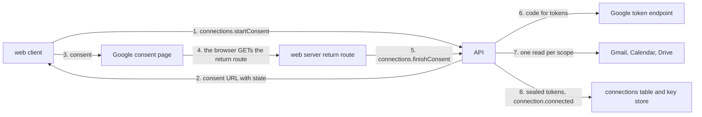

# Google connections

- **Status:** draft
- **Work items:** [the connections](https://linear.app/zgeoff/issue/GEO-1824). The return route
  waits on [the OAuth return spike](https://linear.app/zgeoff/issue/GEO-267).
- **Decision records:** [0010](../../decisions/0010-oauth-clients.md),
  [0007](../../decisions/0007-crypto-shredding.md)

You connect a Google account from the web client. You register your own OAuth client once, consent
on Google's page, and Google sends your browser back to nixie. nixie keeps the tokens encrypted
under a key of the connection's own, refreshes them, and shows each connection's status. You remove
a connection with Forget: nixie revokes the grant at Google and deletes the connection's key. The
tokens are then unreadable in the database at once, and in every backup once the backup job prunes
the key repository ([backups](../../architecture/deployment/backups.md)). Using the account again
needs a fresh consent.

The design builds 2 parts for the one connector, Google: the database backend of the
[credential store](../platform/connectors/credentials.md), and the
[connector interface](../platform/connectors/connector.md) in code. A Google connection has no
Disconnect: the credential design keeps that removal for a secret that lives outside nixie. The
Gmail, Calendar and Drive tools, and the Gmail poll, belong to their own work items.

## Shape



Forget runs the other way: one revocation at Google, then the key's deletion, as [Forget](#forget)
sets out.

## Contracts

### The connector

```ts
// connectors module. Extends Connector, OAuthSpec, SetupStep and HealthReport of the connector design.
// A connections module owns the tables below in nixie.db, their keys in keys.db, and the
// CredentialStore of the credential design for the database backend. In that store a
// CredentialRef is a connection ID, and disconnect and reconnect refuse a Google connection.
const googleConnector: Connector = {
  id: 'google',
  auth: googleOAuth,
  setup: googleSetup, // see "The setup steps"
  // …existing fields: actions, polls, check
};

interface OAuthSpec {
  kind: 'oauth';
  authorizeURL: string; // 'https://accounts.google.com/o/oauth2/v2/auth'
  tokenURL: string; // 'https://oauth2.googleapis.com/token'
  revokeURL: string; // 'https://oauth2.googleapis.com/revoke'
  identityScopes: string[]; // ['openid', 'email']: the account, whatever else you untick
  scopes: string[]; // ['gmail.modify', 'calendar.events', 'calendar.calendarlist.readonly', 'drive.file']: every consent asks for all 4
  authorizeParams: Record<string, string>; // { access_type: 'offline', prompt: 'consent', include_granted_scopes: 'true' }
  hosts: string[]; // ['gmail.googleapis.com', 'www.googleapis.com']; never the host of authorizeURL, tokenURL or revokeURL
  returnPath: string; // '/connections/google/return'
}

interface SetupStep {
  id: string; // stable, such as 'client'; the guide's sections match these one to one
  title: string;
  body: string; // template text; {redirectURI} and {origin} are the only placeholders
  links: { label: string; url: string }[];
  input?: 'oauth_client'; // the step that shows the OAuth client form
}

interface HealthReport {
  grantedScopes: string[];
  missing: MissingScope[]; // each scope in OAuthSpec.scopes that check found missing
  accountName: string | null; // for Google, the ID token's email; check reads no account
}
```

nixie reads the account from the ID token in the token response, never from the connector's `check`,
the read call per scope that runs after consent
([setting up a connection](../platform/connectors/connector.md#setting-up-a-connection)). Google
sends the ID token straight to nixie over TLS, so nixie reads its `sub` and `email` claims without
checking a signature. `sub` is the account's identity and `email` is its account name.

### The setup steps

The web client shows these steps in order, from the connector's data:

| `id`       | Title                         | What it says                                                                                                                                                                                                                                                                              |
| ---------- | ----------------------------- | ----------------------------------------------------------------------------------------------------------------------------------------------------------------------------------------------------------------------------------------------------------------------------------------- |
| `project`  | Create a Google Cloud project | Create one project for this nixie alone. A revocation reaches every client of a project, so one deployment's revocation would end another deployment's grant.                                                                                                                             |
| `apis`     | Turn on the APIs              | Enable the Gmail, Google Calendar, Google Drive and Google Picker APIs, one link each.                                                                                                                                                                                                    |
| `branding` | Fill in the branding          | Give an app name, your email, and a home page and a privacy policy URL on a domain you control, such as a project site. Publishing needs both URLs.                                                                                                                                       |
| `audience` | Publish the app               | Choose External, then publish to production with no test users. In testing status, Google ends each consent after 7 days.                                                                                                                                                                 |
| `client`   | Create a web client           | Create a Web application client with `{redirectURI}` as its only redirect URI and `{origin}` as its JavaScript origin. Create an API key restricted to the Picker API and `{origin}`. Paste the client ID, the secret, the key and the project number here. Google shows the secret once. |
| `consent`  | Connect an account            | Consent on Google's page. An account that does not own the project sees "Google hasn't verified this app" first.                                                                                                                                                                          |

The links point at the Google Auth Platform pages of the console: Branding, Audience and Clients,
and the API library page of each API. Your setup guide is `docs/guides/google.md`. It holds the same
6 steps under the same titles, each with what to click. It adds a section on the warning page, and a
section on revoking a grant by hand at your Google Account's third-party access page. The guide and
the step data ship in one PR.

### The API

```ts
// libs/contract, under `connections`. Each procedure that takes a clientActionID is a checked action.
// list and readForgetStatus are reads, and finishConsent is keyed by state.
connections.registerClient({
  clientActionID,
  connector: 'google',
  clientID,
  clientSecret,
  origin: 'https://nixie.example.org',
  pickerKey: 'AIza…', // optional; the Drive picker's API key, no secret: the browser reads it
  projectNumber: '123456789012', // optional; the picker's app ID, the OAuth client's project
});
// → { client: 'q7m2x9k4ta', redirectURI: 'https://nixie.example.org/connections/google/return' }
//   or INVALID_ORIGIN: not https, holds a path, a query or a user name, or differs from the call's Origin header
//   or CLIENT_EXISTS: one client per connector that is not removed; remove the old one first

connections.removeClient({ clientActionID, client: 'q7m2x9k4ta' });
// → ok, or CLIENT_IN_USE while a connection that is not forgotten uses it

connections.startConsent({ clientActionID, connector: 'google', connection: null });
// → { consentURL: 'https://accounts.google.com/o/oauth2/v2/auth?…&state=…', expiresAt }
//   connection: null for a new account; a connection's short ID for a re-consent, which renews that
//   connection after needs_consent or asks again for its missing scopes
//   or CLIENT_MISSING, CONNECTION_NOT_FOUND

connections.finishConsent({ state, code: '4/0Ab…', error: null });
// → { connection: 'k3x9m2p7qa', missing: [{ scope: 'gmail.modify', reason: 'not_granted' }] }
//   or CONSENT_NOT_FOUND: unknown, used, lapsed, or started by another device session (a signed-in device)
//   or CONSENT_REFUSED: Google returned an error, such as access_denied
//   or TOKEN_EXCHANGE_FAILED { googleError: 'invalid_client' }: from a fixed set, never free text
//   or NO_REFRESH_TOKEN, ACCOUNT_MISMATCH

connections.setLabel({ clientActionID, connection: 'k3x9m2p7qa', label: 'Work' });
// → ok, or LABEL_TAKEN under the label rule of the connection argument (connector design)

connections.forget({ clientActionID, connection: 'k3x9m2p7qa' });
// → { erasure: 'pending', revocation: 'pending', backup: { state: 'pending' } }

connections.readForgetStatus({ connections: ['k3x9m2p7qa'] });
// → [{ connection: 'k3x9m2p7qa', erasure: 'done', revocation: 'confirmed', backup: { state: 'complete' } }]
//   or CONNECTION_NOT_FOUND for a short ID that no connection holds

connections.list();
// → [{ connection, connector, label, account, status, reason, statusSince, lastSuccessAt,
//      scopes, missing, fingerprint, forget: null | ForgetStatus }]  fingerprint: token_fingerprint
//   a forgotten connection lists with label and account null
```

```ts
// libs/contract
type Erasure = 'pending' | 'done';
type Revocation = 'pending' | 'confirmed' | 'refused' | 'unknown' | 'not_attempted';
type ConnectionStatus = 'active' | 'failing' | 'needs_consent' | 'expiring' | 'forgotten';
type ForgetStatus = { erasure: Erasure; revocation: Revocation; backup: ForgetBackup };
type ForgetBackup = z.infer<typeof forgetBackupSchema>; // libs/contract: off, pending, failed, complete, unknown
type MissingScope = { scope: string; reason: 'not_granted' | 'api_disabled' };
```

[Checked actions](../../architecture/channels/api.md#checked-actions) keep each action's first
result beside a hash of its input, so a retry with the same `clientActionID` gets that result.

- The hash leaves out `clientSecret` and `label`. A hash of a secret is a copy of it, and a hash of
  a label outlives a Forget and confirms a guess at the label.
- A retry of `startConsent` gets a fresh `state` and consent URL, which replace the first ones and
  keep the first `expiresAt`. The table stores only a hash of each `state`.
- `finishConsent` takes no `clientActionID`, because each `state` works once. A second call with a
  used `state` answers `CONSENT_NOT_FOUND`.

### The return route

```http
GET /connections/google/return?state=…&code=4/0Ab…&scope=… HTTP/1.1
Cookie: <the device session>

HTTP/1.1 303 See Other
Location: /settings/connections/k3x9m2p7qa
Cache-Control: no-store
Referrer-Policy: no-referrer
```

The web server serves the route, because every path outside `/rpc` reaches it. Its server handler
calls `connections.finishConsent` with the browser's session as a bearer token, as a render does
([the client path](../../architecture/overview.md#the-client-path)). On success it answers 303 to
the connection's page, which shows `missing`, and a re-consent lands on the same page. On a error
from `finishConsent` it renders an error page with status 400. The page shows the error code, and
for `TOKEN_EXCHANGE_FAILED` also Google's error code. The API keeps its rule that every procedure is
a `POST` that carries nixie's custom client header
([a call's way in](../../architecture/channels/api.md#a-calls-way-in)).

### The tables

```text
oauth_clients            plain table, connections module
  oauth_client_id        text  random UUID
  short_id               text  createShortID
  connector_id           text  'google'
  google_client_id       text  plain; it is no secret
  key_id                 text  random UUID in the key store; seals the secret
  secret_sealed          blob
  secret_fingerprint     text  8 hex digits of SHA-256
  redirect_uri           text  origin + returnPath, fixed at registration
  picker_key             text? plain; the browser reads it
  project_number         text? plain
  created_at             int
  removed_at             int?  the key is gone

connections              plain table, connections module
  connection_id          text  random UUID
  short_id               text  createShortID
  connector_id           text
  oauth_client_id        text  FK
  key_id                 text  random UUID in the key store; seals every *_sealed column
  account_sealed         blob  { sub, email }
  label_sealed           blob
  refresh_token_sealed   blob
  token_fingerprint      text  of the refresh token; changes on rotation and on re-consent
  refresh_expires_at     int?  from refresh_token_expires_in, set when you grant access for a limited time
  granted_scopes         text  JSON array
  missing_scopes         text  JSON array of MissingScope
  status                 text  active | failing | needs_consent | expiring | forgotten
  status_reason          text? unauthorised | service_error | no_answer
  status_since           int
  last_success_at        int?
  binding                text  enabled | removing | removed
  removal_counter        int   0 at creation
  created_at             int

consent_requests         plain table, connections module
  consent_id             text  random UUID
  state_hash             text  SHA-256 of the state; the state is 32 random bytes
  device_session_id      text  the device session that started it
  oauth_client_id        text
  connection_id          text? set when consenting again
  scopes                 text  JSON array asked for
  key_id                 text  seals the PKCE verifier
  verifier_sealed        blob
  expires_at             int   10 min after the start
```

- Every sealed value binds its key ID, its table and its column as additional data, as
  [erasable fields](../../architecture/core/erasable-fields.md#keys) do.
- Each key is a row of `record_keys` in `keys.db`, the key store. The backup job ships the key store
  to the key repository, and a Forget deletes the key and checkpoints the key store as
  [forgetting a record](../../architecture/core/erasable-fields.md#forgetting-a-record) does.
- `binding` and `removal_counter` are the binding and its counter from
  [Disconnect and forget](../platform/connectors/credentials.md#disconnect-and-forget). Each removal
  and each re-consent advances the counter, and a save checks it, so a refresh that began before
  either saves nothing. They sit on the connection row, because a Google connection has one binding.
- Access tokens stay in the server's memory, keyed by connection ID and removal counter, and never
  reach a table, a record or a log.

### The records

```ts
// connections module. Each kind belongs to no task thread and holds no free text, so the log
// creates no record key for it.
type ConnectionRecord =
  | { kind: 'connection.client_registered'; client: string; fingerprint: string }
  | { kind: 'connection.client_removed'; client: string }
  | {
      kind: 'connection.connected';
      connection: string;
      shortID: string;
      scopes: string[];
      missing: MissingScope[];
      fingerprint: string;
      again: boolean;
    }
  | { kind: 'connection.label_set'; connection: string }
  | {
      kind: 'credential.refreshed';
      connection: string;
      counter: number;
      fingerprint: string;
      rotated: boolean;
    }
  | {
      kind: 'credential.status_changed';
      connection: string;
      status: ConnectionStatus;
      reason: 'unauthorised' | 'service_error' | 'no_answer' | null;
    }
  | { kind: 'connection.forget_started'; connection: string; counter: number }
  | { kind: 'connection.revocation_started'; connection: string }
  | {
      kind: 'connection.revocation_recorded';
      connection: string;
      outcome: Revocation;
      status: number | null;
      googleError: string | null;
    }
  | { kind: 'connection.forgotten'; connection: string }
  | {
      kind: 'connection.consent_discarded';
      reason: 'account_mismatch' | 'connection_forgotten';
      revocation: Revocation;
    };
```

These records never hold a label, an account address or a `sub`, so the connection's key covers
every copy that the connection itself keeps. The
[status line](../platform/connectors/tools.md#what-the-model-learns-about-a-connection) reads the
label from the connection row.

## Constraints

### Consent

- `startConsent` asks for `identityScopes` and `scopes`, with `state`, PKCE S256 and
  `authorizeParams`. `prompt: 'consent'` makes Google issue a refresh token on every consent, the
  one after a Forget included.
- `state` is bound to the device session that started it. A call from another session, or after
  `expires_at`, answers `CONSENT_NOT_FOUND`, so a link that an attacker sends you cannot attach the
  attacker's account.
- The token exchange sends the OAuth client secret, the PKCE verifier and the stored `redirect_uri`.
  The security of the return rests on `state` and the OAuth client secret, never on PKCE.
- `finishConsent` deletes the consent request and its key in the transaction that records the
  outcome, success or refusal. A sweep at start and every hour deletes each lapsed request and its
  key.
- A token response without a refresh token answers `NO_REFRESH_TOKEN` and keeps nothing.
- A re-consent replaces the connection's refresh token, scopes and `missing`, sets `active`, and
  advances the removal counter.
- A new consent whose `sub` matches a live connection counts as a re-consent of that connection.
- A re-consent whose `sub` differs from its connection's `sub` answers `ACCOUNT_MISMATCH`.
- To match a `sub` or check `LABEL_TAKEN`, nixie decrypts the account or label of each live
  connection of the connector, because it keeps no hash of either.
- `finishConsent` keeps no refresh token after `ACCOUNT_MISMATCH`, or when its connection was
  forgotten during the consent. After its transaction commits, it makes one revocation attempt and
  records `connection.consent_discarded` with the outcome.
- It skips that revocation when a live connection reaches the same account. Google's revocation ends
  the whole grant, so it would end that connection too.
- The return route's handler and the web server's request log never record the query string.

### Fewer scopes

- `check` makes one read call per scope in `scopes`. For `calendar.calendarlist.readonly` it reads
  the calendar list, because `calendar.events` cannot list calendars. A scope Google did not grant
  is `not_granted`. A scope whose call Google refuses because the project has not enabled its API is
  `api_disabled`.
- The connection keeps every granted scope that passed, and its tools join the
  [tool registry](../../architecture/connectors/tool-calls.md). The tool endpoint of each task run
  and worker run leaves out each action whose scope is in `missing`.
- The connection's page shows each missing scope with its reason and the tools it holds back, and
  one button that runs `startConsent` for the connection. The notice stays until a consent clears
  `missing`.
- A connection with only the identity scopes still connects, and lists no tools.

### Refresh and use

- [Refresh](../platform/connectors/credentials.md#refresh) holds as written, with these mappings of
  Google's answers:

| Google answers                               | The store                                                                 |
| -------------------------------------------- | ------------------------------------------------------------------------- |
| a token, with or without a new refresh token | saves the rotation, records `credential.refreshed`, `active`              |
| `invalid_grant`, `admin_policy_enforced`     | `needs_consent`                                                           |
| `invalid_client`, `unauthorized_client`      | `failing` with `unauthorised`, at once                                    |
| a 5xx, or no answer within 10 s              | backs off; `failing` with `service_error` or `no_answer` after 3 in a row |

- A refresh saves only when the removal counter it read still holds, in the transaction that writes
  `credential.refreshed`, and a rotated refresh token goes in that same transaction.
- A crash after Google answers and before that commit loses a rotated refresh token. When Google has
  spent the old one, the next refresh gets `invalid_grant` and the connection becomes
  `needs_consent`. The crash test checks that outcome, and that the row keeps the old token whole.
- A connection whose `refresh_expires_at` falls within 3 days is `expiring`. Past it, the connection
  is `needs_consent`. The refresh schedule checks the time on each pass and at start.
- When 2 statuses hold, the first of `needs_consent`, `failing` and `expiring` wins.
- The [fetcher](../platform/connectors/credentials.md#the-interface), which adds the token to a
  connector's request on the host, holds a shared lock on the connection for each request it sends.
  Forget takes the lock exclusive, after it aborts every request in flight on that connection. A
  request Google already received stays with Google.
- The fetcher refuses the hosts of `authorizeURL`, `tokenURL` and `revokeURL`, and every path under
  `/oauth2/` on any host, because `www.googleapis.com` also serves an older token endpoint. No tool
  then reaches a token or revocation endpoint.

### Tasks that already run

- The conversation's endpoint builds its tool list at each turn from the live connections, so a new
  connection, a Forget or a change in `missing` reaches the conversation at its next turn. The turn
  in flight keeps its list.
- A worker run keeps its list for its life. A job run keeps its pins, as
  [the connection argument](../platform/connectors/connector.md#the-connection-argument) sets.
- Every call checks the connection at the time of the call. A call to a forgotten connection fails
  with the error for a `forgotten` credential, and that error never holds the connection's label or
  status ([statuses](../platform/connectors/credentials.md#statuses)).
- A job whose pins all name forgotten connections lists none of the connector's tools. The client's
  view of the job shows the forgotten pin.

### Forget

Forget runs in 3 steps. A crash between them leaves the rest to the server's start, which finishes
every Forget before it hands out any task work:

1. In the checked action's transaction: the binding becomes `removing`, the counter advances, the
   status becomes `forgotten`, and `connection.forget_started` commits. The store refuses every
   fetch and refresh from here.
2. `connection.revocation_started` commits. nixie sends the refresh token to `revokeURL` once, with
   a 10 s timeout. `connection.revocation_recorded` commits the outcome: 200 is `confirmed`, 400 is
   `refused` with Google's error code, and anything else is `unknown`.
3. nixie deletes the connection's key and checkpoints the key store, then clears the sealed columns.
   It runs the conversation's
   [session cleanup](../../architecture/memory/context.md#forgetting-and-the-live-session), as a
   memory forget does. The cleanup deletes every session summary and opens a new session, so no
   status line or connection argument that named the connection reaches a later turn. It then
   commits `connection.forgotten` with the binding `removed`.

- A server start that finds `revocation_started` with no outcome records `unknown` and sends
  nothing, so nixie never sends the revocation twice.
- A server start that finds `forget_started` with no `revocation_started` makes the attempt.
- The key goes only after the outcome commits, because the revocation needs the refresh token.
- A connection whose key the key store lacks, such as after a restore, skips step 2 with
  `not_attempted` and finishes step 3.
- The web client shows erasure, revocation and backup state apart. Beside a revocation that is not
  `confirmed`, it links the guide's section on revoking by hand.
- A forgotten connection keeps its row, with its short ID and scopes and no sealed value, so a job
  pin can name it.
- Forget erases nixie's own copies of the connection: its tokens, label and account. Text that names
  the account elsewhere, such as a message, a summary, a tool result or an email, keeps its own key,
  and you remove it with the forget of that record.
- `removeClient` deletes the client's key and checkpoints, and needs no revocation: Google keeps the
  client until you delete it in the console.

### Backups and resets

- `connection.forgotten` joins the forget records that make a forget set due, and
  [a forget's backup state](../../architecture/deployment/backups.md#a-forgets-backup-state) reads
  from it.
- A full [reset](../../architecture/core/event-log.md#the-reset) makes one revocation attempt per
  live connection before it deletes the keys, 10 s each. Its answer gains
  `revocations: { connection: string; outcome: Revocation }[]`. A failed attempt never stops the
  reset. A reset of the conversation leaves connections alone.
- A restore of a data copy from before a Forget meets a connection whose key is gone, and finishes
  its Forget with `not_attempted`.
- A restore of a data copy from before a connection existed loses the connection, and its grant
  stays live at Google with no token in nixie. The restore steps ask you to check the third-party
  access page of each Google account you connected.

### A rollback

| The change                          | The release before                                                                              |
| ----------------------------------- | ----------------------------------------------------------------------------------------------- |
| the migration of the 3 tables       | starts, because the migration only adds tables, and never selects the tables                    |
| the keys in `record_keys`           | keeps them, and its full reset deletes them                                                     |
| the 11 record kinds                 | never meets them on a thread, and no projection of it reads them                                |
| `connection.forgotten` as a forget  | stages no forget set for it, so the next scheduled set covers the Forget                        |
| the procedures and the return route | has neither; a consent in flight lands on a 404, and its row waits for the next upgrade's sweep |

- The design adds no config key.
- A Forget left part way finishes only at the server start of a release that has this design. Before
  a rollback, wait until every Forget shows erasure `done`.

## Decisions

- **Forget only, no Disconnect.** The owner chose this on 13 Nov 2026: a pause is rare for one
  person, and a paused token still sits in the database and its backups.
- **The account comes from the ID token, with `openid` and `email` asked for.** An agent's call on
  13 Nov 2026: Google shows sign-in scopes on a page of their own, so the account is known when you
  untick Gmail, and `sub` survives an address change.
- **Connections are plain tables beside audit records, not projections.** An agent's call on 13 Nov
  2026: a token changes at runtime, and a projection would put every value into the append-only log.
- **Label, account and tokens sit under the connection's key, and no record carries them.** An
  agent's call on 13 Nov 2026: Forget then erases every copy the connection keeps, and a hash of the
  account would outlive it, as a message hash would.
- **The return route is a web server route that calls a procedure.** An agent's call on 13 Nov 2026:
  the API keeps one way in, and the browser's `Lax` cookie reaches a top-level navigation from
  Google.
- **The redirect URI comes from the page's origin at registration, not from a config key.** An
  agent's call on 13 Nov 2026: Google checks it against the OAuth client anyway, and a rollback
  needs no step.
- **Access tokens stay in memory.** An agent's call on 13 Nov 2026: a restart costs one refresh, and
  the database holds one secret per connection.
- **One revocation attempt, recorded before it is sent.** The credential design sets one attempt. An
  agent's call on 13 Nov 2026: recording it first makes a crash read as `unknown`, and a second
  request could revoke a grant that a consent made after the Forget.
- **A consent of an account already connected updates that connection.** An agent's call on 13 Nov
  2026: a refusal would leave a second grant at Google, and revoking it would revoke the first.

## Builder decides

- Internal names, file layout, and which module holds the store's code beside its tables.
- The wording of each error, of the setup steps' bodies and of the guide.
- The read call that `check` makes per scope, within the tools' design.
- How the fetcher's lock and abort are built, within the constraint.
- The layout of the tests, and the kill points of the crash tests.

## Out of scope

- The Gmail, Calendar and Drive tools and the Gmail poll:
  [Gmail](https://linear.app/zgeoff/issue/GEO-1825) and
  [Calendar and Drive](https://linear.app/zgeoff/issue/GEO-1826).
- A Disconnect or a pause for a Google connection.
- A second OAuth client per connector, and connectors from other providers.
- Picking Drive files for `drive.file`: the browser's own token and the picker belong to
  `docs/design/queue/gmail-calendar-drive-tools.md`, which reads `picker_key` and `project_number`.
- Finding and forgetting the records whose text names a forgotten account.

## Open questions

- **Does Google accept a redirect URI on a private-network HTTPS name, and PKCE on a Web application
  client?** [The OAuth return spike](https://linear.app/zgeoff/issue/GEO-267) settles it. Until then
  the return route is built as here, and the guide says the redirect URI's host needs a name under a
  public suffix. The browser, not Google, follows the redirect, so a public name that resolves only
  inside the private network serves as the fallback. When Google refuses PKCE on a Web application
  client, nixie drops it, because the return's security never rests on it.
- **The names: the `connections` procedures, the record kinds, "Settings → Connections" and the
  return path.** The owner settles them in
  [the connections issue](https://linear.app/zgeoff/issue/GEO-1824). Until then the names here hold.
- **Where the fewer-scopes notice shows.** The owner settles it in the same issue. Until then it
  shows on the connection's page and in the connections list, never in the conversation.
