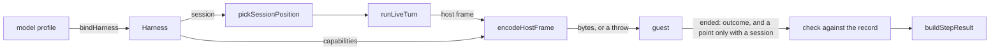

# The harness boundary

- **Status:** draft. The owner chose the shape below.
- **Work items:** [the harness boundary](https://linear.app/zgeoff/issue/GEO-2547),
  [the Codex harness](https://linear.app/zgeoff/issue/GEO-2237)

Host code holds one record per profile, `Harness`, and never reads a field that only one harness
has, so a task runs on a second harness, such as Codex, with no change to the code that runs its
steps.

- The host sends a harness only the frames and fields its capabilities cover.
- Every guest ends a turn with an `outcome` in the same words.
- A step on a harness with no session rebuilds its session from the log at every step.

## Terms

- **Harness.** The model loop that runs a profile's turns inside a sandbox: the Agent SDK or Codex.
- **Guest.** The program that runs a harness's loop inside the sandbox, such as the conversation
  guest of the Agent SDK.
- **Capability.** One thing a harness can do, such as `resume`, from the built
  `harnessCapabilities`.
- **Session point.** The place in a harness's own session where the next step resumes. One concept
  has these names in code: the type `SessionPoint`, the frame keys `ended.boundary` and
  `turn.resume`, the stored column `sessionBoundary`, and the `boundary` field of a position.
- **Harness with a session.** A harness that declares both `resume` and `resume-at-entry`.
- **`unkept`.** The session position of a task that has an opening, no summary and no session point
  its harness owns. nixie derives it at each step and stores it nowhere.

Other terms are in the [glossary](../../glossary.md).

## Shape



## Contracts

### The record

```ts
const harness = bindHarness(profile);
// → for an Agent SDK profile with authHeader 'bearer' and no contextTokens:
//   { id: 'agent-sdk', api: 'anthropic-messages', capabilities: <all 12>, secretHeader: 'bearer',
//     contextWindow: 200000, session: { owns, nameSession, listFiles }, … }
const secret = deriveModelSecret(resolved, harness); // reads harness.secretHeader
const checkProfile = harness.toTurnProfile('one-off'); // the agent-sdk member, cacheTTL '5m'
```

```ts
// models module. Replaces HarnessDescriptor and getHarness.
export interface Harness {
  // …the fields of HarnessDescriptor with their types: id, api, buildGrant, guest, imageKey,
  //   toolUseMetaKey and toolCallWaitMs. listSessionFiles moves into `session`.
  readonly capabilities: ReadonlySet<HarnessCapability>; // harnessCapabilities[id]
  readonly secretHeader: SecretSpec['header']; // the HTTP header that carries the model secret

  // 'kept': a session nixie resumes. 'one-off': a session nixie never resumes, such as a check's.
  readonly toTurnProfile: (use: 'kept' | 'one-off') => TurnProfile;

  // tokens; null without `context-window`. The skill catalog's loader sizes the catalog by it.
  readonly contextWindow: number | null;

  // non-null exactly for a harness with a session; the definition's type enforces it
  readonly session: HarnessSession | null;
}

export interface HarnessSession {
  readonly owns: (point: SessionPoint) => boolean; // whether a stored point is this harness's
  readonly nameSession: (point: SessionPoint) => string; // for lostSessionID and the kept session
  readonly listFiles: (point: SessionPoint) => readonly string[]; // the built listSessionFiles
}

// The union of each definition's profile type. The models config holds it.
export type HarnessProfile = AgentSDKProfile; // the Codex harness adds CodexProfile
export declare function bindHarness(profile: HarnessProfile): Harness;
```

```ts
// wire library: the capability lists become tuples, so a type reads them. The built Sets derive
// from them.
export const harnessCapabilityLists = {
  'agent-sdk': [/* the 12, as built */],
  codex: ['tools', 'fresh-session', 'interrupt', 'images', 'turn-limit', 'call-usage'],
} as const satisfies Record<HarnessID, readonly HarnessCapability[]>;

type HasSession<ID extends HarnessID> =
  | 'resume'
  | 'resume-at-entry' extends (typeof harnessCapabilityLists)[ID][number]
  ? true
  : false;

// models module: a definition gives `session` exactly when its capabilities say so
interface HarnessDefinition<ID extends HarnessID, Profile extends ModelProfile> {
  readonly id: ID;
  readonly profileSchema: HarnessProfileSchema; // built type, strict
  readonly bind: (profile: Profile) => Omit<Harness, 'session'>;
  readonly session: HasSession<ID> extends true ? HarnessSession : null;
}
```

```ts
// models module. The 6 fields every harness has, with one meaning on each.
export interface ModelProfile {
  readonly id: string;
  readonly harness: HarnessID;
  readonly baseURL: string;
  readonly credential: string;
  readonly model: string;
  readonly prices: ModelPrices | null;
}

// models module, the Agent SDK's definition file: the built fields that leave ModelProfile.
interface AgentSDKProfile extends ModelProfile {
  readonly harness: 'agent-sdk';
  readonly authHeader: 'bearer' | 'x-api-key';
  readonly effort: ReasoningEffort;
  readonly contextTokens: number | null;
  readonly cacheTTL: '5m' | '1h';
  readonly providerPin: string | null;
}
```

The Agent SDK's `bind` keeps the built descriptor's values, and adds `secretHeader` from
`authHeader`, `contextWindow` from `contextTokens` or else `getCLIContextWindow(model)`, and a
`toTurnProfile` that sets `cacheTTL: '5m'` for `one-off`. Its `session.owns` is
`point.harness === 'agent-sdk'`. `harnesses` lists every definition, and the built
`buildModelsConfigSchema` takes their profile schemas.

### The host encoder

```ts
const bytes = encodeHostFrame(harness.capabilities, {
  type: 'turn',
  profile: harness.toTurnProfile('kept'),
  limits: { modelCalls: 40, toolCallWaitMs: harness.toolCallWaitMs },
  // tools, systemPrompt, input; the `resume` key only when harness.session is non-null
});
// → the frame's bytes, or a throw when the capabilities lack a frame's or a field's need
```

```ts
// wire library
export const hostFrameNeeds: Readonly<Record<HostFrame['type'], HarnessCapability | null>> = {
  turn: null,
  message: 'live-messages',
  interrupt: 'interrupt',
  summarize: 'summarize',
  purge: null,
};

// a turn frame's `resume` key, and a non-null `limits.modelCalls`
export const turnFieldNeeds = {
  resume: 'resume',
  modelCalls: 'turn-limit',
} as const satisfies Readonly<Record<string, HarnessCapability>>;

export declare function encodeHostFrame(
  capabilities: ReadonlySet<HarnessCapability>,
  frame: HostFrame,
): Uint8Array<ArrayBuffer>;

// The turn frame's `resume`, built as sessionPointSchema.nullable(), becomes
// sessionPointSchema.nullable().optional(): the key is absent for a harness without `resume`.
// encodeTurnFrame, built, keeps guest frames only.
```

### The turn outcome

```ts
// wire library
export const turnOutcomeSchema = z.enum([
  'finished',
  'stopped',
  'limit',
  'interrupted',
  'overflow',
]);
export type TurnOutcome = z.infer<typeof turnOutcomeSchema>;

const endedFrameSchema = z
  .object({
    type: z.literal('ended'),
    outcome: turnOutcomeSchema, // required: the one field the host reads to tell how the turn ended
    boundary: sessionPointSchema.optional(), // was required; sent exactly by a harness with a session
    stopReason: z.string().nullable(), // the harness's own words: written, never read
    terminalReason: z.string().optional(), // the same
    // …existing fields: isError, turns, usage, thinkingTokens, context. `subtype` is gone.
  })
  .readonly();

// assistant frame: messageID is z.string().min(1), was z.uuid()
// models module, model.turn_ended codec: outcome: turnOutcomeSchema.exactOptional()
```

### The session position

```ts
pickSessionPosition({ ...input, session: harness.session });
// → { state: 'unkept', boundary: null }

// sessions module
type SessionState = /* …existing states */ 'unkept';

type SessionStart =
  | /* …existing members */
  | {
      readonly kind: 'rebuild';
      readonly reason: 'lost' | InvalidationCause | 'images' | null; // null: a step from unkept
      readonly lostSessionID: string | null;
    };
```

## Constraints

### The record and the definitions

- Host code reads the record and never branches on a harness ID. Outside its definition file, code
  reads a profile as `ModelProfile`, and only a definition's `bind` reads a field of its own profile
  type.
- A definition's profile schema is strict, so a key that its harness's loop ignores fails the
  config's load.
- `roleNeeds` lists every capability a role's frames can use, including what its input can hold,
  such as `images` for a role whose input can carry an image. So a capability gap fails the config's
  load, and `encodeHostFrame` throws only on a host bug.
- A profile on a harness outside `harnesses` fails the config's load.
  [The harness list in the models config error](https://linear.app/zgeoff/issue/GEO-2579) owns the
  text.
- A unit test fails when `harnessIDs` and `harnesses` hold different IDs. The built `harnessIDs`
  holds `codex`, so the Codex harness adds the test with the Codex definition.
- A model secret's name is a digest of the profile ID, `secretHeader` and the model API's host name,
  in that order. These are the built parts, so every secret keeps its name.
- The skill catalog's loader reads `contextWindow` as a number: only the conversation builds a
  catalog, and the conversation role needs `context-window`.
- The checker runner takes its profile from `toTurnProfile('one-off')`. The check request's
  `profile` is the turn profile union.
- The `zgeoff/import-zones` lint rule keeps confining the Agent SDK to the conversation guest, the
  contract suite and 2 eval files.

### The host encoder

- `encodeHostFrame` is the host's only encoder of host frames. `runGuestTurn`, `runGuestPurge` and
  the compaction's `runGuestSummary` call it.
- When the host is about to send a frame or a field that the harness does not declare,
  `encodeHostFrame` throws, nixie sends nothing, and the step fails. The step code asks for no such
  frame, so a throw marks a bug.
- A host error about a guest holds the guest package of the step's harness, or no guest's name. The
  3 built errors that say "the conversation guest" change.

### The contract a guest meets

| Need             | What the guest does                                                                     |
| ---------------- | --------------------------------------------------------------------------------------- |
| Turn start       | Reads one `turn` frame and writes guest frames                                          |
| Tool calls       | Connects to the frame's tool route over HTTP MCP with the step token                    |
| Tool-use ID      | Sends the model's tool-use ID under the record's `toolUseMetaKey` on each tool call     |
| Streaming        | Sends one `assistant` frame per model message, as each completes                        |
| Usage            | Sends one `call` frame per model API call, before the next frame                        |
| Reads            | Sends a `read` frame that lists the input messages the model received                   |
| Model-call limit | Stops at `limits.modelCalls` and ends with the outcome `limit`                          |
| Interrupt        | Stops the model loop on an `interrupt` frame and sends `ended` for the turn so far      |
| Failure          | Sends `failed` with a built reason, and never `ended` after it                          |
| Purge            | Removes every file the loop holds of a session on a `purge` frame, then sends `purged`  |
| Tool-call wait   | Sets `limits.toolCallWaitMs` in the runtime, by [the tool-call wait](tool-call-wait.md) |

- The guest sends `failed` with `tools_not_connected` when the tool server is not connected, with
  `model_auth` or `model_api` when the model API refuses, and with `error` when the loop errors or
  its stream closes.
- A `call` frame holds its usage in the built `modelCallUsageSchema`, and the host prices it with
  the profile's price table. `ended.usage` is the sum of the turn.
- The read cursor moves only over the messages that a `read` frame lists.
- When you forget a memory item, the session cleanup starts the guest of each open task that reads
  memory and sends it a `purge` frame, on every harness.
- A guest resumes, takes live messages and compacts only when its harness declares the capability.
- Each step starts the guest, runs one turn and ends the guest.

### The turn outcome

- `finished` is a turn that the model ended. `limit` is a turn that the guest stopped at
  `limits.modelCalls`. `interrupted` is a turn that an `interrupt` frame stopped, such as the built
  interrupt at a task's dollar limit. `overflow` is a turn whose context passed the model's window.
  `stopped` is any other end, such as a refusal or an output cap, and is never `limit`.
- `isContextOverflow` reads `outcome === 'overflow'`. `hasFinishedTurn` reads
  `outcome === 'finished'` on the record that the running step just built, and on no other record.
- nixie writes `stopReason` and `terminalReason` to `model.turn_ended` and never reads them.
- `model.turn_ended` holds `outcome` as an optional key, because earlier releases wrote records
  without it. nixie reads it only on the record that the running step built.
- The design adds no record kind, and no value to an enum of a stored record.

### The session point and `unkept`

- A guest sends a session point in `ended` exactly when its harness has a session. The session point
  union holds one member per harness with a session, so it holds the Agent SDK's alone.
- When a stored point belongs to another harness, nixie reads it as no point, and the step rebuilds
  the session from the log.
- On a harness with no session, the first step finds `fresh` and each later step finds `unkept`,
  unless a forget or a persona change makes it `invalidated`.
- From `unkept`, the step writes an opening with `kind: 'rebuild'`, `reason: null` and
  `lostSessionID: null`, which the built codec allows, and adds no `reason` value: the release a
  deployment rolls back to would fail to decode one. From `fresh` or `invalidated`, it writes the
  built opening.
- The built `runOpenedTurn` commits an opening with its point in one step result, and a failed step
  commits neither. So an Agent SDK task finds `unkept` only after its profile moves from a harness
  with no session; it then stores its point and becomes `resumable`.
- A rebuild reads its clock, its status lines and its block IDs from inputs of the step, so a test
  that fixes those 3 gets the same opening from the same log.
- A step on a harness with no session sends a `turn` frame with no `resume` key, no `message` frame
  because it starts no live inbox reader, no `summarize` frame, and an `interrupt` frame only when
  the harness declares `interrupt`. It stores `sessionBoundary: null`.
- A message that arrives mid-turn on such a harness waits for the next step. nixie never marks it
  read in the running turn, so the step's commit finds it unread and sets the task to `ready`, as
  built.

| Position                         | Event   | Condition                       | Next         |
| -------------------------------- | ------- | ------------------------------- | ------------ |
| `fresh`, `invalidated`, `unkept` | open    | The step stores a point         | `resumable`  |
| `fresh`, `invalidated`, `unkept` | open    | The step stores no point        | `unkept`     |
| `summarized`, `lost`             | open    | Always                          | `resumable`  |
| `resumable`                      | resume  | The context is under threshold  | `resumable`  |
| `compaction-due`                 | compact | The compaction gives a summary  | `summarized` |
| `compaction-due`                 | compact | The compaction gives no summary | `resumable`  |

A forget or a persona change moves any position to `invalidated`. `compaction-due` exists only for a
harness that declares `summarize` and `context-window`.

### A broken contract and an overflow

- The step fails as a broken contract when a guest sends a session point and its harness has no
  session, sends `ended` with no point and its harness has one, or sends a context size and its
  harness declares no `context-window`.
- When a turn that opened a session overflows, the step fails.
- When a resumed turn overflows on a harness that declares `summarize`, nixie compacts.
- On a harness with no session, every step opens a session from the log within the built rebuild
  token budget, so history alone never overflows. A single turn that grows past the window fails its
  step, and the task's next step opens again from the log.

### What the last release does

- It reads a `model.turn_ended` with `outcome`, because a record codec's `decode` drops a key it
  does not know. It parses a stored session point as before.
- The `ended` frame's `outcome` is required, so the host and the guest images ship together, as the
  server image's guest digests already make them.
- The design adds no config key, record kind or migration.

## Decisions

- **The guest sets the outcome.** The host reads one field in the same words for every harness, and
  each guest maps its runtime's words.
- **`unkept` is derived at each step and stored nowhere.** A stored state would need a migration and
  a value that the last release could not read.
- **A rebuild from `unkept` reuses `reason: null`.** The built codec allows it, and a new value
  would break a rollback.
- **`encodeHostFrame` checks at runtime.** The harness comes from the deployment's config, so the
  step code holds a `Harness` whose capabilities no type knows. A frame type narrowed by capability
  would carry a harness type parameter through the step code, which is the branching the boundary
  removes.
- **A turn ends in one of 5 outcomes, and a refusal or an output cap is never `finished`.** An
  agent's call on 13 Nov, which the owner accepted: `hasFinishedTurn` reads
  `outcome === 'finished'`, so with 4 outcomes a refused or cut-off turn would count as finished.
- **Each harness definition is one file in the models module.** An agent's call on 13 Nov, open to
  the owner's veto: a definition reaches nothing outside nixie from the server, which is the case
  where [the code layout](../../architecture/code-layout.md) keeps an implementation in its module.
- **On a harness with no session, a turn that overflows fails its step, and the step's retries open
  again from the log.** An agent's call on 13 Nov, which the owner accepted: it adds no code path,
  and a smaller-rebuild retry would have nothing to fire on while Codex reports an overflow as a
  plain failure.

## Builder decides

- How `bindHarness` finds the definition of a profile's harness.
- The text of each host error, within the rule above, and of `encodeHostFrame`'s throw.
- Internal names, and the layout of the tests.

## Out of scope

- The Codex definition, its profile and its guest.
  [The Codex harness](https://linear.app/zgeoff/issue/GEO-2237) adds them.
- The fields of a profile outside Claude.
  [Tasks on OpenRouter models](https://linear.app/zgeoff/issue/GEO-2234) adds them.
- A Codex member or a "none" member in the session point union, and resume, live messages and
  compaction on Codex.
- A fallback from `outcome` to the Agent SDK's words.
- A capability for a process that a harness holds across steps, which voice would need.
- A turn field that removes images for a harness without `images`, and a fixed context window for
  the skill catalog when a harness reports none.

## Open questions

- **What are the words of the 5 outcomes?** The owner settles it: `finished`, `stopped`, `limit`,
  `interrupted` and `overflow`, or other words. Until then, the sketches hold those 5.
- **Does Codex report a context overflow as its own error?** The overflow case of
  [the Codex gates](https://linear.app/zgeoff/issue/GEO-2546) measures it. Until then, a Codex
  overflow is a `failed` turn, and the step's retries handle it.
