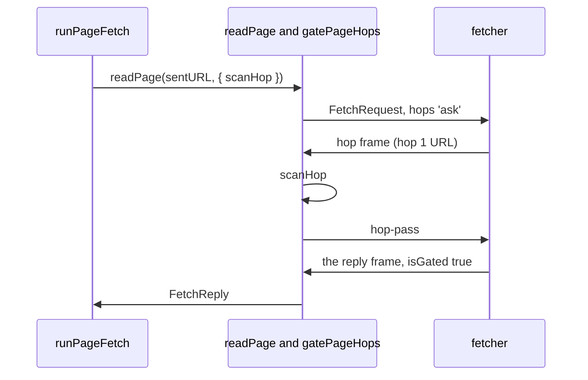

# The hop gate of a fetch

- **Status:** draft
- **Work items:** [the hop gate](https://linear.app/zgeoff/issue/GEO-2587),
  [the secret refusal in the fetch tool](https://linear.app/zgeoff/issue/GEO-2246)

The fetcher follows redirects inside the fetch sandbox, where nixie's secrets and secret rules never
go, so a fetch can reach a URL that nixie never scanned. With the hop gate, the fetcher asks the
server before it follows each redirect, on the open stream of the fetch, and waits for the server's
pass. The server decides each hop with a `scanHop` function that
[the secret refusal](secret-url-refusal.md) supplies.

In this doc, "the server" is the nixie server, and "a host" is the host of a URL. The fetcher is the
program in the fetch sandbox that sends each request, and the fetch image is the sandbox image that
holds it. A hop is one URL of a fetch: hop 0 is the sent URL, and each redirect adds 1. A gated
fetch is a fetch whose request holds `hops: 'ask'`.

## Shape



## Contracts

### The wire

```ts
// wire lib
interface FetchRequest {
  // …existing fields
  // A field of the type only. 'ask': the fetcher sends a hop frame and waits for a pass before
  // each hop after hop 0.
  hops: 'ask' | 'none';
}
// On the wire, hops 'none' is the frame that main sends, byte for byte. hops 'ask' writes
// "limits": { …, "redirects": 0 } and "hopGate": { "redirects": <the redirect limit> }. The decoder
// reads hopGate.redirects as limits.redirects when the frame holds hopGate, and decodes the
// request as hops 'ask'. Only the encoder and the decoder read or write hopGate.

// Guest to server, before the fetcher resolves the hop's host.
interface FetchHop {
  kind: 'hop';
  url: string;
}

// Server to guest. The wire holds no refusal frame: the server stops the fetcher.
interface FetchHopPass {
  kind: 'hop-pass';
}

type FetchGuestFrame = FetchHop | FetchReply;

// FetchReply: each of the 4 members gains one field.
//   isGated: boolean; // true when the fetcher asked before each hop; the decoder reads a missing field as false
```

```ts
// wire lib: the guest's half. Writes the hop frame, resolves on hop-pass, rejects on an abort or
// when the fetcher's input closes.
function makeHopAsker(io: {
  frames: AsyncIterator<Uint8Array>;
  write: (bytes: Uint8Array) => Promise<void>;
}): AskHop;

type AskHop = (url: string, signal: AbortSignal) => Promise<void>;
```

### The server's half

```ts
const reply = await readPage('https://wikipedia.org/', { scanHop });
// → { kind: 'page', url: 'https://www.wikipedia.org/', status: 200, isGated: true, … }
//   or { kind: 'refused', reason: <the hop's refusal sentence>, isGated: true }
```

```ts
// connectors module
interface PageHop {
  number: number; // 1 for the first redirect
  url: string;
  sentBy: string; // the host of the URL before this one, which the server tracks itself; the guest never sends it
}

type HopVerdict = { kind: 'pass' } | { kind: 'refuse'; reason: string };

type HopScan = (hop: PageHop) => Promise<HopVerdict>;

// readPage of startFetchSandbox gains an optional second argument. A call with a scanHop sends
// hops 'ask', and a call without one sends hops 'none'.
type ReadFetchPage = (url: string, options?: { scanHop?: HopScan }) => Promise<FetchReply>;

// Reads the frames of one gated fetch and calls scanHop for each hop frame.
function gatePageHops(
  stream: ExecStream,
  gate: { sentURL: string; redirects: number; scanHop: HopScan; limit: TimeLimit }, // TimeLimit: as built in startFetchSandbox
): Promise<FetchReply>;
```

A gated fetch has 5 states on the server:

| State      | Event           | Next state | What the server does                    |
| ---------- | --------------- | ---------- | --------------------------------------- |
| `reading`  | a `hop` frame   | `scanning` | counts the hop and runs `scanHop`       |
| `scanning` | a pass          | `reading`  | sends `hop-pass`                        |
| `scanning` | a refusal       | `stopped`  | stops the fetcher and returns `refused` |
| `reading`  | the reply frame | `replied`  | returns the reply                       |
| any state  | a fault         | `failed`   | stops the fetcher and returns `failed`  |

## Constraints

- A fault is any of these: `scanHop` throws; the fetcher sends more `hop` frames than the redirect
  limit; the fetcher sends a `hop` frame on a fetch sent with `hops: 'none'`; a frame from the
  fetcher does not decode, or a hop's URL does not parse; the fetcher's output closes before a reply
  frame; the fetch passes its time limit.
- The fetcher asks after it counts the redirect and before `planHop`, so it never resolves the host
  of a hop that the server has not passed, and never connects to it.
- The fetcher's try of `https` for an `http` sent URL is still hop 0 and needs no ask: it changes
  only the scheme.
- The server takes one thing from a `hop` frame, the hop's URL. It counts the hops itself, and
  `sentBy` is the `host` that the URL parser gives for the URL before.
- The fetcher reads the request and each `hop-pass` through one frame reader on its input, which
  `makeHopAsker` takes as decoded message bodies.
- A reply that the server makes itself, such as a fault, a create failure or a stopped sandbox,
  carries `isGated` true for a gated fetch and false otherwise. Only a reply decoded from the
  fetcher can get the reason for an older fetch image.
- The server handles one frame of a fetch at a time, and the fetcher waits while `scanHop` runs. The
  fetch's one time limit covers each scan.
- When the server stops the fetcher, the fetcher's own cleanup does not run. The server destroys the
  sandbox, which removes the fetcher's temporary directory.
- A redirect costs one frame each way and one scan. The server never starts a sandbox for a hop, and
  a fetch with no redirect pays nothing.
- A fetcher whose decoder does not know `hopGate` reads a redirect limit of 0, so it never follows a
  hop that the server did not scan.
- When the server gets a `failed` reply with `isGated: false` to a request sent with `hops: 'ask'`
  and a redirect limit above 0, it replaces the reason with one that says the fetch image is of a
  release before the server's.
- A server of the release before sends no `hopGate`, so this fetch image sends no hop frame and
  follows redirects unscanned, as that release does.
- `makeHopAsker` and `gatePageHops` import nothing from the fetcher, so another guest and another
  sandbox starter can use them.

## Decisions

- **A refused hop stops the fetcher; the wire holds no refusal frame.** A fetcher that a page took
  over could ignore a refusal frame, and it cannot ignore a stop.

## Builder decides

- The wording of the reason for a fetch image of an older release, within the rule above.
- The internal names of the frame reader and the state machine.

## Out of scope

- A page reader that runs a headless browser. Its guest and its sandbox starter can call
  `makeHopAsker` and `gatePageHops` with the same `scanHop`, and its design owns its navigation
  limit and a first request that differs from the sent URL.
- A check of whether a hop's host is paused:
  [the pause per host](https://linear.app/zgeoff/issue/GEO-2244).

## Open questions

- **Does nixie scan hops on the server?** The owner settles it, between (a) the server scans each
  hop on the open stream, (b) the public rules run inside the fetcher and the own values are checked
  on the sent URL only, and (c) a sandbox for each hop. Only (a) scans every hop against nixie's own
  secret values and starts no extra sandbox. Until then, the design follows (a).
- **Does a real sandbox carry several frames each way for the fetch image?** Only the stub sandbox
  and the conversation guest show it. The secret refusal item's 2 tests on a real sandbox settle it,
  and print the time from each `hop` frame to its `hop-pass`, which is what a redirect costs. Until
  then, the hop gate is built on the stub. When a real sandbox cannot carry the exchange, the work
  stops and the first question returns to the owner.
