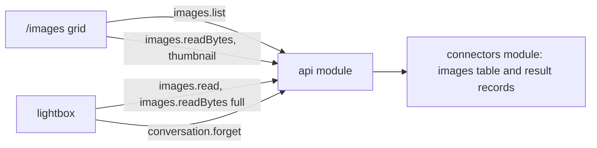

# The images page

- **Status:** draft

The assistant draws and edits pictures with the
[image tools](../../architecture/connectors/images.md), and you see each one only in the
conversation where it was made. The web client gains an images page at `/images`: a grid of the
stored images, newest first, showing pinned images until you tick "Show all". A tap opens an image
in a lightbox with its name, its prompt, when it was made and a link to the image it was edited
from, so you can walk back through the passes, and the lightbox carries the same forget control as
the rest of the client.

The page reads the stored images through 3 new API calls in an `images` namespace. One image reaches
the chat through [`file.send`](../../architecture/connectors/code-tool.md#sending-a-file), and this
design leaves that path unchanged.

## Shape



## Contracts

### Listing the images

```ts
const page = await nixie.images.list({ pinnedOnly: true });
// → { images: [{ image: 'i7', name: 'harbour at dusk', prompt: 'a harbour at dusk, in oil paint',
//      from: 'i4', source: 'draw', isPinned: true, isForgotten: false,
//      createdAt: new Date('2026-11-20T18:04:00Z'), thread: 'conversation', sequence: 48120 }],
//    nextCursor: 'i3' }
```

```ts
// libs/contract
images: {
  list: signedIn
    .input(z.object({
      pinnedOnly: z.boolean().optional(), // true lists only pinned images; absent or false lists all
      cursor: z.string().max(100).optional(), // the nextCursor of the page before
    }))
    .output(z.object({
      images: z.array(galleryImageSchema).max(30), // newest first
      nextCursor: z.string().nullable(), // null on the last page
    })),
}

const galleryImageSchema = z.object({
  image: z.string(), // the short ID that the assistant also sees
  name: z.string().nullable(), // the latest image.named name; null when cleared, never set or forgotten
  prompt: z.string().nullable(), // from the result record; null for an import and for a forgotten image
  from: z.string().nullable(), // the image an edit started from; null for a new draw and an import
  source: z.enum(['draw', 'file', 'photo']),
  isPinned: z.boolean(),
  isForgotten: z.boolean(), // true when a forget made the result record unreadable
  createdAt: z.date(),

  // the thread and sequence of the tool_result record that holds the bytes; the forget names them
  thread: threadSchema,
  sequence: sequenceSchema,
});
```

### Reading one image

```ts
const image = await nixie.images.read({ image: 'i4' });
// → the galleryImageSchema shape, for any image, a forgotten one included
//   or the UNKNOWN_IMAGE error (404) when no image has the ID

const thumbnail = await nixie.images.readBytes({ image: 'i7', size: 'thumbnail' });
// → File, image/webp, long edge 512 pixels
//   or UNKNOWN_IMAGE (404), or IMAGE_FORGOTTEN (410) when a forget made the bytes unreadable
```

```ts
// libs/contract
images: {
  // …list
  read: signedIn
    .errors({ UNKNOWN_IMAGE })
    .input(z.object({ image: z.string().min(1).max(100) }))
    .output(galleryImageSchema),
  readBytes: signedIn
    .errors({ UNKNOWN_IMAGE, IMAGE_FORGOTTEN })
    .input(z.object({
      image: z.string().min(1).max(100),
      size: z.enum(['thumbnail', 'full']), // full returns the stored PNG as it is
    }))
    .output(z.file()),
}
```

The api module serves the 3 calls, and the connectors module exports the reads of the `images`
table, the result records and the names that they need, as it does for `files.*`.

## Constraints

- Every `images` call needs a device session. A read-only token gets a 403 on each one, because the
  list of paths it reaches stays unchanged.
- `images.list` leaves out every forgotten image, so the grid shows only images that load.
  `images.read` returns a forgotten image, with its `from`, so a walk back through the passes goes
  on past it.
- A page holds up to 30 images. The next page loads when the grid's end scrolls into view and when
  you press Load more.
- The server makes a thumbnail on each read and never stores it, so a forget leaves no copy of the
  picture behind.
- Each tile reads its thumbnail only when it scrolls into view. The client keeps bytes as blobs and
  never navigates to them, as the [files page](../../architecture/channels/client.md#the-files-page)
  does.
- The name and the prompt came from a model, so the page shows them as plain text, never as
  Markdown.
- The "Show all" checkbox sets the `all` search parameter, and the open image sets the `image`
  search parameter, so a reload keeps both and the browser's Back button walks forward through the
  passes again.
- The page and its link in the shell's bar exist whether or not the deployment config has an
  `images` block, because images stored before the block was removed stay readable.

### The lightbox

- The lightbox shows the full image beside its name, its prompt, when it was made in the browser's
  time zone, and one line about where it came from:
  - an edit shows "Edited from" and the earlier image's name, or its ID when it has no name. The
    link opens that image in the lightbox.
  - an import shows "Imported from a file" or "Imported from a photo", with no link.
  - a new draw shows no such line.
- A forgotten image reached by the link shows "Forgotten" in place of the picture, the name and the
  prompt, and keeps its "Edited from" link.

### Forgetting an image

- The forget control in the lightbox runs `conversation.forget` on the image's `tool_result` record,
  with the thread and sequence from `galleryImageSchema`, and first asks, as every forget control
  does.
- Each result record holds one image, so the forget takes that image alone. The confirmation says
  that the picture and its prompt are forgotten, and that edits made from it keep their pictures.
- After the forget, the lightbox shows the line with the key backup state in place of the control,
  the grid drops the image, and the client reads `images.list` again. The forget also drops the
  cached bytes of that image.

### Empty and error states

- With "Show all" off and no pinned image, the page says that no image is pinned, that the assistant
  pins an image when you ask it to, and points at the checkbox.
- With "Show all" on and no image, the page says that images appear here when the assistant draws or
  imports one.
- When `images.list` fails, the page says that it can't load the images, with a Retry button.
- A tile whose thumbnail read fails shows "Unavailable". A tile that gets `IMAGE_FORGOTTEN` leaves
  the grid.
- When the full image fails to load, the lightbox keeps its text and says that the image is
  unavailable.
- An `UNAUTHORIZED` answer renders the enrolment form, as on every page.

## Decisions

- **Pinned images by default.** A pin marks the images worth keeping, so the default view holds
  those and "Show all" holds every pass.
- **The forget takes the result record.** That record holds the bytes and the prompt that the page
  shows, and the files page forgets a code-run file the same way.
- **Thumbnails are made on each read.** A stored thumbnail would be one more copy that each forget
  must find and delete.

## Builder decides

- The layout of the grid and the lightbox, and how the lightbox reuses the image viewer of the files
  page.
- How the tile shows a pin, a name and an edit.
- The cursor's format, and the wording of each message and confirmation.
- The WebP quality of a thumbnail.
- The test layout, and the mock procedures for the web client's tests.

## Out of scope

- Pinning, naming or editing an image from the page. The assistant does each one with its tools when
  you ask.
- Downloading an image. `file.send` puts a picture in the chat.

## Open questions

- **Does a forget from the page also forget the call record and the name?** The `tool_called` record
  of a draw holds the prompt in its input, and each `image.named` record holds a name, so both
  outlive a forget of the result record. On a task's thread, no control in the client forgets them.
  The owner settles it. Until then, the page forgets the result record alone, and the confirmation
  says that the request in the conversation keeps its prompt.
