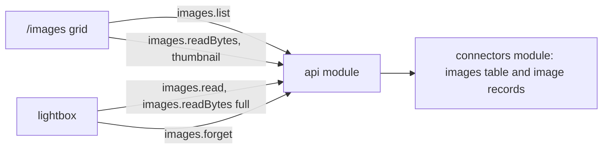

# The images page

- **Status:** draft
- **Work items:** [the images page](https://linear.app/zgeoff/issue/GEO-2802), which builds this
  design once the owner approves it

The assistant draws and edits pictures with the
[image tools](../../architecture/connectors/images.md), and you see each one only in the
conversation where it was made. The web client gains an images page at `/images`: a grid of the
stored images, newest first, showing pinned images until you tick "Show all". A tap opens an image
in a lightbox with its name, its prompt, when it was made and a link to the image it was edited
from, so you can walk back through the passes. A forget from the lightbox takes the whole image: its
picture, its prompt and its name.

The page reads and forgets the stored images through 4 new API calls in an `images` namespace.

## Shape



## Contracts

The api module serves the 4 calls. The connectors module exports the reads of the `images` table,
the result records and the names that the calls need, as it does for `files.*`, and the lookup of
the records that `images.forget` takes.

### The image in a reply

Each read returns an image in this shape. Every image, an import included, has one `tool_called`
record, one `tool_result` record that holds its bytes and its prompt, and any number of
`image.named` records.

```ts
// libs/contract
const galleryImageSchema = z.object({
  image: z.string(), // the short ID that the assistant also sees
  name: z.string().nullable(), // the latest image.named name; null when cleared, never set, or the image is forgotten
  prompt: z.string().nullable(), // from the result record; null for an import and for a forgotten image
  from: z.string().nullable(), // the image an edit started from; null for a new draw and an import
  source: z.enum(['draw', 'file', 'photo']),
  isPinned: z.boolean(),
  isForgotten: z.boolean(), // true when a forget made the result record unreadable; always false in images.list
  createdAt: z.date(), // created_at of the images row
});
```

### Listing the images

```ts
const page = await nixie.images.list({ pinnedOnly: true });
// → { images: [{ image: 'i7', name: 'harbour at dusk', prompt: 'a harbour at dusk, in oil paint',
//      from: 'i4', source: 'draw', isPinned: true, isForgotten: false,
//      createdAt: new Date('2026-11-20T18:04:00Z') }],
//    nextCursor: '812' }
```

```ts
// libs/contract
images: {
  list: signedIn
    .input(z.object({
      pinnedOnly: z.boolean().optional(), // true lists only pinned images; absent or false lists all
      cursor: z.string().regex(/^\d+$/u).max(20).optional(), // lists the rows older than this one
    }))
    .output(z.object({
      images: z.array(galleryImageSchema).max(30), // by images rowid, newest first, as image.list orders
      nextCursor: z.string().nullable(), // the rowid of the oldest row read; null on the last page
    })),
}
```

### Reading one image

```ts
const image = await nixie.images.read({ image: 'i4' });
// → one image in galleryImageSchema, a forgotten one included

const thumbnail = await nixie.images.readBytes({ image: 'i7', size: 'thumbnail' });
// → File, image/webp, long edge 512 pixels, encoded with Bun.Image as convertToPng does
```

```ts
// libs/contract; IMAGE_NOT_FOUND stays the error of conversation.readImage alone
const UNKNOWN_IMAGE = { message: 'No stored image has this ID', status: 404 };
const IMAGE_FORGOTTEN = { message: 'A forget made this image unreadable', status: 410 };

images: {
  // …list
  read: signedIn
    .errors({ UNKNOWN_IMAGE })
    .input(z.object({ image: z.string().min(1).max(100) }))
    .output(galleryImageSchema),
  readBytes: signedIn
    .errors({ UNKNOWN_IMAGE, IMAGE_FORGOTTEN })
    .input(z.object({
      image: z.string().min(1).max(100),
      size: z.enum(['thumbnail', 'full']), // full returns the stored PNG, typed image/png
    }))
    .output(z.file()),
}
```

### Forgetting an image

```ts
const forgotten = await nixie.images.forget({ clientActionID, image: 'i7' });
// → { forgottenAt: new Date('2026-11-22T09:12:00Z'), backup: { state: 'pending' } }
```

```ts
// libs/contract
images: {
  // …list, read, readBytes
  forget: checkedAction // a device session and a client action ID, as conversation.forget takes
    .errors({ UNKNOWN_IMAGE })
    .input(z.object({ clientActionID: clientActionIDSchema, image: z.string().min(1).max(100) }))
    .output(z.object({ forgottenAt: z.date(), backup: forgetBackupSchema })),
}
```

## Constraints

### The API

- Every `images` call needs a device session. A read-only token reaches only `conversation.read`,
  `tasks.list` and `tasks.read`, so it gets a 403 on each `images` call with no change to that list.
- `images.list` reads at most 300 rows a call and leaves out every forgotten image, so a page can
  hold fewer than 30 images, or none, while `nextCursor` remains.
- `images.read` returns a forgotten image with its `from`, so a walk back through the passes goes on
  past it.
- The server makes a thumbnail on each read and never stores it, so a forget leaves no copy of the
  picture behind.

### The page

- The shell's bar links Images after Files, with or without an `images` block in the config.
- The next page of images loads when the grid's end scrolls into view and when you press Load more.
- Each tile reads its thumbnail only when it scrolls into view. The client reads bytes through the
  oRPC client, keeps them as blobs and never navigates to them, as the
  [files page](../../architecture/channels/client.md#the-files-page) does.
- The page shows the name and the prompt as plain text, because a model wrote them.
- The "Show all" checkbox sets the `all` search parameter, and the open image sets the `image`
  search parameter, so a reload keeps both and the browser's Back button steps back along the walk.

### The lightbox

- The lightbox shows the full image beside its name, its prompt, when it was made in the browser's
  time zone, and one line about where it came from:
  - an edit shows "Edited from" and the earlier image's name, or its ID when it has no name. The
    link opens that image in the lightbox.
  - an import shows "Imported from a file" or "Imported from a photo", with no link, and a new draw
    shows no such line.
- An image that `images.read` returns with `isForgotten` shows "Forgotten" in place of the picture,
  the name and the prompt, and keeps its "Edited from" link.

### Forgetting an image

- `images.forget` takes the image's `tool_called` record, its `tool_result` record and every
  `image.named` record that names it, on whichever thread each one sits, as one forget. It runs the
  2-part forget of a [record forget](../../architecture/channels/api.md#forgetting-a-record): one
  transaction commits a `record.forget_started` for each record, and the cleanup deletes every key,
  runs the session cleanup and commits a `record.forgotten` for each record.
- The answer's `backup` is `failed` when any record's state is failed, else `unknown` when any is
  unknown, else `pending` when any is pending, else the state they share. A retry with the same
  client action ID finishes a cleanup that a failed call left.
- A forget of an image that is already forgotten forgets whatever of its records still has a key,
  and answers with the time of the first forget when none does.
- The forget keeps the image's row, as the
  [image store](../../architecture/connectors/images.md#storage) does for every forget, so the edit
  chain keeps its shape. An edit made from a forgotten pass keeps its picture and its "Edited from"
  link. `images.read` of that pass returns its `from`, so the walk goes on through it to the passes
  before it.
- The forget control in the lightbox asks for confirmation first, as every forget control does. The
  confirmation warns that the picture, its prompt, its name and the assistant's request for it are
  forgotten, and that edits made from it keep their pictures.
- After the forget, the lightbox shows the line with the key backup state in place of the control,
  the client drops the image's cached bytes, and the grid drops the image and reads `images.list`
  again.

### Empty and error states

- With "Show all" off and no pinned image, the page says that no image is pinned, that the assistant
  pins an image when you ask it to, and points at the checkbox.
- With "Show all" on and no image, the page says that images appear here when the assistant draws or
  imports one.
- When `images.list` fails, the page says that it can't load the images, with a Retry button.
- A read that gets `IMAGE_FORGOTTEN` removes the tile from the grid, and shows "Forgotten" in the
  lightbox. Any other failed read of a thumbnail or a full image shows "Unavailable", and the
  lightbox keeps its text.
- An `UNAUTHORIZED` answer renders the enrolment form, as on every page.

## Decisions

- **Pinned images by default.** A pin marks the images worth keeping; "Show all" holds every pass.
- **A forget takes the whole image.** The call record holds the prompt and the `image.named` records
  hold the name, and no other control in the client forgets either kind.

## Builder decides

- The layout of the grid and the lightbox, and how the lightbox reuses the image viewer of the files
  page and the forget control of the conversation.
- How the tile shows a pin, a name and an edit.
- The wording of each message and confirmation.
- The WebP quality of a thumbnail, and how many thumbnails the server encodes at once.
- The test layout, and the mock procedures for the web client's tests.

## Out of scope

- Pinning, naming or editing an image from the page. The assistant does each one with its tools when
  you ask, and the page shows the change on its next read.
- Downloading an image, and sending one into the chat, which
  [`file.send`](../../architecture/connectors/code-tool.md#sending-a-file) does.
